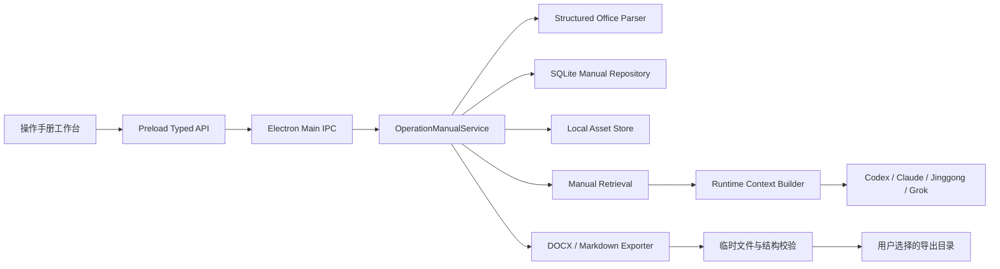

# 精工 Agent 0.7.0 需求与技术方案

> 文档版本：V1.2  
> 目标产品版本：0.7.0  
> 代码基线：`zhuangxiaolong/jg_agent`，分支 `develop/desktop-poc`  
> 基线产品版本：0.6.9  
> 编制日期：2026-11-14  
> 面向实施：Codex / 精工 Agent 开发人员  
> 文档性质：产品需求方案 + 技术实施方案 + 验收标准

---

## 0. 本次开发范围与结论

本次 0.7.0 承接此前 P0 改进项中除“权限治理”以外的三条主线，并增加一项操作手册能力：

1. **Runtime 能力治理与自动兼容测试**：让平台准确识别 Codex、Jinggong、Claude Agent SDK、Grok Build ACP 当前真实具备的能力，并用可复现的测试证据验证兼容性。
2. **正式版本质量门禁**：修复已记录的回归测试失败，建立 PR、主分支和 Release 的自动质量检查，避免未经验证的代码进入正式版本。
3. **MES/WMS 项目真实验证中心**：复用现有验证证据链，补齐不同项目类型的构建/测试配置、.NET TRX 等报告解析、历史验证复核及任务关联。
4. **操作手册知识库与导出**：分别建立 MES5、MES6、WMS 操作手册库，导入 Word/PPT/Excel 现代格式文档，保留可追溯的章节/页/幻灯片/工作表来源，并支持 Agent 辅助编写、人工修订和导出 Word 操作手册。

**明确排除：权限治理。** 本版本不重新设计三级权限、不新增 Windows 沙箱、不改变 Runtime 的文件/命令权限策略，也不以本方案名义调整当前执行权限。涉及验证命令时，必须沿用现有 `VerificationRunService`、主进程校验和现有授权流程，不得另建一条绕开现有机制的命令执行通道。

本版本不以增加 Runtime 数量或增加模型数量为目标，不做全局知识库向量检索重构（操作手册只实现满足场景所需的结构化分块和关键词检索）、不做写入型多智能体并行开发、不做云端团队平台、不做 MCP 全量接入。

### 0.1 0.7.0 的产品目标

0.7.0 完成后，开发人员应该能够：

- 看到当前 Runtime 的真实能力、版本、组件状态和最近一次兼容测试结论；
- 清楚区分“Runtime 声明支持”“平台已接入”“已经通过验证”“暂不支持”；
- 在提交 PR 前获得自动化构建、单元测试、桌面冒烟和 Runtime 合同测试结果；
- 在 MES5、MES6、WMS、前端项目中选择匹配的验证方案；
- 查看真实构建/测试命令、退出码、测试数量、原始报告、代码指纹和证据完整性；
- 将验证 Run 关联到当前 Jira 任务/Agent Task，避免拿旧测试结果为新代码背书；
- 分别导入和管理 MES5、MES6、WMS 操作手册，检索对应系统的操作步骤；
- 根据已导入手册、当前项目和用户确认的内容生成操作手册草稿，经人工审核后导出 DOCX 或 Markdown。

### 0.2 实施原则

1. **先检查仓库，再修改代码。** 本方案是目标要求，不代表所有模块尚未实现。必须逐项盘点现有实现，优先扩展现有模块。
2. **不重复建设。** 复用 `runtime-capabilities.ts`、`RuntimeAdapter`、`packages/verification`、`VerificationRunService`、`verification-history.ts`、`task-evidence.ts`、`TaskEngineeringService`、现有 SQLite 迁移、IPC 和面板。
3. **以真实结果为准。** 模型文字、Runtime 自报状态、README 描述不能代替真实进程、退出码、报告解析和证据复核。
4. **不虚构能力。** 上游 Runtime 具备某能力，不代表精工已接入；平台只有完成适配和测试后才能显示已支持。
5. **失败关闭。** 能力未知、测试未执行、结果解析失败、证据不完整时显示“未知/未验证/无法判定”，不能按成功处理。
6. **向后兼容。** 旧会话、旧 Run、旧数据库、旧报告继续可读；历史报告不能自动升级为新证据。
7. **最小化改动。** 不大规模重写主进程、Renderer、Runtime Adapter 或存储层；需要拆分时仅做本次需求所需的局部抽离。
8. **操作手册来源可追溯。** 导入文件、解析文本、引用片段、手册版本和导出文件之间必须建立关联；不能将 AI 补写内容伪装成原手册内容。
9. **先复用 Office 解析能力。** 当前 `packages/knowledge/src/index.ts` 已能提取 DOCX、PPTX、XLSX 文本，本次在其上扩展操作手册生命周期和结构化定位，不另造一套重复 Office 解码器。
10. **原型是实施依据。** 本文的页面线框、字段布局、状态和交互流程是 0.7.0 的低保真产品原型；Codex 必须按原型实现真实可操作界面，不得只交付静态展示页。若当前 UI 结构有冲突，先说明差异，再以最小改动保持原有桌面工作流。
11. **所有验收有证据。** 每个里程碑都要交付测试、构建日志、变更说明和未完成事项。

---

# 第一部分：现状基线与差距

## 1.1 当前工程结构

仓库当前采用 Windows 桌面 Electron + React + TypeScript 架构，主要结构如下：

```text
desktop-poc/
├─ apps/desktop/
│  └─ src/
│     ├─ main/       # Electron 主进程、Runtime 生命周期、验证服务、IPC
│     ├─ preload/    # Renderer 可调用的桌面 API
│     └─ renderer/   # React 界面与各功能面板
├─ packages/
│  ├─ agent-orchestrator/ # 任务编排、Runtime 能力、任务治理
│  ├─ agent-runtime/      # Codex/Claude/Grok/Jinggong Runtime Adapter
│  ├─ domain/             # 领域类型与 API 类型
│  ├─ storage/            # SQLite 本地持久化及迁移
│  ├─ verification/       # 验证报告、指纹、JUnit 解析、状态计算
│  ├─ requirements/      # Jira 需求准入
│  ├─ performance/       # 执行监控、索引与测试建议
│  └─ ...
├─ tests/                 # Node Test 单元/集成测试
├─ scripts/               # 构建、桌面冒烟、运行时探测等脚本
└─ .github/workflows/     # 当前 Release 工作流
```

当前 `package.json` 版本为 `0.6.9`，主要命令包括：

```powershell
npm run build
npm test
npm run test:desktop
npm run test:ui:grok
npm run runtime:probe
npm run dist
```

开发环境当前要求 Windows x64、Node.js 24、npm 和 Git for Windows。安装包应继续保持对普通开发人员友好，不要求额外安装 Node.js、Python 或 Docker。

## 1.2 Runtime 现状

已存在的核心文件：

- `packages/agent-runtime/src/manager.ts`
- `packages/agent-runtime/src/index.ts`
- `packages/agent-runtime/src/claude-adapter.ts`
- `packages/agent-runtime/src/grok-adapter.ts`
- `packages/agent-orchestrator/src/runtime-capabilities.ts`
- `packages/agent-orchestrator/src/governance.ts`
- `packages/domain/src/index.ts`
- `apps/desktop/src/main/runtime-integrity.ts`
- `apps/desktop/src/main/runtime-prewarm.ts`

当前已有 `RuntimeAdapter` 统一接口、`RuntimeManager`、Runtime 健康检查和 `runtimeCapabilityMatrix()` 能力矩阵。能力矩阵目前描述了原生 Subagents、独立上下文、暂停恢复、会话恢复、Token/费用统计、工具权限拦截、Worktree、事件流、结构化结果、模型请求拦截等能力。

当前存在的主要问题：

- 能力矩阵主要是代码内静态声明，缺少“声明值”和“最近一次实测结论”的分离；
- 各 Runtime 的组件检查、协议握手、工具闭环和真实模型兼容性并没有统一的可复核测试报告；
- Runtime 能力信息还没有形成足够清晰的用户侧状态卡片和历史记录；
- `JinggongRuntimeAdapter` 当前复用了 `CodexRuntime` 的实现，通过精工 Runtime 标识/版本区分，不能把它表述为完全独立的推理引擎；
- Grok、Claude、Codex/Jinggong 的能力边界不同，不能以“统一接口”掩盖能力差异。

能力声明应沿用当前实际接入情况。以下能力不应在 0.7.0 中被虚构为已完成：原生 Subagents、暂停后恢复在途执行、权威 Token 用量、可审计实际费用、所有原生工具的完整拦截。

## 1.3 质量门禁现状

当前 `.github/workflows/release.yml` 主要由 `v*` 标签触发，负责 Windows 安装包构建和 GitHub Release 上传；尚未形成覆盖 PR 的统一质量门禁。

仓库内已有：

- `npm run build`：TypeScript 检查和应用构建；
- `npm test`：`tests/*.test.ts`；
- `npm run test:desktop`：Electron 桌面端冒烟测试；
- `npm run test:ui:grok`：Grok UI 冒烟；
- 多个专题 smoke 脚本，包括 Runtime 切换、项目/会话、Git、Jira、设置、性能等。

仓库 `docs/验证报告-2026-11-13-Claude-Grok运行时修复.md` 记录：构建通过、定向测试 37/37 通过、Grok UI 冒烟通过；全量测试 574/580 通过，6 项失败集中在：

- `agent-task-runner-governance.test.ts`
- `automatic-agent-plan.test.ts`
- `session-memory.test.ts`

该报告是最近一次明确的测试结果记录，不代表 2026-11-14 当前 HEAD 必然仍是相同结果。0.7.0 第一步必须在当前分支重新运行并保存实际结果，禁止直接照抄历史结论。

## 1.4 验证证据链现状

已有核心文件：

- `packages/verification/src/index.ts`
- `apps/desktop/src/main/verification-service.ts`
- `apps/desktop/src/main/verification-history.ts`
- `apps/desktop/src/main/task-evidence.ts`
- `apps/desktop/src/main/task-engineering.ts`
- `packages/storage/src/index.ts`
- `packages/domain/src/index.ts`
- `apps/desktop/src/renderer/PerformancePanel.tsx`

当前已具备：

- Build/Test/Lint/Typecheck/Custom 等验证类型；
- 应用端启动真实进程、采集退出码和运行时间；
- stdout/stderr 采集、日志大小限制；
- 执行前后工作区指纹；
- SHA256 Manifest 及文件完整性验证；
- JUnit XML 解析；
- `passed / failed / not_run / indeterminate / stale` 状态；
- 历史 Run 复核和证据过期识别；
- SQLite 中的真实执行登记；
- Agent Task 与验证证据关联的部分能力。

当前固定验证入口主要覆盖唯一 `.sln/.slnx` 或 `package.json scripts.build` 的构建、TypeScript `tests/*.test.ts` 测试，以及 TypeScript 类型检查。当前解析器包含 JUnit XML，尚需结合实际 MES/WMS 项目使用的测试工具链补齐 .NET TRX 等格式。

0.7.0 不重建一条新的验证系统，而是在现有证据链上补齐：项目类型配置、验证套件、报告解析器、任务关联、报告展示和真实项目验收。

---


## 1.5 操作手册能力现状与差距

当前 `packages/knowledge/src/index.ts` 已提供 Office 文档文本读取能力：

- DOCX：读取正文、表格及部分页眉/页脚/脚注等 XML 内容；
- PPTX：按演示文稿中的幻灯片关系提取幻灯片文本，并尝试提取演讲者备注；
- XLSX：按工作表读取单元格，保留单元格坐标，能提取共享字符串、内联字符串和公式及其缓存值；
- Office 压缩包已做条目数量、解压大小、路径穿越、XML DTD/实体、宏及嵌入对象等安全检查；
- 当前通用文档提取器支持 `.docx/.pptx/.xlsx`，旧版二进制 `.doc/.ppt/.xls` 不支持，需要另存为新格式。

但这套能力目前主要面向通用开发资料/需求资料导入，`ManagedDocument.kind` 仅有 `dictionary / requirement`，没有独立的操作手册实体、版本生命周期、系统隔离、章节/幻灯片/单元格级来源引用、图片资产管理、手册检索面板和 DOCX 导出工作流。现有 Office 提取结果以扁平文本为主，不能直接满足“按步骤引用并生成规范操作手册”的产品要求。

**0.7.0 的增量重点不是重新实现 Word/PPT/Excel 解析器，而是扩展结构化文档快照及操作手册管理能力：**

1. 继续调用现有安全文件读取和 Office 解包校验；
2. 为 DOCX/PPTX/XLSX 增加可定位的结构化块和来源标记；
3. 对 Word/PPT 中的图片截图进行安全提取与资产关联；不执行宏、公式、外部链接，不在 0.7.0 承诺 OCR；
4. 建立 MES5/MES6/WMS 操作手册分类、版本、启停、归档、检索和上下文引用；
5. 增加基于手册证据的 AI 草稿、人工审核、版本化保存与 DOCX/Markdown 导出。

---

# 第二部分：需求一——Runtime 能力治理与自动兼容测试

## 2.1 目标

建立一个统一、可解释、可测试的 Runtime 能力管理机制。用户不应只看到 Runtime “在线/离线”，还应知道它能做什么、哪些能力没有接入、哪些能力已实测、哪些功能当前不适用。

平台必须明确区分四个概念：

1. **上游能力**：Runtime/SDK/协议本身理论上提供的能力；
2. **精工接入能力**：当前 Adapter 和平台真正实现并开放的能力；
3. **实测能力**：在当前 Runtime 版本、配置和运行环境下，兼容测试实际验证的能力；
4. **当前可用性**：组件是否存在、版本是否兼容、启动/握手是否成功。

其中第 2、3 项才可以用于界面上的“精工已支持”判断。

## 2.2 功能需求

### RT-001：统一 Runtime 能力定义

沿用 `runtime-capabilities.ts` 当前能力清单，检查是否需要补充能力项，不得无依据扩大范围。每项能力至少包含：

| 字段 | 含义 |
|---|---|
| `supported` | `true / partial / false`，表示平台当前接入情况 |
| `enforcementLayer` | `platform / runtime / adapter / none` |
| `notes` | 说明边界和限制 |
| `testStatus` | `passed / failed / not_run / unsupported / unknown` |
| `lastTestedAt` | 最近一次实测时间 |
| `testRunId` | 最近一次兼容测试记录 ID，可选 |

要求：

- 现有 `runtimeCapabilityMatrix()` 保持为能力声明的单一来源；
- 实测结果另行存储，不允许把一次测试通过永久写成能力声明；
- 测试不通过时不能自动把源码声明改为支持；
- 声明支持但未测过时，界面必须显示“未验证”；
- 上游有能力但精工未接入时，显示“上游可能支持，精工尚未接入”；
- `false` 和 `partial` 必须有明确原因，不能只显示灰色图标。

### RT-002：统一兼容测试分类

建立 Runtime 兼容测试目录和测试注册表。首期至少包含：

| 测试 ID | 测试内容 | 类型 | 说明 |
|---|---|---|---|
| `runtime.health` | 组件存在、版本读取、兼容性检查 | 本地 | 不调用模型 |
| `runtime.initialize` | 启动及初始化/协议握手 | 本地 | 不调用模型或仅做协议初始化 |
| `runtime.text` | 简单文本请求/响应 | 在线可选 | 需要有效模型配置 |
| `runtime.multiturn` | 连续多轮对话 | 在线可选 | 验证会话上下文保持 |
| `runtime.file_read` | 读取临时测试项目文件 | 在线可选 | 使用临时测试工作区 |
| `runtime.file_write` | 创建/修改临时文件并读取结果 | 在线可选 | 仅验证现有 Adapter 工具闭环，不扩展权限范围 |
| `runtime.tool_roundtrip` | 一轮中连续调用工具并返回结果 | 在线可选 | 记录真实工具事件 |
| `runtime.cancel` | 用户取消后任务进入终态 | 本地/在线 | 验证停止事件和进程回收 |
| `runtime.resume` | 新会话/历史会话恢复能力 | 本地/在线 | 不把“恢复上下文”描述为“恢复在途执行” |
| `runtime.image_input` | 图片输入能力 | 在线可选 | 不支持时标记 unsupported |

说明：测试用例按 Runtime 能力适配。对声明不支持的能力，正确结果是 `unsupported`，不是测试失败；对声明支持但测试失败的能力，记为 `failed` 并提供证据。

### RT-003：分层测试，不在每次 PR 中调用真实模型

兼容测试分为三层：

**A. 本地静态/合同测试（默认 CI 必跑）**

- Runtime Adapter 接口合同；
- 能力矩阵声明完整性；
- 未知 Runtime 必须显式失败，不允许 fallback 到其他 Runtime；
- Adapter 的事件、取消、关闭、错误分类、状态转换；
- 配置变化后 Runtime 会话绑定行为；
- 假 Runtime/Fixture Runtime 的确定性回归测试。

**B. 本机组件测试（开发人员或发布前运行）**

- 本机 Runtime 组件存在性；
- 版本检查；
- 初始化握手；
- 不依赖外部模型 API 的协议验证；
- 组件缺失、版本不兼容、超时和启动失败的诊断。

**C. 真实模型端到端测试（手动或发布候选阶段）**

- 使用用户已经配置的 Provider/模型；
- 明确展示预计会调用真实模型以及可能产生费用；
- 用户主动启动；
- 使用临时目录和固定测试任务；
- 保存 Runtime 版本、Provider ID、模型 ID、端点标识、测试步骤、耗时、工具事件、结论和错误；
- 密钥、Authorization、Cookie、完整 URL 查询参数等敏感信息不得进入报告。

**禁止**每次 PR 自动调用付费模型 API，也禁止把 Fixture 测试结果显示成真实模型兼容性通过。

### RT-004：兼容测试结果模型

建议定义独立领域类型，避免把完整测试历史塞进现有 `RuntimeHealth`：

```ts
export type RuntimeCompatibilityStatus =
  | 'ready'
  | 'degraded'
  | 'unsupported'
  | 'failed'
  | 'not_tested';

export type RuntimeTestStatus =
  | 'passed'
  | 'failed'
  | 'not_run'
  | 'unsupported'
  | 'unknown';

export interface RuntimeCompatibilityRun {
  id: string;
  runtimeKind: RuntimeKind;
  runtimeVersion: string;
  capabilitiesVersion: number;
  providerId?: string;
  modelId?: string;
  testLayer: 'contract' | 'local_component' | 'live_model';
  startedAt: string;
  finishedAt?: string;
  status: RuntimeCompatibilityStatus;
  results: RuntimeCompatibilityTestResult[];
  environment: {
    platform: string;
    arch: string;
    nodeVersion?: string;
    appVersion: string;
  };
  limitations: string[];
}

export interface RuntimeCompatibilityTestResult {
  testId: string;
  status: RuntimeTestStatus;
  durationMs?: number;
  evidenceRefs: string[];
  message?: string;
}
```

实现时优先检查是否已有可复用的运行记录/存储模式；若无，再新增 SQLite 表及迁移。不要将 API Key、模型中转站凭据、原始请求头和完整敏感响应写入结果。

### RT-005：Runtime 能力矩阵与测试结果联动

能力矩阵每一行同时展示：

- 平台接入状态；
- 最近一次实测状态；
- 实测时间；
- 不支持/部分支持原因；
- 查看本次测试记录入口。

推荐状态文案：

- `已接入 · 已验证`
- `已接入 · 尚未验证`
- `部分接入 · 存在限制`
- `上游支持 · 精工未接入`
- `当前 Runtime 不支持`
- `最近测试失败`

Runtime 组件“健康”不能覆盖能力测试失败。比如组件启动成功，但工具多轮调用失败，应显示 `degraded` 而不是 `ready`。

### RT-006：Runtime 诊断建议

测试失败时输出确定性诊断分类：

- 组件文件不存在；
- 版本不兼容；
- 协议握手失败；
- Provider 配置缺失；
- 模型 ID 不匹配；
- 鉴权失败；
- 请求超时；
- 工具协议不兼容；
- 工具执行失败；
- 会话恢复不支持；
- 测试未运行。

模型可根据诊断内容生成解释建议，但不能修改真实测试状态或错误分类。

### RT-007：能力差异说明与文档一致性

统一 README、使用说明、Runtime 设置页、能力矩阵中的 Runtime 口径。重点检查：

- Grok 会话中途切换 Provider/模型的实际约束；
- Grok 是否逐项授权、普通会话权限范围；
- Claude 是否支持原生 Subagents、恢复和推理强度；
- Codex/Jinggong 是否接入原生多智能体协议；
- Jinggong Runtime 当前是否仍复用 CodexRuntime；
- Token/费用指标是否真实可采集。

如果能力只部分实现，必须标注限制，不得使用“完整支持”“原生支持”等容易误导的描述。

## 2.3 技术方案

### 2.3.1 建议新增/扩展模块

优先复用并扩展：

- `packages/agent-orchestrator/src/runtime-capabilities.ts`：能力声明；
- `packages/agent-runtime/src/manager.ts`：统一 Adapter 和能力查询；
- `packages/domain/src/index.ts`：兼容测试领域类型；
- `packages/storage/src/index.ts`：兼容测试结果持久化；
- `apps/desktop/src/main/index.ts`：主进程服务初始化/IPC 注册；
- `apps/desktop/src/preload/index.ts`：向 Renderer 暴露最小 API；
- `apps/desktop/src/renderer/SettingsPanel.tsx` 或独立 `RuntimeCompatibilityPanel.tsx`：能力与测试 UI；
- `tests/`：能力矩阵、合同测试和存储测试。

建议单独新增服务文件：

```text
apps/desktop/src/main/runtime-compatibility-service.ts
packages/agent-orchestrator/src/runtime-compatibility.ts
packages/domain/src/runtime-compatibility.ts  # 如当前同名文件已存在则扩展，不重复创建
```

新建前必须检查实际目录、既有同名导出及职责，不得创建平行服务。

### 2.3.2 服务接口建议

接口名称可按当前项目风格调整，语义保持一致：

```ts
interface RuntimeCompatibilityService {
  listRuntimeReports(): Promise<RuntimeCompatibilityRun[]>;
  getRuntimeReport(runId: string): Promise<RuntimeCompatibilityRun | undefined>;
  runContractTests(runtimeKind: RuntimeKind): Promise<RuntimeCompatibilityRun>;
  runLocalComponentTests(runtimeKind: RuntimeKind): Promise<RuntimeCompatibilityRun>;
  runLiveTests(input: {
    runtimeKind: RuntimeKind;
    providerId: string;
    modelId: string;
    testIds: string[];
  }): Promise<RuntimeCompatibilityRun>;
}
```

约束：

- `runLiveTests` 必须由用户明确触发；
- Provider 和模型从已保存配置读取，调用方不得传 API Key；
- `RuntimeCompatibilityService` 不直接创建另一套 Runtime 执行实现，而是复用 `RuntimeManager`/Adapter；
- 每个测试超时可取消；取消后必须清理进程和临时工作区；
- 不支持的测试用例返回 `unsupported`，不得伪装成通过；
- 所有结果保存 Runtime 版本、能力版本和测试层级。

### 2.3.3 测试运行方式

新增命令建议：

```powershell
npm run test:runtime-contract
npm run test:runtime-local
npm run test:runtime-live
```

- `test:runtime-contract`：默认可在 CI 中运行，只用 Fixture/模拟组件，不产生模型费用；
- `test:runtime-local`：使用当前机器安装的 Runtime 组件，默认不调用真实模型；
- `test:runtime-live`：需要已配置 Provider/模型，必须显示费用提醒并由用户主动执行，不加入 PR 必跑门禁。

如果实际运行环境无法启动某个 Runtime，测试应输出 `unavailable/unsupported` 的诊断信息；不能因为它不可用就把其他 Runtime 的结果套用到该 Runtime。

### 2.3.4 数据持久化

如新增表，使用当前 LocalStore SQLite 版本迁移模式，迁移必须：

- 保留现有会话、任务、记忆、验证记录；
- 使用 append-only 或不可变 Run 记录；
- 通过 Run ID 查询；
- 不在旧记录上覆盖新的测试状态；
- 数据库升级后可正常读取旧版本数据；
- 增加迁移成功、重复启动和异常恢复测试。

## 2.4 Runtime 验收标准

| ID | 场景 | 验收结果 |
|---|---|---|
| RT-AC-01 | 查询四种 Runtime 的能力 | 每种 Runtime 均返回完整能力矩阵，不缺关键字段 |
| RT-AC-02 | 能力声明为 false | UI 显示不支持及原因，不显示“已验证通过” |
| RT-AC-03 | 声明支持但未测试 | UI 显示“尚未验证” |
| RT-AC-04 | 合同测试失败 | 保存失败 Run、错误分类和测试证据 |
| RT-AC-05 | Runtime 组件缺失 | 显示组件缺失，不 fallback 到其他 Runtime |
| RT-AC-06 | Grok 只有文本响应成功 | 不据此判定工具闭环兼容 |
| RT-AC-07 | 真实模型测试 | 用户主动触发，显示 Provider/模型和费用提示，不记录凭据 |
| RT-AC-08 | 测试取消 | 任务进入取消终态，进程/临时目录得到清理 |
| RT-AC-09 | 历史记录查看 | 可查看 Runtime 版本、测试层级、测试时间、结果及限制 |
| RT-AC-10 | 文档口径 | README、使用说明、界面能力描述一致 |

---

# 第三部分：需求二——正式版本质量门禁

## 3.1 目标

建立以 GitHub Actions 为主的自动化质量流程，做到：

- 每个 PR 自动执行构建和测试；
- 主分支变更自动执行相同质量检查；
- Release 发布前必须通过质量门禁；
- 失败时保存日志和测试结果，方便定位；
- CI 默认不调用真实模型 API，不需要开发者个人密钥；
- 不允许用 `continue-on-error`、跳过测试或修改断言掩盖真实缺陷。

## 3.2 功能需求

### QG-001：当前 6 项测试失败重新复现与修复

第一步在当前 `develop/desktop-poc` HEAD 上执行：

```powershell
npm ci
node node_modules/electron/install.js
npm run build
npm test
```

对以下测试文件重点检查：

- `tests/agent-task-runner-governance.test.ts`
- `tests/automatic-agent-plan.test.ts`
- `tests/session-memory.test.ts`

实施要求：

1. 先记录当前 HEAD SHA、Node/npm/Windows 版本、总测试数、通过数、失败数；
2. 找出每个失败的具体测试名称、错误堆栈和可复现命令；
3. 判断是产品逻辑回归、测试环境问题、异步竞态、数据迁移问题还是断言过时；
4. 优先修复产品逻辑；
5. 只有在产品行为确实合理且需求已变更时，才允许更新测试预期，并在变更说明中写明原因；
6. 不得删除失败测试、降低断言、增加无条件跳过、把异常改成吞掉或把失败强制转成通过；
7. 修复后先定向复跑，再全量复跑，最后运行桌面冒烟。

验收要求：记录中的失败全部得到解释并关闭；全量测试结果必须为 0 个未解释失败。

### QG-002：建立 PR 质量工作流

新增或调整 GitHub Actions 工作流，覆盖：

- `pull_request`：目标分支包括 `main` 和 `develop/desktop-poc`（如仓库实际分支策略不同，按仓库现行规则适配）；
- `push`：`main`、`develop/desktop-poc`；
- `workflow_dispatch`：允许手工触发；
- `release`：正式标签发布前执行等价质量检查。

默认 CI 环境：

- `windows-latest`；
- Node.js 24；
- npm cache；
- `npm ci`；
- `node node_modules/electron/install.js`；
- 不依赖本机个人数据目录、个人 Jira、外部模型密钥或客户生产数据库。

### QG-003：必跑检查项

PR 门禁首期包含：

| 顺序 | 检查 | 命令 | 要求 |
|---|---|---|---|
| 1 | 依赖安装 | `npm ci` | 必须成功 |
| 2 | Electron 运行时准备 | `node node_modules/electron/install.js` | 必须成功 |
| 3 | TypeScript/应用构建 | `npm run build` | 必须成功 |
| 4 | 全量单元/集成测试 | `npm test` | 0 失败 |
| 5 | 桌面端冒烟 | `npm run test:desktop` | 必须成功 |
| 6 | Runtime 合同测试 | `npm run test:runtime-contract` | 必须成功 |

如果某个命令在 Windows CI 上存在已知环境依赖，必须先通过可重复的 CI 适配解决；不能直接将其从门禁删掉。专题 smoke（例如 Grok UI、Runtime 切换）可以作为额外 job 或按模块路径触发，但核心门禁不能因此变成可选。

### QG-004：Release 工作流前置门禁

当前 Release 工作流主要由 `v*` 标签触发，0.7.0 必须保证正式打包之前先完成与 PR 相同的质量门禁。

推荐方案：

- 把核心检查抽为可复用 workflow，或在 Release workflow 中通过 `needs` 依赖质量检查 job；
- `build-and-publish` 必须依赖质量检查 job 成功；
- 质量检查失败时，不得上传 Release 资产；
- 代码签名证书等现有发布 Secret 只在打包/发布 job 使用，质量测试 job 不需要读取；
- PR 工作流不需要 GitHub Release 写权限。

必须保留现有 NSIS、安装包、blockmap、`latest.yml` 发布行为，不得破坏在线更新。

### QG-005：测试产物和失败诊断

每次 CI 至少保存：

- 构建日志；
- Node Test 原始输出或结构化测试报告；
- 桌面冒烟执行结果；
- Runtime 合同测试结果；
- 运行环境和提交 SHA；
- 失败步骤的摘要。

要求：

- 无论成功/失败都使用 `if: always()` 上传适当测试产物；
- 日志中不得包含 API Key、Token、Jira 密码、Cookie 或 Webhook 密钥；
- 设置合理的 artifact retention；
- 失败原因可定位到 workflow job、step、测试名称；
- 对不产生报告的测试命令，保留 stdout/stderr 作为最小诊断证据。

### QG-006：CI 不运行真实模型调用

PR 默认门禁只能运行：

- 单元测试；
- Fixture Runtime 合同测试；
- 本地协议/组件模拟测试；
- 桌面冒烟测试。

不运行真实 Grok、Claude、Codex 中转站模型调用，不向 PR job 注入个人 API Key。真实模型端到端测试走手工触发或发布候选验证，并独立记录费用和限制。

### QG-007：分支保护说明

GitHub Actions 工作流本身不能自动保证仓库不允许绕过合并。交付说明中必须列出建议设置为 Required Status Checks 的 job 名称，并说明需要仓库管理员在 Branch Protection / Rulesets 中配置。

建议必选：

- `build`
- `unit-tests`
- `desktop-smoke`
- `runtime-contract`

实际 job 名称以最终 YAML 为准，文档和设置清单要保持一致。

## 3.3 技术方案

### 3.3.1 建议文件

```text
.github/workflows/
├─ quality.yml            # 新增：PR/Push/手工质量门禁，建议支持 workflow_call
└─ release.yml            # 修改：发布前 needs quality
```

如果当前已有其他未列出的 workflow，先检查目录并整合，不要覆盖已有发布或自动更新行为。

### 3.3.2 示例工作流结构

以下是逻辑结构示意，Codex 应按实际 npm 命令、脚本和 GitHub Actions 语法落地，不要求逐字照抄：

```yaml
name: Desktop quality gate

on:
  pull_request:
  push:
    branches: [main, develop/desktop-poc]
  workflow_dispatch:
  workflow_call:

jobs:
  build:
    runs-on: windows-latest
    steps:
      - uses: actions/checkout@v4
      - uses: actions/setup-node@v4
        with:
          node-version: 24
          cache: npm
      - run: npm ci
      - run: node node_modules/electron/install.js
      - run: npm run build

  unit-tests:
    needs: build
    runs-on: windows-latest
    steps:
      # checkout/setup/install 按缓存和成本优化
      - run: npm test

  desktop-smoke:
    needs: build
    runs-on: windows-latest
    steps:
      # checkout/setup/install/Electron runtime
      - run: npm run test:desktop

  runtime-contract:
    needs: build
    runs-on: windows-latest
    steps:
      # checkout/setup/install
      - run: npm run test:runtime-contract
```

可按运行时间优化 job 依赖和 npm 缓存，但不能因优化而漏掉门禁。若 `npm test` 与 `desktop-smoke` 需要完整依赖，应使用可复现安装，不能依赖上一 job 的非持久工作目录。

### 3.3.3 脚本约束

- 保持 `npm test` 作为统一测试入口；
- 新增的 Runtime 合同测试脚本必须纳入 `npm run build` 类型检查或单独 TypeScript 检查；
- 所有测试退出码必须能正确传递到 Actions；
- 不使用 `|| true` 等方式吞掉失败；
- 测试清理使用 `try/finally`，不得清理用户实际项目目录；
- 桌面冒烟使用临时测试数据目录，不能读取真实用户 `%LOCALAPPDATA%` 数据。

## 3.4 质量门禁验收标准

| ID | 场景 | 验收结果 |
|---|---|---|
| QG-AC-01 | PR 创建/更新 | 自动触发质量门禁 |
| QG-AC-02 | 构建失败 | Required job 失败，Release 不得继续 |
| QG-AC-03 | 单测失败 | 失败测试名称、日志和退出码可查看 |
| QG-AC-04 | 桌面冒烟失败 | 门禁失败并上传诊断产物 |
| QG-AC-05 | Runtime 合同失败 | 门禁失败并定位到 Runtime/testId |
| QG-AC-06 | PR 无个人密钥 | 所有默认质量测试仍可执行 |
| QG-AC-07 | 真实模型 API 不可用 | 默认 PR 质量门禁不受影响 |
| QG-AC-08 | Release 标签触发 | 先执行质量检查，成功后才构建并上传资产 |
| QG-AC-09 | 失败的 CI | 上传已产生的日志/测试结果 |
| QG-AC-10 | 历史 6 项失败 | 当前 HEAD 复跑、根因修复、全量测试 0 个未解释失败 |

---

# 第四部分：需求三——MES/WMS 项目真实验证中心

## 4.1 目标

把当前通用的 Build/Test 验证能力，扩展为适配 MES5、MES6、WMS、前端项目的项目级验证中心。验证结论必须保持“真实进程 + 机器可读结果 + 代码指纹 + 证据校验”的原则。

重点是建立统一的验证配置和报告解析机制，而不是声称任意客户项目都能自动完成全部接口、数据库或业务验收。

## 4.2 功能需求

### VE-001：项目验证配置

项目添加或识别系统后，提供验证配置：

- 系统代际：MES5 / MES6 / WMS / 前端 / 通用；
- 构建方案；
- 测试方案；
- 类型检查/静态检查方案；
- 测试报告格式；
- 报告输出路径；
- 超时时间；
- 方案来源（系统内置/项目配置/人工选择）；
- 配置版本和最后修改时间。

系统识别只能提供默认建议，用户可核对或手动调整。识别不明确时不能自动假设为 MES5/MES6/WMS。

建议首期默认方案：

| 项目类型 | 构建策略 | 测试策略 | 说明 |
|---|---|---|---|
| MES5 | 优先识别项目要求的 `JZ.IMS.sln` | 识别现有 .NET 测试项目并运行 `dotnet test` | 不允许将构建通过当成测试通过 |
| MES6 | 识别项目内实际 `.sln/.slnx`；多个时要求选择 | 识别 .NET 测试项目，支持 TRX 输出 | 不写死客户项目绝对路径 |
| WMS | 根据仓库识别 .NET/Node 等真实构建入口 | 按已识别测试工具链运行；支持 JUnit/TRX | 不假设所有 WMS 项目技术栈相同 |
| 前端 | 读取 `package.json` 中已存在的 build/typecheck/test 脚本 | 根据脚本配置报告格式 | 不擅自安装依赖或新增脚本 |
| 通用 | 识别唯一受支持构建入口 | 未发现测试入口时显示未配置 | 不猜测测试命令 |

**重点约束：**

- MES5 的 `JZ.IMS.sln` 规则来自现有项目规范；必须先确认文件是否存在以及实际工作区位置；
- MES6/WMS 不得硬编码某个客户项目路径；
- 多个解决方案或多个测试项目时，显示候选项让用户确认；
- 没有测试工程时，测试状态显示 `not_run` 或 `not_configured`，不能显示测试通过；
- 不允许为了让测试通过而临时创建空测试、伪造测试数或改变项目业务代码。

### VE-002：验证套件模型

建议把单一的 `build / typecheck / tests` 入口扩展为“项目验证 Profile + Suite”。

```ts
export type VerificationSystem = 'MES5' | 'MES6' | 'WMS' | '前端' | '通用';
export type VerificationSuiteType = 'build' | 'typecheck' | 'unit_test' | 'integration_test' | 'lint' | 'custom';
export type VerificationReportFormat = 'junit' | 'trx' | 'nunit' | 'none' | 'unknown';

export interface ProjectVerificationProfile {
  id: string;
  version: number;
  projectId: string;
  system: VerificationSystem;
  suites: VerificationSuite[];
  updatedAt: string;
  source: 'builtin' | 'project' | 'user';
}

export interface VerificationSuite {
  id: string;
  name: string;
  type: VerificationSuiteType;
  enabled: boolean;
  executable: string;
  args: string[];
  workingDirectory: string;
  reportFormat: VerificationReportFormat;
  reportPath?: string;
  timeoutMs: number;
  required: boolean;
}
```

实现时必须根据已有 `VerificationProfileId`、`VerificationRunRequest`、`VerificationRunRecord` 等类型做最小扩展，避免重复声明相同概念。

命令只能经现有验证服务执行。Renderer 不得直接传入未经校验的 executable/args 让主进程执行；如需配置命令，必须沿用当前主进程验证配置校验与用户确认流程。0.7.0 不新增独立的 Shell/命令执行能力。

### VE-003：支持 .NET TRX 报告

首期必须增加 Microsoft/VSTest TRX 解析器，优先支持 `dotnet test --logger trx`。

统一输出结构：

- total；
- passed；
- failed；
- skipped；
- errors；
- 测试名称；
- 测试类/套件；
- 错误消息；
- StackTrace/StdOut（按报告格式可用）；
- 原始报告 SHA256；
- 解析器 ID 和版本；
- 解析状态 `parsed / empty / invalid`。

TRX 解析必须使用确定性 XML 解析，不能依赖 LLM。对计数不匹配、XML 结构损坏、重复 TestId、结果标识未知等情况，返回 `invalid` 或 `indeterminate`，不能取一个看似合理的数字继续通过。

JUnit 解析保持兼容并补充边界测试。NUnit XML 只有在当前 MES/WMS 项目或已有测试项目确实使用时才纳入首期；由 Codex 仓库勘察给出证据，不能仅因为“可能用到”而扩大解析器数量。

### VE-004：统一状态判定

继续沿用现有状态：

- `passed`
- `failed`
- `not_run`
- `indeterminate`
- `stale`

测试报告格式可用时，测试 Run 要标为 `passed` 必须满足：

1. 进程真实启动并正常结束；
2. 没有取消、超时、崩溃或启动失败；
3. Exit Code = 0；
4. 必须有有效的机器可读测试报告；
5. 解析结果为 `parsed`；
6. failed/errors 均为 0；
7. total 大于 0，除非当前项目配置明确允许 0 测试并留有理由；
8. 执行前后代码指纹一致；
9. Manifest、日志和报告哈希校验成功；
10. 查看历史结果时，当前代码指纹仍与 Run 的执行后指纹一致。

测试状态必须与构建状态分开。构建通过不等于单元测试通过，更不等于接口测试、数据库验证、客户验收通过。

### VE-005：分项验证，不允许合并成一个虚假的总通过

UI 和报告至少分别展示：

- 构建；
- 类型检查；
- 单元测试；
- 集成/API 测试；
- 静态检查；
- 未配置/未执行项。

每一项单独显示 Run ID、状态、执行时间、耗时、退出码、测试统计和证据入口。

整体结论规则：

- 所有必需套件 passed，且当前代码指纹一致，整体才可为 passed；
- 任意必需套件 failed，整体为 failed；
- 任意必需套件未执行，整体为未完成/未执行；
- 任意必需套件无法判定，整体为 indeterminate；
- 验证后代码改变，整体为 stale；
- 非必需套件失败仍须展示，不能隐藏。

### VE-006：验证报告和任务关联

在当前 `VerificationRunRecord` 及 `VerificationExecutionRecord` 基础上扩展必要字段：

- `profileId`；
- `profileVersion`；
- `suiteId`；
- `suiteType`；
- `system`；
- `reportFormat`；
- `parserId/parserVersion`；
- `commandSource`；
- `taskId`（可选）；
- `jiraIssueKey`（已有字段则复用）。

要求：

- 真实执行登记仍是判断历史证据是否可信的必要条件；
- 任务关联证据必须核对 projectId、sessionId、taskId、workspacePath、任务启动/完成时间和代码指纹；
- 旧 Run 没有新字段时按旧记录兼容处理，不伪造 profile/suite 信息；
- 报告解析结果与原始报告哈希绑定；
- 新 Run 不能引用旧任务或旧代码的验证结果来证明当前任务完成。

### VE-007：验证配置界面

在现有 Git/验证/执行监控区域中扩展，优先复用已有 UI 和 API，不另建一套平行测试面板。

推荐 UI 内容：

**项目验证配置**

- 当前项目系统类型；
- 自动识别结果及可信状态；
- 可用构建方案；
- 可用测试方案；
- 报告格式；
- 方案来源和版本；
- 编辑/重置为默认方案入口。

**运行验证**

- 选择单项或运行全部必需套件；
- 执行前展示命令和工作目录；
- 显示真实进程状态和进度；
- 支持取消；
- 不允许 UI 假定完成后才去补造结果。

**验证历史**

- 按时间倒序列出 Run；
- 显示 passed/failed/not_run/indeterminate/stale；
- 点击查看原始日志、报告、Manifest、代码指纹和测试明细；
- 当前代码变化时明确标记历史 Run 已过期；
- 支持复制摘要和导出 Markdown。

### VE-008：测试结果反馈 Jira

保留现有 Jira 写入的用户确认流程。仅允许把真实验证服务已确认的状态、测试数量、失败摘要及证据引用整理成 Jira 测试说明。

必须区分：

- 本地报告已生成；
- 用户已经确认写回；
- Jira 写入成功；
- Jira 写入失败。

以上状态不能互相替代。不得因为本地 Markdown 生成成功就显示 Jira 已反馈成功。

### VE-009：数据库/接口验证边界

0.7.0 可以将已有项目接口测试命令纳入验证 Profile，但不新建通用数据库连接器，不自动向客户生产库写入数据，不实现完整 CI/CD。

没有授权 Token、测试库、测试数据或接口环境时：

- 标记未执行；
- 写明缺少条件；
- 不得把接口验证推断为通过；
- 不得将本地构建通过等同于客户环境验收。

数据库读写、DDL、生产数据操作不属于本次验证中心的实施范围。

## 4.3 技术方案

### 4.3.1 复用现有模块

| 现有模块 | 0.7.0 扩展方向 |
|---|---|
| `packages/verification/src/index.ts` | TRX 解析、统一报告类型、确定性状态判定 |
| `apps/desktop/src/main/verification-service.ts` | Profile/Suite 解析及执行，继续统一采集进程证据 |
| `apps/desktop/src/main/verification-history.ts` | 历史 Run 按新旧版本复核 |
| `apps/desktop/src/main/task-evidence.ts` | 任务关联和证据新鲜度检查 |
| `apps/desktop/src/main/task-engineering.ts` | Task Evidence 关联与验证状态呈现 |
| `packages/domain/src/index.ts` | Profile/Suite/Run Summary 类型扩展 |
| `packages/storage/src/index.ts` | Profile 持久化、必要的数据库迁移 |
| `apps/desktop/src/main/index.ts` | 注册现有验证 API 的新接口，不重复注册平行 IPC |
| `apps/desktop/src/preload/index.ts` | 扩展类型化 Desktop API |
| `apps/desktop/src/renderer/PerformancePanel.tsx` / `GitPanel.tsx` | 展示验证 Profile、运行状态及证据 |

### 4.3.2 验证 Profile 存储方案

优先考虑两种方式：

1. **本地 SQLite 项目配置**：最适合用户自定义项目路径和项目设置，不污染目标客户仓库；
2. **项目内受版本管理的配置文件**：适合团队共享、代码审查和复用，但必须清楚标识其来源，并由用户主动启用。

0.7.0 首期推荐：内置默认 Profile + 本地项目级配置。是否额外支持项目内配置文件，由 Codex 勘察当前配置管理后给出最小实现方案，不要同时实现两套配置源导致优先级不清。

配置必须有 `version`，数据库升级可回滚/备份。旧项目没有 Profile 时按自动发现结果提供建议，不自动执行所有发现的命令。

### 4.3.3 .NET TRX 解析器

新增函数建议：

```ts
export function parseTrxXml(source: string): ParsedTestReport;
```

要求：

- 解析 namespace；
- 读取 `UnitTestResult`、`Counters`、`ResultSummary` 等实际 TRX 结构；
- 统一映射 Passed/Failed/NotExecuted/Aborted/Error 等结果；
- 对计数不匹配进行校验；
- 处理重复测试 ID；
- 保留失败消息和可用堆栈；
- 使用 XML 安全配置，限制输入文件大小；
- 相同输入得到相同解析结果；
- 解析失败返回 `invalid`，不抛出未处理异常使整个桌面应用崩溃。

解析器需要针对真实 `dotnet test --logger trx` 样本建立 fixture。若没有真实样本，可使用公开格式构建最小 fixture，但必须在报告中标记样本来源，后续用真实 MES/WMS 项目补充验收。

### 4.3.4 执行命令与报告输出

- 继续复用 `VerificationRunService` 的 `spawn`、日志采集、超时、取消、指纹和证据 Manifest；
- 不允许 Renderer 直接执行 Shell；
- Profile 只描述已验证的套件和命令模板；
- `.NET test` 使用唯一/明确的测试项目和 TRX 输出目录；
- 测试报告写入 Run 隔离目录，再复制/登记到 Evidence 目录；
- 运行期间工作区发生变化，Run 不可直接标记通过；
- 报告文件不存在、为空、解析失败时，测试状态不可通过；
- 记录真正执行的命令参数和脱敏后展示内容。

### 4.3.5 运行记录的兼容

不要直接改变旧 `VerificationRunRecord.version = 1` 现有语义。可以：

- 增加可选字段并保持旧字段读取兼容；或
- 新增 `schemaVersion` 并实现版本转换器。

最终选择以当前 `run.json` 读写和 `LocalStore` 迁移方式为准。历史 Run 缺少新字段时显示“旧版记录/未记录”，不可填入猜测值。

### 4.3.6 报告文件结构

沿用现有证据根目录结构，不另建一套目录体系。每个 Run 可以包含：

```text
<app-data>/verification/<project>/<session>/<run>/
  run.json
  manifest.json
  stdout.log
  stderr.log
  report.md
  test-results/
    junit.xml
    trx/
      <suite>.trx
  parsed-summary.json
```

实际路径以当前 `VerificationRunService` 的实现为准；如已经存在固定目录，不得为了符合示意结构搬迁旧数据。

---

# 第五部分：需求四——MES5/MES6/WMS 操作手册库与导出

## 5.1 产品目标与范围

在精工 Agent 中增加独立的“操作手册”功能。用户可以将 MES5、MES6、WMS 的现有操作手册导入本地分类知识库，后续在开发/实施任务中按系统和主题检索；也可以让 Agent 基于已导入资料、当前项目和用户提供的业务信息编写新操作手册，经人工编辑审核后导出。

**0.7.0 首期导入格式：**

| 办公格式 | 扩展名 | 处理方式 |
|---|---|---|
| Word | `.docx` | 提取标题、段落、表格、图片及文档顺序 |
| PowerPoint | `.pptx` | 按幻灯片顺序提取标题、文本、表格/图形中的可识别文本、备注和图片 |
| Excel | `.xlsx` | 按工作表顺序提取名称、单元格坐标、值、公式及缓存值 |

现有解析器也支持 PDF 和普通文本等格式，但本需求新增的操作手册导入入口必须明确支持 DOCX/PPTX/XLSX。旧版二进制 `.doc/.ppt/.xls` 不在 0.7.0 首期范围，界面提示用户另存为 `.docx/.pptx/.xlsx` 后导入。不得将扩展名改名当作格式转换。

**0.7.0 首期导出格式：**

- **DOCX（主要格式）**：面向交付、培训和客户使用的正式 Word 操作手册；
- **Markdown（辅助格式）**：便于 Git 管理、二次编辑和后续 AI 处理。

0.7.0 不要求导出 PPTX/XLSX，也不要求 PDF 生成。原始导入文件应保留，可供用户按原格式查看/另行下载；规范化导出是重新生成的手册，不得宣称与原文件版式完全一致。

## 5.2 用户角色与主要场景

- MES/WMS 实施顾问：导入已有操作说明、培训材料和客户操作规范；按模块检索正确步骤。
- 项目经理/交付负责人：整理项目上线操作手册、岗位手册、培训手册和操作变更说明。
- 开发/实施人员：在回答客户操作问题时引用对应系统、版本的手册来源。
- 手册维护人员：维护版本、审核新内容、导出正式版本并留档。

典型流程：

1. 打开【操作手册】，选择 MES5、MES6 或 WMS；
2. 选择一个或多个 DOCX/PPTX/XLSX 文件，可填写模块、业务主题、适用版本、客户/项目范围和备注；
3. 精工预解析并展示文件清单、页/幻灯片/工作表数量、文本量、图片数量和解析警告；
4. 用户确认导入，系统计算文件 SHA256，保存源文件、结构化内容和解析资产；
5. Agent 根据当前项目识别的系统类型检索相关手册段落；
6. 用户选择“生成操作手册”，指定标题、目标用户、业务模块和输出范围；
7. Agent 依据检索证据生成草稿，每个关键步骤附来源引用；无依据内容标记为“待确认”；
8. 用户在编辑器中修订、确认、审核并发布版本；
9. 点击导出 Word 或 Markdown，保存到用户选择的路径。

## 5.3 功能需求

### OM-001：独立操作手册分类

操作手册按以下一级系统分类，彼此隔离：

- MES5；
- MES6；
- WMS。

每份手册至少维护以下元数据：

| 字段 | 说明 |
|---|---|
| `manualId` | 稳定 ID |
| `system` | MES5/MES6/WMS，必填 |
| `title` | 手册名称 |
| `module` | 模块，如基础资料、生产、仓储、库存、条码、报表等，可为空 |
| `category` | 操作说明/岗位手册/培训材料/故障处理/上线说明/其他 |
| `applicableVersion` | MES/WMS 产品或客户版本，可为空 |
| `projectId` / `customerScope` | 可选项目或客户范围；未指定时为系统通用资料 |
| `sourceFormat` | docx/pptx/xlsx |
| `sourceFileName` | 原始文件名 |
| `sourceSha256` | 原始文件 SHA256 |
| `revision` | 手册版本序号或版本标签 |
| `status` | draft/active/archived |
| `createdAt/updatedAt` | 导入及更新时间 |
| `createdBy` | 本机用户标识或本地操作人标签 |

要求：

- MES5、MES6、WMS 之间不能自动混合检索；当前项目识别为 MES5 时，默认只检索 MES5 和明确标记为“通用”的资料；本需求中的操作手册一级库本身只建 MES5/MES6/WMS，是否包含通用资料由现有资料库决定。
- 项目专用手册只有绑定该项目或用户明确选择后才能进入当前项目上下文，不得把 A 客户操作规范自动提供给 B 客户。
- 手册可启用、停用、归档；停用/归档手册不得自动注入 Agent 上下文。
- 支持按名称、系统、模块、类别、版本、状态和导入时间筛选。
- 手册元数据与内容来源分开存储，不把原始文件全文塞入 Renderer 状态。

### OM-002：Word/PPT/Excel 批量导入

界面支持一次选择多个文件并逐一展示导入结果。用户在导入前必须指定系统归属：MES5、MES6 或 WMS；不允许仅根据文件名自动判定系统。

导入步骤：

1. 校验扩展名和 Office 文件真实结构；
2. 校验文件是普通文件且读取期间未发生变化；
3. 使用现有 `readDocumentTextFile()` / `packages/knowledge` 的 Office 安全解析能力；
4. 通过新增结构化解析 API 获取段落/表格/幻灯片/单元格等块和来源定位；
5. 检测 SHA256 重复文件；
6. 预览解析内容和警告；
7. 用户确认后再写入手册库。

导入结果至少有：成功、重复、解析失败、超限、格式不支持、待用户确认等状态。单个文件失败不得导致同批其他合格文件全部回滚；批次摘要需要列出每个文件的真实结果。

重复处理：

- `sourceSha256` 相同：提示“该文件已导入”，不重复新增版本；
- 同系统、同手册标题/文档身份但 SHA256 不同：提示“检测到新版本”，由用户选择新增修订、另存为另一手册或取消；
- 禁止静默覆盖历史手册内容或原始附件。

### OM-003：结构化内容提取与来源定位

当前 Office parser 以扁平文本为主，需要在现有解析器基础上增加面向操作手册的结构化输出。建议接口：

```ts
export type ManualSourceAnchor =
  | { kind: 'docx'; sectionPath?: string[]; paragraphIndex: number; tableIndex?: number; rowIndex?: number; cellIndex?: number }
  | { kind: 'pptx'; slideIndex: number; shapeIndex?: number; notes?: boolean }
  | { kind: 'xlsx'; sheetName: string; cellRange?: string; rowIndex?: number };

export interface ManualContentBlock {
  id: string;
  order: number;
  blockType: 'heading' | 'paragraph' | 'table' | 'list' | 'image' | 'note' | 'sheet_range';
  text?: string;
  table?: string[][];
  assetIds?: string[];
  source: ManualSourceAnchor;
  headingLevel?: number;
}

export interface StructuredManualImport {
  sourceFormat: 'docx' | 'pptx' | 'xlsx';
  sourceSha256: string;
  blocks: ManualContentBlock[];
  assets: ManualAsset[];
  warnings: string[];
  parserVersion: string;
}
```

定位要求：

- DOCX：保留文档顺序、标题层级、段落序号、表格序号/行列；Word 分页受字体和打印布局影响，首期不声称有稳定物理页码，引用以章节标题+段落序号为准；
- PPTX：按 `presentation.xml` 关系顺序生成 1-based 幻灯片序号，记录形状/文本块顺序，备注单独标记；
- XLSX：保留工作表名称、单元格坐标/区域、公式和缓存值；不重新计算公式；
- 所有块必须能追溯至原始文件 SHA256 和具体来源锚点；
- 内容提取不完整或解析器无法识别的对象必须形成 warning，不能静默丢弃后宣称完整导入。

表格应尽量保持行列结构；不能准确还原合并单元格/复杂图表时，输出警告并保留能读取的文本/数值。

### OM-004：图片、截图和附件资产

操作手册通常包含页面截图、设备图片和操作示意图。0.7.0 至少要保留 DOCX/PPTX 内嵌图片：

- 只允许明确白名单的位图格式，例如 PNG/JPEG/GIF/WebP；SVG 等可执行/主动内容格式首期不作为模型图像资产，必要时只保留警告；
- 只解析包内相对关系，不访问外链，不下载图片网址；
- 图片资产以 SHA256 命名或登记，记录所属手册修订、原始文件、所在段落/幻灯片和排序；
- 设置单图、单文件累计解压图片总大小和数量限制，防 ZIP Bomb；
- 0.7.0 不执行 OCR。Agent 能否理解图片由当前 Runtime/模型视觉能力决定；不支持图片输入时必须提示“图片已保存但未参与模型理解”；
- Excel 中的图片/图表如本轮无法稳定提取，保留解析 warning，不作为导入失败的唯一原因；工作表文字和单元格仍正常处理。

不得把图片文件直接写入 SQLite 大字段；在本地应用数据目录按手册/修订/资产 ID 保存，数据库保存相对路径、尺寸、格式、哈希和来源锚点。路径必须由应用生成并规范化。

### OM-005：手册解析预览与质量检查

导入确认前展示：

- 文件名称、格式、大小、SHA256（可展示短摘要）；
- 解析出的标题/章节/幻灯片/工作表；
- 文本块数量、表格数量、图片数量；
- 隐藏工作表、空工作表、公式缓存缺失、不可识别的复杂对象等警告；
- 超限、加密、宏、外部链接、嵌入对象或损坏文档等拒绝原因；
- 系统归属、模块、版本和客户/项目范围。

解析失败时不得创建半成品手册记录。可查看失败原因后重新导入。

### OM-006：手册检索与 Agent 上下文

0.7.0 首期实现确定性关键词检索/分块召回，不引入向量数据库，不把全库所有手册一次性注入 Prompt。

检索条件：

- 当前项目系统代际（MES5/MES6/WMS）；
- 用户显式选择的手册/模块；
- 手册 active 状态；
- 项目/客户范围匹配；
- 关键词、标题、章节和块内容。

检索结果返回有限数量的相关块，并包含来源引用。必须在 Agent 上下文明确标注“以下是资料来源，不是模型推断”，保留原文与推断的区分。

每个引用至少包含：

- 手册标题、版本、系统类型；
- 原始文件名及 SHA256 短摘要；
- DOCX 章节路径/段落编号，或 PPTX 幻灯片序号，或 XLSX 工作表和单元格坐标；
- 关联图片资源 ID（若有）。

对于没有来源证据的操作步骤，Agent 必须标记“待项目确认”，不可自行编造按钮名称、菜单路径、字段口径、权限条件、数据影响或操作结果。

### OM-007：操作手册草稿生成

新增“生成操作手册”入口，至少支持：

- 目标系统：MES5/MES6/WMS；
- 手册标题；
- 手册类别：岗位操作/模块操作/业务流程/上线切换/故障处理/培训教程；
- 目标读者：操作员/仓管员/班组长/质量人员/管理员/实施顾问等；
- 模块与适用版本；
- 关联项目/客户（可选）；
- 选择引用手册/自动检索；
- 用户补充的业务背景、实际流程、特殊注意事项；
- 期望目录和详细程度。

生成必须复用当前会话 Runtime，不单独另造模型 API。模型输出采用有 Schema 的结构化手册草稿，应用端校验标题、章节、步骤、注意事项、图片和来源引用。若当前 Runtime 不支持结构化输出，则用受限 JSON 输出并做 Zod 校验；解析失败时保留原始草稿供用户重试，不得写入正式版本。

每个操作步骤建议包含：

- 步骤序号；
- 用户操作动作；
- 页面/菜单路径（必须有来源或标记待确认）；
- 输入条件/字段说明；
- 预期结果；
- 注意事项/风险；
- 对应截图或示意图；
- 来源引用列表。

草稿生成后状态为 `draft`，不自动发布、不自动覆盖已有手册。

### OM-008：手册编辑、审核与版本管理

- 编辑器支持标题、章节、段落、列表、表格、步骤清单、图片和引用；
- 支持新增/删除/调整章节、修改步骤和重排目录；
- 人工编辑内容与 AI 生成内容在数据结构上不必强制做不同编辑器，但须保留来源引用；
- 修改后保存为新修订，不覆盖已发布修订；
- 状态包括 `draft / in_review / published / archived`；
- 发布前检查是否存在未确认操作步骤、失效引用、缺失标题/步骤序号等问题；
- 发布动作由用户明确触发；
- 已发布版本只读，修改需创建新修订；
- 记录修订时间、修改人标签、变更摘要、生成 Runtime/模型（如能读取）和引用的源手册版本。

### OM-009：DOCX/Markdown 导出

导出前允许选择：

- 手册版本；
- 输出格式 DOCX 或 Markdown；
- 是否包含封面、版本记录、目录、图片、注意事项、来源附录；
- 是否输出“待确认项”清单；
- 页面规格和页眉页脚使用默认企业模板即可，不要求可视化模板设计器。

DOCX 至少生成：

1. 封面：手册名称、系统（MES5/MES6/WMS）、适用版本、文档版本、生成日期；
2. 文档控制信息/修订记录；
3. Word 标准 Heading 1/2/3 标题层级；
4. 目录字段或可更新目录；
5. 正文步骤和表格；
6. 内嵌图片及图注；
7. 注意事项和风险提示；
8. 来源引用附录（可定位至源 Word 段落、PPT 幻灯片、Excel 工作表单元格）；
9. 未确认项列表（若用户选择包含）；
10. 页码/页脚和导出元数据。

DOCX 必须由 Node/Electron 本地库生成，不得依赖用户安装 Microsoft Office、LibreOffice 或云端转换服务。优先评估并采用维护活跃、可在 Node/Electron 环境运行的 DOCX 生成库；新增依赖前先检查许可证、打包体积、Windows 兼容性和安全更新策略。若现有依赖无法完成可靠 DOCX 生成，不得通过伪造 `.docx` 扩展名导出 HTML/Markdown。

Markdown 导出应包含同等的标题、步骤、表格、图片相对路径/引用链接、来源引用和待确认项。导出目录应将 Markdown 与引用图片打包到同一目录或 ZIP，避免图片链接失效；ZIP 是否提供可由 Codex 根据现有依赖最小实现。

导出结果先写临时文件，校验文件结构与大小后再移动到用户选定目录；文件名默认：`<系统>_<手册标题>_<版本>_<日期>.docx`。重复文件必须提示覆盖/另存为，不得静默覆盖。

### OM-010：导出历史与来源快照

- 每次导出生成唯一 `exportId`；记录手册版本、导出格式、导出时间、目标文件名、文件 SHA256、引用来源版本和导出状态；
- 不将用户目标绝对路径写入模型上下文；在 UI 的本机导出历史中可查看；
- 导出后手册内容变更，不修改历史导出记录；再次导出生成新记录；
- 导出失败时保留草稿并显示失败原因，不生成“导出成功”状态。

### OM-011：本地数据与备份

- 原始 Office 文件、提取文本、结构化块、图片资产和导出产物分开保存；
- SQLite 只保存元数据、索引、块 JSON/关联信息及导出历史，不把大文件作为数据库 BLOB；
- 手册/修订/资产目录使用 app data 路径，不写入客户 Git 仓库；
- 会话备份是否携带手册源文件由现有备份设计决定；0.7.0 默认不把大型手册库自动打入会话备份，应提供独立“导出手册包/备份”方案或清楚说明当前本地数据目录的备份方式；
- 删除手册时先归档/确认；若被已发布手册或历史导出引用，应保留不可变来源快照或阻止物理删除。

## 5.4 界面原型与交互设计

本节是本次 0.7.0 的低保真交互原型。原型优先约束信息架构、区域布局、字段、状态和操作流程，不要求 Codex 像素级照搬 ASCII 线框；视觉样式沿用当前精工 Agent 的主题、字体、圆角、按钮和面板体系。必须把原型落实为真实 React 组件、IPC 操作和本地持久化，不接受只有按钮无行为的静态页面。

### 5.4.1 全局原型约束

- 设计基准：Windows 桌面端 1440×900；最小可用窗口宽度建议 1100px。低于设计基准时允许列表和右侧详情改为抽屉/弹层，不得发生横向内容溢出。
- 沿用现有 Electron 主窗口和主题，不重新设计应用壳，不改变现有聊天、项目、Jira、Git 的主流程。
- 操作手册作为一级功能入口，入口放在现有主导航/功能入口中；点击后在主内容区打开“操作手册工作台”。不得把手册维护能力仅藏在全局设置的文档上传区域。
- 操作手册工作台默认使用“左侧分类与目录 + 中间列表/编辑区 + 右侧来源/属性面板”的桌面工作台结构。窗口较窄时，右侧来源面板可折叠。
- Runtime 兼容矩阵、项目验证中心分别复用现有设置和 Git/执行监控区域，不新建重复应用壳。
- 所有列表支持加载、空数据、搜索无结果、部分失败和错误状态；所有异步操作显示进度并可防止重复提交。
- 删除、归档、覆盖、发布、导出覆盖等操作必须二次确认；普通查看和筛选不应反复弹确认框。
- 所有页面应支持键盘焦点、按钮可访问名称、表格横向滚动或响应式折叠；重要状态不能只靠颜色表达，必须同时显示文字。

### 5.4.2 原型 A：0.7.0 研发质量总览

入口可放在现有“执行监控/质量验证”区域，不新增独立首页。用于快速查看 Runtime 与验证状态。

```text
┌──────────────────────── 精工 Agent ─────────────────────────────────────────┐
│ 项目：WMS-客户项目 ▼   会话：库存多组织改造 ▼        Runtime：Codex ▼       │
├──────────────┬───────────────────────────────────────────────┬───────────────┤
│ 左侧项目/会话 │                当前任务 / 对话                 │  质量检查面板   │
│              │                                               │               │
│ 项目列表      │  Jira：WMS-1234                               │  Runtime 能力  │
│  ├ WMS 项目   │  需求准入：已通过                             │  Codex   已验证│
│  ├ MES6 项目  │                                               │  Claude  部分   │
│  └ MES5 项目  │  Agent 执行记录                               │  Grok    未验证│
│              │  - 已分析库存组织过滤逻辑                      │               │
│ 会话列表      │  - 修改 4 个文件                               │  [查看能力矩阵] │
│  ├ 本轮任务   │  - 构建已完成                                 │               │
│  └ 历史任务   │                                               │  验证结果       │
│              │                                               │  构建   通过    │
│              │                                               │  单测   失败    │
│              │                                               │  接口   未执行  │
│              │                                               │  [查看证据]     │
└──────────────┴───────────────────────────────────────────────┴───────────────┘
```

交互：

1. 点击“查看能力矩阵”进入 Runtime 能力详情；点击某个状态查看证据/失败原因。
2. 点击“查看证据”打开当前会话的验证历史，不把 Agent 回复中的“测试通过”作为状态来源。
3. 若项目没有验证配置，展示“尚未配置”，并提供“配置验证方案”入口；不默认猜测并运行自定义命令。

### 5.4.3 原型 B：Runtime 能力矩阵

位置：设置中的“Runtime”分组或现有运行时管理页面中新增“能力与兼容性”子页。

```text
┌──────────────────────── Runtime 能力与兼容性 ───────────────────────────────┐
│ [Runtime 组件状态] [能力矩阵] [兼容测试历史]                                 │
│                                                                              │
│ Runtime       版本       启动状态      能力测试        最近测试时间           │
│ ────────────────────────────────────────────────────────────────────────── │
│ Codex         0.156.1    可用          通过             2026-11-14 10:20       │
│ Jinggong      0.1.0      可用          部分通过         2026-11-14 10:25       │
│ Claude SDK    0.3.x      可用          未完整验证       2026-11-13 16:40       │
│ Grok ACP      1.0.x      可用          失败             2026-11-13 16:50       │
│                                                                              │
│ 能力明细：              Codex       Jinggong     Claude      Grok             │
│ 多轮工具调用            已验证      已验证       部分         未验证           │
│ 图片输入                已验证      已验证       已验证       不支持           │
│ 会话恢复                部分        部分         部分         部分             │
│ Token 权威统计          不支持      不支持       未接入       不支持           │
│ 原生 Subagents          未接入      未接入       未接入       未接入           │
│                                                                              │
│ [运行选中 Runtime 合同测试] [运行全部兼容测试] [导出诊断报告]                │
│ 提示：能力声明与本平台实际验证结果分开显示；“未验证”不等于“不支持”。         │
└──────────────────────────────────────────────────────────────────────────────┘
```

交互：

- 每个单元格展示“已验证/部分/未验证/不支持/失败”，点击后显示能力声明、接入层、实测时间和证据链接。
- 运行测试前显示测试范围及是否会调用模型 API；默认先运行不调用外部模型的组件/协议测试，真实模型闭环测试必须明确标记并由用户主动发起。
- “导出诊断报告”导出 JSON/Markdown 诊断文件，不包含 API Key、密码、Token 或原始敏感环境变量。

### 5.4.4 原型 C：项目验证中心

位置：当前 Git 面板和 PerformancePanel 的真实验证功能整合展示，具体入口由 Codex 勘察后选择最小侵入方式。

```text
┌──────────────────────── 项目验证中心 ───────────────────────────────────────┐
│ 项目：WMS-客户项目     系统：WMS     Worktree：agent/WMS-1234                 │
│ [验证方案] [执行历史] [证据详情]                                               │
│                                                                              │
│ 验证方案                                                                      │
│ ┌───────────────┐ ┌───────────────┐ ┌───────────────┐                       │
│ │ 项目构建       │ │ 单元测试       │ │ 接口验证       │                       │
│ │ 已配置         │ │ 已配置         │ │ 未配置         │                       │
│ │ [运行构建]     │ │ [运行测试]     │ │ [配置方案]     │                       │
│ └───────────────┘ └───────────────┘ └───────────────┘                       │
│                                                                              │
│ 最近执行                                                                      │
│ 类型       结论          时间             Exit Code      Run ID               │
│ 构建       通过          10:20            0              8a...                │
│ 单测       失败          10:24            1              91...                │
│ 接口测试   未执行        —                —              —                    │
│                                                                              │
│ 当前结论：构建通过；单元测试失败；接口测试未执行。整体质量状态：未通过。      │
│ [查看失败日志] [重新运行失败项] [导出验证报告]                                 │
└──────────────────────────────────────────────────────────────────────────────┘
```

交互：

- 每个验证类型独立展示状态；构建通过不能自动把单测、接口测试置为通过。
- 用户点击执行后显示命令摘要、工作目录、预计影响和运行状态；命令只能来自应用配置的 Profile/Suite，不让 Renderer 传入任意 executable/args。
- 运行详情显示原始日志、JUnit/TRX 结果、代码指纹、证据完整性和 stale 原因。
- 重新运行失败项创建新的 Run，不覆盖旧 Run。

### 5.4.5 原型 D：操作手册库首页

入口：主导航“操作手册”。进入后默认保留上次选择的系统 Tab；首次打开默认选中 MES5，但不能自动导入或自动发布任何资料。

```text
┌──────────────────────────── 操作手册工作台 ────────────────────────────────┐
│ 操作手册                                                                  │
│ [MES5] [MES6] [WMS]                                       [导入资料] [新建手册]│
├──────────────────┬───────────────────────────────────────┬─────────────────┤
│ 分类/筛选         │ 手册列表                              │ 手册详情/预览     │
│                  │                                       │                 │
│ 模块              │ 搜索手册名称、关键词...                │ WMS 库存管理手册  │
│ □ 基础资料        │                                       │ v1.2 · 已发布    │
│ □ 生产管理        │ 标题          模块    类型   版本 状态 │                 │
│ □ 仓储管理        │ 库存作业手册  库存    操作   1.2  发布 │ 适用版本：6.x    │
│ □ 条码管理        │ 入库培训手册  入库    培训   1.0  发布 │ 来源：入库.pptx │
│ □ 报表管理        │ PDA操作说明   PDA     岗位   0.3  草稿 │ 幻灯片：8        │
│                  │                                       │                 │
│ 类别              │ [名称排序 ▼] [状态 ▼] [更新时间 ▼]     │ [查看全文]       │
│ □ 岗位操作        │                                       │ [编辑新修订]     │
│ □ 模块操作        │                                       │ [生成类似手册]   │
│ □ 培训材料        │                                       │ [导出]           │
│ □ 故障处理        │                                       │                 │
│                  │                                       │ 来源与引用       │
│ 状态              │                                       │ 入库操作.pptx    │
│ □ 草稿 □ 审核中   │                                       │ 第 8 张幻灯片    │
│ □ 已发布 □ 已归档 │                                       │                 │
└──────────────────┴───────────────────────────────────────┴─────────────────┘
```

字段与行为：

- 系统 Tab：MES5/MES6/WMS，切换后只展示该系统手册；当前项目系统可用于默认筛选，但用户显式切换后以用户选择为准。
- 列表列：标题、模块、类别、适用版本、修订号、状态、更新时间、操作。
- 搜索同时查标题、模块、章节和已索引文本；关键字匹配结果必须能在详情中定位。
- 右侧详情：元数据、摘要、原始来源文件、内容预览、来源锚点、资产图片、修订记录。
- 主按钮：“导入资料”“新建手册”；行操作：“查看”“编辑新修订”“归档”“导出”。已发布版本不可直接覆写。
- 空状态显示“当前系统还没有操作手册”，并提供导入和新建入口；不得显示模拟数据。

### 5.4.6 原型 E：操作手册导入向导

采用两步向导，不把所有字段塞进一次弹窗。批量文件逐个解析并显示独立结果。

**步骤 1：选择文件与归属**

```text
┌────────────────────────── 导入操作手册 ───────────────────────────────────┐
│ 步骤 1 / 2：选择文件与归属                                                 │
│                                                                            │
│ 归属系统： (● MES5) (○ MES6) (○ WMS)     模块： [仓储管理 ▼]                │
│ 手册类别： [模块操作 ▼]                   适用版本：[6.x                  ] │
│ 项目/客户范围：[系统通用 ▼]               备注：[                         ] │
│                                                                            │
│ ┌──────────────────────────────────────────────────────────────────────┐  │
│ │ 将 DOCX / PPTX / XLSX 文件拖到此处，或 [选择文件]                    │  │
│ │ 支持批量导入；旧版 DOC/PPT/XLS 请先另存为 DOCX/PPTX/XLSX              │  │
│ └──────────────────────────────────────────────────────────────────────┘  │
│                                                                            │
│ 待导入文件                                                                  │
│ 文件名                   格式    大小      SHA256      状态                 │
│ MES5仓库操作.docx        DOCX    3.2MB     8f1...      待解析               │
│ PDA入库培训.pptx         PPTX    8.1MB     4a2...      待解析               │
│ 库位维护.xlsx            XLSX    1.1MB     9bc...      待解析               │
│                                                                            │
│ [取消]                                             [解析并预览 →]          │
└────────────────────────────────────────────────────────────────────────────┘
```

**步骤 2：解析预览与确认**

```text
┌────────────────────────── 导入解析预览 ───────────────────────────────────┐
│ 步骤 2 / 2：解析结果                                                       │
│                                                                            │
│ 文件：PDA入库培训.pptx             系统：MES5    结果：[解析成功]            │
│ 幻灯片：26   文本块：83   表格：4   图片：12   原文件哈希：4a2...          │
│                                                                            │
│ 目录/结构                 内容预览                     警告                 │
│ 01 入库前准备             账号登录、设备检查...         —                    │
│ 02 PDA 登录               用户名、密码...              —                    │
│ 03 扫描物料               扫描条码...                  1张SVG未提取          │
│ 04 上架确认               库位确认...                  备注文本为空          │
│                                                                            │
│ 批次状态：2 成功 / 1 需确认 / 0 失败                                       │
│ □ 对检测到的同源文件新增修订（仅对已选择的文件生效）                       │
│                                                                            │
│ [返回修改] [取消]                         [确认导入 2 个文件]              │
└────────────────────────────────────────────────────────────────────────────┘
```

交互与校验：

- 文件选择限定 `.docx/.pptx/.xlsx`，多文件批量；扩展名正确但包结构不匹配时解析失败。
- 用户必须选 MES5/MES6/WMS；不能只凭文件名猜系统归属。
- 解析预览必须呈现文件级状态；一个文件失败不阻塞其他合格文件，但确认导入数量必须准确。
- 发现哈希重复时显示“已导入”，不创建重复修订；发现同标题异哈希时要求选择新增修订/新建手册/取消。
- 确认导入前不持久化“已导入”记录；临时解析产物在取消后清理。

### 5.4.7 原型 F：手册查看、编辑与来源追溯

使用“目录 + 正文 + 来源”三栏结构。编辑中的内容保存为草稿修订，不得覆盖已发布版本。

```text
┌──────────────────────────── 手册编辑器 ────────────────────────────────────┐
│ ← 返回手册库   WMS 库存作业手册   v1.3 草稿       [保存] [提交审核] [更多 ▼]│
├──────────────────┬───────────────────────────────────────┬─────────────────┤
│ 目录              │ 正文编辑区                            │ 来源与属性       │
│                  │                                       │                 │
│ 1. 目的与范围     │ # 库存作业手册                        │ 系统：WMS       │
│ 2. 登录系统       │ 适用对象：仓管员                      │ 模块：库存       │
│ 3. 入库作业       │                                       │ 版本：6.x       │
│   3.1 创建单据    │ ## 3.1 创建入库单                     │ 修订：v1.3 草稿  │
│   3.2 扫描物料    │ 1. 进入【入库管理】页面（待确认）      │                 │
│   3.3 上架确认    │ 2. 选择入库单，录入单据编号            │ 当前步骤来源     │
│ 4. 异常处理      │ 3. 点击查询，核对入库状态              │ 入库培训.pptx   │
│ 5. 常见问题      │                                       │ 第 8 张幻灯片    │
│                  │ 注意：实际菜单名称需按客户版本确认。    │ [查看原文片段]   │
│ [+ 添加章节]      │ [插入步骤] [插入表格] [插入图片]        │ [查看源文件]     │
│                  │                                       │                 │
│                  │ 未确认步骤：1 条                      │ 引用有效性：正常 │
└──────────────────┴───────────────────────────────────────┴─────────────────┘
```

交互要求：

- 左侧目录点击跳转对应章节；支持新建章节、重命名、删除和拖动排序，删除章节需要确认。
- 中间内容支持标题、正文、编号步骤、项目符号、表格、图片、图注、注意事项和引用标记。
- 右侧显示当前选中步骤引用的源文件、版本、来源定位和原文；点击“查看原文片段”展开只读预览。
- AI 生成步骤没有有效来源时，必须显示“待确认”标签；用户确认后保留确认人标签和时间，不允许 AI 自动替用户确认。
- 保存草稿与提交审核是不同动作；已发布版本只读，用户修改时必须创建新的草稿修订。
- 发布前列出未确认步骤、无效引用、缺少章节标题等问题；允许的警告可由用户注明原因后发布，阻断项不能绕过。

### 5.4.8 原型 G：AI 生成操作手册

从操作手册库首页或手册详情点击“新建手册/生成类似手册”打开向导。

```text
┌────────────────────────── 生成操作手册 ────────────────────────────────────┐
│ 基本信息                                                                    │
│ 系统：(● MES5) (○ MES6) (○ WMS)                                             │
│ 标题：[MES5 生产报工操作手册                         ]                      │
│ 类别：[模块操作 ▼]        目标读者：[生产操作员 ▼]                          │
│ 模块：[生产管理 ▼]        适用版本：[MES5 当前客户版本                     ] │
│ 项目/客户：[当前项目 ▼]   详细程度：[标准 ▼]                                │
│                                                                            │
│ 资料来源                                                                    │
│ [自动检索匹配手册] [选择手册…]                                              │
│ 已选来源：MES5生产培训.docx v2.0；报工PPT.pptx v1.1                          │
│                                                                            │
│ 业务补充                                                                    │
│ ┌──────────────────────────────────────────────────────────────────────┐  │
│ │ 补充实际操作角色、客户定制流程、特殊字段、异常处理等已确认信息...     │  │
│ └──────────────────────────────────────────────────────────────────────┘  │
│ 期望目录： [自动建议目录] [手动编辑目录]                                    │
│                                                                            │
│ [取消]                                      [生成草稿]                       │
└────────────────────────────────────────────────────────────────────────────┘
```

生成后进入原型 F 编辑器。生成过程须显示当前步骤（检索资料/组装上下文/生成章节/校验引用/保存草稿），不得显示伪造百分比；如 Runtime 不提供真实阶段事件，则使用不带百分比的阶段文字。

### 5.4.9 原型 H：DOCX/Markdown 导出

导出采用模态对话框，先确认版本、格式和内容选项，再选择保存位置。

```text
┌──────────────────────────── 导出操作手册 ──────────────────────────────────┐
│ 手册：WMS 库存作业手册        版本：v1.3（已发布）                           │
│                                                                            │
│ 导出格式： (● Word（.docx）) (○ Markdown（.md）)                             │
│                                                                            │
│ 文档内容                                                                    │
│ ☑ 封面及文档信息     ☑ 修订记录       ☑ 自动目录                            │
│ ☑ 操作步骤           ☑ 表格           ☑ 图片及图注                          │
│ ☑ 来源引用附录       ☑ 注意事项       □ 未确认项清单                        │
│                                                                            │
│ 输出文件名：[WMS_库存作业手册_v1.3_20261114.docx                         ] │
│ 保存位置：[选择文件夹…]                                                     │
│ 同名文件： (● 提示另存为) (○ 选择后覆盖)                                    │
│                                                                            │
│ 导出预览：标题层级 5；步骤 28；图片 7；来源引用 14；未确认项 1              │
│                                                                            │
│ [取消]                                        [导出并校验]                  │
└────────────────────────────────────────────────────────────────────────────┘
```

交互要求：

- 默认导出当前已发布修订；草稿导出需明确提示“非正式草稿”，并要求用户确认。
- “未确认项清单”默认不勾选，但若当前仍有未确认内容，导出按钮旁必须显示提示；不得将未确认步骤藏在普通注意事项里。
- DOCX/Markdown 选择后，文件名后缀自动同步；用户可编辑文件名但不能输入路径穿越字符。
- 保存位置由系统文件选择框返回，不能由模型指定路径；模型上下文不接收用户机器绝对路径。
- 点击“导出并校验”后显示真实进度阶段：生成内容、写临时文件、结构校验、计算哈希、写入导出历史、完成。若没有可测量进度，不显示假百分比。
- 导出成功显示文件名、大小、SHA256 和“打开文件夹”；导出失败显示原因并保留草稿。

### 5.4.10 操作手册在 Agent 会话中的引用原型

当 Agent 回答手册相关问题或生成操作手册时，引用不能只在长文本末尾堆一串文件名。每段关键操作建议附来源引用卡片。

```text
Agent：WMS 入库作业建议按以下顺序操作：

1. 打开入库管理，选择待处理入库单。
2. 扫描物料条码并核对数量。
3. 确认上架库位，提交入库。

资料来源：
┌────────────────────────────────────────────────────────────────┐
│ WMS《PDA 入库培训手册》v1.2 · 第 8 张幻灯片                     │
│ 原文件：PDA入库培训.pptx · SHA256：4a2…                          │
│ [查看原文片段] [打开手册]                                        │
└────────────────────────────────────────────────────────────────┘
注意：第 1 步菜单路径尚未在当前客户版本核实，标记为“待确认”。
```

交互要求：

- 点击“查看原文片段”打开只读来源预览，不直接打开可编辑原文件。
- 点击“打开手册”定位到对应系统/手册/修订/章节。
- 已归档、停用或项目范围不匹配的手册不得成为新任务的默认检索结果。
- 当引用对应修订已归档或被新版本替代时，历史会话仍显示当时引用的来源快照；新任务只检索当前有效修订。

### 5.4.11 原型对应技术链路



说明：

- Renderer 只提交手册 ID、筛选条件、编辑内容和导出选项，不直接读写任意本地路径。
- Office 解析、文件快照、哈希、图片资产和导出由主进程服务管理，遵循现有文件导入与存储边界。
- Agent 检索只拿到有限的手册块和引用 ID；发布状态、来源哈希和导出状态由应用端决定。
- 本图描述逻辑边界，不代表必须按图新增同名包；优先扩展现有模块。

### 5.4.12 原型验收标准

1. 操作手册主入口在应用中可发现，点击后进入手册工作台；页面无模拟数据。
2. MES5/MES6/WMS Tab 切换时列表、筛选和统计均按当前系统刷新，不串库。
3. 导入向导可以选择多份 DOCX/PPTX/XLSX，预览后确认导入；批次中失败文件单独展示。
4. 手册详情能够显示来源文件、版本和章节/幻灯片/工作表位置；无法定位时明确显示 warning。
5. 编辑器可以保存草稿、提交审核和发布；已发布版本不能直接被覆盖。
6. 生成手册向导参数真实生效，生成草稿可继续编辑；无依据步骤带“待确认”。
7. 导出弹窗支持 DOCX/Markdown、内容选项和保存位置；导出失败不会提示成功。
8. Agent 回答中的引用卡片能定位到原始来源块，跨 MES5/MES6/WMS 不会混用资料。
9. 窗口缩放后列表、编辑区和来源面板可用；窄窗口允许折叠右侧面板，不出现布局溢出。
10. Runtime 与验证原型复用现有设置/Git/监控入口，不因为本次功能重复创建平行页面。

## 5.5 技术方案

### 5.5.1 复用现有 Office 解析器

复用：

- `packages/knowledge/src/index.ts` 的 `readDocumentTextFile()`、`importDocumentFile()`、`SUPPORTED_DOCUMENT_TEXT_EXTENSIONS`；
- `fflate` 的 ZIP 解包；
- `fast-xml-parser` 和 `XMLValidator`；
- 现有 `documentLimits()` 和 Office 压缩包安全校验；
- 现有 `packages/knowledge/src/security.ts` 的文本敏感信息检查能力（按手册业务内容特点评估调用，不应误删普通业务字段示例）。

当前 `importDocumentFile()` 仅接受 `dictionary/requirement`，不要把 `ManagedDocument.kind` 随意扩展为第三个大实体后让设置页、同步逻辑和旧数据库承受隐式变化。建议新增 `operation-manual` 专用领域模型和服务，底层仍调用通用文件快照与 Office parser。

需要将现有内部 Office 提取流程抽出最小可复用的结构化解析函数，例如：

```ts
export async function readStructuredOfficeDocument(
  filename: string,
  options: StructuredOfficeReadOptions
): Promise<StructuredOfficeSnapshot>;
```

要求：

- 保留现有 `readDocumentTextFile()` 对外行为和现有测试；
- 结构化 API 可返回 block、sourceAnchor、assets、warnings 和 source SHA256；
- ZIP filter 仅额外放行受支持的图片资源路径和 MIME 类型，不能无差别解压所有文件；
- 限制图片数量、单图字节数、图片总字节数、ZIP 条目数、单条目解压大小和总解压大小；
- 图片关系目标必须规范化为 Office 包内部路径，禁止绝对路径、`..`、外部 URL 和反斜线路径；
- SVG、宏、OLE 嵌入、外部关系等不受支持对象显示 warning 或拒绝，不能执行；
- 不执行 Excel 公式，不打开外部链接，不访问远程资源。

**不得破坏现有 `extractDocx/extractPptx/extractXlsx` 通用扁平文本读取结果。** 如需重构，需先增加现有输出的黄金样本回归测试，再拆出结构化解析器。

### 5.5.2 建议目录与模块

先按当前仓库实际结构确定位置，推荐最小模块：

```text
packages/
  operation-manuals/
    src/
      index.ts                 # 领域服务纯函数、校验与检索
      types.ts                 # 操作手册领域类型
      retrieval.ts             # 确定性关键词检索/分块
      export-markdown.ts       # Markdown 生成
      export-docx.ts           # DOCX 生成适配
apps/desktop/src/main/
  operation-manual-service.ts  # 文件导入、SQLite、资产、导出、IPC 服务
apps/desktop/src/renderer/
  OperationManualPanel.tsx     # 手册库/导入/检索/导出 UI
  OperationManualEditor.tsx    # 手册草稿编辑和审核
  operation-manuals.css
```

如果已有 `packages/knowledge` 更适合放置结构化 Office 读取功能，可以直接扩展该包，不要新增重复解析包。UI 如果已有可复用的文档管理面板，则复用布局和上传控件。

### 5.5.3 数据模型与 SQLite

建议逻辑实体如下，最终字段以当前 `LocalStore` 模式和迁移机制为准：

```ts
interface OperationManual {
  id: string;
  system: 'MES5' | 'MES6' | 'WMS';
  title: string;
  module?: string;
  category: string;
  applicableVersion?: string;
  projectId?: string;
  customerScope?: string;
  status: 'draft' | 'active' | 'archived';
  createdAt: string;
  updatedAt: string;
  latestRevisionId?: string;
}

interface OperationManualRevision {
  id: string;
  manualId: string;
  revision: number;
  sourceFormat: 'docx' | 'pptx' | 'xlsx' | 'generated';
  sourceFileName?: string;
  sourceSha256?: string;
  parserVersion?: string;
  contentJson: string;
  status: 'draft' | 'in_review' | 'published' | 'archived';
  createdAt: string;
  changeSummary?: string;
}

interface OperationManualAsset {
  id: string;
  revisionId: string;
  relativePath: string;
  mimeType: string;
  size: number;
  sha256: string;
  sourceAnchor: string;
}

interface OperationManualExport {
  id: string;
  manualId: string;
  revisionId: string;
  format: 'docx' | 'markdown';
  fileName: string;
  sha256?: string;
  status: 'success' | 'failed';
  createdAt: string;
  sourceSnapshotHash: string;
}
```

逻辑表建议：

- `operation_manuals`：手册主记录；
- `operation_manual_revisions`：修订记录，追加式；
- `operation_manual_assets`：截图等资产；
- `operation_manual_exports`：导出历史；
- 可选 `operation_manual_blocks`：若 JSON 检索性能不足再建立独立块表。

存储规则：

- 迁移版本号必须读取当前 SQLite `user_version` 并递增，不得照抄示意版本；
- 修订记录、导出记录优先追加式，不覆盖已发布修订；
- 旧数据库迁移必须有备份/恢复测试，旧 `ManagedDocument` 数据原样兼容；
- 源文件、图片和导出文件保存在 `%LOCALAPPDATA%\\JinggongAgent\\manual-library\\` 下的受管目录；
- DB 存相对路径，读取时做 realpath、路径边界、符号链接和文件 SHA256 校验；
- 同一 source SHA256 在同一系统范围内去重；跨 MES5/MES6/WMS 重复导入允许但必须独立记录归属，避免错误串库。

### 5.5.4 导入 API / IPC 建议

建议类型化 API，不把主进程任意文件路径或解析器内部对象暴露给 Renderer：

```ts
interface OperationManualApi {
  previewImport(files: string[], metadata: ManualImportMetadata): Promise<ManualImportPreview[]>;
  commitImport(previewIds: string[]): Promise<ManualImportResult[]>;
  list(filter: ManualListFilter): Promise<OperationManualSummary[]>;
  getDetail(manualId: string, revisionId?: string): Promise<OperationManualDetail>;
  updateMetadata(manualId: string, patch: ManualMetadataPatch): Promise<OperationManualSummary>;
  setStatus(manualId: string, status: 'active' | 'archived'): Promise<void>;
  createDraft(input: CreateManualDraftInput): Promise<OperationManualRevision>;
  saveRevision(input: SaveManualRevisionInput): Promise<OperationManualRevision>;
  publishRevision(manualId: string, revisionId: string): Promise<void>;
  exportRevision(input: ManualExportInput): Promise<ManualExportResult>;
  readExport(exportId: string): Promise<ManualExportSummary>;
}
```

具体 IPC 命名按仓库既有 `DesktopApi` 风格实施；所有输入用 Zod 校验。Renderer 只传经过系统文件选择器选择的本地文件句柄/受控路径，不允许伪造任意路径或直接调用 Node fs。文件选择和保存对话框由 Electron 主进程执行。

### 5.5.5 检索与上下文集成

- 将手册检索接入现有上下文构建流程（如 `buildDeveloperContext` 或等效服务）；
- 当前系统类型应来自 session/project 既有识别结果，不允许模型自己决定查哪个系统；
- 每轮最多检索有限数量的块，并设置总字符预算；
- 默认只召回 active 手册，手动选择的历史修订需明确显示版本；
- 任务上下文中带引用 ID，主 Agent 输出的关键步骤应能反向解析为手册来源；
- 如果同一标题存在不同修订，默认使用最新 active 版本，但必须显示版本号；
- 项目/客户范围不匹配时拒绝自动注入。

关键词排序首期可采用标题/章节/正文的加权命中、词频和短语命中，不需加入向量数据库。检索结果必须可解释，显示命中词和来源锚点。

### 5.5.6 DOCX 生成实现

- 采用独立的 `export-docx.ts` 适配层；
- 优先选择 Node 环境可用的 DOCX 生成库，先通过小型 PoC 验证标题层级、表格、图片、页眉页脚、目录字段、Windows 打包和中文字体兼容；
- 不依赖 Office/LibreOffice；
- Markdown 由确定性模板生成；
- DOCX 导出文件需要用 ZIP 内容检查确保 `[Content_Types].xml`、`word/document.xml`、关系文件和图片文件结构完整；
- 不能只检查文件扩展名或写出一个纯文本文件就宣称成功；
- 目录可以使用 Word TOC 域，用户在 Word 打开后可更新；若无法稳定生成自动目录，至少生成基于 Heading 样式的目录文本，并在导出说明中明确限制。

### 5.5.7 手册导入/导出流程状态

导入状态：`queued / parsing / preview_ready / imported / duplicate / failed / rejected`。

生成/审核状态：`draft / in_review / published / archived`。

导出状态：`queued / exporting / success / failed`。

所有状态由应用端服务写入，不能由模型决定。导入和导出发生错误时必须保留诊断信息，不留下无法识别的半成品文件。

## 5.6 操作手册验收标准

| ID | 场景 | 预期结果 |
|---|---|---|
| AC-OM-01 | 导入正常 DOCX | 提取标题/段落/表格，保留来源顺序和 SHA256 |
| AC-OM-02 | 导入正常 PPTX | 按演示文稿实际顺序生成幻灯片块，提取备注和可读取图片 |
| AC-OM-03 | 导入正常 XLSX | 保留工作表名称、坐标、值、公式及缓存值，不执行公式 |
| AC-OM-04 | 导入旧 DOC/PPT/XLS | 明确提示另存为现代 OOXML 格式，不误判为成功 |
| AC-OM-05 | 同文件重复导入 | 命中 SHA256 去重，不重复新增修订 |
| AC-OM-06 | 同标题不同文件 | 提示新增修订/新建手册/取消，不自动覆盖 |
| AC-OM-07 | 文件损坏、加密、宏、外链、ZIP Bomb | 拒绝或产生明确 warning；不执行内容、不崩溃 |
| AC-OM-08 | 导入 MES5 手册后当前项目为 MES6 | 默认不召回 MES5 手册 |
| AC-OM-09 | 手册项目范围不匹配 | 不自动进入当前项目上下文 |
| AC-OM-10 | 停用/归档手册 | 默认检索不到 |
| AC-OM-11 | PPT 截图/Word 图片 | 图片资产安全保存并关联页/段落，视觉不支持时明确提示 |
| AC-OM-12 | 根据手册生成操作步骤 | 有证据的步骤带来源引用，无证据步骤标记待确认 |
| AC-OM-13 | 人工修改并保存 | 生成新修订，旧已发布修订不被覆盖 |
| AC-OM-14 | 导出 DOCX | Word 文档可解包，包含标题、章节、步骤、表格、图注和来源附录 |
| AC-OM-15 | 导出 Markdown | 内容完整，图片和引用链接在导出包中有效 |
| AC-OM-16 | 重复导出同名文件 | 询问覆盖或另存，不静默覆盖 |
| AC-OM-17 | 导出后修改原手册 | 历史导出 SHA256 和来源修订保持不变 |
| AC-OM-18 | 应用重启 | 手册、修订、资产和导出历史仍可读取 |

---

# 第六部分：0.7.0 实施顺序与里程碑

## 6.1 里程碑安排

### M0：仓库勘察与现状基线

交付：

- 当前分支 HEAD SHA；
- 当前工作区是否存在未提交修改；
- 四条需求与现有文件/模块映射；
- 当前 `npm run build`、`npm test`、`npm run test:desktop` 结果；
- 6 项历史失败在当前分支上的复现情况；
- Runtime 组件/能力现状；
- MES5/MES6/WMS 当前真实构建与测试入口盘点。

禁止在 M0 未完成前大规模改代码。

### M1：质量门禁先行

实施：

1. 复现并修复当前测试失败；
2. 新建 PR 质量 workflow；
3. Release 前置质量 job；
4. 保存 CI 诊断产物；
5. 整理 Required Status Checks 说明。

验收：当前分支全量测试通过，PR workflow 能成功运行，Release job 确实依赖质量门禁。

### M2：Runtime 能力与兼容测试

实施：

1. 完善能力声明和实测结果数据结构；
2. 实现合同测试；
3. 实现本地组件/协议测试；
4. 实现手动真实模型测试入口（若本轮时间/现有 API 支持；否则交付明确的接口设计和待办，不得以模拟代替）；
5. 结果持久化与 Runtime 能力 UI；
6. README/使用手册同步。

验收：四种 Runtime 都能展示真实接入状态；默认 CI 能跑合同测试；不能运行或不支持的能力显示真实限制。

### M3：MES/WMS 验证 Profile 与报告解析

实施：

1. 盘点真实项目构建/测试入口；
2. 设计并实现项目级 Profile/Suite；
3. 实现 TRX 解析器和单元测试；
4. 将 MES5/MES6/WMS/前端默认方案接入现有验证服务；
5. 扩展验证 UI 和历史记录；
6. 接入 Agent Task 证据关联；
7. 补充真实项目验证样本和局限说明。

验收：至少一个 .NET 项目使用 TRX 完成真实测试 Run；至少一个前端或 Node 项目完成真实测试 Run；MES5/MES6/WMS 的默认策略有可核对依据，未验证的环境明确标注未执行。

### M4：操作手册库、AI 编写与导出

实施：

1. 扩展现有 Office 结构化解析 API，保留原有通用文档导入行为；
2. 建立 MES5/MES6/WMS 操作手册分类、源文件快照、修订和资产存储；
3. 完成 DOCX/PPTX/XLSX 导入预览、重复检测和来源锚点；
4. 接入当前项目上下文，完成关键词检索及 Agent 来源引用；
5. 完成操作手册草稿、人工编辑/审核、DOCX/Markdown 导出；
6. 补齐 Office 结构解析、图片、来源隔离、版本、导出和重启测试。

验收：三种格式分别有真实样例导入；MES5/MES6/WMS 检索隔离正确；至少生成并人工审核一份示例手册，成功导出 DOCX 与 Markdown；导出文件结构可校验。

### M5：版本收口与 0.7.0 发布候选

实施：

- 全量构建与单测；
- 桌面冒烟；
- Runtime 合同测试；
- Runtime 本机组件验证；
- 验证 Profile 测试；
- TRX/JUnit 解析器测试；
- Office 结构化导入及 DOCX/Markdown 导出测试；
- SQLite 迁移兼容性；
- 安装包构建及覆盖升级验证；
- README、使用说明和升级说明；
- 0.7.0 Release Candidate 验证报告。

### 6.2 依赖顺序

```text
M0 仓库勘察
   ↓
M1 质量门禁 ─────────────┐
   ↓                     │
M2 Runtime 能力治理       │
   ↓                     │
M3 MES/WMS 验证中心        │
   ↓                     │
M4 发布候选与回归验证  ←──┘
```

质量门禁必须尽早完成，后续 M2/M3 每次提交都由门禁回归。

---

# 第七部分：建议修改文件清单

以下是预期涉及范围，不是要求每个文件都必须修改。Codex 必须以当前代码实际情况为准，避免无必要改动。

| 文件/目录 | 预期改动 |
|---|---|
| `packages/agent-orchestrator/src/runtime-capabilities.ts` | 能力声明与实测状态分离，保持真实能力 |
| `packages/agent-runtime/src/manager.ts` | 暴露现有 Adapter 能力/健康信息，不重写 Runtime |
| `packages/domain/src/runtime-compatibility.ts` | 扩展 Runtime 测试结果类型；已有文件则复用 |
| `packages/domain/src/index.ts` | 导出类型及 Desktop API 定义 |
| `packages/storage/src/index.ts` | Runtime 兼容报告和 Verification Profile 持久化/迁移 |
| `apps/desktop/src/main/runtime-compatibility-service.ts` | 新增或扩展 Runtime 兼容测试服务 |
| `apps/desktop/src/main/index.ts` | 注册 Runtime/验证 API；避免持续增加大段业务逻辑 |
| `apps/desktop/src/preload/index.ts` | 暴露类型化 IPC API |
| `apps/desktop/src/renderer/SettingsPanel.tsx` | Runtime 能力摘要/入口，必要时拆出组件 |
| `apps/desktop/src/renderer/RuntimeCompatibilityPanel.tsx` | 可选：独立能力矩阵与测试历史面板 |
| `packages/verification/src/index.ts` | TRX 解析与统一报告状态计算 |
| `apps/desktop/src/main/verification-service.ts` | Profile/Suite 执行及证据采集扩展 |
| `apps/desktop/src/main/verification-history.ts` | 历史新旧 Run 兼容复核 |
| `apps/desktop/src/main/task-evidence.ts` | 新验证证据与任务绑定校验 |
| `apps/desktop/src/main/task-engineering.ts` | 展示任务证据新鲜度/状态 |
| `apps/desktop/src/renderer/PerformancePanel.tsx` | 展示 Runtime 测试状态或跳转入口 |
| `apps/desktop/src/renderer/GitPanel.tsx` | 展示构建/测试分项和验证入口 |
| `packages/knowledge/src/index.ts` | 扩展现有 Office 解析为结构化块/来源锚点/图片资产，保留旧 API 结果 |
| `packages/operation-manuals/`（若拆包合适） | 操作手册模型、检索、版本校验、Markdown/DOCX 导出 |
| `packages/domain/src/index.ts` | 增加 OperationManual/Revision/Asset/Export 类型和 Desktop API |
| `packages/storage/src/index.ts` | 操作手册、修订、资产、导出历史的 SQLite 迁移及仓储方法 |
| `apps/desktop/src/main/operation-manual-service.ts` | Office 导入、手册生命周期、上下文检索和导出服务 |
| `apps/desktop/src/renderer/OperationManualPanel.tsx` | MES5/MES6/WMS 手册库、导入预览、筛选和历史 |
| `apps/desktop/src/renderer/OperationManualEditor.tsx` | 手册草稿编辑、来源引用、审核和导出 |
| `apps/desktop/src/renderer/operation-manuals.css` | 操作手册 UI 样式 |
| `tests/` | 增加能力矩阵、TRX、Profile、迁移、证据关联、Office 导入、手册检索和导出测试 |
| `.github/workflows/quality.yml` | 新增 PR/Push 质量门禁 |
| `.github/workflows/release.yml` | 发布前依赖质量门禁 |
| `package.json` | 增加 Runtime 合同/本地测试脚本，版本更新到 0.7.0 的时机按发布流程执行 |
| `README.md`、`docs/使用说明-0.7.0.md` | 更新真实能力、测试流程、操作手册导入/编写/导出、限制和升级说明 |

---

# 第八部分：测试策略与验收总表

## 7.1 单元测试

至少覆盖：

**Runtime**
- 四种 Runtime 能力矩阵字段完整；
- `true/partial/false` 状态和实测状态分开；
- 不支持能力返回 unsupported；
- 组件缺失、版本不兼容、初始化失败；
- Runtime 切换不会静默 fallback；
- 测试报告序列化、脱敏和历史读取。

**质量门禁**
- Workflow YAML/脚本语法有效；
- 测试命令失败正确返回非 0；
- 失败日志上传；
- CI 默认不要求模型 API Key；
- Release 对质量 job 有正确依赖。

**验证证据**
- TRX 正常通过、失败、跳过、取消/未执行；
- XML 无效、空报告、计数冲突、重复 ID；
- JUnit 现有测试回归；
- Build passed 但 Test not_run 的状态区分；
- 代码变化后 stale；
- 证据 Manifest 损坏后 indeterminate；
- 旧 Run 缺少新字段时兼容展示；
- Run 与 Agent Task/Jira 错误绑定时拒绝关联。

**操作手册**
- DOCX/PPTX/XLSX 正常文件结构解析及来源锚点；
- Office 压缩包路径穿越、重复条目、超限解压、XML DTD/实体、宏和外部关系安全测试；
- 图片提取白名单、大小限制、SHA256 和引用位置；
- 文件重复检测、修订冲突、不同系统隔离、项目范围隔离；
- 关键词检索命中解释、停用/归档过滤和上下文预算；
- 草稿 Schema 校验、无来源步骤待确认、发布状态门禁；
- DOCX OOXML 结构、表格/图片/标题/目录字段；
- Markdown 导出与相对图片引用完整性；
- 重复导出文件保护和历史导出快照不变。

## 7.2 集成测试

- RuntimeManager 对四种 Adapter 的选择及错误处理；
- 兼容测试服务真实调用 Adapter Fixture；
- LocalStore 迁移、重启、历史查询；
- VerificationRunService 调用真实子进程；
- TRX 文件写入/读取/解析/哈希验证闭环；
- TaskEngineeringService 读取验证证据并校验新鲜度；
- 操作手册导入预览→用户确认→SQLite/文件资产持久化闭环；
- Office 源文件、结构化块、图片资产和修订版本关联正确；
- 手册检索只返回当前系统/项目范围内 active 的手册；
- Agent 生成草稿→用户修订→发布→DOCX/Markdown 导出闭环；
- DOCX 导出文件可由 ZIP/XML 检查器重新读取；
- IPC 参数验证和 Renderer API 类型检查。

## 7.3 桌面冒烟

至少覆盖：

1. 打开 Runtime 能力面板；
2. 运行合同测试；
3. 查看某 Runtime 的不支持/失败原因；
4. 进入 MES5/MES6/WMS 项目验证配置；
5. 运行构建/测试；
6. 查看真实测试统计及 Run ID；
7. 查看历史 Run 并触发 stale 提示；
8. 任务详情中展示关联验证结果；
9. 关闭/重新启动后历史记录仍存在；
10. 旧版本数据升级后原有会话与设置仍可用；
11. 导入 MES5/MES6/WMS 操作手册并完成检索；
12. 生成操作手册草稿、保存修订、发布并导出 DOCX/Markdown；
13. 应用重启后手册、图片资产、修订和导出历史仍可查看。

## 7.4 0.7.0 发布验收门槛

| 类别 | 必须达到 |
|---|---|
| 构建 | `npm run build` 通过 |
| 单元/集成测试 | `npm test` 0 失败 |
| 桌面端 | `npm run test:desktop` 通过 |
| Runtime 合同 | `npm run test:runtime-contract` 通过 |
| Runtime 能力 | 四种 Runtime 的声明状态和限制准确，未知状态不冒充支持 |
| TRX/JUnit | 对应正常/失败/空/损坏报告的解析测试通过 |
| 证据真实性 | 只有真实进程+有效报告+有效指纹+完整证据才能测试 passed |
| 项目 Profile | MES5/MES6/WMS/前端有默认建议或明确未配置状态 |
| 操作手册导入 | DOCX/PPTX/XLSX 真实样例导入成功，来源可定位，系统隔离正确 |
| 操作手册导出 | 至少一份示例手册完成审核并成功导出 DOCX/Markdown，文件结构可检查 |
| 历史兼容 | 旧 Run/旧 SQLite 数据可读取，不被伪装成新证据；旧 ManagedDocument 不丢失 |
| 安装升级 | Windows 安装包可构建，覆盖升级不丢用户数据 |
| 原型落地 | 本文 5.4 节原型对应页面真实可用，关键流程桌面冒烟通过并提供截图 |
| 文档 | README、使用说明、Release Notes 与实际功能一致 |

真实模型端到端测试、客户生产 Jira 写入、客户生产数据库测试不列入默认 CI 必过项，但必须明确标注未覆盖范围，不能把未测说成通过。

---

# 第九部分：明确不做的事情

为控制 0.7.0 的交付范围，本次不实施以下功能：

1. 权限治理、三级权限重构、Windows Sandbox/AppContainer 等 OS 级隔离；
2. 新增第五种 Runtime 或引入新的模型服务商；
3. 将 Codex/Jinggong/Claude/Grok 的能力强行统一为同一套完整功能；
4. 直接宣称 Jinggong Runtime 是独立模型引擎；
5. 实现原生 Subagents、多 Agent 并行写入、自动合并代码；
6. 实现暂停后恢复在途工具执行；
7. 自建 Token/费用估算并标记为真实账单；
8. 建设通用数据库连接器、自动执行生产库 DDL/DML；
9. 建设完整 CI/CD、自动部署和客户生产环境发布系统；
10. 大规模重写 Electron 主进程、Renderer、SQLite 存储架构；
11. 以 UI 展示替代真实测试或把 Agent 自述作为验证证据；
12. 为了让测试绿色而删除测试、降低断言、吞掉异常或自动忽略失败。

---

# 第十部分：交付物清单

Codex 完成 0.7.0 后，必须提交：

1. 修改文件清单及每个模块的改动说明；
2. Runtime 能力矩阵说明和四种 Runtime 的真实能力边界；
3. Runtime 合同测试结果、本机组件测试结果（可运行的环境范围）；
4. PR 质量门禁 Workflow 和 Required Status Checks 配置说明；
5. 历史 6 项失败在当前 HEAD 上的复现、根因及修复记录；
6. MES5/MES6/WMS/前端验证 Profile 说明；
7. JUnit/TRX 解析器说明和测试样本来源；
8. SQLite 数据迁移与旧数据兼容说明；
9. 桌面端验证截图或冒烟结果；
10. `npm run build`、`npm test`、`npm run test:desktop`、`npm run test:runtime-contract` 的实际执行结果；
11. 操作手册模块的导入样例、结构化解析结果、来源锚点及图片资产测试记录；
12. 至少一份经人工审核的操作手册 DOCX/Markdown 导出样例及 SHA256；
13. 0.7.0 使用说明、升级说明和 Release Notes；
14. 本文原型各页面的实际桌面截图（至少覆盖手册首页、导入预览、编辑器、导出弹窗、Runtime 能力矩阵、项目验证中心）；
15. 未完成事项、当前不支持的 Runtime 能力和未覆盖的客户环境列表。

任何没有真实执行的测试，必须标注“未执行”；任何没有真实项目环境的验收，必须标注“待客户/项目现场验证”。

---

# 第十一部分：给 Codex 的实施指令

请以当前仓库 `develop/desktop-poc` 分支为代码基线，按本文实施精工 Agent 0.7.0。

**实施顺序必须遵循：M0 仓库勘察 → M1 质量门禁 → M2 Runtime 能力治理 → M3 MES/WMS 验证中心 → M4 操作手册库及导出 → M5 发布候选验证。**

开始编码前：

1. 检查当前分支、HEAD SHA、工作区状态和所有未提交文件；
2. 不覆盖、不清理、不回滚用户已有改动；
3. 重新核对本文列出的每个文件是否存在、是否已实现相关功能；
4. 输出“现状映射 + 需要修改的最小文件清单 + 风险点”；
5. 逐项复现 2026-11-13 验证报告提及的 6 项测试失败，确认当前 HEAD 的真实状态；
6. 检查 `.github/workflows` 当前全部工作流，保证不破坏现有 Release/在线更新；
7. 检查 `packages/knowledge/src/index.ts` 对 DOCX/PPTX/XLSX 的现有解析流程、格式限制、压缩包安全策略和对应测试；
8. 对照本文 5.4 节界面原型，映射当前导航、面板、弹窗和组件，输出原型与现有 UI 的差异；
9. 检查 `ManagedDocument`、`LocalStore`、设置页文档管理和现有文档导入 IPC，确认操作手册独立建模的最小改动方案；
10. 选择真实或自行生成的无敏感样例 DOCX/PPTX/XLSX，明确其来源并作为解析回归 fixture。

实施要求：

- 先修复质量门禁，再扩展业务功能；
- 先写测试或测试样本，再实现对应逻辑；
- 优先扩展现有模块，不另造一套 Runtime/Verification/Storage；
- 不要仅因本文出现某个文件路径就假设它已经存在或必须新增；
- 不要改变权限治理策略，本次明确排除权限治理；
- 不要把 Runtime 上游能力写成精工已实现能力；
- 不要将文本回复成功判定为 Agent 工具闭环成功；
- 不要使用 LLM 文本生成验证状态、测试数量、退出码、哈希或 Runtime 兼容结论；
- 不要将构建通过判定为测试通过；
- 不要将本地测试通过判定为客户生产验收通过；
- 不要为了节省 CI 时间跳过核心测试或吞掉错误；
- 数据库有变更时必须补迁移、旧版本兼容和重启测试；
- 每个里程碑完成后执行对应测试并提交阶段说明；
- 操作手册必须优先复用已有 Office 安全解析能力，不得新建重复的 ZIP/XML 解码链；
- 结构化解析 API 不得改变当前 `readDocumentTextFile()` / `importDocumentFile()` 的既有返回语义；
- 操作手册原文件、修订、图片和导出文件必须有哈希及来源关联；
- DOCX 导出必须是真正可解包的 OOXML 文档，不能仅改扩展名；
- 页面实现必须对应本文 5.4 节原型，至少覆盖工作台首页、导入向导、编辑/来源追溯、生成手册、导出确认，以及 Runtime/验证面板；交付实际运行截图，不得只提供静态线框或没有行为的按钮；
- 生成的业务步骤必须有来源引用或“待确认”标记，发布需要用户明确确认。

**不要一次性大重构。** 如果发现现有架构与本文设计不一致，先输出差异和最小替代方案，优先保持当前产品可运行、旧数据可读、现有用户流程不回退。

最终回复必须包含：

- 完成了哪些需求 ID；
- 修改了哪些文件；
- 每项测试的真实命令、执行结果和失败数；
- 真实 Runtime API 测试是否执行；
- 使用了哪些 MES/WMS 项目或测试样本；
- DOCX/PPTX/XLSX 导入样本及解析结果；
- 操作手册生成、人工审核、DOCX/Markdown 导出是否真实执行；
- 哪些功能仍未完成/未验证；
- 0.7.0 是否满足发布条件。

若未满足发布条件，必须如实写“未达到 0.7.0 发布条件”，并列出阻塞项，不得使用“基本完成”“应该没问题”等模糊表述代替验收。

---

## 附录 A：重要代码入口

- [项目 README](https://github.com/zhuangxiaolong/jg_agent/blob/develop/desktop-poc/README.md)
- [Runtime 能力矩阵](https://github.com/zhuangxiaolong/jg_agent/blob/develop/desktop-poc/packages/agent-orchestrator/src/runtime-capabilities.ts)
- [Runtime Adapter 管理](https://github.com/zhuangxiaolong/jg_agent/blob/develop/desktop-poc/packages/agent-runtime/src/manager.ts)
- [Runtime 治理](https://github.com/zhuangxiaolong/jg_agent/blob/develop/desktop-poc/packages/agent-orchestrator/src/governance.ts)
- [验证核心](https://github.com/zhuangxiaolong/jg_agent/blob/develop/desktop-poc/packages/verification/src/index.ts)
- [验证执行服务](https://github.com/zhuangxiaolong/jg_agent/blob/develop/desktop-poc/apps/desktop/src/main/verification-service.ts)
- [验证历史复核](https://github.com/zhuangxiaolong/jg_agent/blob/develop/desktop-poc/apps/desktop/src/main/verification-history.ts)
- [任务证据关联](https://github.com/zhuangxiaolong/jg_agent/blob/develop/desktop-poc/apps/desktop/src/main/task-evidence.ts)
- [任务工程服务](https://github.com/zhuangxiaolong/jg_agent/blob/develop/desktop-poc/apps/desktop/src/main/task-engineering.ts)
- [SQLite 存储](https://github.com/zhuangxiaolong/jg_agent/blob/develop/desktop-poc/packages/storage/src/index.ts)
- [0.6.9 使用说明](https://github.com/zhuangxiaolong/jg_agent/blob/develop/desktop-poc/docs/使用说明-0.6.9.md)
- [2026-11-13 Runtime 验证报告](https://github.com/zhuangxiaolong/jg_agent/blob/develop/desktop-poc/docs/验证报告-2026-11-13-Claude-Grok运行时修复.md)

## 附录 B：操作手册功能代码入口

- Office 通用文档解析：`packages/knowledge/src/index.ts`
- Office 文件限制：`packages/knowledge/src/limits.ts`
- 文档领域模型：`packages/domain/src/index.ts` 的 `ManagedDocument`（仅供兼容参考；操作手册建议使用独立实体）
- SQLite 迁移/仓储：`packages/storage/src/index.ts`
- 文档管理 UI：`apps/desktop/src/renderer/SettingsPanel.tsx` 中现有资料管理入口，需评估复用或新建独立面板
- 主进程 IPC：`apps/desktop/src/main/index.ts`
- Preload API：`apps/desktop/src/preload/index.ts`
- 本次页面原型：本文第 5.4 节（操作手册工作台、导入向导、编辑器、生成向导、导出弹窗、Runtime 能力矩阵和项目验证中心）

## 附录 C：重要说明

本文档是 0.7.0 的目标需求及技术约束，不构成“当前功能已完成”的证明。所有当前状态以 Codex 在实际工作区复核后的源码、测试输出、运行记录和发布产物为准。
