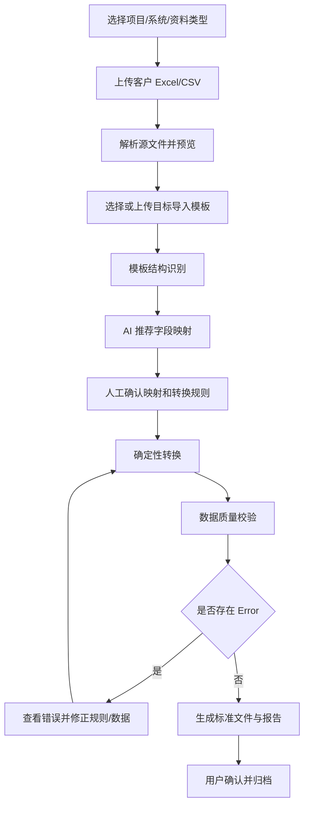
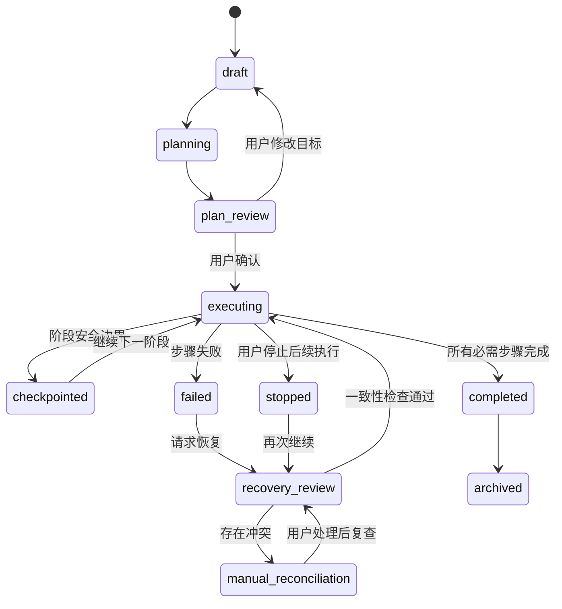
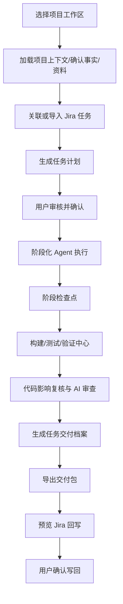
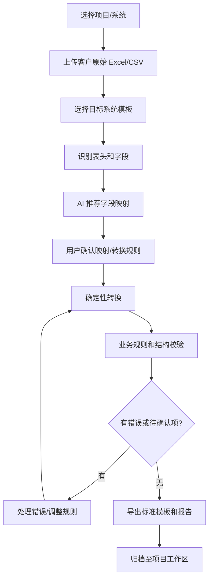

# 精工 Agent 0.7 第二迭代（0.7.1）需求与技术方案

> 文档版本：V1.0  
> 目标产品版本：0.7.1  
> 版本归属：0.7 系列第二迭代（独立功能迭代包）  
> 编制日期：2026-11-14  
> 目标仓库：`zhuangxiaolong/jg_agent`，当前已知开发目录为 `develop/desktop-poc`  
> 面向实施：Codex / 精工 Agent 开发人员  
> 文档性质：独立产品需求 + 技术实施方案 + 界面原型 + 测试与验收标准  
> 需求依据：仅本文；不依赖其他需求文档。

---

## 0. 本轮迭代范围与实施总则（必读）

### 0.1 本文的独立性与范围边界

本文定义精工 Agent 0.7 系列第二迭代的完整新增功能范围，目标版本为 0.7.1。**本文可独立交给 Codex 实施，不需要读取、引用或完成任何其他需求文档，也不以其他文档是否开发完成作为开工条件。**

本轮只实施本文列出的六个新功能模块：

| 编号 | 模块 | 优先级 | 本轮交付判断 |
|---|---|---|---|
| F01 | 项目工作区与项目上下文中心 | P0 | 必须完成 |
| F02 | 客户基础资料智能映射与转换 | P0 | 必须完成，是本轮最重要的业务场景 |
| F03 | Agent 任务计划、阶段执行与断点续跑 | P0 | 必须完成平台级检查点和安全恢复流程 |
| F04 | 代码变更影响分析与 AI 代码审查 | P1 | 本轮目标完成；可分影响分析、审查两个子阶段 |
| F05 | Jira 任务交付闭环与交付包 | P1 | 本轮目标完成，至少具备本地交付包与 Jira 关联/回写确认 |
| F06 | Runtime/模型效率分析 | P2 | 有可靠原始数据再实现，不得伪造 Token 或费用 |

本文不要求重新开发精工 Agent 已有的基础聊天、Runtime 调用、Jira 客户端、Git 管理、会话管理等通用能力；但也**不假设这些功能或任何其他计划模块一定已经存在**。Codex 必须检查当前代码，以实际可运行实现为准：已有能力通过正式接口复用；不存在的依赖通过本轮定义的轻量接口/适配器隔离，不能将未实现的功能当作可用依赖。

本轮目标是让 Agent 从“执行单次开发指令”进一步升级为“理解项目背景、处理客户交付数据、按计划完成工程任务、检查代码影响，并留下可追溯交付结果”的 MES/WMS 工程智能体平台。

### 0.2 六项功能的价值与顺序

1. **项目上下文中心**：将项目、代码仓库、Jira、数据字典、需求文件、历史任务和已确认业务事实组织起来，减少每次任务重复提供背景，并防止跨项目串用资料。
2. **客户基础资料智能映射与转换**：将客户现有 Excel/CSV 与 MES5/MES6/WMS 系统导入模板进行字段匹配、格式转换、业务规则校验和错误定位，解决交付现场高频的数据准备问题。
3. **任务计划与断点续跑**：复杂任务先制定计划并确认，再分阶段执行；在安全边界保存检查点，异常后经过状态检查再恢复。
4. **代码影响分析与 AI 审查**：识别代码、接口、数据对象和业务模块的影响范围，输出带证据等级的风险报告。
5. **Jira 任务交付闭环**：把 Jira、Agent 任务、Git 变更、构建/测试证据、文档和交付摘要组织成可导出的交付档案。
6. **Runtime 效率分析**：采集可验证的耗时、成功率和真实用量，为模型与 Runtime 选择提供数据依据。

实施顺序：F01 → F02 → F03 → F04 → F05 → F06。可以并行开发互不冲突的单元，但必须先定义接口、数据迁移与集成边界，不能把所有模块无依赖地同时开工。

### 0.3 当前代码复用原则

Codex 开发前必须盘点当前仓库真实实现。以下目录是先前代码审查中发现的候选入口，实际路径可能变化，必须以当前 HEAD 为准：

- 领域模型：`packages/domain`；
- 数据存储：`packages/storage` 当前 SQLite migration 与 repository；
- 知识与文档：`packages/knowledge`；
- Agent 编排与 Runtime：`packages/agent-orchestrator`、`packages/agent-runtime`；
- Jira：当前 Jira 登录、任务查询、附件读取和字段配置服务；
- Git：当前仓库识别、分支、Diff、Worktree 和提交信息能力；
- 验证能力：当前构建/测试执行与历史证据模块（若存在）；
- 桌面应用：`apps/desktop/src/main`、`preload`、`renderer`；
- 测试：当前 `tests/`、各 package 的测试目录与桌面冒烟脚本。

上述目录仅是排查线索，不是对当前实现状态的保证。禁止复制一套平行 Jira 客户端、Git 管理器、Runtime Manager、SQLite 访问层或知识库。某项能力不存在时，应通过本轮的接口边界实现最小可用版本，或把集成标记为可选，不得用静态 Mock 冒充真实能力。

### 0.4 工程实施约束

1. **本轮需求以本文为准。** 不需要读取其他版本需求文件；本文中的功能和验收点是本轮交付依据。
2. **先盘点代码，再编码。** 不能把需求文档、注释或 UI 占位符误认为真实功能已经实现。
3. **保护开发现场。** 先执行 `git status`、确认当前分支、HEAD 和未提交改动；不得覆盖已有代码或用户数据。
4. **最小兼容改动。** 优先扩展当前领域服务和接口；需要调整公共模块时，必须增加回归测试。
5. **独立模块不应被外部规划阻塞。** 对当前代码尚不存在的验证服务、操作手册服务或高级知识检索，采用可选 Adapter；本轮核心功能必须在缺少这些扩展模块时仍能完成基本工作流。
6. **禁止虚假成功。** AI 输出、模型自评、Runtime 自报、静态推断不能代替真实转换结果、真实命令退出码、真实测试报告或 Jira 写入回执。
7. **可追溯。** 新增项目、映射规则、转换任务、计划、检查点、审查问题和交付件均需有唯一 ID、时间、来源和状态。
8. **本地优先。** 保持 Windows Electron 桌面应用定位；没有明确需求不引入云服务、团队服务器或强制 Docker/Python 运行时。
9. **职责分层。** 不要把业务逻辑继续堆入 `main/index.ts`、`renderer/App.tsx` 或单个超大存储文件。
10. **AI 是建议层，规则引擎是执行层。** 尤其基础资料转换、校验和状态计算必须可确定性复现。
11. **原型是实施要求。** 本文低保真原型必须落实为真实页面、真实操作和真实状态，不得只做静态 UI。
12. **依赖可选化。** 本轮与现有 Jira、Git、知识、验证等能力的集成必须有接口和降级路径；若连接不可用，核心本地流程仍应可用并明确提示。

# 第一部分：产品需求

## 1. F01——项目工作区与项目上下文中心（P0）

### 1.1 背景与问题

MES5、MES6、WMS 项目的信息分散在 Jira、Git 仓库、客户 Excel、Word/PPT 需求资料、数据字典、操作手册、接口资料、历史问题和实施人员经验中。当前 Agent 主要依赖用户在某次会话中临时输入背景，常见问题包括：

- 每次新会话都要重新描述项目、系统版本和业务背景；
- 同一个人同时负责多个项目，容易把 A 项目的业务规则误用到 B 项目；
- 文件有多个版本，Agent 可能引用过期资料；
- 历史确认过的业务规则无法沉淀，后续任务重复讨论；
- Agent 回答了结论，但用户无法知道结论来自哪个文件、Jira 任务还是模型推断。

### 1.2 产品目标

为每个项目建立独立 Project Workspace。用户选择项目后，Agent 可以按项目范围检索资料、加载任务上下文，并展示引用来源。项目事实必须区分“已确认”“待确认”“模型推断”，未经用户确认的内容不得自动成为项目事实。

### 1.3 用户角色

- 项目经理：维护项目资料、业务事实、版本和风险；
- 实施顾问：查阅数据字典、操作手册、项目流程和历史问题；
- 开发人员：获取当前项目代码、接口、表结构、需求和约束；
- 研发/交付负责人：查看多个项目的总体状态、未确认事项和最近任务。

### 1.4 功能需求

#### PW-001：项目创建与基本信息

每个项目至少包含：

| 字段 | 说明 | 约束 |
|---|---|---|
| projectId | 平台项目唯一 ID | 系统生成，不使用项目名称作为主键 |
| projectName | 项目名称 | 必填 |
| customerName | 客户名称 | 可选 |
| systemType | MES5 / MES6 / WMS / Other | 必填，使用枚举 |
| productVersion | 产品版本 | 可选，允许多个版本及备注 |
| projectStage | 售前/蓝图/实施/开发/联调/试运行/验收/维护/归档 | 可配置枚举 |
| projectCode | 内部项目编号 | 可选，唯一性按组织规则 |
| owner | 项目负责人 | 可选 |
| description | 项目说明 | 可选 |
| status | active / archived | 必填 |

支持新增、编辑、归档、恢复。删除项目不能级联删除历史 Agent 任务、Git 证据、验证记录或交付包。默认采用归档，不提供无确认的物理删除。

#### PW-002：项目资源关联

项目支持关联以下资源：

- 一个或多个本地代码仓库；
- Jira 项目 Key、查询过滤器、任务关联；
- 数据字典及其版本；
- 现有操作手册资料及其修订（如当前应用已提供）；
- 需求文档、蓝图文档、接口说明、客户模板、会议纪要；
- 历史 Agent Task、验证 Run、交付包；
- 项目自定义说明和规则。

资源原则上通过引用 ID 或受控路径关联，不复制大文件。源文件被移除或不可访问时，显示来源失效，不静默删除引用。

#### PW-003：项目资料管理

- 支持添加文件、目录或已有知识中心资源；
- 支持资料分类：需求、蓝图、数据字典、操作手册、接口、数据模板、会议纪要、历史问题、其他；
- 支持适用系统、版本、模块、有效日期、状态、备注等元数据；
- 资料状态至少包括 active、superseded、archived、unavailable；
- 同一逻辑资料存在新版本时，保留旧版本并记录替代关系；
- 对文件计算 SHA256，展示来源文件名、大小、更新时间和指纹；
- 不允许只靠文件名判断文件内容相同。

#### PW-004：项目事实与决策台账

建立两类可维护记录：

**项目事实（Project Fact）**：已确认的业务规则、组织范围、编码规则、接口约束、客户要求、部署环境等。  
**项目决策（Project Decision）**：某事项如何决定、由谁确认、何时生效、是否被后续决策替代。

每条记录包含：标题、内容、分类、来源、提出人/确认人、确认时间、状态、版本、有效范围、附件引用。

状态：`proposed / confirmed / rejected / superseded`。只有 `confirmed` 且未被替代的记录可以默认注入 Agent 上下文。

Agent 可以建议创建 Fact/Decision 草稿，但必须用户点击“确认入库”后才进入 confirmed 状态。

#### PW-005：项目上下文组装

新建任务或进入项目会话时，用户选择当前项目。平台根据以下优先级组装上下文：

1. 当前任务明确输入和用户指令；
2. 当前项目已确认事实及有效决策；
3. 当前项目关联的需求、字典和操作手册；
4. 当前 Jira 任务及其附件；
5. 当前仓库分支、Git 状态和相关代码摘要；
6. 历史任务/验证记录（只在相关时召回）。

上下文按 Token/字符预算选择，不能把整个项目所有文件无上限塞给 Runtime。上下文快照必须记录实际选中的来源及来源版本。

#### PW-006：项目隔离与跨项目检索

默认只允许检索当前项目资源。跨项目检索必须由用户主动选择，并在 UI 明确显示检索范围。严禁因名称相似、文件名相同或关键词命中而自动混合多个项目资料。

#### PW-007：上下文来源追溯

Agent 会话中使用项目资料时，提供“本次使用的项目资料”面板，显示：来源名称、分类、修订/版本、命中章节/工作表/页码、引用片段、是否为已确认事实。

如果引用内容来自推断而非资料原文，标记为“AI 分析”，不显示成“资料引用”。

#### PW-008：项目导入/导出与备份

本次只要求支持项目配置 JSON 导出/导入（不包含客户原始文件二进制内容）；导出时写明资源 ID、源文件哈希和资源缺失状态。恢复时可重新绑定本地资源。不得覆盖已有 projectId 对应的数据；发生冲突时要求用户选择新建副本或合并可安全字段。

### 1.5 项目工作区原型

```text
┌──────────────────────────────────────────────────────────────────────────────┐
│ 精工 Agent  / 项目工作区    [项目：灏博电子 - MES6 ▼]        [新建项目]       │
├───────────────────┬───────────────────────────────────┬──────────────────────┤
│ 项目导航          │ 项目资料                           │ 项目概览             │
│                   │ [全部][需求][字典][操作手册][接口] │ 客户：灏博电子       │
│ 项目概览          │ [数据模板][会议纪要][历史问题]     │ 系统：MES6           │
│ 项目资料          │                                   │ 版本：Vx.x           │
│ 需求与任务        │ 文件/资料       版本   状态        │ 阶段：联调           │
│ 数据字典          │ 蓝图方案.docx    V2    有效        │ 负责人：...          │
│ 操作手册          │ MES6字典.xlsx    V3    有效        │ Jira：MES6           │
│ 项目事实          │ 接口清单.xlsx    V1    待更新      │ Git：仓库/分支       │
│ 决策记录          │                                   │                      │
│ 风险与问题        │ [添加资料] [关联已有知识]          │ 已确认事实  18       │
│                   │                                   │ 待确认事项   4       │
│                   │                                   │ 最近任务/验证        │
└───────────────────┴───────────────────────────────────┴──────────────────────┘
```

### 1.6 Agent 会话中的项目上下文原型

```text
┌──────────────────────────────────────────────────────────────────────────────┐
│ 新建 Agent 任务    项目：[灏博电子 - MES6 ▼]    Jira：[MES6-123 ▼]            │
├──────────────────────────────────────────────────────────────────────────────┤
│ 任务描述：                                                                    │
│ 增加工单完工入库的批次校验逻辑……                                              │
│                                                                              │
│ 本次将加载的项目上下文                                                       │
│ ☑ 项目确认规则 3 条   ☑ 数据字典 2 份   ☑ 操作手册 1 份                       │
│ ☑ Jira 描述/附件     ☑ 当前 Git 分支   □ 历史任务（可选）                     │
│                                                                              │
│ [查看来源详情] [调整上下文] [开始分析]                                       │
└──────────────────────────────────────────────────────────────────────────────┘
```

### 1.7 F01 验收标准

- 能创建、编辑、归档、恢复项目；项目 ID 稳定且唯一；
- 同一项目能关联多类资源，资源删除/移动后显示失效，不丢历史引用；
- 项目事实和决策支持草稿、确认、驳回、替代；未确认事实不默认注入；
- 两个项目资料相同名称但内容不同，默认不会串用；
- Agent 上下文可展示实际加载来源和版本；
- 任务历史保存 ContextSnapshot，不因资料后来更新而篡改过去任务的来源证据；
- 项目归档不删除历史任务、验证证据和交付包；
- UI 的加载中、无资料、来源失效、检索无结果、错误状态均可用。

---

## 2. F02——客户基础资料智能映射与转换（P0，版本标志性功能）

### 2.1 背景与业务价值

客户通常已经有自己的 Excel 基础资料，但字段名称、列顺序、编码规则、枚举值、格式、数据关系与 MES5/MES6/WMS 导入模板不一致。实施顾问需要逐列人工比对、改名、拆分、拼接、转换和排错。

本功能让 Agent 负责“识别与推荐”，让确定性规则引擎负责“转换与校验”，让实施顾问负责“确认业务规则”。最终输出标准导入文件和错误报告，不直接操作客户生产系统。

### 2.2 首期范围

**输入格式：** `.xlsx`、`.csv`。  
**目标模板：** `.xlsx`，模板可来自精工内置模板、项目模板库或用户上传。  
**输出格式：** 标准导入 `.xlsx`、错误明细 `.xlsx/.csv`、映射规则 JSON、处理报告 Markdown/HTML（按现有导出技术选择）。

首批资料类型建议：

- 物料主数据；
- 客户/供应商主数据；
- 仓库、库区、库位；
- BOM/产品结构；
- 工艺路线/工序；
- 单位、分类、状态等枚举字典。

**限制：** 以仓库实际具备的 MES5/MES6/WMS 数据字典和导入模板为准。没有真实模板和字段定义的对象只能作为“用户自定义模板”，不得虚构系统标准字段。

### 2.3 功能需求

#### DM-001：转换任务创建

用户创建 Mapping Job 时需要指定：项目、系统（MES5/MES6/WMS）、产品版本、资料类型、源文件、目标模板、任务名称和说明。若从项目工作区打开，自动带入项目和系统，但用户可以核对后修改。

#### DM-002：源文件解析与结构预览

必须展示：文件名、SHA256、工作表/CSV、检测到的标题行、数据起止行、总行数、列数、隐藏工作表/行列、合并单元格、空列、公式单元格及解析 Warning。

用户可以修改：工作表、表头行、数据起始行、跳过行、列名行。不得假设第一行永远是表头。

XLSX 处理规则：

- 不执行公式；优先使用可读取的缓存值；无缓存值时明确显示公式和“需确认”；
- 保留文本型编码的前导零；
- 不 silently 将长编码转成科学计数法或浮点数；
- 日期序列必须根据工作簿日期系统处理，并让用户预览转换结果；
- 合并单元格、隐藏行列和空白行需提示，不能误删业务数据。

#### DM-003：目标模板识别

解析目标模板中的工作表、表头、列顺序、样式之外的字段定义和模板版本信息。支持用户补充模板名称、版本、生效日期、适用系统/版本、资料类型。

模板识别后生成 Template Snapshot 和 SHA256。模板发生变化时，重新计算结构指纹并标记已有映射规则是否兼容。

#### DM-004：AI 字段映射推荐

候选映射综合以下信息排序：

1. 字段名称、别名和历史映射；
2. 目标数据字典说明；
3. 项目确认事实；
4. 字段类型、长度、必填和枚举定义；
5. 源数据样本值、唯一值和分布特征；
6. 同一项目历史批次已确认规则。

每个候选必须给出映射依据和匹配分数。分数是模型/算法的排序指标，不代表准确率证明。

映射状态：`suggested / confirmed / rejected / unmapped / conflict`。模型不得自行把 suggested 改为 confirmed。

#### DM-005：映射规则编辑

每个源字段与目标字段映射可以配置：

- 直接映射；
- 常量/默认值（需要用户确认）；
- 字符串清洗（去空格、替换、大小写）；
- 日期、数值、文本格式转换；
- 单字段拆分；
- 多字段拼接；
- 枚举值转换；
- 单位换算（需明确单位和换算比例）；
- 条件映射（仅支持可视化表达的受限规则，不运行任意用户代码）；
- 跳过字段（必须说明原因）。

转换规则应保存为版本化 JSON DSL；禁止将模型生成的任意 JavaScript、Python 或 SQL 作为转换执行代码。

#### DM-006：数据确定性转换

相同源文件指纹、模板指纹、映射规则版本和转换引擎版本，应得到可重复的转换结果。输出前必须校验目标字段顺序、字段类型、必填规则和数据行数变化。

#### DM-007：数据校验引擎

校验分层：

- 结构校验：工作表、表头、列数、列名、目标模板结构；
- 字段校验：必填、类型、长度、正则、数值范围、日期格式；
- 枚举校验：值是否在目标允许范围；
- 重复校验：单字段或组合业务主键；
- 关系校验：父子关系、仓库-库区-库位、BOM 引用、分类引用；
- 跨行校验：同键冲突、数量合计、父子行关系等；
- 规则校验：项目确认的业务规则。

每条问题需包含：issueId、严重级别、规则 ID、工作表、原始行号、源列、目标字段、原始值、转换值、问题说明、建议操作、是否允许用户忽略。

严重级别：`error / warning / info`。error 默认阻止生成“可直接导入”状态文件；用户可导出带错误标记的检查稿，但不得命名为“校验通过”。

#### DM-008：人工复核

提供字段映射复核、错误筛选、错误值修正建议、单条/批量确认。用户修改目标值或映射规则后，必须重新执行受影响的转换和校验，不能只修改页面显示。

#### DM-009：结果输出

至少输出：

1. 标准导入文件：目标模板结构；
2. 错误明细：问题列表与源文件定位；
3. 转换报告：总行数、成功行、错误行、警告行、跳过行、规则版本、模板版本；
4. 映射规则文件/持久记录：便于同项目复用。

原始文件始终只读保留，输出写入新的受管结果目录。默认不覆盖用户文件。

#### DM-010：映射规则复用

同项目、同系统、同资料类型、同模板指纹可以复用已确认规则。跨项目只能在用户明确复制规则后使用，并需二次确认项目差异。模板指纹变化时不得静默套用旧规则。

#### DM-011：批量处理与进度

支持单任务多文件或多工作表批量处理（以稳定性为前提）。显示解析、匹配、转换、校验、导出各阶段进度；允许取消。取消不得留下被误认为成功的半成品。

#### DM-012：历史记录

记录 Mapping Job 的源文件指纹、模板指纹、映射规则版本、转换引擎版本、操作者、执行时间、结果和输出文件哈希。历史结果可再次打开，但重新运行必须生成新 Run，不覆盖原结果。

### 2.4 基础资料转换工作流



### 2.5 原型 A：字段映射工作台

```text
┌──────────────────────────────────────────────────────────────────────────────┐
│ 基础资料转换  / 新建任务      项目：XXX   系统：WMS   资料：物料主数据       │
├───────────────────────────────┬──────────────────────────────────────────────┤
│ 客户源文件                    │ 系统目标模板                                 │
│ 客户物料清单.xlsx              │ WMS_物料导入模板_V3.xlsx                     │
│ Sheet：物料资料                │ Sheet：物料                                 │
│ 表头行：2   数据行：3~2502     │ 模板指纹：a2b...   版本：V3                  │
│                               │                                              │
│ 源字段       样本              │ 目标字段       匹配度  类型   状态          │
│ 物品编号     M-0001            │ item_code      98%     文本   已确认        │
│ 物品名称     螺丝              │ item_name      96%     文本   已确认        │
│ 规格型号     M8*20             │ specification  92%     文本   待确认        │
│ 物品类型     外购件            │ item_type      82%     枚举   待确认        │
│ 备注         标准螺丝          │ remark         76%     文本   待确认        │
│                               │                                              │
│ [查看匹配依据]                 │ [编辑映射] [新增规则] [批量确认]             │
├───────────────────────────────┴──────────────────────────────────────────────┤
│ 已确认 2 / 待确认 3 / 未匹配 0     [保存映射草稿] [进入数据校验]               │
└──────────────────────────────────────────────────────────────────────────────┘
```

### 2.6 原型 B：转换规则详情

```text
┌──────────────────────────────────────────────────────────────────────────────┐
│ 字段映射详情：物品类型 → item_type                                           │
├───────────────────────────────┬──────────────────────────────────────────────┤
│ 源字段                        │ 目标字段                                    │
│ 物品类型                      │ item_type                                   │
│ 示例值：外购件、自制件、委外件 │ 目标枚举：BUY / MAKE / OUTSOURCE            │
│                               │                                              │
│ 转换规则：枚举映射             │                                              │
│ 外购件  → BUY                 │ [编辑映射表]                                │
│ 自制件  → MAKE                │                                              │
│ 委外件  → OUTSOURCE           │                                              │
│ 未识别值 → 报错（默认）        │                                              │
│                               │                                              │
│ 映射依据：项目字典/用户确认    │                                              │
│ [保存草稿] [确认规则] [取消]   │                                              │
└──────────────────────────────────────────────────────────────────────────────┘
```

### 2.7 原型 C：数据校验与结果输出

```text
┌──────────────────────────────────────────────────────────────────────────────┐
│ 数据校验结果                                                                 │
├──────────────────────────────────────────────────────────────────────────────┤
│ 总行数 2,500   可导入 2,421   错误 52   警告 27   未确认 0                    │
│                                                                            │
│ [全部] [错误] [警告] [重复] [关联关系]                                      │
│ 行号 业务主键  字段          问题说明                建议                    │
│ 18   M-0018   item_type     枚举值不在目标范围      选择对应枚举              │
│ 39   M-0039   warehouse     仓库编码不存在          核对仓库资料              │
│ 72   M-0072   item_code     业务主键重复            确认是否重复记录          │
│                                                                            │
│ [定位源文件] [批量修正] [下载错误明细] [重新校验]                          │
├──────────────────────────────────────────────────────────────────────────────┤
│ [导出标准文件]（仅当阻断级错误为 0 且未确认项为 0 时可用）                  │
└──────────────────────────────────────────────────────────────────────────────┘
```

### 2.8 F02 安全与准确性约束

- 原始客户文件只读，不覆盖；输出独立落盘；
- 文件解析和转换尽量在本地完成；发送给模型的字段/样本必须符合现有模型隐私策略并让用户可查看；
- 不把客户全量资料默认发送到第三方模型；字段推荐应优先发送字段名、定义和脱敏样本；
- 不允许通过公式、宏、外部链接或嵌入代码执行文件内容；
- 不自动写入 MES/WMS 数据库，不自动登录客户生产环境；
- 未确认的业务默认值和枚举映射不得自动应用；
- 映射匹配分数不是“准确率”，不以 95% 等模型分数直接跳过用户确认；
- 结果文件必须带处理报告或独立报告，明确“已校验/有警告/有错误/未完成”。

### 2.9 F02 验收标准

- 准备不少于 5 份脱敏真实客户 Excel/CSV 样本和对应 MES/WMS 模板；
- 覆盖不同表头行、列顺序、前导零、日期、枚举、合并单元格、重复主键和关联关系；
- 字段映射可解释、可调整、可保存、可复用；
- 相同输入和规则可重复生成一致的规范数据（忽略文件元数据差异）；
- 标准文件工作表、字段名、字段顺序与模板一致；
- 错误可以回溯到源文件、工作表、单元格/行列；
- 有 Error 或未确认规则时，不显示“校验通过”；
- 用户可下载转换结果、错误明细和规则；
- 大文件解析有进度、取消和内存保护测试；
- 不连接生产库、不自动导入客户系统。

---

## 3. F03——Agent 任务计划、阶段执行与断点续跑（P0）

### 3.1 背景与问题

复杂开发任务通常依次涉及需求理解、项目上下文加载、代码定位、方案设计、代码修改、构建、测试和交付总结。对话式执行存在计划不透明、执行顺序难控、失败后不知道做到哪里、应用关闭后无法安全恢复等问题。

### 3.2 产品目标

把复杂工程任务从一次性对话转为可检查、可暂停于阶段边界、可恢复、可追溯的 Task Plan。简单问答和小修改仍可直接执行，不能把所有会话都变成繁重工作流。

### 3.3 功能需求

#### TP-001：任务复杂度判断

用户可以手动选择“直接执行”或“规划后执行”。平台也可根据变更文件数、需求复杂度、涉及模块和验证要求给出“建议先制定计划”。不能仅靠模型主观打分强制复杂模式。

#### TP-002：结构化任务输入

任务最少包含：目标、当前项目、任务类型、约束、验收标准、关联 Jira（可选）、关联仓库/分支、执行策略。

#### TP-003：生成执行计划

每份计划包含：

- 任务理解摘要；
- 前置条件和缺失信息；
- 执行阶段和步骤；
- 每步目标、输入、预期产物；
- 可能影响的模块/文件（初步预测）；
- 依赖关系和阻塞点；
- 失败处理方式；
- 构建/测试验证计划；
- 用户需要确认的事项。

计划步骤建议阶段：需求理解 → 项目/代码定位 → 方案设计 → 实施 → 构建/测试 → 代码审查 → 交付总结。允许按任务类型调整，不能每次机械生成全部步骤。

#### TP-004：计划编辑与确认

用户可以编辑步骤名称、说明、优先级、依赖和验收项，可删除不适用步骤、添加步骤。确认后建立 Plan Revision。执行期间修改计划要生成新 Revision，并显示修改原因。

#### TP-005：阶段化执行

每个步骤需要有状态、起止时间、执行记录和产物引用。状态至少包括：`pending / ready / running / succeeded / failed / skipped / blocked / invalidated`。

用户可以在阶段边界停止后续步骤，但不应误将“停止后续步骤”描述成 Runtime 能力层的原生暂停。

#### TP-006：检查点保存

阶段完成或明确安全边界时创建 Task Checkpoint，至少记录：

- Task ID、Plan Revision、Step ID；
- 当前项目 ID、仓库 ID、工作区路径引用；
- Git 分支、HEAD SHA、执行前后工作区状态；
- 当前 Runtime、会话 ID（若可用）、模型配置标识（不存密钥）；
- 阶段目标和上下文摘要；
- 本阶段已完成动作、输出、文件变更清单；
- 命令记录、退出码、验证证据 ID；
- 未解决问题、下一步建议和恢复条件。

检查点以摘要和引用为主，不复制大体积仓库文件。

#### TP-007：断点恢复

恢复前必须执行一致性检查：

1. 当前分支和 HEAD 是否与检查点兼容；
2. 工作区是否存在检查点后新增的用户改动；
3. 相关文件 SHA256 是否改变；
4. 项目上下文资料版本是否变更；
5. 之前验证证据是否仍然适用于当前代码指纹；
6. Runtime 是否仍可用，原生 Session Resume 是否真实支持。

根据结果分类：

- `safe_to_resume`：可从最近安全检查点继续；
- `resume_with_revalidation`：先重新构建/测试或重新读取相关文件，再继续；
- `manual_reconciliation_required`：用户需要处理工作区或计划冲突；
- `cannot_resume`：信息不足或上下文已失效，建议从新任务重新开始。

若底层 Runtime 不支持原生会话恢复，则创建新执行 Session，将旧检查点摘要作为已完成上下文继续，保留父子执行关联。必须明确显示“平台级任务恢复”，不能声称“恢复原 Runtime 进程”。

#### TP-008：计划与实际差异

任务完成后显示计划步骤和实际执行差异：新增步骤、删除步骤、跳过步骤、实际改动范围偏差、验证项变化和未完成事项。

#### TP-009：与验证中心集成

验证计划可创建或关联当前可用验证服务的 Profile/Suite/Run；若仓库不存在验证服务，则使用本轮定义的 VerificationAdapter 接口接入构建/测试执行器。验证 Run 必须关联任务步骤及代码指纹；不能把旧 Run 或其他项目 Run 显示为当前任务通过。

#### TP-010：检查点清理与保留

提供检查点保留策略：最近 N 个检查点保留、任务归档后压缩、关联的 Git/测试证据仍可追溯。清理只移除可重建的冗余摘要，不删除原始测试报告和用户代码。

### 3.4 任务状态机



### 3.5 原型 D：任务计划确认

```text
┌──────────────────────────────────────────────────────────────────────────────┐
│ Agent 任务：增加 WMS 多组织库存查询                                           │
├───────────────────────────────────────┬──────────────────────────────────────┤
│ 任务计划                              │ 计划详情                              │
│                                       │                                      │
│ 1 需求理解             已完成         │ 当前步骤：分析代码结构                │
│ 2 项目资料检索         已完成         │ 目标：定位库存查询及组织过滤逻辑      │
│ 3 代码定位             进行中         │ 预计检查：Service / Repository / DTO  │
│ 4 技术方案             待执行         │                                      │
│ 5 代码实施             待执行         │ 预计影响：8 个文件（初步判断）        │
│ 6 构建与回归           待执行         │ 建议验证：WMS Profile / 库存查询测试  │
│ 7 交付总结             待执行         │                                      │
│                                       │ 风险：组织隔离、旧接口兼容             │
│ [编辑计划] [查看依赖关系]             │ [查看上下文] [确认计划并执行]         │
├───────────────────────────────────────┴──────────────────────────────────────┤
│ 执行日志 / 阶段输出 / 证据 / 失败原因                                        │
└──────────────────────────────────────────────────────────────────────────────┘
```

### 3.6 原型 E：检查点与恢复

```text
┌──────────────────────────────────────────────────────────────────────────────┐
│ 任务恢复检查                                                                  │
├──────────────────────────────────────────────────────────────────────────────┤
│ 最近检查点：代码定位完成   保存时间：2026-11-14 15:21                         │
│                                                                              │
│ 检查项目                         结果              说明                       │
│ Git 分支                         一致              feature/wms-org            │
│ HEAD SHA                         有变化/一致       以真实检查结果显示         │
│ 工作区改动                       发现新改动         需要用户确认               │
│ 项目资料版本                     一致              3 个来源未变化             │
│ 验证证据                         已过期/有效       以文件指纹判断             │
│ Runtime 原生恢复                 不支持/支持       以实测能力矩阵为准         │
│                                                                              │
│ 恢复建议：存在工作区新改动，需要先查看 Diff。                                │
│ [查看差异] [重新验证后继续] [手动处理] [放弃恢复]                            │
└──────────────────────────────────────────────────────────────────────────────┘
```

### 3.7 F03 验收标准

- 复杂任务可生成结构化计划，用户能编辑并确认；
- 每个阶段有状态、开始/结束时间、产物和日志；
- 在阶段边界生成持久化检查点，应用重启后可读取；
- 人为制造应用退出/Runtime 异常后，可以进入恢复检查页面；
- 工作区出现检查点之后的新改动时，系统阻止无条件继续；
- 旧验证证据因代码指纹变化而标记 stale；
- Runtime 不支持原生暂停/恢复时，UI 和报告明确说明平台级恢复；
- 恢复后保留父 Task、原 Plan Revision 和检查点历史；
- 简单任务仍可直接执行，不强制先创建完整计划。

---

## 4. F04——代码变更影响分析与 AI 代码审查（P1）

### 4.1 目标

在修改代码前识别可能影响模块和业务对象，在修改完成后进行结构化审查，为开发人员和组长提供可定位、可复核的问题清单。此功能是风险辅助，不代替真实测试、人工代码审查或业务验收。

### 4.2 变更前影响分析

#### CR-001：需求到代码关联

输入当前任务需求、Jira 描述、项目事实和关键词，结合代码搜索、符号索引（若现有技术栈具备）、Git 历史定位相关模块、类、方法、接口和配置项。

每个影响对象标注来源：
- 代码搜索命中；
- 静态调用/依赖关系；
- Git 变更历史；
- AI 推断。

不能把 AI 推断当成已确认调用关系。

#### CR-002：MES/WMS 业务风险关注点

根据系统类型和任务主题提示重点检查：

- 多组织隔离、组织过滤条件；
- 库存数量、批次、库位、容器、库存状态；
- 入库、出库、拣货、上架、盘点、调拨等状态流转；
- 工单、报工、工艺路线、BOM、工序关系；
- 接口 DTO、字段映射、序列化兼容；
- SQL 条件、事务、并发、幂等；
- 旧版本配置和客户定制逻辑。

这些只是检查清单，不代表每个业务都必然适用。必须根据项目上下文筛选。

#### CR-003：回归建议

结合被影响模块和验证中心已配置的 Profile/Suite，推荐回归范围。推荐项要区分“关联测试”与“实际已执行测试”。不得将建议清单表示为已覆盖。

### 4.3 变更后 AI 代码审查

#### CR-004：Diff 范围审查

基于当前任务 Worktree/分支 Diff 审查：
- 修改文件是否与需求相关；
- 是否有意外改动、删除或新增文件；
- 是否残留调试代码、临时文件和敏感信息；
- 是否改变公共接口、配置、数据库字段或依赖版本；
- 是否缺少对应测试或文档。

#### CR-005：代码质量与业务风险

根据项目语言和当前可用工具检查：空值、异常、资源释放、并发、事务、SQL 风险、重复查询、硬编码、日志泄露、兼容性、边界值及测试遗漏。能使用 ESLint、TypeScript、Roslyn、现有静态检查时优先用工具；不可用时才让模型给出疑点。

#### CR-006：问题证据等级

问题等级：
- `verified`：工具、测试或明确代码路径可以复现/确认；
- `likely`：代码上下文强烈暗示有风险，需要人工确认；
- `suggestion`：优化建议，不一定是缺陷；
- `unknown`：资料不足，无法判断。

每个 Finding 必须包含：文件、行号/范围、代码片段或符号、严重级别、证据等级、问题说明、风险原因、建议修复、来源工具/模型、审查时间。

#### CR-007：问题管理

支持确认、忽略、标记误报、转为 Jira 子任务、重新审查。忽略必须填写原因。新一轮审查与历史 Finding 基于规则指纹/文件位置/问题摘要进行关联，区分新增、已修复、仍存在和无法复核。

#### CR-008：审查报告与任务关联

审查报告关联 Agent Task、Git Diff 指纹、项目、Jira Key、验证 Run。代码发生变化后，旧审查报告标记为 stale，不得用旧报告为新代码背书。

### 4.4 原型 F：影响分析与代码审查

```text
┌──────────────────────────────────────────────────────────────────────────────┐
│ 代码影响分析 / 审查     任务：WMS-123    分支：feature/wms-org                │
├────────────────────────────────────┬─────────────────────────────────────────┤
│ 影响对象                           │ 风险摘要                                │
│ [代码模块]                         │ 高：组织过滤条件可能遗漏                │
│ InventoryQueryService.cs           │ 中：公共 DTO 新增字段                    │
│ StockRepository.cs                 │ 中：库存查询索引                         │
│ InventoryQueryDto.cs               │ 低：日志内容调整                         │
│ [接口/数据对象]                    │                                         │
│ /api/inventory/query               │ 审查结果                                │
│ Stock / Warehouse / Org            │ 级别  文件                问题           │
│                                    │ 高    StockRepository.cs   组织条件缺失  │
│ [建议回归]                         │ 中    DTO                  兼容性待确认  │
│ WMS-库存查询 Suite                 │                                         │
│ WMS-多组织隔离 Suite               │ [查看代码] [确认/忽略] [生成任务]        │
├────────────────────────────────────┴─────────────────────────────────────────┤
│ [重新分析] [运行验证] [导出审查报告]                                         │
└──────────────────────────────────────────────────────────────────────────────┘
```

### 4.5 F04 验收标准

- 影响报告可以定位真实文件和行/符号；
- 工具事实与 AI 推断明确区分；
- 回归建议可关联当前可用验证配置；若不存在统一验证配置，则输出通用命令级回归建议；
- 代码审查报告关联 Git Diff 指纹；
- 用户可确认、忽略、标记误报；
- 代码变化后旧报告变为 stale；
- 不以“AI 未发现问题”宣称代码正确或安全；
- 审查功能默认只读，不自动修改代码。需要修复时创建新的 Agent 任务。

---

## 5. F05——Jira 任务交付闭环与交付包（P1）

### 5.1 目标

将 Jira 的任务要求与 Agent 执行计划、代码变更、验证记录、审查报告和交付说明关联。项目经理或开发组长能用一份交付包回答：做了什么、改了什么、验证了什么、还剩什么问题。

### 5.2 功能需求

#### DP-001：Jira 任务导入与关联

复用当前 Jira 集成，支持通过 Jira Key 关联任务；读取标题、描述、验收条件、附件和当前状态。任务快照保存导入时间及 Jira 更新时间。若 Jira 任务后来变化，提示“源需求已更新”，允许重新拉取并生成差异。

#### DP-002：任务交付档案

每个交付档案关联：
- Jira Key 和任务快照；
- 项目 ID；
- Agent Task ID / Plan Revision；
- Git 仓库、分支、提交 SHA 和 Diff 摘要；
- 代码影响分析及审查 Finding；
- 构建、测试和验证中心 Run；
- 需求/技术说明、操作手册、数据转换报告等附件；
- 遗留问题、风险、待客户确认事项。

#### DP-003：自动生成交付摘要

基于真实证据生成以下章节：任务目标、实现内容、修改文件、验证结果、代码审查、遗留事项、风险与建议、关联附件。每个章节能够回溯到证据 ID。

模型可以润色摘要，但数据项如测试状态、通过数、失败数、Git SHA 必须由平台数据生成，不能由模型自由编造。

#### DP-004：交付包导出

最低支持 Markdown + HTML 或 Markdown + ZIP。如当前应用已有 DOCX 生成能力则复用；否则首期以 Markdown + ZIP 为正式交付格式，DOCX 作为可选扩展，不得因此阻塞本模块。建议 ZIP 结构：

```text
DeliveryPackage_<JiraKey>_<Date>/
├─ README_交付摘要.md
├─ 需求与实现说明.md
├─ Git变更摘要.md
├─ 验证报告/
│  ├─ 验证汇总.md
│  └─ 原始测试报告/（按用户勾选）
├─ 代码审查报告.md
├─ 附件/
└─ 遗留问题与风险.md
```

导出时可选择包含原始日志/截图/客户文件。默认不把客户源文件、密钥、环境配置、完整仓库代码放入交付包。

#### DP-005：Jira 回写预览

允许用户预览并编辑将写回的 Jira 评论或附件说明。写入评论、上传附件、变更状态等操作必须由用户逐项确认。不能自动将 Jira 状态改成 Done，也不能默认提交/合并 PR。

#### DP-006：回写记录

记录 Jira 操作类型、目标 Issue、请求内容摘要、请求时间、返回状态、响应 ID、失败原因和执行人。失败时保留本地交付包，不丢失本地证据；允许用户重试。

#### DP-007：交付包版本

每次重新生成交付包形成新的 revision。保留旧版包哈希、生成时间和输入证据快照。不能覆盖历史导出。

### 5.3 原型 G：任务交付档案

```text
┌──────────────────────────────────────────────────────────────────────────────┐
│ 任务交付档案    Jira：MES6-123    项目：灏博电子 MES6                         │
├──────────────────────────────────────────────────────────────────────────────┤
│ 交付状态：待复核      Agent Task：AT-2026-00123     Git：feature/xxx          │
│                                                                              │
│ 任务目标                                                                       │
│ 增加工单完工入库批次校验……                                                    │
│                                                                              │
│ 交付证据                                                                       │
│ [任务计划 7 步] [Git 修改 8 文件] [构建通过] [测试 42/42] [审查 2 项待确认]    │
│                                                                              │
│ 交付内容                                                                       │
│ ☑ 交付摘要  ☑ Git变更摘要  ☑ 验证报告  ☑ 代码审查  ☑ 遗留风险                │
│ □ 原始测试日志  □ 图片/截图  □ 其他附件                                      │
│                                                                              │
│ [预览交付包] [生成 ZIP] [预览 Jira 评论] [确认并写回 Jira]                    │
└──────────────────────────────────────────────────────────────────────────────┘
```

### 5.4 原型 H：Jira 回写确认

```text
┌──────────────────────────────────────────────────────────────────────────────┐
│ Jira 回写预览    MES6-123                                                     │
├──────────────────────────────────────────────────────────────────────────────┤
│ 操作：新增评论                                                                │
│                                                                              │
│ 本次实现：                                                                    │
│ - 增加多组织库存查询过滤……                                                    │
│ - 修改 InventoryQueryService.cs 等 8 个文件                                  │
│                                                                              │
│ 验证结果：                                                                    │
│ - Build：通过（真实 Run #...）                                                │
│ - Test：42 通过 / 0 失败（真实报告）                                          │
│                                                                              │
│ 待确认事项：                                                                  │
│ - 组织权限边界仍需客户确认                                                   │
│                                                                              │
│ [编辑评论] [仅导出本地交付包] [确认写入 Jira] [取消]                          │
└──────────────────────────────────────────────────────────────────────────────┘
```

### 5.5 F05 验收标准

- 交付档案可关联 Jira、项目、Agent Task、Git、验证 Run 和审查报告；
- 交付包中的验证状态、测试数和 SHA 来自真实数据库记录；
- 交付包离线可打开；
- 默认排除密钥、环境文件和客户原始源文件；
- Jira 回写先预览再确认；
- Jira 回写失败不影响本地交付包；
- 每次重新生成保留历史版本和输入快照。

---

## 6. F06——Runtime/模型效率分析（P2，可选）

### 6.1 目标

帮助研发负责人了解 Runtime 和模型在不同任务类型中的真实效率，包括启动、响应、执行耗时、成功率和可追溯的用量数据。由于当前部分中转站和 Runtime 不一定提供 Token/费用数据，本模块必须按数据来源区分真实值、估算值和未知值。

### 6.2 指标范围

- Runtime 启动成功/失败次数；
- 任务开始、首个输出、任务完成的时间戳；
- 首字延迟、总响应时间、端到端任务时长；
- 任务成功/失败/中断数量及失败分类；
- 输入/输出 Token（仅在上游真实返回或 Runtime 真实提供时）；
- 费用（仅在 Token 可追溯且价格配置可验证时）；
- 按 Runtime、模型、任务类型和项目做聚合。

### 6.3 数据来源标签

每个计量字段增加 `sourceType`：`provider_reported / runtime_reported / estimated / unavailable`。估算值必须单独展示并可查看计算公式；无来源时显示“未知/未提供”，不得默认填 0。

价格配置需保存来源、币种、生效时间和版本。禁止把估算费用与上游账单金额合并显示。

### 6.4 原型 I：效率分析面板

```text
┌──────────────────────────────────────────────────────────────────────────────┐
│ 运行效率分析    时间范围：[最近 7 天 ▼]    Runtime：[全部 ▼]                   │
├──────────────────────────────────────────────────────────────────────────────┤
│ 任务完成率       平均耗时       首字延迟       Token/费用数据可用率            │
│ 以真实 Run 统计   以事件时间统计  以时间戳计算    真实值与未知值分开             │
├──────────────────────────────────────────────────────────────────────────────┤
│ Runtime/模型对比                                                               │
│ Codex      任务数  成功率  平均耗时  Token 来源  费用状态                     │
│ Grok       ...                                                               │
│ Claude     ...                                                               │
├──────────────────────────────────────────────────────────────────────────────┤
│ 错误分类 / 任务类型分布 / 最近运行明细                                         │
└──────────────────────────────────────────────────────────────────────────────┘
```

### 6.5 F06 验收标准

- 每项指标可追溯原始事件；
- 不可用 Token 显示 unavailable，不显示虚构 0；
- 估算值与真实值有明确标识；
- 价格版本、币种和计费口径可查看；
- 指标采集不会明显影响 Agent 执行性能；
- F06 未完成不阻塞 0.7.1 核心版本。

---

# 第二部分：跨模块工作流与总体界面

## 7. 端到端工作流

### 7.1 项目开发任务



### 7.2 客户基础资料准备任务



## 8. 菜单与信息架构建议

沿用现有 Electron Shell，新增能力尽量整合到当前导航，不进行大规模重做：

```text
精工 Agent
├─ 工作台
│  ├─ 最近项目
│  ├─ 最近任务
│  └─ 待确认事项
├─ 项目工作区（新增一级入口）
│  ├─ 项目概览
│  ├─ 项目资料
│  ├─ 项目事实与决策
│  ├─ 需求与 Jira
│  └─ 项目任务/交付记录
├─ Agent 开发
│  ├─ 会话与任务
│  ├─ 任务计划与执行
│  ├─ Git / Diff
│  └─ 代码影响分析与审查
├─ 交付工具（新增或整合）
│  ├─ 基础资料智能转换
│  ├─ 映射规则库
│  └─ 任务交付包
├─ 知识中心
│  ├─ 数据字典
│  ├─ 操作手册（当前知识资源，如已存在）
│  └─ 项目知识
└─ 平台管理
   ├─ Runtime 与兼容性（当前已有平台能力）
   ├─ 验证与测试证据（当前已有平台能力）
   └─ 使用效率分析（P2）
```

UI 约束：

- 优先复用当前应用已有的 Design Token、字体、图标和布局；
- 推荐设计基准 1440×900，最小窗口宽度延续当前应用实际约束；
- 左侧项目导航、中间工作区、右侧属性/来源面板可折叠；
- 所有状态同时使用文字和图标，不仅使用颜色；
- 有 loading、empty、no result、partial success、error、stale 等状态；
- 高风险操作（归档、覆盖、清除、Jira 回写、规则批量应用）必须二次确认；
- 表格支持筛选、排序、分页/虚拟滚动，避免大量 Excel 错误行导致卡顿；
- 文件上传应显示解析进度、错误文件和部分成功情况。

---

# 第三部分：技术方案

## 9. 总体架构与技术原则

### 9.1 架构定位

继续沿用 Electron + React + TypeScript + SQLite 的 Windows 桌面架构：

```text
Renderer (React)
  ├─ Project Workspace UI
  ├─ Data Mapping UI
  ├─ Task Plan UI
  ├─ Impact Review UI
  └─ Delivery Package UI
          │ typed preload API
          ▼
Preload (narrow typed API)
          │ IPC + schema validation
          ▼
Electron Main
  ├─ ProjectContextService
  ├─ DataMappingService
  ├─ TaskPlanService
  ├─ CodeImpactService
  ├─ DeliveryPackageService
  └─ UsageAnalyticsService (P2)
          │
          ├─ Existing Jira Service
          ├─ Existing Git/Worktree Service
          ├─ Existing Runtime Manager / Orchestrator
          ├─ Existing Knowledge / Operation Manual Service
          ├─ Existing Verification Service
          ├─ Existing Task Evidence Service
          └─ Existing SQLite Store + File Asset Store
```

### 9.2 技术原则

1. 主进程负责文件读写、SQLite、受控目录、Jira 写操作和任务检查点；Renderer 不直接访问 Node fs。
2. IPC 采用类型化 API 和运行时 Schema 校验，不能暴露任意命令执行或任意路径读写能力。
3. AI 推理通过现有 Runtime/模型调用层执行，禁止第二套绕过 Runtime Manager 的模型客户端。
4. 数据转换核心算法独立于模型；模型仅负责识别、建议和自然语言解释。
5. 新增表必须通过 SQLite 增量迁移；不得在 UI 启动时静默重建数据库。
6. 大文件解析应支持进度和取消，并在 Worker/Utility Process 或适当隔离层执行（以当前 Electron 架构可行性为准）。
7. 不引入新的数据库、消息队列或云服务，除非当前架构无法满足并经过单独评审。
8. 业务逻辑按领域服务组织，避免集中塞入 `apps/desktop/src/main/index.ts`。
9. 所有执行状态和结果以服务端/主进程持久化为准，Renderer 不自行宣告成功。

## 10. 模块与代码组织建议

建议按逻辑领域新增或扩展模块，最终要以仓库现有组织模式为准。**不要为了目录整齐机械拆包。**

```text
packages/
  project-context/                 # 若领域规模足够独立
    src/types.ts
    src/context-builder.ts
    src/project-facts.ts
  data-mapping/
    src/types.ts
    src/template-parser.ts
    src/field-matcher.ts
    src/rule-engine.ts
    src/validator.ts
    src/exporter.ts
  task-planning/
    src/types.ts
    src/plan-validator.ts
    src/checkpoint.ts
    src/recovery-policy.ts
  code-impact/
    src/types.ts
    src/diff-analyzer.ts
    src/review-normalizer.ts
  delivery-package/
    src/types.ts
    src/package-builder.ts
    src/redaction.ts

apps/desktop/src/main/
  project-context-service.ts
  data-mapping-service.ts
  task-plan-service.ts
  code-impact-service.ts
  delivery-package-service.ts
  usage-analytics-service.ts        # P2

apps/desktop/src/renderer/
  ProjectWorkspacePanel.tsx
  DataMappingPanel.tsx
  DataMappingReviewPanel.tsx
  TaskPlanPanel.tsx
  TaskRecoveryPanel.tsx
  CodeImpactPanel.tsx
  DeliveryPackagePanel.tsx
  UsageAnalyticsPanel.tsx           # P2
```

如果已有 `packages/domain`、`packages/storage`、`packages/knowledge`、`packages/agent-orchestrator` 中的模块更合适，应优先扩展，不要新增重复 package。

## 11. 核心数据模型

以下是逻辑数据模型和字段建议，实际 SQL 必须遵循仓库现有命名、时间戳、ID 和 migration 规范。字段可按实现需要增减，但不可缺失关键关联和来源指纹。

### 11.1 Project Workspace

```ts
interface ProjectWorkspace {
  id: string;
  projectCode?: string;
  name: string;
  customerName?: string;
  systemType: 'MES5' | 'MES6' | 'WMS' | 'OTHER';
  productVersions: string[];
  stage: string;
  owner?: string;
  description?: string;
  status: 'active' | 'archived';
  createdAt: string;
  updatedAt: string;
}

interface ProjectResourceLink {
  id: string;
  projectId: string;
  resourceType: 'repository' | 'jira_project' | 'knowledge_document' | 'operation_manual' | 'requirement' | 'data_template' | 'agent_task' | 'other';
  resourceId: string;
  displayName: string;
  versionLabel?: string;
  status: 'active' | 'superseded' | 'unavailable' | 'archived';
  sourceSha256?: string;
  linkedAt: string;
}

interface ProjectFact {
  id: string;
  projectId: string;
  title: string;
  content: string;
  category: string;
  status: 'proposed' | 'confirmed' | 'rejected' | 'superseded';
  sourceRefs: Array<{ type: string; id: string; anchor?: string }>;
  confirmedBy?: string;
  confirmedAt?: string;
  validFrom?: string;
  validTo?: string;
  supersedesFactId?: string;
  createdAt: string;
  updatedAt: string;
}

interface ProjectDecision {
  id: string;
  projectId: string;
  title: string;
  decision: string;
  reason?: string;
  status: 'proposed' | 'confirmed' | 'rejected' | 'superseded';
  decisionMaker?: string;
  decisionAt?: string;
  sourceRefs: Array<{ type: string; id: string; anchor?: string }>;
  supersedesDecisionId?: string;
  createdAt: string;
  updatedAt: string;
}

interface ProjectContextSnapshot {
  id: string;
  projectId: string;
  taskId?: string;
  selectedSources: Array<{
    sourceType: string;
    sourceId: string;
    revisionId?: string;
    sha256?: string;
    anchor?: string;
    reason: string;
  }>;
  contextHash: string;
  builderVersion: string;
  createdAt: string;
}
```

### 11.2 Data Mapping

```ts
interface MappingJob {
  id: string;
  projectId?: string;
  systemType: 'MES5' | 'MES6' | 'WMS';
  productVersion?: string;
  dataType: string;
  sourceFileName: string;
  sourceSha256: string;
  sourcePath: string;
  templateId?: string;
  templateSha256: string;
  status: 'draft' | 'parsing' | 'mapping' | 'review' | 'validating' | 'ready' | 'has_errors' | 'exported' | 'failed' | 'cancelled';
  mappingRuleSetId?: string;
  createdAt: string;
  updatedAt: string;
}

interface MappingRuleSet {
  id: string;
  projectId?: string;
  systemType: 'MES5' | 'MES6' | 'WMS';
  dataType: string;
  templateSha256: string;
  version: number;
  rulesJson: string;
  status: 'draft' | 'confirmed' | 'archived';
  confirmedBy?: string;
  confirmedAt?: string;
  createdAt: string;
}

interface FieldMapping {
  id: string;
  ruleSetId: string;
  sourceColumnKey: string;
  sourceColumnLabel: string;
  targetFieldKey: string;
  targetFieldLabel: string;
  transformDsl: Record<string, unknown>;
  confidence?: number;
  rationale?: string;
  status: 'suggested' | 'confirmed' | 'rejected' | 'unmapped' | 'conflict';
}

interface ValidationIssue {
  id: string;
  mappingRunId: string;
  severity: 'error' | 'warning' | 'info';
  ruleId: string;
  sheetName?: string;
  sourceRow?: number;
  sourceColumn?: string;
  targetField?: string;
  sourceValue?: string;
  convertedValue?: string;
  message: string;
  suggestion?: string;
  blocking: boolean;
  status: 'open' | 'resolved' | 'ignored';
}

interface MappingRun {
  id: string;
  jobId: string;
  ruleSetVersion: number;
  engineVersion: string;
  sourceSha256: string;
  templateSha256: string;
  rowCount: number;
  successCount: number;
  errorCount: number;
  warningCount: number;
  outputPath?: string;
  outputSha256?: string;
  reportPath?: string;
  status: 'running' | 'passed' | 'has_errors' | 'failed' | 'cancelled';
  startedAt: string;
  completedAt?: string;
}
```

### 11.3 Task Plan 与 Checkpoint

```ts
interface TaskPlan {
  id: string;
  taskId: string;
  revision: number;
  projectId?: string;
  goal: string;
  assumptions: string[];
  acceptanceCriteria: string[];
  status: 'draft' | 'review' | 'confirmed' | 'executing' | 'completed' | 'superseded';
  createdAt: string;
  confirmedAt?: string;
}

interface TaskPlanStep {
  id: string;
  planId: string;
  stepKey: string;
  title: string;
  description: string;
  order: number;
  dependsOn: string[];
  status: 'pending' | 'ready' | 'running' | 'succeeded' | 'failed' | 'skipped' | 'blocked' | 'invalidated';
  required: boolean;
  startedAt?: string;
  completedAt?: string;
  outputSummary?: string;
  evidenceRefs: string[];
}

interface TaskCheckpoint {
  id: string;
  taskId: string;
  planId: string;
  stepId: string;
  projectId?: string;
  repoId?: string;
  branch?: string;
  headSha?: string;
  worktreeFingerprint?: string;
  fileManifestJson: string;
  contextSnapshotId?: string;
  runtimeId?: string;
  runtimeSessionId?: string;
  checkpointSummary: string;
  completedActionsJson: string;
  pendingActionsJson: string;
  evidenceRefsJson: string;
  recoveryStatus: 'safe_to_resume' | 'resume_with_revalidation' | 'manual_reconciliation_required' | 'cannot_resume' | 'not_checked';
  createdAt: string;
}

interface TaskPlanExecution {
  id: string;
  taskId: string;
  planId: string;
  runtimeId: string;
  runtimeSessionId?: string;
  parentExecutionId?: string;
  status: 'queued' | 'running' | 'stopped' | 'failed' | 'completed';
  startedAt?: string;
  completedAt?: string;
}
```

### 11.4 Code Impact / Review / Delivery

```ts
interface ImpactReport {
  id: string;
  taskId: string;
  projectId?: string;
  diffFingerprint?: string;
  findingsJson: string;
  recommendedSuitesJson: string;
  status: 'completed' | 'failed' | 'stale';
  createdAt: string;
}

interface ReviewRun {
  id: string;
  taskId: string;
  projectId?: string;
  diffFingerprint: string;
  runtimeId?: string;
  modelId?: string;
  status: 'completed' | 'failed' | 'stale';
  createdAt: string;
}

interface ReviewFinding {
  id: string;
  reviewRunId: string;
  fingerprint: string;
  severity: 'critical' | 'high' | 'medium' | 'low' | 'info';
  confidence: 'verified' | 'likely' | 'suggestion' | 'unknown';
  filePath?: string;
  startLine?: number;
  endLine?: number;
  title: string;
  description: string;
  evidenceRefs: string[];
  status: 'open' | 'confirmed' | 'ignored' | 'false_positive' | 'fixed' | 'stale';
}

interface DeliveryPackageRecord {
  id: string;
  taskId: string;
  jiraKey?: string;
  projectId?: string;
  revision: number;
  sourceSnapshotJson: string;
  outputPath: string;
  outputSha256: string;
  status: 'building' | 'success' | 'failed';
  createdAt: string;
}

interface JiraWritebackRecord {
  id: string;
  jiraKey: string;
  operation: 'comment' | 'attachment' | 'status_transition';
  previewJson: string;
  requestHash: string;
  resultStatus: 'pending_confirmation' | 'success' | 'failed' | 'cancelled';
  responseId?: string;
  errorMessage?: string;
  createdAt: string;
}
```

### 11.5 数据库表建议

具体表名按仓库既有命名规范微调，逻辑上至少覆盖：

| 表 | 用途 | 关键索引 |
|---|---|---|
| `project_workspaces` | 项目主记录 | projectCode、status、systemType |
| `project_resource_links` | 项目资源关系 | projectId、resourceType、resourceId |
| `project_facts` | 项目事实 | projectId、status、updatedAt |
| `project_decisions` | 项目决策 | projectId、status、decisionAt |
| `project_context_snapshots` | 实际上下文快照 | projectId、taskId、contextHash |
| `mapping_jobs` | 数据映射任务 | projectId、status、createdAt |
| `mapping_rule_sets` | 映射规则版本 | projectId、systemType、dataType、templateSha256 |
| `mapping_runs` | 转换执行记录 | jobId、status、startedAt |
| `mapping_validation_issues` | 校验问题 | mappingRunId、severity、status |
| `task_plans` | 计划版本 | taskId、revision、status |
| `task_plan_steps` | 计划步骤 | planId、order、status |
| `task_checkpoints` | 阶段检查点 | taskId、createdAt、recoveryStatus |
| `task_plan_executions` | 计划执行 | taskId、planId、status |
| `impact_reports` | 影响分析 | taskId、diffFingerprint |
| `review_runs` | 代码审查执行 | taskId、diffFingerprint |
| `review_findings` | 审查问题 | reviewRunId、fingerprint、status |
| `delivery_packages` | 交付包历史 | taskId、revision、outputSha256 |
| `jira_writeback_records` | Jira 回写记录 | jiraKey、resultStatus、createdAt |
| `runtime_usage_events` | 效率事件（P2） | runtimeId、taskId、createdAt |

迁移要求：

- 读取当前 SQLite migration 版本后递增，不要假定版本号；
- 迁移必须事务化，提供旧库副本测试；
- 新增列允许 nullable/default 的兼容策略；
- 旧会话、旧 Jira 配置、旧 Agent Task、既有验证记录和知识文档仍可读取；
- 新表外键策略应遵循既有存储层，不可随意级联删除历史证据；
- 若迁移失败，应用应显示可理解错误，不能用空库启动掩盖失败。

## 12. IPC / 服务接口建议

所有 API 命名以仓库现有 Desktop API 规范为准。以下是接口职责示例，要求类型化、输入校验、返回稳定错误结构。

### 12.1 Project Context API

```ts
interface ProjectWorkspaceApi {
  listProjects(filter?: ProjectFilter): Promise<ProjectWorkspaceSummary[]>;
  createProject(input: CreateProjectInput): Promise<ProjectWorkspace>;
  updateProject(id: string, patch: UpdateProjectInput): Promise<ProjectWorkspace>;
  archiveProject(id: string): Promise<void>;
  restoreProject(id: string): Promise<void>;
  linkResource(input: LinkProjectResourceInput): Promise<ProjectResourceLink>;
  unlinkResource(linkId: string): Promise<void>;
  listResources(projectId: string, filter?: ProjectResourceFilter): Promise<ProjectResourceSummary[]>;
  createFactDraft(input: CreateProjectFactInput): Promise<ProjectFact>;
  confirmFact(factId: string, actor?: string): Promise<ProjectFact>;
  updateFact(factId: string, patch: UpdateProjectFactInput): Promise<ProjectFact>;
  createDecisionDraft(input: CreateProjectDecisionInput): Promise<ProjectDecision>;
  confirmDecision(id: string, actor?: string): Promise<ProjectDecision>;
  buildContext(input: BuildProjectContextInput): Promise<ProjectContextPreview>;
}
```

### 12.2 Data Mapping API

```ts
interface DataMappingApi {
  createJob(input: CreateMappingJobInput): Promise<MappingJob>;
  previewSource(jobId: string, source: SelectedFileRef): Promise<SourceFilePreview>;
  previewTemplate(jobId: string, template: SelectedFileRef): Promise<TemplatePreview>;
  suggestMappings(jobId: string): Promise<FieldMappingSuggestion[]>;
  saveRuleSet(input: SaveMappingRuleSetInput): Promise<MappingRuleSet>;
  confirmMappings(input: ConfirmMappingInput): Promise<void>;
  runValidation(jobId: string): Promise<MappingRun>;
  getRun(runId: string): Promise<MappingRunDetail>;
  exportResult(runId: string, options: MappingExportOptions): Promise<MappingExportResult>;
  cancelJob(jobId: string): Promise<void>;
  listHistory(filter: MappingHistoryFilter): Promise<MappingJobSummary[]>;
}
```

### 12.3 Task Plan API

```ts
interface TaskPlanApi {
  createPlan(input: CreateTaskPlanInput): Promise<TaskPlanDetail>;
  updatePlan(planId: string, patch: UpdateTaskPlanInput): Promise<TaskPlanDetail>;
  confirmPlan(planId: string): Promise<TaskPlanDetail>;
  startPlan(planId: string): Promise<TaskPlanExecution>;
  stopAfterCurrentStep(taskId: string): Promise<void>;
  createCheckpoint(input: CreateCheckpointInput): Promise<TaskCheckpoint>;
  inspectRecovery(taskId: string, checkpointId?: string): Promise<RecoveryAssessment>;
  resumeFromCheckpoint(taskId: string, checkpointId: string, options: RecoveryOptions): Promise<TaskPlanExecution>;
  listCheckpoints(taskId: string): Promise<TaskCheckpoint[]>;
}
```

### 12.4 Code Impact / Delivery API

```ts
interface CodeImpactApi {
  analyzeImpact(input: AnalyzeImpactInput): Promise<ImpactReportDetail>;
  runReview(input: RunCodeReviewInput): Promise<ReviewRunDetail>;
  updateFindingStatus(findingId: string, status: ReviewFinding['status'], reason?: string): Promise<void>;
  exportReviewReport(reviewRunId: string): Promise<ExportedArtifact>;
}

interface DeliveryPackageApi {
  buildPackage(input: BuildDeliveryPackageInput): Promise<DeliveryPackageRecord>;
  getPackage(packageId: string): Promise<DeliveryPackageDetail>;
  previewJiraWriteback(packageId: string, options: JiraWritebackOptions): Promise<JiraWritebackPreview>;
  confirmJiraWriteback(previewId: string): Promise<JiraWritebackResult>;
  listPackages(filter: DeliveryPackageFilter): Promise<DeliveryPackageSummary[]>;
}
```

### 12.5 通用 IPC 约束

- Renderer 不传任意命令字符串请求主进程执行；
- 文件读写通过 Electron 文件选择/保存对话框返回的受控引用或由主进程生成的 asset ID；
- 所有写操作校验对象存在、版本一致、状态可转换；
- 多窗口/重复点击时使用幂等 ID 防止重复创建任务/导出；
- IPC 返回错误结构至少有 `code`、`message`、`retryable`、`details`；
- 需要长时间执行的作业支持 progress 事件、cancel 和结果查询；
- 不把 API Key、Token、连接密码写入项目上下文快照、交付包或日志。

## 13. 关键技术实现方案

### 13.1 Project Context Builder

实现顺序：

1. 读取项目基本信息与有效资源关系；
2. 过滤 archived、unavailable、superseded 资源；
3. 根据任务系统类型、模块、关键字和 Jira Key 检索候选资料；
4. 优先加入已确认事实/决策；
5. 从当前可用的知识库/文档服务获取可引用的结构化片段；若不可用，则从项目资料索引中检索并附带来源；
6. 加入当前 Git 变更上下文和 Jira 任务快照；
7. 按 token/字符预算排序并截断；
8. 写入 `ProjectContextSnapshot`，保存命中来源、版本和 Hash；
9. 将上下文内容交给现有 Runtime 请求构建器。

不得在项目服务中复制 Runtime 的 prompt 拼接逻辑。如果现有任务上下文构建服务可扩展，应在统一入口接入 ProjectContextProvider。

建议检索优先级：已确认事实 > 当前 Jira 任务 > 当前有效需求/字典/手册 > 相关历史问题 > 其他资料。任何来源都需要带可点击引用标识。

### 13.2 XLSX/CSV 解析与导出

#### 13.2.1 解析层

- 优先复用 `packages/knowledge` 已有 XLSX 解析能力，特别是安全解包和工作表结构读取；
- 不要直接拿扁平文本提取结果做精确数据转换，因为需要单元格地址、数据类型、工作表和行列信息；
- 检查当前依赖是否有可用的 XLSX 读写库；如需新依赖，先验证 Windows 打包、许可证、维护状态、内存和兼容性；
- CSV 解析必须支持 UTF-8/常见 BOM 和可选分隔符检测，遇到编码不确定要提示；
- 对超大文件采用流式/分块策略或明确上限，不得一次性将无限行载入内存。

#### 13.2.2 统一内部表结构

建议解析成：

```ts
interface ParsedWorkbook {
  fileName: string;
  sha256: string;
  sheets: ParsedSheet[];
  warnings: ParseWarning[];
}
interface ParsedSheet {
  name: string;
  rows: ParsedCell[][];
  headerCandidates: Array<{ rowIndex: number; score: number }>;
  mergedRanges: string[];
  hiddenRows: number[];
  hiddenColumns: string[];
}
interface ParsedCell {
  address: string;
  rawValue: string | number | boolean | null;
  displayValue?: string;
  cellType: 'string' | 'number' | 'boolean' | 'date' | 'formula' | 'blank' | 'error';
  formula?: string;
  cachedValue?: string | number | boolean | null;
}
```

保留 `rawValue` 和 `displayValue`，不能用显示格式覆盖原始值。物料编码、客户编码等字段即使只包含数字，也默认按业务字段定义处理，不自动当作可计算数值。

#### 13.2.3 Template Snapshot

模板解析形成：模板指纹、工作表、字段键、显示名、列顺序、必填、类型、长度、枚举、字段说明和来源。字段元数据可以来自 Excel 模板说明、数据字典和用户配置；来源不明的规则必须标记 unknown。

#### 13.2.4 AI 候选映射

构建严格的模型输入：仅包含源列元信息、少量脱敏样本、目标字段定义和同项目确认规则。模型只返回候选 JSON；主进程用 Schema 校验字段键和规则 DSL。拒绝模型输出任意代码、未知目标字段和未经批准的默认值。

候选打分可以由确定性特征（名称相似、类型匹配、历史映射）和模型排序共同构成；界面显示“建议匹配度”，不要把它宣传成模型准确率。

#### 13.2.5 Rule Engine

- 规则 DSL 采用白名单操作符；
- 规则执行必须纯函数化，输入输出可测；
- 每条规则记录版本；
- 错误不能静默转空字符串或 0；
- 类型转换失败应生成 ValidationIssue；
- 业务默认值只从已确认规则获取；
- 导出前检查模板结构和行数。

#### 13.2.6 输出文件

输出建议目录：

```text
%LOCALAPPDATA%/JinggongAgent/data-mapping/<jobId>/<runId>/
  source-reference.json
  mapped-output.xlsx
  validation-issues.xlsx
  mapping-report.md
  manifest.json
```

路径应通过现有 AppData 管理服务生成。manifest 记录原文件和输出文件 SHA256、模板 Hash、RuleSet Version、Engine Version、行数统计和生成时间。不要把源文件复制到 ZIP 包，除非用户明确勾选。

### 13.3 Task Plan 与检查点引擎

#### 13.3.1 计划生成

复用当前 Agent 自动计划能力（若存在 `automatic-agent-plan` 相关模块则扩展），新增结构化 schema 和持久化计划版本。计划生成结果必须经 Schema 验证，检查 step ID 唯一、依赖无环、步骤顺序和验收标准非空。

#### 13.3.2 阶段执行

任务计划服务不应自己实现一套 Runtime 调用协议。它负责：从 Plan 获取下一步、建立 Execution Step、委派现有 Task Runner/Orchestrator、采集产物、在安全阶段创建 Checkpoint。

#### 13.3.3 检查点内容

检查点内容必须可序列化、可迁移、可压缩，避免存放大块 prompt、二进制文件或密钥。检查点应引用：

- Git 状态快照（分支、HEAD、工作区 diff hash、目标文件 manifest）；
- ContextSnapshot ID；
- 计划和步骤版本；
- 当前执行结果和证据 ID；
- 下一步建议。

#### 13.3.4 安全恢复算法

```text
inspectRecovery(task, checkpoint):
  1. load task, plan revision, checkpoint
  2. verify project/repository identity
  3. read current git branch + HEAD + working tree status
  4. compare checkpoint manifest with current files
  5. detect user changes after checkpoint
  6. compare project context snapshot/source revisions
  7. verify linked validation evidence freshness
  8. check runtime capability: native resume or fresh-session continuation
  9. return recovery classification + blocking reasons + actions
```

有未提交文件或差异无法解释时，默认 `manual_reconciliation_required`。不自动 reset、checkout、clean、stash 或覆盖用户改动。

#### 13.3.5 恢复执行方式

如果 Runtime 实测支持原生 Session Resume 且适配层已经接入，才调用原生恢复。否则创建新的 Runtime Session，将检查点摘要和已有证据作为上下文继续，Execution 关联 `parentExecutionId`。恢复后对可能受影响的构建/测试重新执行。

### 13.4 代码影响分析与审查

- 输入必须绑定项目、Task、Git Diff Fingerprint 和项目系统类型；
- 优先复用 Git Diff、文件索引、现有代码检索和静态检查；
- 不新增完整代码图数据库；首期使用文件变更、关键词、符号/调用关系（已有能力时）和 AI 推断的组合；
- 统一 ReviewFinding Schema，使模型输出可校验；
- Finding 路径必须在当前 Worktree 内，行号必须在文件范围内；
- 不允许模型引用不存在的文件作为 verified；
- 审查完成后计算 Diff Fingerprint；代码变化即标记 stale；
- 默认只读，避免审查动作隐式修改源码。

### 13.5 Jira Delivery Package

- 复用当前 Jira API 封装和 OAuth/Token 配置；
- 先形成本地 DeliveryPackage，所有证据来自数据库记录和文件 Hash；
- 导出时采用白名单收集文件，不允许递归打包整个 repo；
- 过滤 `.env`、密钥文件、凭据配置、证书、私钥、客户原始文件、巨大日志和用户未勾选附件；
- Markdown/HTML/ZIP 生成使用确定性模板；AI 仅负责语言摘要；
- Jira 写入只能通过显式确认流程触发；
- 网络失败时保留预览和本地包，重试时通过 requestHash 做幂等校验（如 Jira 接口无法幂等则先查已有评论/附件）。

### 13.6 Runtime 效率事件

从现有 Runtime 事件流、任务状态和 provider usage 字段采集事件。事件 schema 应区分实际值/估算/缺失；避免改造 Runtime 底层协议导致本次范围失控。

---

# 第四部分：测试策略与验收

## 14. 单元测试要求

### 14.1 Project Workspace

- project CRUD、归档/恢复；
- resource link 建立/解绑/失效；
- Fact/Decision 状态机；
- project isolation；
- context builder 排序、预算、引用和 snapshot hash；
- 资料更新后旧 snapshot 不变化。

### 14.2 Data Mapping

- XLSX 多工作表、表头偏移、隐藏行列、合并单元格；
- CSV BOM/分隔符/编码识别；
- 前导零、大整数、日期序列、公式缓存；
- 字段映射 Schema 校验；
- 受限 Rule DSL 执行；
- 必填/长度/枚举/重复/关联校验；
- 原文件只读；
- 同输入规则结果确定性；
- 取消/失败不留下伪成功输出。

### 14.3 Task Plan

- Plan JSON Schema、步骤唯一性、依赖环检测；
- 步骤状态合法转换；
- Checkpoint 保存/恢复；
- Git 状态变化检测；
- 文件指纹变化使旧证据 stale；
- Runtime 原生 Resume 与平台级恢复分支；
- 恢复时不覆盖用户新改动。

### 14.4 Code Impact / Review

- Diff 指纹生成和 stale 判断；
- Finding Schema 校验；
- 不存在路径和越界行号拒绝；
- 证据等级映射；
- Finding 历史状态同步。

### 14.5 Delivery Package

- 证据关联完整性；
- 导出 manifest 和 SHA256；
- 秘密/凭据排除；
- 包内容可离线读取；
- Jira 预览与确认门；
- 写入成功/失败回执持久化。

## 15. 集成测试

| 测试 ID | 场景 | 预期 |
|---|---|---|
| IT-PW-01 | 创建 MES6 项目并关联 Jira、Git、字典和手册 | 项目资源展示正确 |
| IT-PW-02 | 两个项目存在同名规则文档 | 检索不串项目 |
| IT-PW-03 | Agent 使用项目确认事实回答问题 | 回答附事实来源和版本 |
| IT-DM-01 | 客户 Excel 映射到 WMS 模板 | 输出字段顺序/表结构一致 |
| IT-DM-02 | 枚举值无法映射 | 输出错误，不自动编造默认值 |
| IT-DM-03 | 源文件有前导零编码 | 转换后不丢零 |
| IT-DM-04 | 模板升级 | 旧映射提示重新适配 |
| IT-TP-01 | 计划任务跨 3 个步骤执行 | 步骤和检查点均有持久记录 |
| IT-TP-02 | 应用关闭后恢复 | 显示恢复检查并安全继续 |
| IT-TP-03 | 检查点后用户修改代码 | 阻止自动恢复覆盖 |
| IT-CR-01 | 修改公共 DTO | 影响报告提示关联接口和回归建议 |
| IT-CR-02 | 代码修改后再次审查 | 旧审查标记 stale，新报告绑定新 Diff |
| IT-DP-01 | 从 Jira 任务生成交付包 | Jira、Git、验证证据可追溯 |
| IT-DP-02 | 交付包中包含凭据文件 | 凭据被排除并记录 |
| IT-DP-03 | Jira 写回失败 | 本地包保留，失败回执可见 |

## 16. 桌面 UI 冒烟

必须覆盖：

1. 新建项目、修改信息、归档和恢复；
2. 关联项目资料、查看事实和决策；
3. 在项目下创建 Agent 任务并查看上下文来源；
4. 上传 Excel/CSV、预览、字段映射、确认规则、校验和导出；
5. 创建计划、修改计划、确认执行、查看步骤进度；
6. 模拟应用中断并进入恢复页面；
7. 打开影响分析、定位代码和确认 Finding；
8. 生成交付包、预览 Jira 评论并取消/确认（测试环境）；
9. 当前已有功能面板和既有数据仍可正常使用。

## 17. 0.7.1 验收总表

| ID | 模块 | 必须验收结果 | 优先级 |
|---|---|---|---|
| AC-01 | 项目中心 | 项目隔离、资料关联、事实确认、来源快照通过 | P0 |
| AC-02 | 基础资料映射 | 真实脱敏样本完成字段推荐、人工确认、规则转换和校验 | P0 |
| AC-03 | 任务计划 | 计划可确认、执行分阶段、状态持久化 | P0 |
| AC-04 | 断点恢复 | 恢复前检查分支/工作区/证据，冲突时阻止自动继续 | P0 |
| AC-05 | 代码影响分析 | 影响对象和推断/实测事实分层 | P1 |
| AC-06 | 代码审查 | Finding 可定位、可确认/忽略、与 Diff 绑定 | P1 |
| AC-07 | 交付包 | 离线包可用、证据真实、敏感文件排除 | P1 |
| AC-08 | Jira 回写 | 预览/用户确认/结果回执完整 | P1 |
| AC-09 | 效率分析 | 只展示有来源的真实值，未知不伪装为 0 | P2 |
| AC-10 | 向后兼容 | 当前仓库已有功能、旧数据库、旧会话和旧任务继续可用 | P0 |
| AC-11 | 安装包 | Windows x64 安装包运行正常，不要求额外安装 Python/Office/Node | P0 |

---

# 第五部分：实施计划与交付管理

## 18. 迭代里程碑

### M0：当前仓库基线盘点与接口冻结

**目标：** 不覆盖现有开发成果，明确本轮独立功能包的真实代码基线。

任务：
- 检查 `git status`、当前分支、HEAD、未提交改动；
- 逐项检查本文涉及的领域模型、存储、知识、Runtime、Jira、Git、任务执行和 UI 模块；
- 对照代码检查项目资源、知识文档、Jira、Git、Task Engine、构建/测试执行、SQLite 和 UI 的现状；
- 输出“已实现/部分实现/未实现/不可复用”的差异表；
- 对 F01-F05 确认真实扩展点、接口和数据库迁移位置；
- 不要将需求文档内容误认为代码已经实现。

交付物：`docs/0.7.1-基线盘点与差异表.md`、数据迁移设计和接口草案。

### M1：项目工作区与项目上下文（F01）

交付：项目 CRUD、资源关联、项目 Facts/Decisions、上下文构建、来源引用、持久化和 UI。

### M2：客户基础资料智能映射（F02）

交付：Excel/CSV 解析、目标模板快照、AI 字段建议、映射规则 DSL、确定性转换、校验、导出和历史记录。完成真实脱敏样本测试。

### M3：Agent 任务计划与阶段恢复（F03）

交付：Plan/Step 模型、计划确认、执行进度、Checkpoint、恢复检查、平台级新 Session 续跑和证据关联。

### M4：代码影响分析与 AI 审查（F04）

交付：Diff 绑定、影响对象、风险分类、Finding 管理、回归建议、审查报告。

### M5：Jira 交付闭环（F05）

交付：交付档案、证据聚合、离线交付包、Jira 回写预览/确认和回写历史。

### M6：效率分析（F06，可选）

只有当 Runtime 事件能提供可靠字段时再实现；缺少真实 Token/费用数据不影响版本发布。

### M7：本轮迭代回归与 0.7.1 RC

- 执行完整构建和全量测试；
- 运行新增单元/集成/桌面 UI 冒烟；
- 对本轮改动涉及的现有功能执行回归；
- 完成 SQLite 旧库升级和回滚演练；
- 完成 Windows x64 安装包安装、启动、数据读取和卸载保留策略测试；
- 交付未完成问题、风险和已知限制清单。

## 19. 建议的修改文件范围

此表是检查清单，不是强制所有文件都要改。Codex 必须检查当前代码实际位置后形成差异映射。

| 区域 | 优先检查/扩展位置 | 预期职责 |
|---|---|---|
| Domain | `packages/domain/src` | Project、Mapping、TaskPlan、Review、Delivery 类型 |
| Storage | `packages/storage/src` | SQLite migration、repository、历史快照 |
| Knowledge | `packages/knowledge/src` | 结构化 XLSX 读取复用；项目检索接口 |
| Orchestrator | `packages/agent-orchestrator/src` | 计划执行和上下文提供器接入 |
| Runtime | `packages/agent-runtime/src` | 仅复用现有 Adapter/事件，不重建客户端 |
| Jira | 现有 Jira service/client | 任务快照和显式回写 |
| Git | 现有 Git/Worktree 服务 | Diff、分支、指纹和恢复检查 |
| Verification | `packages/verification` / main verification service | 验证 Run 关联与证据新鲜度 |
| Main | `apps/desktop/src/main` | ProjectContext、DataMapping、TaskPlan、CodeImpact、Delivery 服务 |
| Preload | `apps/desktop/src/preload` | 受控类型化 IPC API |
| Renderer | `apps/desktop/src/renderer` | 新增工作区、转换器、计划、审查和交付 UI |
| Tests | `tests/` | 单元、集成、迁移和 UI 冒烟 |
| Docs | `docs/` | 0.7.1 使用说明、限制和升级说明 |

## 20. 建议开发分支与提交策略

- 先确认当前工作分支、HEAD 与未提交变更；不假设任何其他迭代已经合并或发布；
- 若当前仓库存在多人并行开发或未合并实现，先确认安全基线与接口契约，再开展本轮改动；
- 推荐按领域拆分提交：`project-context`、`data-mapping`、`task-planning`、`code-review`、`delivery-package`；
- 不要将全部新增功能一次性写进同一个超大提交；
- 每个迁移单独测试；
- 每个 UI 模块在真实页面流程可用后才算完成，不以组件编译通过替代功能验收。

---

# 第六部分：明确不做与风险控制

## 21. 本次不做

| 项目 | 处理 |
|---|---|
| 原生多 Agent 并行写代码、自动合并冲突 | 暂不做，避免 Runtime 能力不一致造成不可控并发 |
| 自动连接客户生产数据库并写入资料 | 不做；只生成文件和校验报告 |
| 自动登录客户 MES/WMS 生产环境执行导入 | 不做 |
| Runtime 全部原生暂停/恢复 | 不承诺；先实现平台阶段检查点和新 Session 续跑 |
| 完整静态调用图/代码知识图谱平台 | 不做；首期使用现有 Git/搜索/静态检查和 AI 辅助 |
| 替代 Jira 的项目管理系统 | 不做；Jira 继续为任务管理主系统 |
| 云端多租户/团队知识平台 | 不做；保持本地桌面产品形态 |
| 自动发布/合并 PR 或自动关闭 Jira | 不做；需要用户明确操作 |
| Token/费用精确统计（上游未提供） | 不伪造；显示未知或估算 |
| 面向所有 ERP/MES 的通用数据转换平台 | 不做；优先 MES5/MES6/WMS 基础资料场景 |

## 22. 风险与控制

| 风险 | 可能后果 | 控制措施 |
|---|---|---|
| 当前代码接口仍在变化 | 重复实现或合并冲突 | M0 盘点；接口契约；适配层；按提交拆分 |
| 项目上下文错误归属 | Agent 使用错误客户规则 | 项目隔离、来源快照、用户确认事实 |
| 资料版本过期 | 错误开发或错误实施 | 资料状态、版本、有效期、Hash |
| 字段 AI 映射错误 | 错误导入客户系统 | 确定性规则校验、人工确认、错误报告、禁止直写生产 |
| Excel 复杂格式 | 数据丢失/错位 | 真实样本、解析预览、坐标追溯、上限和取消 |
| 恢复覆盖用户改动 | 代码丢失 | 恢复前检查工作区，冲突默认人工处理 |
| 旧证据被复用 | 虚假通过 | Git/文件指纹、新鲜度校验、证据绑定 Task |
| AI 代码审查误报/漏报 | 错误信任模型 | 证据分级、只读审查、真实测试门禁 |
| Jira 回写失败 | 交付状态不一致 | 预览确认、本地包保留、回执和重试 |
| 交付包泄露凭据/客户资料 | 信息安全事件 | 白名单、敏感文件过滤、导出预览 |
| 范围过大 | 版本延期 | P0 优先，P1 分段，P2 可延后 |

---

# 第七部分：给 Codex 的直接实施指令

## 23. Codex 实施总指令（必须遵守）

你正在实现精工 Agent 0.7 系列第二迭代（目标版本 0.7.1）。**本文件是本轮独立迭代的完整需求与技术方案，不依赖其他需求文档。** 本轮范围仅包括 F01 项目工作区与上下文中心、F02 客户基础资料智能映射与转换、F03 Agent 任务计划与断点续跑、F04 代码影响分析与 AI 审查、F05 Jira 任务交付闭环、F06 Runtime/模型效率分析。请勿擅自扩大范围去重做或开发本文没有定义的其他平台模块。对当前仓库中已经存在的聊天、Runtime、Jira、Git、知识或验证能力，必须先验证是否真实可用再复用；对不存在的可选依赖，使用本文定义的接口隔离或明确降级，不得假设其他版本文档中的功能已经完成。

### 23.1 开始编码前必须完成

1. 检查当前 Git 仓库路径、分支、HEAD、`git status` 和所有未提交改动；不得覆盖已有工作。
2. 读取 `package.json`、应用入口、domain、storage、knowledge、Jira、Git、Task Runner/Orchestrator、Verification、Operation Manual（若已实现）相关代码。
3. 将本文六个模块逐项映射到当前代码，识别可复用能力、需要扩展的能力和本轮新建能力。
4. 对照本文 M0，形成基线盘点表和接口依赖图。
5. 先设计 SQLite Migration、领域模型和 IPC 契约，再按 M1-M5 实施。
6. 任何已有功能都先查找复用点，不得因为不熟悉原代码而新建平行实现。
7. 发现本文与仓库现状冲突时，先以仓库事实为准，记录偏差和修正建议；不能静默删减用户需求。

### 23.2 开发顺序

严格按以下顺序推进：

- 第一阶段：F01 项目工作区和上下文；
- 第二阶段：F02 客户基础资料转换；
- 第三阶段：F03 任务计划与检查点恢复；
- 第四阶段：F04 影响分析与审查；
- 第五阶段：F05 交付包与 Jira 回写；
- 第六阶段：F06 效率分析（可选）。

每个阶段必须先完成 domain/storage/service/UI/test，再进入下一阶段。可以先创建完整接口，但不得用 mock 数据冒充真实功能完成。

### 23.3 原型落地要求

本文原型 A-I 是低保真交互原型。请在实际应用 Shell 中实现对应页面和流程：

- 项目工作区和会话上下文来源；
- 基础资料映射、规则编辑、校验输出；
- 任务计划确认、阶段执行、检查点恢复；
- 代码影响分析和审查 Finding；
- 任务交付档案和 Jira 回写确认；
- 效率分析仅在 P2 真实数据能力具备时实现。

页面必须接入真实 Main Service/SQLite/Jira/Git/Verification，不允许只有静态 UI 或本地硬编码数组。需要提供 loading、empty、error、partial、stale 等状态。关键页面应提供桌面端截图作为交付证据。

### 23.4 测试和真实性要求

- 每个模块先写纯函数/领域单元测试，再写存储和 IPC 集成测试；
- Excel 处理使用脱敏真实样本测试，记录文件 Hash 和模板版本；
- Task 恢复必须测试用户中途修改文件、分支变化、Runtime 不支持 Resume 等边界；
- 代码审查不能把模型输出全部标记为 verified；
- 交付包必须做真实解压和敏感文件检查；
- Jira 写入使用测试 Issue 或测试环境，并在 UI 做确认；
- 所有测试数据应有明确 fixture，不要用测试 mock 结果宣称生产能力完成。

### 23.5 版本与发布

- 版本号更新必须遵循当前仓库版本管理规则；
- 不得擅自修改或删除当前仓库已有的 Release/Tag、未提交改动、分支和用户数据；
- 0.7.1 应作为增量版本，保留旧数据库和旧会话兼容；
- 任何未完成的 P1/P2 功能必须在最终报告中明确披露，不得以页面已存在表述为完成。

### 23.6 Codex 每阶段汇报格式

每个里程碑完成后，输出：

1. 已实现功能；
2. 关键代码文件；
3. 数据库 Migration 及回滚验证；
4. API/IPC 接口；
5. 真实页面截图；
6. 单元/集成/UI 测试结果（给出命令、通过数、失败数）；
7. 未实现、暂缓和已知限制；
8. 对当前既有功能、数据结构和公共接口的影响；
9. 下一阶段依赖和风险。

### 23.7 本轮最终交付清单

- [ ] 基线盘点与差异表；
- [ ] 项目工作区和项目上下文中心；
- [ ] 客户基础资料映射、转换、校验、导出；
- [ ] 任务计划、执行步骤和安全检查点恢复；
- [ ] 代码变更影响分析和代码审查；
- [ ] Jira 任务交付档案和本地交付包；
- [ ] Jira 写回预览/确认/结果记录；
- [ ] P2 Runtime 效率分析（若真实数据具备）；
- [ ] SQLite Migration 与旧库兼容报告；
- [ ] Windows 桌面冒烟与截图；
- [ ] 完整测试报告；
- [ ] `docs/使用说明-0.7.1.md`；
- [ ] `docs/0.7.1-已知限制与升级说明.md`。

---

# 附录 A：关键决策汇总

| 主题 | 本文结论 |
|---|---|
| 版本关系 | 本文独立定义 0.7 系列第二迭代（目标版本 0.7.1） |
| 外部需求文档依赖 | 无；只以本文和当前仓库真实代码为依据 |
| 最优先价值 | 项目上下文、基础资料转换、任务计划与安全恢复 |
| Excel 转换方式 | AI 推荐 + 用户确认 + 确定性规则引擎校验 |
| 客户生产系统 | 不直接写库、不自动执行导入 |
| Task Resume | 首期平台级检查点恢复，不虚构 Runtime 原生能力 |
| Code Review | 证据分层，默认只读，不自动改代码 |
| Jira 操作 | 回写必须预览并经用户确认 |
| Token/费用 | 无可靠上游数据就显示未知，不伪造统计 |
| 桌面形态 | 继续 Windows Electron 本地优先 |

# 附录 B：术语

| 术语 | 定义 |
|---|---|
| Project Workspace | 某个 MES5/MES6/WMS 项目的独立工作区和资源集合 |
| Project Context Snapshot | 某次任务实际加载的项目资料、版本、引用和上下文指纹快照 |
| Mapping Job | 一次客户源数据到系统导入模板的转换任务 |
| Mapping RuleSet | 可版本化复用的字段映射和转换规则集合 |
| Task Plan | Agent 执行复杂任务前形成并经用户确认的步骤计划 |
| Task Checkpoint | 阶段边界保存的任务状态、Git 状态、上下文和证据快照 |
| Platform-level Resume | 平台读取检查点后新建/恢复任务执行，不等同 Runtime 原生暂停/恢复 |
| Diff Fingerprint | 当前 Git 变更范围的稳定指纹，用于判断影响报告/审查报告是否过期 |
| Delivery Package | 关联 Jira、代码改动、验证报告、审查和遗留项的本地交付档案 |

---

**文档结束。**
