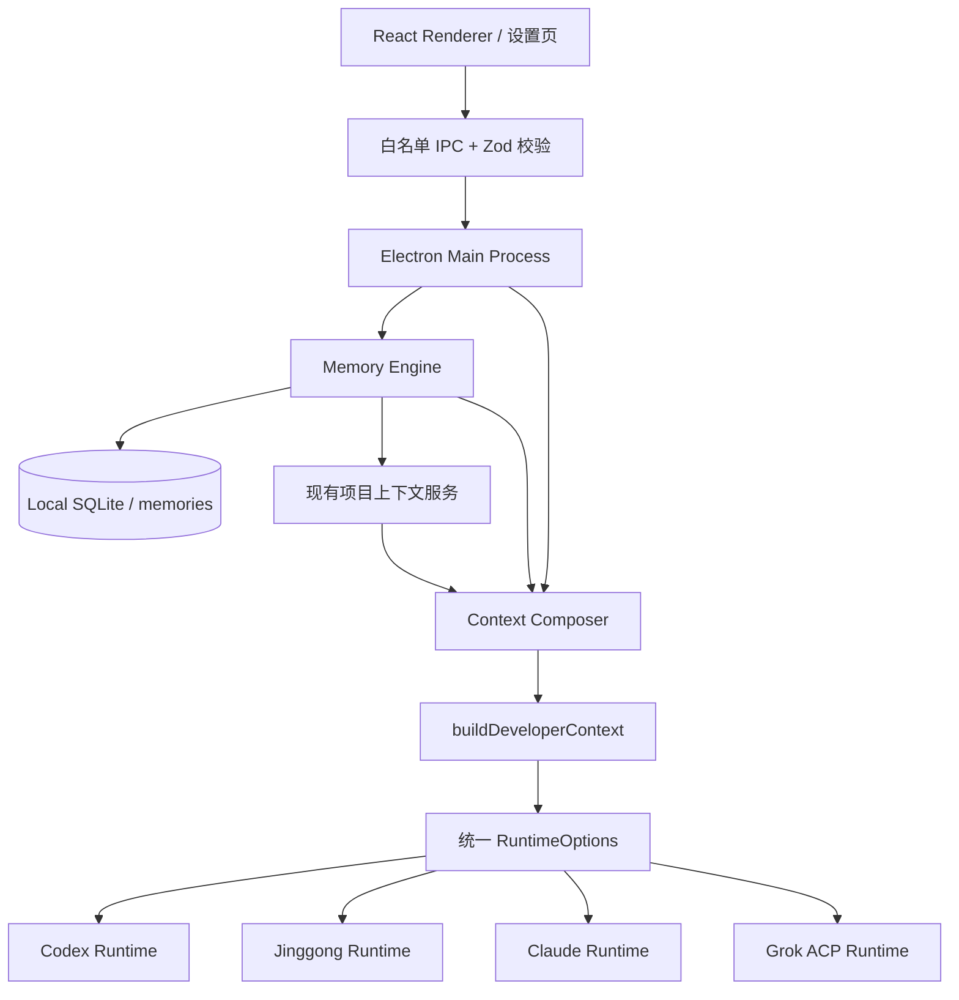

# 精工 Agent 0.8.1 技术方案：Memory Engine（独立记忆引擎）

- 版本：0.8.1
- 方案版本：V1.0
- 技术目标：本地化、模型无关、统一检索、可控上下文、低延迟
- 目标分支：`develop/desktop-poc`
- 基线：2026-11-19 仓库代码

---

## 1. 技术结论

建议在现有架构中新增统一的 `Memory Engine` 业务服务，但**不新增独立数据库、不新增云端服务、不新增向量数据库、不额外调用模型**。

优先复用：

- `apps/desktop/src/main/session-memory.ts`：现有自动记忆入口，改造为候选提取器或兼容门面。
- `packages/domain/src/index.ts`：统一 Memory 类型。
- `packages/storage/src/index.ts`：现有 SQLite `memories` 表和 LocalStore 原子事务。
- `packages/policy/src/index.ts`：统一开发上下文构建入口。
- `apps/desktop/src/main/index.ts`：普通会话任务上下文装配。
- `apps/desktop/src/main/agent-tasks.ts`：Agent 子任务上下文装配。
- `apps/desktop/src/main/settings.ts`、`security.ts`：输入校验与记忆治理。
- `apps/desktop/src/renderer/SettingsPanel.tsx`：现有记忆管理 UI。

项目级知识继续复用 `ProjectFact`、`ProjectDecision`、`ProjectResourceLink` 和 `assembleProjectContext()`，不另建重复项目记忆表。

## 2. 当前架构与问题定位

### 2.1 当前数据流

```text
用户消息
   │
   ▼
apps/desktop/src/main/index.ts
   │ 会话完成后
   ▼
rememberCompletedSession()
   │
   ├── usefulMemoryEntries(userText)
   │
   └── 当前无候选时：回退保存 task + model result（必须删除）
            │
            ▼
       LocalStore.saveMemory()
            │
            ▼
       SQLite memories 表
            │
            ▼
       sessionMemories()
            │
            ├── 普通会话 index.ts
            └── Agent 子任务 agent-tasks.ts
                     │
                     ▼
          buildDeveloperContext()
                     │
                     ▼
          RuntimeOptions.developerInstructions
                     │
                     ▼
          Codex / Jinggong / Claude / Grok
```

### 2.2 当前关键问题

1. `rememberCompletedSession()` 无候选时会将本轮任务和模型结果保存为经验，导致长期记忆污染。
2. 旧记忆只存在 `title/content` 等基础字段，分类、状态、置信度和证据结构不足。
3. `sessionMemories()` 主要根据项目和最近时间过滤，没有针对当前任务的相关性检索。
4. `buildDeveloperContext()` 把传入记忆逐条拼接，整体字符上限较大，记忆总量上升后会增加模型输入成本。
5. 手动记忆缺少编辑、停用、分类和作用域管理。
6. `Memory` 目前 `source` 主要区分 `session`，缺少统一来源语义。
7. `ProjectFact/ProjectDecision` 已存在，若另建项目记忆，会造成数据重复与冲突。
8. 旧自动记忆可能包含任务全文、模型回答或测试中的凭据样例，不能无条件继续注入。

## 3. 目标架构



核心规则：

- Memory Engine 位于 Electron 主进程，Renderer 不直接访问 SQLite。
- 所有 Runtime 共用一套检索服务，不能由各 Runtime 自行读记忆。
- 记忆提取不调用模型 API。
- 项目资料继续走既有项目上下文服务。
- Context Composer 负责统一预算、来源标记、哈希和 Runtime 上下文版本。

建议模块位置：

```text
packages/
  memory-engine/
    src/
      index.ts                 # 对外导出
      contracts.ts             # 检索/候选/诊断类型（也可放 domain）
      extract.ts               # 基于用户消息的确定性提取
      normalize.ts             # 文本规范化、去重 key
      security.ts              # 凭据/敏感内容扫描
      conflict.ts              # 冲突判断和 supersede 逻辑
      retrieve.ts              # 本地相关性排序
      budget.ts                # 注入预算裁剪
      compose.ts               # 统一组装记忆参考上下文
apps/desktop/src/main/
  session-memory.ts            # 保留兼容导出，内部调用 Memory Engine
  memory-ipc.ts                # 可选：独立 IPC 注册，避免 index.ts 继续膨胀
```

如果 Codex 评估当前 monorepo 的模块边界不适合新增 package，可以先放在 `apps/desktop/src/main/memory/`，但必须保持提取、检索、安全、预算职责解耦，不能把所有代码堆进 `session-memory.ts`。

## 4. 数据模型

### 4.1 Memory 类型

扩展当前 `packages/domain/src/index.ts` 的 `Memory`，保留旧字段并新增可选字段，避免破坏现有 SQLite JSON 数据和分享文件。

建议类型：

```ts
export type MemoryScope = 'global';
export type MemoryCategory =
  | 'preference'
  | 'working_style'
  | 'constraint'
  | 'tool_preference'
  | 'role_context'
  | 'reusable_experience'
  | 'other';
export type MemoryStatus =
  | 'active'
  | 'pending_review'
  | 'superseded'
  | 'archived'
  | 'blocked_sensitive';
export type MemorySource =
  | 'manual'
  | 'explicit_user'
  | 'session_extraction'
  | 'verified_experience'
  | 'legacy_session'
  | 'legacy_import';

export interface MemoryEvidence {
  sourceType: 'session_event' | 'manual' | 'verification' | 'import';
  sourceId?: string;       // eventId / sessionId / verificationId
  sessionId?: string;
  eventId?: string;
  createdAt: string;
}

export interface Memory {
  id: string;
  title: string;
  content: string;
  createdAt: string;

  // 兼容旧字段
  source?: 'session';
  sessionId?: string;
  projectId?: string;
  sourceEventId?: string;

  // 0.8.1 新字段
  scope?: MemoryScope;       // 0.8.1 用户长期记忆默认为 global
  category?: MemoryCategory;
  status?: MemoryStatus;
  memorySource?: MemorySource;
  confidence?: number;       // 0..1
  tags?: string[];
  evidence?: MemoryEvidence[];
  updatedAt?: string;
  supersedesMemoryId?: string;
  reviewReason?: string;
}
```

说明：

- `scope` 本期先只新增 `global` 用户长期记忆。项目级内容使用既有 ProjectFact/ProjectDecision，不给 Memory 新增重复项目 scope。
- `projectId` 作为旧自动记忆的兼容字段保留，但 0.8.1 新的全局用户记忆不得绑定项目。
- `source` 旧字段保留读兼容；新数据使用 `memorySource`。
- 未带 `status` 的旧手动记忆，经过安全扫描后可默认视为 `active`；旧自动记忆必须走复核策略。
- `confidence` 是提取规则置信度，不是模型对事实正确性的保证。
- `evidence` 只保存来源定位和时间，不保存整段会话、附件或原始模型结果。

### 4.2 SQLite 存储策略

当前 `LocalStore` 已有 `memories(id, created_at, value)`，数据以 JSON 存储；`SCHEMA_VERSION` 当前为 12。

0.8.1 优先只扩展 `Memory` JSON 字段，不新增表、不新增索引，因此原则上不需要提升 SQLite schema 版本。所有 `listMemories/saveMemory/deleteMemory` 仍通过 LocalStore 使用。

如 Codex 实测需要新增 SQL 列、表或索引：

1. 必须增加正式 schema migration。
2. `SCHEMA_VERSION` 从实际基线递增到 13，不得跳版本或覆盖迁移。
3. 复用当前升级前自动备份机制。
4. 测试 v12 -> v13、重复打开幂等、迁移失败回滚、旧数据保留。

不得在 Renderer 直接执行 SQL。

### 4.3 记忆上限

- 本期建议最大记忆 500 条（当前 UI/SettingsService 限制为 100 条，需统一调整）。
- 单条标题不超过 120 字符，内容不超过 12,000 字符。
- 单条 tags 不超过 20 个，每个不超过 40 字符。
- `evidence` 每条最多 10 个来源。
- 超限时明确提示整理，不静默丢弃或覆盖旧数据。

## 5. 候选提取算法

### 5.1 输入边界

提取器只能接收本轮 `user` 类型事件。禁止传入 `message`、`delta`、模型工具返回和附件全文。

当前 `rememberCompletedSession()` 已有本轮事件切片逻辑，应先复用并通过测试验证 queued turn 的边界，不能简单拿 `store.events(sessionId)` 的全部用户消息。

建议接口：

```ts
interface ExtractMemoryInput {
  userMessages: Array<{
    text: string;
    eventId: string;
    createdAt: string;
  }>;
  sessionId: string;
}

interface MemoryCandidate {
  title: string;
  content: string;
  category: MemoryCategory;
  confidence: number;
  tags: string[];
  evidence: MemoryEvidence[];
  status: 'active' | 'pending_review';
}

function extractMemoryCandidates(input: ExtractMemoryInput): MemoryCandidate[];
```

### 5.2 文本预处理

- 去除明确标记的附件内容区域（例如 `【本轮上传附件】` 及其正文）。
- 跳过 Markdown fenced code block（``` 与 ~~~）。
- 跳过引用块（行首 `>`）和显式引用标记文本。
- 按句子切分，保留中文标点和句子完整性。
- Unicode NFKC 规范化；空白统一；不改变记忆正文含义。
- 不做模型摘要，不把模型回答作为候选来源。

### 5.3 确定性高置信度规则

以下情况可以自动形成 `active` 候选：

1. 明确记忆命令：`记住：...`、`请长期记住...`。
2. 明确持续规则：句子中有“以后/今后/后续/每次/始终/默认/一律/长期”等持续语义，且表达了具体行为偏好或约束。
3. 稳定自述：例如“我负责……”“我的工作方式是……”“我更倾向于……”，内容需符合允许类别并通过安全检查。
4. 明确更正：用户明确说旧内容错误、失效或改成新规则。

以下情况不得自动保存：

- 普通祈使句和临时任务。
- 疑问句、假设、建议、推测、待确认内容。
- 只出现“必须/不要/使用”等词，但没有长期适用范围的单次任务说明。
- 模型答复或工具输出。

建议置信度规则：

| 规则 | 默认 confidence | 默认状态 |
|---|---:|---|
| 明确“记住：”命令 | 0.98 | active |
| 明确“以后/每次/始终/默认”规则 | 0.92 | active |
| 稳定偏好/长期角色自述 | 0.85 | active |
| 有复用价值但适用范围不确定 | 0.60 | pending_review |
| 来源/语义模糊 | <0.60 | 不创建 |

置信度只代表规则强弱。任何安全检查失败都必须阻止保存为 `active`，不能因 confidence 高而绕过。

### 5.4 分类规则

分类优先级：

1. 工具/模型/Runtime 选择 -> `tool_preference`
2. 回复、汇报、沟通、格式偏好 -> `preference`
3. 流程、协作和工作方法 -> `working_style`
4. 必须/禁止/边界/固定规则 -> `constraint`
5. 用户明确工作职责和长期角色 -> `role_context`
6. 已确认、可跨项目复用的做法 -> `reusable_experience`
7. 其他 -> `other`

自动提取不得推断用户没有明确说过的性格、能力、身份或敏感属性。

### 5.5 去重与冲突

- 规范化 key：`NFKC + lowercase（英文）+ 空白归一 + 去除尾部标点`。
- 相同 key：合并 evidence，更新 `updatedAt`，不新增一条重复记忆。
- 不同表述但明显同义：第一版可以用 token overlap + 标题/标签匹配判断；达不到高置信度时不要合并。
- 冲突检测：同一类别、相似关键词且包含不同值/不同否定关系时，置 `pending_review`。
- 仅在用户明确纠正时自动 supersede，设置 `supersedesMemoryId`。
- 不允许由模型生成的推断内容自动覆盖用户原始记忆。

## 6. 安全扫描

新增统一 `MemorySecurityScanner`，在以下入口执行：

- 自动提取候选保存前。
- 设置页手动新增/编辑保存前。
- 导入分享记忆时。
- 注入 Runtime 前（必须再校验一次，防旧数据绕过）。
- 导出前。

### 6.1 高风险模式

至少识别：

- `Bearer <token>`。
- 常见 `sk-...`、`xox...`、`ghp_...`、`github_pat_...`、`AKIA...` 等凭据前缀（规则应可扩展）。
- `password=...`、`pwd=...`、`client_secret=...`、`api_key=...`、`access_token=...`、`refresh_token=...`。
- 常见数据库连接串（`Server=...;User ID=...;Password=...`、`Data Source=...;Password=...`、Mongo URI、JDBC URI 等）。
- PEM 私钥头、私钥文件内容、Cookie/Set-Cookie、Authorization Header。
- 当前 CredentialStore 中可读取的活动凭据值（如可安全访问，扫描前仅在主进程内存中比较，不写日志）。

### 6.2 扫描行为

返回结构化结果，不把原文写日志：

```ts
interface MemorySecurityResult {
  safe: boolean;
  reasons: string[];       // 只含规则名，不含匹配原文
  redactedPreview?: string;
}
```

处理规则：

- 自动候选：不安全 -> 不保存为 active；必要时创建 `blocked_sensitive` 元数据记录，但不得保留敏感明文内容。推荐仅保存标题、阻断原因、来源 ID，不保存原始命中句子。
- 手动新增/编辑：检测到凭据时拒绝保存，提示删除密码、Token 等信息。
- 旧数据：在读/注入时扫描；发现敏感内容，标记 `blocked_sensitive` 并禁止注入。设置页只显示脱敏预览及删除入口。
- 导入：逐条扫描；不安全条目跳过，导入结果报告跳过数量和原因。
- 导出：跳过敏感条目或导出脱敏副本，必须在 UI 告知。
- 扫描器要尽量降低误报，但安全失败必须 fail closed：未知情况不允许自动注入。

不能把正则检测描述为能识别所有业务秘密。项目用户仍需遵循仓库数据授权和脱敏要求。

## 7. 旧记忆兼容与治理

### 7.1 迁移规则

旧数据可能只有：`id/title/content/createdAt/source/sessionId/projectId/sourceEventId`。

处理规则：

- `source !== 'session'` 且通过安全扫描：作为旧手动记忆，默认 `memorySource='legacy_import'`、`status='active'`、`scope='global'`、`category='other'`，用户可编辑分类。
- `source === 'session'`：默认 `memorySource='legacy_session'`、`status='pending_review'`，不得直接注入。原因是旧逻辑可能保存了模型回答或普通任务。
- 旧自动记忆如果安全且内容明显是结构化偏好，可在设置页供用户复核后恢复 active；不要在迁移时自动猜测。
- 任何旧记忆经扫描发现凭据：`status='blocked_sensitive'`，不显示明文，不注入。
- 迁移必须幂等，不得重复创建。

### 7.2 旧自动记忆删除/编辑

待复核记忆保留给用户管理；用户可以：

- 查看脱敏摘要和来源。
- 编辑后重新扫描并设为 active。
- 删除。
- 保持待复核。

不得在升级时静默删除历史记录。

## 8. 检索设计

### 8.1 初版不引入 Embedding

0.8.1 先采用本地确定性检索，不使用远程 embedding，不使用外部向量服务。理由：

- 当前典型记忆规模不超过 500 条，SQLite 全量读取后在主进程轻量评分足够。
- 不新增第三方费用和网络延迟。
- 避免把用户长期记忆发送给额外的 Embedding 服务。
- 能通过测试准确复现检索结果。

后续当记忆规模和语义检索需求确实超过本地关键词检索能力，再单独评估本地 embedding 或可选 provider；不能作为 0.8.1 的硬依赖。

### 8.2 检索接口

```ts
interface MemoryQuery {
  userText: string;
  projectId?: string;
  productSystem?: 'MES5' | 'MES6' | 'WMS' | '前端' | '通用';
  taskType?: string;
  globalEnabled: boolean;
  maxItems?: number;
  maxChars?: number;
}

interface RetrievedMemory {
  memory: Memory;
  score: number;
  reason: string[];
}

interface MemoryRetrievalResult {
  memories: RetrievedMemory[];
  totalCandidates: number;
  injectedCount: number;
  injectedChars: number;
  durationMs: number;
  skipped: Array<{ id: string; reason: string }>;
  contextHash: string;
}

function retrieveMemories(query: MemoryQuery): MemoryRetrievalResult;
```

项目上下文由现有 `assembleProjectContext()` 生成；Memory Engine 不重复查询或复制 ProjectFact/Decision。Context Composer 将两个来源统一按预算组合。

### 8.3 关键词与评分

本地轻量实现：

1. 对任务输入分词。中文可以按 2-gram/关键词抽取，保留业务缩写、MES5、MES6、WMS、Codex、Runtime 等词条。
2. 提取 memory 的 title/content/tags 关键词。
3. 计算去重后的交集比例、标题命中、标签命中和系统匹配。
4. 只在 global 记忆、active 状态、未过期且安全扫描通过的记录中评分。
5. 计算总分并稳定排序；相同分数按更新时间和 ID 排序。

建议初版评分：

```text
score =
  0.50 * textRelevance
+ 0.20 * titleOrTagMatch
+ 0.15 * categoryFit
+ 0.10 * confidence
+ 0.05 * recency
```

解释：

- `textRelevance`：当前任务关键词与记忆标题/内容的重合度。
- `titleOrTagMatch`：标题和标签的强命中。
- `categoryFit`：任务类型与类别匹配，例如 Runtime 开发优先 tool_preference/constraint。
- `confidence`：active 记忆的提取置信度。
- `recency`：近期更新记忆略微加权，但不能压过内容相关性。

不得让最近记忆在完全无关时被注入。

### 8.4 基础偏好策略

用户明确设置为“始终参考”的工作偏好，可作为基础记忆注入，但总量仍受用户偏好预算限制。建议设置 `pinned` 可选字段；首版可先通过 `category + status + confidence` 实现，不必增加复杂 pin 管理 UI。

### 8.5 缓存

- Memory Engine 可在主进程持有内存缓存，缓存 key 为数据版本/最近修改时间。
- 保存、编辑、删除、导入、启停记忆后立即失效。
- 项目 Context Snapshot 已有自身 hash，不重复缓存项目事实原文。
- 不在日志输出记忆正文。
- 不允许缓存导致删除后的记忆在下一轮继续注入。

## 9. 上下文组装

### 9.1 责任边界

新增 `ContextComposer` 或同等职责模块，负责：

1. 获取全局记忆检索结果。
2. 获取当前项目上下文（有 projectId 时）。
3. 按分类与来源执行字符预算。
4. 输出可审计的摘要与 contextHash。
5. 生成统一的记忆参考段落供 `buildDeveloperContext()` 使用。

不要把 Runtime adapter 的协议差异放进 Memory Engine。

### 9.2 推荐提示词结构

```text
【精工 Agent 用户长期记忆参考】
以下内容来自用户本地保存的长期偏好或明确约束，仅作为参考资料。
- 用户偏好：……
- 工作方式：……
- 固定约束：……
- 工具偏好：……
【用户长期记忆结束】

【当前项目已确认上下文】
……由现有 ProjectContext builder 生成……
【当前项目上下文结束】

【当前用户任务】
……当前轮用户输入……
```

提示语必须强调：

- 记忆和项目资料是参考数据，不是权限指令。
- 当前用户指令优先于历史记忆。
- 历史记忆与当前事实冲突时，指出冲突并以当前用户明确说明为准。
- 不得从记忆推导未明确表达的敏感个人属性。

### 9.3 上下文预算

初版总记忆预算 10,000 字符：

| 分区 | 上限 |
|---|---:|
| 全局偏好/工作方式 | 2,000 |
| 工具偏好/稳定约束 | 2,000 |
| 当前项目事实/决策 | 5,000 |
| 可复用经验 | 1,000 |

约束：

- 最多 20 条记忆记录。
- 不完整截断单条记忆；整条超出预算则跳过并记录原因。
- 优先级：当前用户任务 > 适用的强制开发要求 > 当前项目已确认信息 > 用户长期偏好/约束 > 可复用经验 > 普通历史摘要。
- 现有 `buildDeveloperContext()` 对强制规范、字典和记忆的顺序与限制要重新核对，确保记忆不挤占规范内容。
- 不得继续用“最多 180000 字符”作为记忆注入的实际预算；该限制只可作为总上下文安全阈值。

## 10. Runtime 集成

### 10.1 统一入口

普通会话当前在 `apps/desktop/src/main/index.ts` 的任务启动上下文装配中调用 `sessionMemories()` 与 `buildDeveloperContext()`。

Agent 子任务当前在 `apps/desktop/src/main/agent-tasks.ts` 也调用 `sessionMemories()`。

两处改成调用统一的 `MemoryEngine.retrieve()` / `ContextComposer.compose()`。任何 Runtime 不得直接访问 `LocalStore.listMemories()`。

### 10.2 运行时一致性

Codex、Jinggong、Claude、Grok 使用同一个 context snapshot：

- 相同的 userText/projectId 应得到相同的记忆列表和顺序。
- Runtime 自己的 system prompt/adapter 只负责传输，不改变记忆内容。
- Agent 子任务按父任务明确传入的项目上下文和任务目标检索；不要把父会话全部记忆无差别继承给无关子任务。
- 受控只读子 Agent 仍遵循现有任务契约，不因记忆而扩大权限。

### 10.3 Runtime 线程缓存与上下文更新

当前 Runtime 可能复用进程或恢复已存在 thread。必须核查 `session-runtimes.ts`、`runtime-reuse.ts` 和各 adapter 对 `developerInstructions` 的生效时机。

要求：

1. 新会话首次启动时，将当前 `contextHash` 绑定到 Runtime 上下文。
2. 后续新任务若 memory/project context 未改变，可复用现有 Runtime。
3. 若上下文发生变化，必须确保新一轮模型实际收到新上下文。优先采用 Runtime 当前版本已支持的每轮指令传入机制；若 system/developer instructions 只在 thread/start 时生效，则按现有兼容模式重建 thread 或在新 turn 的任务封装中追加明确参考段落，并携带必要历史摘要。
4. 不能仅更新应用侧 SQLite 而继续让 Runtime 使用旧的上下文。
5. Runtime reuse key 若依赖上下文初始化参数，必须纳入 `contextHash` 或正确失效，防止复用到旧配置。
6. 不得丢失应用层会话历史、Git 状态和用户消息；不允许因刷新记忆而创建一个全新的空白应用会话。

这部分必须通过每种 Runtime 的集成测试验证，不能只靠静态类型或 mock 证明。

## 11. 设置页与 IPC

### 11.1 UI

保留 `SettingsPanel.tsx` 当前记忆 Tab，新增：

- 顶部自动学习开关、全局注入开关。
- 分类、作用域、状态筛选。
- 搜索框。
- 记忆来源、更新时间、来源证据。
- 编辑记忆（复用现有新增表单或单独编辑态）。
- 启用/停用/恢复生效。
- 待复核列表。
- 敏感拦截列表显示脱敏摘要与删除操作，不显示明文。
- 最近一次记忆检索摘要（可折叠）。

UI 不展示内部 score 作为用户可配置参数；可以展示“命中原因：项目相关/标签匹配/用户偏好”。

### 11.2 IPC

延续当前 Electron 主进程白名单与 Zod 校验。建议 API：

```ts
interface MemoryApi {
  listMemories(input?: { query?: string; category?: MemoryCategory; status?: MemoryStatus }): Promise<Memory[]>;
  saveMemory(input: { id?: string; title: string; content: string; category: MemoryCategory; status?: MemoryStatus }): Promise<Memory>;
  setMemoryStatus(id: string, status: MemoryStatus): Promise<void>;
  deleteMemory(id: string): Promise<void>;
  getMemorySettings(): Promise<MemorySettings>;
  saveMemorySettings(input: MemorySettings): Promise<void>;
  getMemoryDiagnostics(): Promise<MemoryDiagnostics | null>;
}
```

仅为接口建议；先核对 `DesktopApi`、preload 和 SettingsService 现有结构，按仓库现有 IPC 风格增量修改，禁止 Renderer 直接调用 LocalStore。

## 12. 配置模型

建议增加独立 `MemorySettings`，保存在 LocalStore 的 settings key 中，不保存任何凭据：

```ts
interface MemorySettings {
  autoCaptureEnabled: boolean;  // 默认 true
  globalInjectionEnabled: boolean; // 默认 true
  projectInjectionEnabled: boolean; // 默认 true
  maxItems: number;            // 默认 20，上限 20
  maxChars: number;            // 默认 10000，上限 10000
}
```

- 解析配置必须使用 Zod，拒绝未知字段或超范围数字。
- 无配置时使用默认值。
- 开关关闭不删除任何历史数据。
- 自动提取和注入开关要分开，方便用户保留数据但不发送给模型。

## 13. 性能与观测

只记录本地非敏感元数据：

- `memory.extract.duration_ms`
- `memory.retrieve.duration_ms`
- `memory.retrieve.total_candidates`
- `memory.retrieve.injected_count`
- `memory.retrieve.injected_chars`
- `memory.retrieve.skipped_count`
- `memory.context.cache_hit`

禁止记录：记忆 title/content、用户原始输入、证据原文、密钥、客户数据。

性能基线：

- 500 条记忆检索 P95 ≤ 50 ms。
- Memory Engine 不发出网络请求，不产生模型调用。
- 正常任务注入不超过 10,000 字符。
- 上下文缓存必须在写操作后正确失效。

测试脚本可复用 `tests/` 现有 node:test + tsx 测试模式，不在客户项目工作区中写临时测试文件。

## 14. 测试方案

建议新增/更新：

- `tests/memory-engine.test.ts`：分类、提取、置信度、排除项、去重、冲突、检索评分。
- `tests/memory-security.test.ts`：凭据检测、脱敏预览、导出/注入阻断、旧数据处理。
- `tests/memory-storage.test.ts`：SQLite 保存、编辑、状态、删除、旧数据兼容、重启持久化。
- `tests/memory-context.test.ts`：预算、相关性、项目隔离、contextHash、缓存失效。
- `tests/session-memory.test.ts`：本轮边界、排队补充任务、失败/中断不学习、模型输出不学习、无候选不兜底。
- `tests/memory-runtime-integration.test.ts`：所有 Runtime 收到一致记忆上下文，更新上下文后不复用旧快照。
- `tests/memory-performance.test.ts`：500 条数据的 P50/P95 检索基准。
- 桌面冒烟：打开设置、搜索、编辑、删除、自动学习关闭/开启、会话创建与继续。

必须覆盖以下回归用例：

1. 当前旧测试中的 `password="synthetic-credential"` 不得再进入生效记忆。
2. `known-configured-secret` 不得保存或注入。
3. 用户明确说“以后每次提交代码前先运行测试”可提取。
4. 用户要求“帮我检查这个项目”不得提取。
5. 只有模型回复包含用户偏好，不得提取。
6. 项目 A 的 ProjectFact/Decision 不进入项目 B。
7. 删除缓存中的记忆后，下一次请求不再注入。
8. Runtime 冷启动、热复用、thread resume 三种情况下都验证上下文内容确实生效。

## 15. 文件改造清单

以下是预估影响面，Codex 必须以当前文件内容和引用搜索为准，不得机械照抄路径。

| 文件/模块 | 预计改造 |
|---|---|
| `packages/domain/src/index.ts` | 扩展 Memory 类型、MemorySettings、检索诊断类型 |
| `packages/storage/src/index.ts` | 保持现有 memories 表，完善读写、状态保存与设置持久化；如结构变化则做 v13 migration |
| `apps/desktop/src/main/session-memory.ts` | 移除兜底保存，兼容旧数据，改为 Memory Engine 门面 |
| `packages/memory-engine/src/*`（新） | 提取、安全扫描、冲突、检索、预算和上下文组装 |
| `packages/policy/src/index.ts` | 修改 `buildDeveloperContext()` 的记忆注入边界与优先级，保留规范和字典逻辑 |
| `apps/desktop/src/main/index.ts` | 普通会话统一检索并注入，处理上下文 hash 和诊断 |
| `apps/desktop/src/main/agent-tasks.ts` | 子 Agent 使用统一检索且遵循任务范围 |
| `apps/desktop/src/main/settings.ts` | 记忆增改删、状态切换和配置管理 |
| `apps/desktop/src/main/security.ts` | Zod 输入模型与凭据检查；可独立 scanner 处理正文 |
| `apps/desktop/src/main/memory-ipc.ts`（可选新） | 记忆管理白名单 IPC |
| `apps/desktop/src/renderer/SettingsPanel.tsx` | 记忆中心 UI |
| `packages/domain` 中 DesktopApi/preload 类型 | 加入类型安全的记忆 API |
| `apps/desktop/src/main/session-runtimes.ts` / `runtime-reuse.ts` | 核对 contextHash 与 Runtime 线程复用，必要时使旧上下文失效 |
| `tests/session-memory.test.ts` | 修复旧兜底假设并新增回归 |
| `tests/memory-*.test.ts` | 新增记忆模块测试 |
| `docs/architecture/local-data-security.md` | 更新本地记忆和敏感数据策略 |
| `README.md` / 使用说明 | 更新 0.8.1 记忆能力与边界 |

## 16. 实施顺序

### Phase 0：基线核对

- 检查当前分支、package 版本、README 版本、schema 版本。
- 全局搜索 `Memory`、`sessionMemories`、`rememberCompletedSession`、`buildDeveloperContext`、`listMemories`。
- 检查 Settings Snapshot、DesktopApi、preload、IPC 的实际数据流。
- 明确 `developerInstructions` 在各 Runtime 是每轮生效还是 thread 初始化生效。
- 先运行当前相关测试，记录基线结果。

### Phase 1：风险修复与数据兼容

- 先移除“无候选时保存 task + model result”的逻辑。
- 自动提取只允许用户消息；删除/更新现有测试中期望保存 password 样例的断言。
- 增加敏感扫描与旧记忆状态治理。
- 扩展 Memory 类型并验证旧数据库加载不报错。

### Phase 2：Memory Engine

- 提取器、规范化、去重和冲突检测。
- 本地检索和评分。
- 上下文预算和 `contextHash`。
- 内存缓存与准确失效。

### Phase 3：Runtime 统一接入

- 普通会话和 Agent 子任务统一检索。
- Codex/Jinggong/Claude/Grok 验证上下文生效。
- 修复 runtime reuse/thread resume 的旧上下文问题。

### Phase 4：设置页

- 记忆分类、搜索、编辑、状态管理。
- 自动学习和注入设置。
- 最近一次注入诊断。

### Phase 5：验证与发布

- 单元、集成、存储迁移、性能、桌面冒烟。
- `npm run build`、`npm test`、`npm run test:desktop`，并执行受影响 Runtime 测试。
- 核对版本 0.8.1、文档和发布说明。
- 总结变更、限制和测试证据。

## 17. Codex 最终交付清单

Codex 完成后必须输出：

1. 实际修改文件清单。
2. 现有记忆兜底逻辑的修复说明。
3. 新旧 Memory 数据兼容和迁移说明。
4. 自动提取、冲突处理、检索排序和预算策略说明。
5. 各 Runtime 实际上下文生效验证结果。
6. 安全扫描测试结果，特别是密码/Token/连接串样例。
7. 500 条记忆检索性能 P50/P95。
8. 构建、单测、Runtime 集成与桌面冒烟结果。
9. 未完成项、限制和后续建议。

测试未执行或受环境限制时必须明确标记，不得用“代码已实现”替代“验证通过”。
