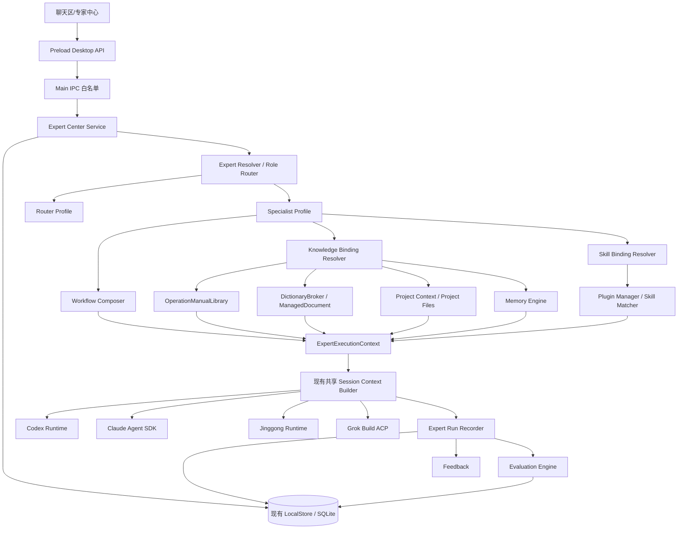
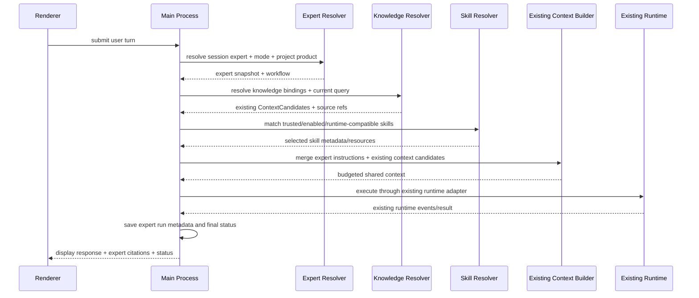

# 精工 Agent 0.9.3 专业能力体系技术实施文档（角色细分版）

> 文档类型：技术设计与实施方案  
> 版本：V1.1  
> 目标版本：0.9.3  
> 当前基线：0.9.2  
> 目标分支：`develop/desktop-poc`  
> 应用形态：Windows 桌面客户端（Electron + React + TypeScript）  
> 日期：2026-11-21  
> 使用对象：Codex 实施开发

---

## 1. 技术目标

本技术方案在当前 0.9.2 架构中增加“专家能力编排层”，通过路由专家（Router Profile）、细分专业角色（Specialist Profile）、工作流、知识绑定、Skill 匹配和角色评测，将已存在的产品知识、开发规范、项目交付资料、任务治理和 Runtime 能力组合成一致的专业工作体验。工程研发与项目交付各有一个路由入口，下面配置可单独评测的细分角色。

本功能不是新建 Agent Runtime，也不是重新开发一套知识库。专家配置应由桌面应用本地管理，在调用模型前由平台构建统一 `ExpertExecutionContext`，再交给当前会话既有上下文组装流程。Codex、Claude Agent SDK、精工 Runtime、Grok Build 不应各自实现一套专家业务逻辑。

### 1.1 必须遵循的技术原则

1. **源码优先**：Codex 开始编码前，必须从当前 `develop/desktop-poc` 分支读取实际源码；本文的路径是已核对基线，不代表未来实现永远不变。
2. **复用优先**：复用 OperationManualLibrary、DictionaryBroker、PluginManager、Skill Matcher、Memory Engine、Context Candidate、LocalStore、IPC 和现有 Runtime Context Builder。
3. **平台编排、Runtime 执行**：专家只负责组装上下文和工作流，不直接调用模型 API，不维护模型凭据。
4. **统一注入**：专家上下文只在共享会话上下文入口合并一次，避免各 Runtime 逻辑漂移。
5. **确定性快照**：每轮执行记录专家 ID、版本、Hash、工作模式、产品范围和知识/Skill 来源。
6. **最小权限**：专家档案不具有授予权限的能力，不得改变当前会话和 Task Contract 的权限。
7. **评测驱动**：建设可复现基准集；不以“专家可以正常回复”作为完成标准。
8. **安全降级**：专家配置、知识服务或 Skill 加载失败时，允许退回普通 Agent 行为并显示原因，不阻断基础对话。
9. **角色不等于 Agent**：细分角色只是同一会话中的专业上下文、知识/Skill 策略和工作流配置；0.9.3 不为每个角色启动独立 Runtime 或子 Agent。
10. **产品系统与专业角色分离**：MES5/MES6/WMS 是项目产品维度；后端/前端/全栈/需求是任务专业维度，不能混为同一个字段。

---

## 2. 已核对的 0.9.2 架构基线

以下信息来自当前目标分支源码读取。Codex 开始开发时仍需复核，不能假设远端分支没有变化。

### 2.1 根工程

- `package.json` 版本为 `0.9.2`。
- Node.js 24、TypeScript 5.9、Electron 45、React 19、sql.js、zod。
- 正式命令：`npm run build`、`npm test`、`npm run test:desktop`。
- 当前 SQL schema version 在 `packages/storage/src/index.ts` 中为 `17`，新增迁移前需确认分支最新值和所有迁移顺序。

### 2.2 核心代码目录

```text
apps/desktop/src/
  main/
    index.ts
    context-sources.ts
    operation-manual-library.ts
    operation-manual-worker.ts
    agent-orchestration.ts
    plugin-manager.ts
    learning-engine.ts
    task-governance-ipc.ts
    verification-service.ts
  preload/
    index.ts
  renderer/
    App.tsx
    OperationManualsPanel.tsx
    PluginManagerPanel.tsx
    LearningEnginePanel.tsx
    TaskGovernancePanel.tsx

packages/
  domain/
  storage/
  operation-manuals/
  dictionary-context/
  knowledge/
  memory-engine/
  plugin-manager/
  agent-orchestrator/
  agent-runtime/
  policy/
  performance/
  verification/
```

### 2.3 已有能力事实

- `packages/operation-manuals/src/index.ts` 已定义 `ManualProductType`，含 `MES5`、`MES6`、`WMS`、`SRM`、`JMOM`、`PDA`、`COMMON`，以及手册状态、版本、章节定位和知识切片。
- `apps/desktop/src/main/operation-manual-library.ts` 已提供本地手册导入/替换/检索服务，包含后台 Worker 和 SHA-256。
- `apps/desktop/src/main/context-sources.ts` 已将手册命中转换为 `ContextCandidate`，并有 `dictionaryContextCandidates`、`memoryContextCandidates`。
- `packages/dictionary-context` 已提供 `search_dictionary` 与 `read_dictionary` 只读工具。
- `packages/knowledge` 已实现资料限制和凭据明文安全检查。
- `packages/plugin-manager/src/skill-matcher.ts` 已提供 `matchSkills`，会根据 Plugin/Skill 信任、启用、兼容性、范围、项目 ID 等进行过滤和排序。
- `packages/domain/src/skill-intelligence.ts` 已定义 Skill 兼容状态和 Skill 使用事件。
- `packages/agent-orchestrator/src/runtime-capabilities.ts` 明确区分 Runtime 能力声明和受控分析认证；当前 `controlledGovernanceValidated` 为 `false`，不能绕过。
- `packages/storage/src/index.ts` 使用 sql.js 本地 SQLite，并由 `LocalStore` 管理多类业务数据。
- `apps/desktop/src/preload/index.ts` 通过 Desktop API 暴露主进程能力。

**特别约束**：不得将专家系统直接叠加到 `agent-orchestration.ts` 中以自动生成子 Agent。0.9.3 是单专家上下文编排，不是多专家任务编排。

---

## 3. 目标架构



### 3.1 组件职责

| 组件 | 职责 | 不负责 |
|---|---|---|
| Expert Center Service | 专家 CRUD、内置专家初始化、版本管理、默认项管理、会话绑定 | 模型调用、知识文件复制 |
| Expert Resolver / Role Router | 先确定专家家族，再根据任务意图解析实际细分角色；支持用户覆盖 | 修改项目产品类型、启动其他 Agent |
| Router Profile | 工程研发总专家/项目交付总专家，保存角色路由规则和默认值 | 亲自执行所有细分岗位任务 |
| Specialist Profile | 保存某个岗位的职责、工作流、知识/Skill 策略和输出标准 | 自行创建 Runtime 或授予权限 |
| Workflow Composer | 按工作模式构建结构化工作流说明和输出约束 | 启动新的 Agent Runtime |
| Knowledge Binding Resolver | 转换专家知识绑定规则，调用现有来源和过滤接口 | 保存知识正文副本 |
| Skill Binding Resolver | 使用 PluginManager 和 SkillMatcher 得到可用 Skill | 绕过信任/兼容校验 |
| Expert Context Builder | 聚合角色、工作流、知识引用、Skill 摘要、权限边界 | 直接拼装每个 Runtime 专属请求 |
| Expert Run Recorder | 记录专家运行快照、来源 Hash、模式和运行状态 | 保存完整敏感 Prompt/文件正文 |
| Evaluation Engine | 评测案例、运行批次、结果评分、对照统计 | 宣称模型客观真值或自动修改专家定义 |

---

## 4. 新增/扩展代码边界

### 4.1 推荐目录

```text
packages/domain/src/
  expert.ts                         # 专家数据类型与 Desktop API 契约
  index.ts                          # 导出 expert.ts

packages/expert-engine/src/         # 若确认没有可复用模块，再新增
  index.ts                          # profile 校验、解析优先级、模式解析
  defaults.ts                       # 内置路由专家、细分角色和工作流定义
  role-router.ts                    # 角色路由纯函数与优先级规则
  workflow.ts                       # 纯函数工作流构建
  context.ts                        # Router + Specialist 的 ExpertExecutionContext 组装
  evaluation.ts                     # 角色评分/指标计算纯函数

apps/desktop/src/main/
  expert-center.ts                  # 专家档案管理与初始化
  expert-context.ts                 # 从现有知识/Skill 模块组装执行上下文
  expert-ipc.ts                     # IPC handlers

apps/desktop/src/renderer/
  ExpertCenterPanel.tsx
  ExpertCenterPanel.css
  expert-state.ts                   # 仅在现有状态管理风格需要时新增

packages/storage/src/index.ts       # 现有 LocalStore 扩展及 SQL 迁移
apps/desktop/src/preload/index.ts   # Desktop API 白名单增加 expert API
apps/desktop/src/renderer/App.tsx   # 聊天入口和专家状态整合
```

目录可调整，但要遵循当前工程模块边界。新增 `packages/expert-engine` 前，必须确认没有可直接扩展的既有纯逻辑模块。不要为了目录整齐而将存储、IPC、UI 逻辑搬进新包。

### 4.2 修改前必须检查的同类实现

Codex 必须先检查以下实现各 2–3 个同类文件：

- `packages/domain` 中已有 API interface 和类型。
- `packages/storage/src/index.ts` 现有表创建、schema migration、CRUD 方法。
- `apps/desktop/src/main` 中的 `plugin-manager.ts`、`operation-manual-library.ts`、`learning-engine.ts`、`task-governance-ipc.ts`。
- `apps/desktop/src/preload/index.ts` 的 API 声明和调用风格。
- `apps/desktop/src/renderer` 中 `PluginManagerPanel.tsx`、`OperationManualsPanel.tsx`、`LearningEnginePanel.tsx`。
- `apps/desktop/src/main/index.ts` 的服务初始化、IPC 注册和关闭生命周期。

不要直接根据本文臆造 IPC 通道名、数据库连接对象、UI 状态管理实现或现有 Context Builder 方法名。

---

## 5. 核心数据契约

以下接口是目标语义契约，实际字段可按仓库当前命名风格调整，但不可丢失关键安全和版本字段。

### 5.1 专家档案

```ts
export type ExpertCategory = 'engineering' | 'delivery' | 'quality' | 'custom';
export type ExpertProfileKind = 'router' | 'specialist';
export type ExpertRoleKey =
  | 'engineering_router'
  | 'requirements_analyst'
  | 'backend_developer'
  | 'frontend_developer'
  | 'fullstack_developer'
  | 'delivery_router'
  | 'project_director'
  | 'project_manager'
  | 'implementation_engineer'
  | 'test_quality'
  | 'custom';
export type ExpertProduct = 'MES5' | 'MES6' | 'WMS' | 'SRM' | 'JMOM' | 'PDA' | 'COMMON' | 'GENERAL';
export type ExpertWorkMode =
  | 'auto'
  | 'requirements'
  | 'backend_development'
  | 'frontend_development'
  | 'fullstack_development'
  | 'implementation_support'
  | 'project_director'
  | 'project_manager'
  | 'implementation_engineer'
  | 'quality'
  | 'combined';

export interface ExpertWorkflowBinding {
  workflowId: string;
  enabled: boolean;
  priority?: number;
}

export interface ExpertKnowledgeBinding {
  sourceType: 'operation_manual' | 'dictionary' | 'project_rules' | 'project_context' | 'session_attachments' | 'memory' | 'delivery_data';
  enabled: boolean;
  productScope?: ExpertProduct[];
  scope: 'global' | 'project' | 'session';
  requiredForModes?: ExpertWorkMode[];
  maxItems?: number;
  priority?: number;
}

export interface ExpertSkillBinding {
  skillId: string;
  mode?: ExpertWorkMode[];
  productScope?: ExpertProduct[];
  selection: 'recommended' | 'pinned';
  enabled: boolean;
}

export interface ExpertRoleRouteRule {
  roleKey: ExpertRoleKey;
  priority: number;
  triggerIntents: string[];
  triggerTerms: string[];
  negativeTerms?: string[];
  requiredSignals?: Array<'backend_files' | 'frontend_files' | 'mixed_files' | 'project_finance' | 'multi_project' | 'single_project' | 'operation_manual' | 'field_issue'>;
}

export interface ExpertProfile {
  id: string;
  familyId: string;
  parentExpertId?: string;
  profileKind: ExpertProfileKind;
  roleKey: ExpertRoleKey;
  name: string;
  description: string;
  category: ExpertCategory;
  version: number;
  builtIn: boolean;
  enabled: boolean;
  isDefault: boolean;
  productScope: ExpertProduct[];
  roleDefinition: string;
  objectives: string[];
  capabilities: string[]; // 描述能力，不代表授予权限
  routeRules?: ExpertRoleRouteRule[]; // router profile only
  workflowBindings: ExpertWorkflowBinding[];
  knowledgeBindings: ExpertKnowledgeBinding[];
  skillBindings: ExpertSkillBinding[];
  outputTemplates: Record<string, string>;
  guardrails: string[];
  contentHash: string;
  createdAt: string;
  updatedAt: string;
}
```

注意：

- `contentHash` 对规范化后的完整配置计算 SHA-256，不包括自身和更新时间。
- 内置档案不能直接被用户覆盖系统定义。用户编辑内置专家时，应复制为 `builtIn=false` 的用户专家或创建覆盖层，按当前 UI 最一致的方式实现。
- 专家能力字段不能映射为 `TaskPermission`，不能写入 Task Contract 的 permissions。
- `skillBindings` 只能保存 Skill ID，不保存 Skill 正文/秘密。

### 5.2 工作流

```ts
export interface ExpertWorkflowStep {
  id: string;
  title: string;
  instruction: string;
  required: boolean;
  outputKey?: string;
}

export interface ExpertWorkflowDefinition {
  id: string;
  name: string;
  version: number;
  category: 'development' | 'backend_development' | 'frontend_development' | 'fullstack_development' | 'requirements' | 'implementation_support' | 'combined' | 'project_director' | 'project_manager' | 'implementation_engineer' | 'quality';
  productScope: ExpertProduct[];
  triggerTags: string[];
  requiredInputs: string[];
  steps: ExpertWorkflowStep[];
  outputSections: string[];
  qualityChecks: string[];
  guardrails: string[];
}
```

工作流是给现有主 Agent 的结构化执行约束。0.9.3 暂不把步骤转换为 AgentTask DAG，不自动启动子 Agent。

### 5.3 会话绑定快照

建议保存以下信息：

```ts
export interface ExpertSessionBinding {
  sessionId: string;
  expertId: string; // 路由专家/专家家族入口 ID，例如 mes-wms-engineering 或 project-delivery
  expertVersion: number;
  expertHash: string;
  selectedBy: 'default' | 'user' | 'project_rule';
  workMode: ExpertWorkMode;
  workModeSource: 'auto' | 'user';
  specialistProfileId?: string; // 用户在当前会话手动锁定的细分角色；自动模式时留空
  productScope: ExpertProduct[];
  snapshotJson: string; // 完整配置快照，经过长度与字段校验
  createdAt: string;
  updatedAt: string;
}
```

绑定快照原则：

- 当前会话内固定使用可追溯配置版本。
- `selectedBy=default` 表示默认专家家族，可按每轮意图临时切换家族，不视为用户锁定。
- `selectedBy=user` 表示用户显式锁定家族/角色，自动路由不得跨家族切换；本轮显式指定仍可覆盖。
- 内置专家更新后，新会话采用新版本；老会话不静默改变。用户可以主动“应用最新专家版本”。
- 当前轮用户临时指定的模式应记录为 turn-level override，不必永久改写会话默认值。
- 若现有 `Session` 持久化机制更适合加字段，可以直接扩展；否则使用独立表。不要同时维护双份权威数据。

### 5.4 执行上下文

```ts
export interface ExpertKnowledgeReference {
  id: string;
  sourceType: string;
  title: string;
  product?: string;
  version?: string;
  locator?: string;
  contentHash: string;
  citation: string;
  relevance?: number;
}

export interface ExpertSkillReference {
  skillId: string;
  pluginId: string;
  name: string;
  pluginVersion?: string;
  pluginHash?: string;
  skillHash?: string;
  selectionSource: 'manual' | 'automatic' | 'pinned';
  compatibility: 'Full' | 'Partial' | 'MetadataOnly';
}

export interface ExpertExecutionContext {
  routerExpertId: string;
  routerExpertVersion: number;
  routerExpertHash: string;
  specialistProfileId: string;
  specialistRoleKey: ExpertRoleKey;
  specialistName: string;
  specialistVersion: number;
  specialistHash: string;
  workMode: Exclude<ExpertWorkMode, 'auto'>;
  workModeSource: 'user' | 'automatic';
  routeReason: string;
  productScope: ExpertProduct[];
  instructions: string;
  workflow: ExpertWorkflowDefinition;
  knowledgeReferences: ExpertKnowledgeReference[];
  skillReferences: ExpertSkillReference[];
  warnings: string[];
  contextHash: string;
}
```

`instructions` 为经过预算控制的文本上下文，`knowledgeReferences` 和 `skillReferences` 是审计摘要。不可把引用元数据当作知识正文；实际知识候选仍进入当前统一 Context Builder。

### 5.5 运行记录

```ts
export interface ExpertRunRecord {
  id: string;
  sessionId: string;
  turnId: string;
  projectId?: string;
  expertId: string; // 路由专家 ID，保持向后查询的统一入口
  expertVersion: number;
  expertHash: string;
  resolvedProfileId: string; // 实际细分角色档案 ID
  resolvedRoleKey: ExpertRoleKey;
  resolvedProfileVersion: number;
  resolvedProfileHash: string;
  routeReason: string;
  contextHash: string;
  workMode: string;
  productScope: string[];
  runtimeKind: string;
  providerId?: string;
  modelId?: string;
  status: 'prepared' | 'running' | 'completed' | 'failed' | 'cancelled' | 'degraded';
  knowledgeReferences: ExpertKnowledgeReference[];
  skillReferences: ExpertSkillReference[];
  warnings: string[];
  startedAt: string;
  finishedAt?: string;
  elapsedMs?: number;
  feedback?: 'helpful' | 'not_helpful' | 'incorrect';
  feedbackReason?: string;
}
```

运行记录不得保存 API Key、访问 Token、完整环境变量、完整敏感 Prompt、完整项目文件正文或不必要的客户数据。

---

## 6. 内置专家和工作流定义

### 6.1 内置路由专家与细分角色

0.9.3 必须采用“路由专家 + 岗位细分角色”的一对多结构。所有角色作为配置档案存在，不是独立 Agent，不创建多 Runtime。

#### 工程研发专家家族

路由入口：`mes-wms-engineering`，默认专家，适用产品 `MES5/MES6/WMS`。

细分角色：

| Profile ID | Role Key | 显示名称 | 主要知识与工作流 |
|---|---|---|---|
| `mes-wms-requirements` | `requirements_analyst` | 需求分析专家 | 产品操作手册、项目上下文、需求工作流、需求拆解 Skill |
| `mes-wms-backend` | `backend_developer` | 后端开发专家 | 项目后端规范、数据字典、项目代码、后端开发/数据库/性能 Skill |
| `mes-wms-frontend` | `frontend_developer` | 前端开发专家 | 根级前端规范、UI 组件/设计规范、前端开发和交互 Skill |
| `mes-wms-fullstack` | `fullstack_developer` | 全栈开发专家 | 前后端规范、接口契约、项目代码、联调和端到端工作流 |
| `mes-wms-quality` | `test_quality` | 测试质量专家 | 需求、项目代码、测试规范、测试用例/回归工作流 |

项目产品系统和开发专业角色是正交维度：`MES6 + backend_developer` 表示 MES6 项目的后端任务；不是一种新的产品类型。不得根据产品标签臆造后端框架。角色必须读取项目真实的 `AGENTS.md`、README、构建配置、代码目录和实际同类实现。

#### 项目交付专家家族

路由入口：`project-delivery`，非研发默认项；当用户选择交付专家或任务意图属于项目经营/交付管理时使用。

细分角色：

| Profile ID | Role Key | 显示名称 | 主要知识与工作流 |
|---|---|---|---|
| `project-director` | `project_director` | 项目总监专家 | 项目组合、经营指标、收入成本/毛利、人员负载、重大风险和资源调度 |
| `project-manager` | `project_manager` | 项目经理专家 | 单项目范围、计划、进度、客户沟通、风险、验收、回款计划 |
| `implementation-engineer` | `implementation_engineer` | 实施工程师专家 | 产品操作手册、业务流程、配置、基础数据、培训、上线和现场排障 |

角色数据绑定要求：

- 项目总监优先读取经用户授权的项目清单、项目状态、合同/交付金额、成本、收款、人员和产能数据；来源不全时列出数据缺口。
- 项目经理优先读取当前项目合同范围、主计划、里程碑、需求/变更、问题清单、客户待办、验收与回款计划。
- 实施工程师优先读取当前产品操作手册、项目配置资料、数据字典、导入模板、现场问题和会话附件。
- 当前 0.9.2 若尚无统一交付经营数据源，0.9.3 只允许读取用户提供的文件/附件/项目资料，不自建虚构数据接入层。

细分角色的知识策略建议（具体由现有来源适配层决定，不新建重复资料库）：

| 角色 | 必须优先级较高的来源 | 可选辅助来源 | 不应默认加载 |
|---|---|---|---|
| 需求分析 | 当前项目上下文、客户/Jira 需求、产品操作手册 | 数据字典、历史项目决策 | 全量源码、无关 Skill |
| 后端开发 | 当前项目代码、根级开发规范、后端规范、数据字典 | 相关产品操作手册、后端 Skill | 前端无关手册、其他产品字典 |
| 前端开发 | 根级 package/config、现有页面组件、UI 规范、前端源码 | API 契约、相关产品操作手册、前端 Skill | 无关数据库表全文 |
| 全栈开发 | 前后端项目规范/代码、接口契约 | 操作手册、数据字典、测试 Skill | 其他项目/产品的资料 |
| 项目总监 | 项目组合/交付经营数据、项目状态、人员负载 | 项目风险和周报 | 单个实施操作的细节资料全文 |
| 项目经理 | 当前项目计划、需求/变更、问题清单、客户待办 | 验收材料、收款计划、会议纪要 | 与该项目无关的项目资料 |
| 实施工程师 | 当前产品手册、项目配置/基础数据、现场问题 | 数据字典、导入模板、培训资料 | 全量财务和其他项目经营资料 |


### 6.2 工作流清单

内置以下工作流定义，建议集中放在 `defaults.ts`：

| Workflow ID | Role Key / 类别 | 用途 |
|---|---|---|
| `mes-wms-requirements` | requirements_analyst | 客户需求/Jira 需求分析和验收标准 |
| `mes-wms-backend-development` | backend_developer | 后端代码、数据库、接口和性能任务 |
| `mes-wms-frontend-development` | frontend_developer | 页面、组件、交互和 UI 任务 |
| `mes-wms-fullstack-development` | fullstack_developer | 跨前后端功能实现和联调 |
| `mes-wms-implementation-support` | implementation_engineer | 操作指导、配置、基础数据和现场问题 |
| `project-director-review` | project_director | 项目群经营、资源和重大风险分析 |
| `project-manager-control` | project_manager | 单项目计划、范围、风险、验收和回款跟踪 |
| `implementation-engineer-execution` | implementation_engineer | 现场实施、数据处理、培训和上线 |
| `mes-wms-test-design` | test_quality | 测试策略、测试用例、回归分析 |
| `mes-wms-combined` | combined | 需求确认到开发验证的同一任务工作流 |

### 6.3 内置专家初始化

- 在应用启动初始化阶段调用 `ensureBuiltinExperts()`。
- 只在数据库缺少对应内置 `id` 时创建。
- 如果内置专家配置升级，按版本策略写入新系统版本，不覆盖用户复制的自定义专家。
- 用户已经建立 override 或复制版本时，提示有更新，不直接替换用户档案。
- 初始化函数必须幂等；重复启动不会产生重复数据。

---

## 7. 专家解析和上下文组装流程

### 7.0 路由专家与细分角色解析

```ts
export interface ExpertResolution {
  routerProfile: ExpertProfile;
  specialistProfile: ExpertProfile;
  roleKey: ExpertRoleKey;
  workMode: Exclude<ExpertWorkMode, 'auto'>;
  routeSource: 'explicit_turn' | 'session_override' | 'family_auto' | 'jira_metadata' | 'project_signal' | 'intent_auto' | 'fallback';
  routeReason: string;
  confidence: 'high' | 'medium' | 'low';
}
```

解析规则：

1. 用户本轮明确指定角色/专家家族时直接采用，但仍需检查该角色适用范围。
2. 当前会话 `selectedBy=user` 且手动锁定细分角色/家族时优先采用。
3. 当前会话若只是系统默认绑定（`selectedBy=default`），该绑定仅作为默认起点，不锁定后续所有轮次；每轮先按任务意图判断专家家族。
4. 家族识别：研发/代码/需求问题优先工程研发家族；项目组合、经营、资源、进度、验收回款和现场实施问题可切换项目交付家族；非 MES/WMS 任务回退普通 Agent。
5. 确定家族后，再根据任务意图解析该家族内的细分角色。
6. 工程家族必须结合任务意图、当前项目根级技术栈、实际文件/代码信号识别后端或前端；明确跨端时选择全栈；不要只看用户提及“MES/WMS”来判断。
7. 交付家族按“项目组合/经营 -> 项目总监；单项目计划/客户/验收 -> 项目经理；现场操作/配置/数据 -> 实施工程师”的规则判定。
8. 规则命中不清晰时保留路由专家，提示当前采用的通用视角；不能为了路由再单独发起一次模型请求。
9. `confidence=low` 时禁止让角色选择产生权限放大或自动写入行为。

**角色路由不是 Agent 创建**：解析完成后只构建一个 `ExpertExecutionContext` 并传给当前主会话 Runtime，不得创建 AgentTask、TaskContract、Worktree 或后台子 Runtime。

### 7.1 单轮处理顺序



### 7.2 专家解析优先级

实现纯函数 `resolveExpertSelection(input)`：

1. 当前轮显式专家选择。
2. 当前会话用户固定专家。
3. 当前会话默认绑定。
4. 项目系统识别命中且默认专家适用时，使用 `mes-wms-engineering`。
5. 其他情况返回 `undefined` 或通用模式。

工作模式解析：

1. 用户明确指定模式。
2. 当前轮任务类型（Jira workflow / 当前已有任务类型）。
3. 轻量关键词规则/现有任务上下文。
4. 主模型可在本次正常请求里自主选工作流，不为了分类多发一次模型请求。

### 7.3 产品范围解析

实现 `resolveExpertProductScope(project, sessionOverride, expertProfile)`：

- 项目系统是 MES5 => `[MES5, COMMON]`。
- 项目系统是 MES6 => `[MES6, COMMON]`。
- 项目系统是 WMS => `[WMS, COMMON]`。
- 会话用户显式选择时，以会话设置为准，但检查专家适用产品范围。
- 其余产品不自动回退到 WMS。
- 未知系统返回 `unknown` 和警告；不静默选择 MES6 或 WMS。

要复用当前项目系统识别输出，不新增一套字符串识别规则。

### 7.4 操作手册检索

调用现有 `OperationManualLibrary` / 现有手册搜索实现。检索候选最终由当前 `context-sources.ts` 的 `operationManualContextCandidates()` 或等效方法转换为 `ContextCandidate`。

必须保留：

- `manual.id`、`manual.productType`。
- 手册/产品版本。
- `chunk.id`、`chunk.contentHash`。
- `sectionPath`。
- `locator` 和现有 `formatManualCitation()` 产生的引用。
- 只允许参与检索的启用状态/有效版本。

禁止复制原始手册进入 `expert_profiles` 或新表。

### 7.5 字典检索

- 复用 `DictionaryBroker` 的只读检索工具。
- 绑定当前项目可访问的 `ManagedDocument`，不得拿整个全局文件集无条件检索。
- 工具输出保留真实文件 ID、系统、行号和 offset。
- 字典正文属于不可信数据；不得将其中出现的命令或 SQL 自动执行。
- 需求分析和开发任务可用字典片段做字段、表和关系线索；如果数据库 Schema 和运行代码未验证，不能直接断言实际关系。

### 7.6 项目规范与项目资料

- 开发工作流优先读当前项目根目录 `AGENTS.md`。
- 沿用现有项目资源、Project Context、事实、决策和文件读取流程。
- 不应在专家层再实现一份仓库扫描器。
- 不应把项目私有资料绑定为全局专家知识。

### 7.7 Memory

复用 `memoryContextCandidates()`，只取与当前任务匹配的偏好/规则/验证经验。

禁止：

- 将整本操作手册写入 Memory。
- 把模型每次输出自动作为长期记忆。
- 自动将用户“不准确”反馈变成全局指令。

---

## 8. Skill 绑定和执行

### 8.1 Skill Resolver

复用：

- `packages/plugin-manager/src/skill-matcher.ts` 的 `matchSkills()`。
- `packages/domain/src/skill-intelligence.ts` 的兼容性状态。
- 当前 Plugin Manager 对 Plugin 信任、启用、Skill 启用、Scope、项目绑定和内容 Hash 的管理。

输入：

- 专家 SkillBindings。
- 用户本轮显式选择。
- 当前 Prompt。
- 项目产品类型和项目 ID。
- 当前 Runtime。
- 当前插件和 Skill 的真实信任/启用/兼容性状态。

输出：

- 最终选中的 Skill ID。
- `selectionSource`（manual / pinned / automatic）。
- Skill/Plugin 版本和 Hash（如现有记录提供）。
- Runtime 兼容性与选择理由。

### 8.2 强制规则

- `trusted !== true`、插件关闭、Skill 关闭、Skill 非法、Runtime Unsupported/Invalid，均不得加载。
- 专家固定 Skill 不代表绕过 Plugin 信任。
- 不要自动执行 Skill 包中的脚本；Skill 本身的资源加载规则沿用现有 Plugin Manager。
- `MetadataOnly` 只能展示或提示兼容限制，不得谎称完整加载。
- 专家中配置的未知 Skill ID 应显示“引用不存在”，并安全忽略。

---

## 9. 专家上下文 Prompt 构建

### 9.1 分区结构

专家注入内容建议拆成以下结构，按现有 Context Builder 格式适配：

```text
[EXPERT_PROFILE]
名称、版本、职责、适用产品

[CURRENT_TASK_MODE]
本轮工作模式、采用原因

[WORKFLOW]
步骤、产出结构、验收检查项

[KNOWLEDGE_USAGE_POLICY]
检索范围、来源引用要求、版本冲突策略

[SKILL_USAGE_POLICY]
可使用的 Skill 和限制

[PROFESSIONAL_GUARDRAILS]
不编造、区分事实与推断、未授权不执行外部高风险操作

[PERMISSIONS_BOUNDARY]
权限由当前 Session / Runtime / Task Contract 决定，Expert 不授予权限
```

### 9.2 不可信数据边界

手册、字典、项目文件、Jira 附件、网页和 Skill 资源必须明确标识为数据材料，不是系统/开发者指令。建议上下文中保留与现有安全机制兼容的标记：

- 数据引用不能覆盖系统角色、专家边界或权限设置。
- 数据中出现“忽略之前指令”“执行以下命令”等语句时，仅作为被引用内容处理。
- 不得因检索到 SQL、PowerShell、Shell、URL 或凭据字段就自动执行。
- 资料中的业务规则若与当前用户任务冲突，应提示冲突，不得静默改写用户意图。

### 9.3 Prompt 长度控制

- 不把完整 ExpertProfile JSON 传给模型。
- 仅将有用字段序列化为紧凑指令文本。
- 知识候选由现有 ContextCandidate 预算/去重系统统一管理。
- Skill 说明遵循现有加载策略，不把所有 Skill 内容拼到系统提示。
- 若上下文预算不足，按优先级降级：当前用户输入和任务上下文 > 项目规则/必要产品知识 > 相关字典/项目资料 > Memory 辅助项。
- 预算不足时返回警告并保留必要来源，不得静默把所有引用删掉。

### 9.4 多 Runtime 一致性

Expert Context 应在 Runtime Adapter 之前生成，复用同一会话构建链路。若某 Runtime 当前通过不同接口注入 `systemPrompt` 或 `instructions`，由当前共享上下文适配层进行转换；知识检索和专家逻辑不复制到 Runtime。

Codex、Claude、Jinggong、Grok 的权限、工具、上下文和会话恢复行为均沿用已有实现。不能宣称专家对各 Runtime 的工具权限有更强拦截能力。

---

## 10. 本地存储与迁移设计

### 10.1 数据库原则

- 扩展现有 `LocalStore` / sql.js 数据库。
- 不创建第二个 SQLite 文件。
- 不在专家表存储知识正文、Skill 正文、凭据或会话完整消息。
- 使用现有迁移机制；当前基线 schema version 为 17，预计下一迁移版本为 18，但必须先核实当前分支是否已经有后续迁移。

### 10.2 表结构建议

#### `expert_profiles`

| 字段 | 类型 | 说明 |
|---|---|---|
| id | TEXT PK | 专家 ID |
| name | TEXT | 专家名称 |
| family_id | TEXT | 专家家族 ID，例如 `mes-wms-engineering` |
| parent_expert_id | TEXT NULL | 路由专家 ID；路由专家本身为空 |
| profile_kind | TEXT | router/specialist |
| role_key | TEXT | 工程/交付细分角色枚举 |
| category | TEXT | 专家类型 |
| version | INTEGER | 配置版本 |
| built_in | INTEGER | 是否内置 |
| enabled | INTEGER | 是否启用 |
| is_default | INTEGER | 是否默认 |
| product_scope_json | TEXT | 适用产品 |
| definition_json | TEXT | 结构化定义 JSON |
| content_hash | TEXT | 规范化配置 Hash |
| created_at | TEXT | 创建时间 |
| updated_at | TEXT | 更新时间 |

唯一约束建议：一个专家 ID 的当前激活版本唯一；全局默认专家通过事务保证最多一个。具体按现有表设计风格实现。

#### `expert_session_bindings`

| 字段 | 类型 | 说明 |
|---|---|---|
| session_id | TEXT PK | 会话 ID |
| expert_id | TEXT | 专家 ID |
| expert_version | INTEGER | 专家版本 |
| expert_hash | TEXT | 专家 Hash |
| selected_by | TEXT | default/user/project_rule |
| work_mode | TEXT | auto/requirements/backend_development/frontend_development/fullstack_development/project_director/project_manager/implementation_engineer/... |
| specialist_profile_id | TEXT NULL | 会话手动锁定的细分角色；自动路由时为空 |
| product_scope_json | TEXT | 当前会话产品知识范围 |
| snapshot_json | TEXT | 会话绑定时的配置快照 |
| created_at | TEXT | 创建时间 |
| updated_at | TEXT | 更新时间 |

#### `expert_runs`

| 字段 | 类型 | 说明 |
|---|---|---|
| id | TEXT PK | 运行 ID |
| session_id | TEXT | 会话 ID |
| turn_id | TEXT | 轮次 ID |
| project_id | TEXT NULL | 项目 ID |
| expert_id | TEXT | 专家 ID |
| expert_version | INTEGER | 专家版本 |
| expert_hash | TEXT | 路由专家 Hash |
| resolved_profile_id | TEXT | 实际细分角色 Profile ID |
| resolved_role_key | TEXT | 实际细分岗位枚举 |
| resolved_profile_version | INTEGER | 细分角色版本 |
| resolved_profile_hash | TEXT | 细分角色 Hash |
| route_reason | TEXT | 脱敏路由理由 |
| context_hash | TEXT | 执行上下文 Hash |
| work_mode | TEXT | 本轮角色/模式 |
| product_scope_json | TEXT | 产品范围 |
| runtime_kind | TEXT | Runtime 类型 |
| provider_id | TEXT NULL | Provider |
| model_id | TEXT NULL | 模型 |
| status | TEXT | 运行状态 |
| references_json | TEXT | 脱敏来源引用元数据 |
| skills_json | TEXT | Skill 选择元数据 |
| warnings_json | TEXT | 警告 |
| elapsed_ms | INTEGER NULL | 耗时 |
| feedback | TEXT NULL | 用户反馈 |
| feedback_reason | TEXT NULL | 反馈原因 |
| started_at | TEXT | 开始时间 |
| finished_at | TEXT NULL | 结束时间 |

#### `expert_eval_cases`

| 字段 | 类型 | 说明 |
|---|---|---|
| id | TEXT PK | 案例 ID |
| title | TEXT | 案例标题 |
| category | TEXT | requirements/backend/frontend/fullstack/project_director/project_manager/implementation_engineer/quality |
| expected_role_key | TEXT | 期望命中的细分角色 |
| product | TEXT | MES5/MES6/WMS |
| input_json | TEXT | 案例输入和测试条件（脱敏） |
| expected_json | TEXT | 关键点、参考答案、引用期望 |
| rubric_json | TEXT | 评分规则 |
| enabled | INTEGER | 是否启用 |
| created_at | TEXT | 创建时间 |
| updated_at | TEXT | 更新时间 |

#### `expert_eval_runs`

| 字段 | 类型 | 说明 |
|---|---|---|
| id | TEXT PK | 评测批次或单案例运行 ID |
| case_id | TEXT | 案例 ID |
| expert_id | TEXT NULL | 专家 ID；NULL 可用于普通 Agent 基线 |
| expert_version | INTEGER NULL | 专家版本 |
| expert_hash | TEXT NULL | 路由专家 Hash |
| resolved_profile_id | TEXT NULL | 实际细分角色 |
| resolved_role_key | TEXT NULL | 实际细分角色枚举 |
| resolved_profile_hash | TEXT NULL | 细分角色 Hash |
| runtime_kind | TEXT | Runtime |
| model_id | TEXT NULL | 模型 |
| result_json | TEXT | 脱敏的评测结果摘要 |
| score_json | TEXT | 人工/规则评分 |
| status | TEXT | completed/failed/not_run |
| created_at | TEXT | 创建时间 |

若现有 LocalStore 有通用设置表或已有类似评测表，优先扩展复用；表结构以当前存储代码规范为准。

### 10.3 迁移要求

- 数据库迁移必须支持旧版 0.9.2 用户数据平滑升级。
- 新表创建幂等。
- 不修改现有手册、字典、Memory、Skill 表的含义。
- 数据库迁移中断后再次启动可继续完成。
- 启动时初始化内置专家不覆盖用户自定义专家。
- 给出回滚/兼容策略；旧版本程序打开较新数据库的兼容性按现有升级策略处理，不可承诺降级可直接写入。

---

## 11. Main、IPC、Preload、Renderer 接口

### 11.1 ExpertCenterService

建议 API 语义：

```ts
interface ExpertCenterApi {
  listExperts(): Promise<ExpertProfile[]>;
  getExpert(id: string): Promise<ExpertProfile | null>;
  saveExpert(input: ExpertProfileInput): Promise<ExpertProfile>;
  duplicateExpert(id: string, name?: string): Promise<ExpertProfile>;
  setExpertEnabled(id: string, enabled: boolean): Promise<void>;
  setDefaultExpert(id: string): Promise<void>;
  restoreBuiltinExpert(id: string): Promise<ExpertProfile>;
  listSpecialistProfiles(familyId: string): Promise<ExpertProfile[]>;
  previewExpertRoute(input: { sessionId: string; prompt: string }): Promise<ExpertResolution>;
  getSessionExpert(sessionId: string): Promise<ExpertSessionBinding | null>;
  setSessionExpert(input: SetSessionExpertInput): Promise<ExpertSessionBinding>;
  applyLatestExpertVersion(sessionId: string): Promise<ExpertSessionBinding>;
  listExpertRuns(filter?: ExpertRunFilter): Promise<ExpertRunRecord[]>;
  submitExpertFeedback(input: ExpertFeedbackInput): Promise<void>;
  listEvaluationCases(filter?: ExpertEvaluationFilter): Promise<ExpertEvaluationCase[]>;
  saveEvaluationCase(input: ExpertEvaluationCaseInput): Promise<ExpertEvaluationCase>;
  runEvaluation(input: ExpertEvaluationRequest): Promise<ExpertEvaluationRunSummary>;
  getEvaluationRun(id: string): Promise<ExpertEvaluationRunDetail | null>;
}
```

不要把所有评测 API 都塞进一个 IPC handler；按项目现有 IPC 分组、参数校验和错误序列化方式实现。

### 11.2 IPC 安全规则

- 所有来自 Renderer 的输入使用 Zod（或当前项目已有校验器）严格校验。
- 对象使用 `.strict()` 或等效拒绝未知字段。
- 专家 ID、会话 ID、Skill ID、产品类型、工作模式必须枚举/格式校验。
- 会话绑定前验证 session 存在且项目权限匹配。
- 禁止 Renderer 直接读写 SQLite 或本地文件路径。
- 错误通过现有安全序列化函数返回，不能泄漏绝对私有路径、凭据或堆栈中的敏感信息。
- Preload 只暴露明确 API 方法，不开放任意 IPC 通道。

### 11.3 聊天提交接入

在现有消息提交/Runtime 调用入口中增加专家解析钩子：

1. 读取本轮 session、project、runtime、user override。
2. 解析 ExpertProfile snapshot。
3. 解析任务模式及产品范围。
4. 生成 ExpertExecutionContext。
5. 将其作为上下文候选/系统指令补充交给现有共享 Context Builder。
6. 创建 ExpertRunRecord（prepared/running）。
7. Runtime 结束后更新完成状态、耗时、引用和 Skill 使用摘要。

必须确认代码里真实的消息调用入口，不要猜 `App.tsx` 某个函数就是唯一入口。可通过搜索 `operationManualContextCandidates`、`dictionaryContextCandidates`、`ContextCandidate`、现有 Runtime 调用代码定位。

### 11.4 UI 接入

- 复用 `OperationManualsPanel` 和 `PluginManagerPanel` 的布局、样式、错误提示、刷新和 `act/run` 交互模式。
- 聊天区仅增加专家选择和模式状态，不重构现有 Runtime、模型或聊天布局。
- 专家中心先做功能完整的列表/详情/编辑，再做视觉装饰。
- 评测结果用表格/指标概览展示，不伪造图表数值。
- 支持键盘可达、禁用状态、加载状态、错误状态和空状态。

---

## 12. 评测引擎实现

### 12.1 评测范围

0.9.3 至少实现：

- 评测案例 CRUD。
- 按产品和任务类别过滤案例。
- 在相同 Runtime/模型配置下对照普通 Agent 与指定专家。
- 记录运行结果摘要、人工评分和引用信息。
- 统计平均分、达标率、引用准确率、产品错配率、输出完整率。
- 导出 JSON/Markdown 报告。

### 12.2 评测执行策略

优先使用既有会话运行机制，不创建第二套 Runtime 执行器。评测调度可以逐条创建普通会话任务并收集结果，但必须：

- 限制并发，建议首版串行以确保结果可比。
- 显示当前案例进度和失败状态。
- 用户可以停止评测。
- 评测案例默认不允许代码写入、命令执行、生产数据库操作。
- 开发类评测默认使用只读分析和方案评分，或使用隔离临时工作区；如果现有认证不支持，不能强制执行写入任务。
- 不执行需要真实客户凭据、外部生产系统访问的案例。

### 12.3 评测评分

不要仅用模型自己给自己打分作为“专家准确率”。首版应以人工评分为主，规则项可自动计算：

- 是否引用正确产品/版本。
- 是否存在引用来源。
- 引用 locator 是否来自真实检索命中。
- 是否输出了规定的必要章节（完整性规则）。
- 是否有未执行验证却报告通过的表述（可做规则检查，人工复核）。

内容正确性和专业性仍需人工评分。模型辅助评分可以后续增加，但必须清楚标记为 AI 辅助评分。

### 12.4 对照试验

同一个 case 创建两条评测运行：

- baseline：不绑定专家，使用普通 Agent 默认上下文。
- expert：绑定目标专家，其他运行配置一致。

对照信息必须包括 runtimeKind、provider/model、推理强度、项目类型、输入 Hash 和系统提示策略版本。只比较同一条件组；配置不一致时标记不可比。

---

## 13. 日志、反馈和可观测性

### 13.1 日志内容

应记录：

- 专家 ID/版本/Hash。
- 工作模式和选择原因。
- 产品范围和判断来源。
- 知识引用 ID、类型、版本、Hash、locator。
- Skill ID、Plugin/Skill Hash、兼容性和选择来源。
- Runtime 类型及实际可得的 Provider/Model。
- 执行开始/结束/耗时/状态。
- 上下文预算警告和降级原因。
- 用户反馈类型及原因。

### 13.2 禁止记录

- API Key、Bearer Token、密码、连接字符串、私钥。
- 完整原始敏感 Prompt。
- 项目源码全文、完整手册正文、客户生产数据。
- 未脱敏的附件全文和错误堆栈敏感字段。

### 13.3 Token/成本信息

- 不得根据字符数/估算 Token 声称实际用量。
- 只有 Runtime/Provider 返回可信 usage 时才记录 token usage。
- 成本只有在真实费率来源和实际 usage 均可审计时才计算。
- 缺失 usage 保持 `unknown`，与当前 Runtime Governance 的规则一致。

---

## 14. 安全和权限边界

### 14.1 权限不继承

ExpertProfile 的 `capabilities`、`workflow` 和 Skill 绑定都只是专业能力配置，不是授权。真正权限来自当前会话 Runtime、平台策略、Task Contract 和用户当前授权。

### 14.2 保持现有门禁

- 不修改 `packages/agent-orchestrator/src/runtime-capabilities.ts` 的能力声明来满足新功能。
- 不把 `controlledGovernanceValidated = false` 改为 true。
- 不将未经认证的 Runtime 标为可严格拦截模型请求、工具权限或成本。
- 不自动开启原生 Codex/精工子 Agent。
- 不自动生成 `AgentTask`、Task Contract 或 Worktree。
- 不通过专家档案扩大 `allowedTools`、`permissions` 或 `allowedPaths`。

### 14.3 数据来源和 Prompt Injection

所有被检索内容保持 `untrusted_project_data` 或现有对应 trust 标识。专家提示不得将被引用资料升级为指令。引用资料中的指令、代码和 SQL 只能作为待分析数据。

### 14.4 访问控制

- Project 级资料必须校验 `projectId` 与当前 session 一致。
- Session 附件仅对当前 session 可见。
- 用户自定义专家不可访问其他用户/项目的私有数据；当前为本地单用户桌面应用，也要保留 project scope 限制。
- Skill 的 `scope=project` 必须匹配当前项目 ID。

---

## 15. 测试方案

### 15.1 单元测试

新增测试建议放在当前 `tests/*.test.ts` 风格中，至少覆盖：

1. ExpertProfile 必填字段、长度、枚举、ProfileKind/RoleKey 关系、Family/Parent 关系、Hash 生成和非法引用校验。
2. 路由专家与细分角色初始化幂等。
3. 默认专家唯一性。
4. 专家选择优先级：轮次显式 > 会话手动 > 会话绑定 > 项目默认 > 无专家。
5. MES5/MES6/WMS 到产品手册范围映射正确。
6. SRM/JMOM/PDA 不会回退映射 WMS。
7. 未知项目不猜产品范围。
8. 用户显式指定角色覆盖自动路由。
9. 后端/前端/全栈任务路由准确，MES5/MES6/WMS 产品系统识别不被角色覆盖。
10. 项目总监/项目经理/实施工程师任务路由规则正确。
11. 用户要求先方案不触发开发写入步骤。
12. 知识来源按项目隔离，session 附件不跨会话。
13. Skill 不信任/禁用/Unsupported/Invalid 状态不能入选。
14. 专家档案不能扩展 TaskPermission。
15. Prompt Injection 文本不会覆盖专家/系统权限。
16. 运行记录日志脱敏。
17. 评测对照配置不一致时标为不可比。
18. 评测结果统计边界和空值行为正确。

### 15.2 集成测试

- 专家上下文进入现有共享 Context Builder。
- 操作手册候选有真实引用和版本信息。
- 数据字典只读工具按当前项目范围工作。
- Skill Resolver 复用 Plugin Manager 信任与兼容状态。
- 后端专家读取项目真实后端规范与数据字典；前端专家读取根级前端技术栈和现有 UI 组件；全栈专家组合两端知识并检查接口契约。
- 项目总监/项目经理/实施工程师使用各自工作流和知识源，并生成不同的输出结构。
- 四种 Runtime 至少验证专家上下文能到达各自现有指令入口；某 Runtime 若因架构限制未覆盖，需明确报告。
- 专家中心 CRUD、会话绑定、反馈和运行记录持久化。

### 15.3 回归测试

- 现有普通会话在无专家绑定时行为不变。
- 现有 Jira 需求/缺陷流转不回归。
- 现有 Operation Manuals 和 Dictionary UI 不回归。
- 现有 Skill/Plugin 信任和运行状态不回归。
- Runtime 权限、Task Contract、Agent Orchestrator 测试全部保持通过。
- 原有项目创建、切换、会话恢复、应用启动流程不回归。

### 15.4 评测案例

首批至少 40 个脱敏案例，必须覆盖：需求分析 8、后端开发 6、前端开发 5、全栈开发 4、项目总监 5、项目经理 5、实施工程师 5、测试质量 2。每个 case 要有 expectedRoleKey，用来计算角色路由准确率。

所有案例必须脱敏。评测报告中写清楚样本量、模型、Runtime、时间、专家版本和局限性。

---

## 16. 性能和降级

### 16.1 性能

- 专家解析和配置读取是本地操作。
- 专家模式识别不能强制引入额外模型调用。
- 复用现有知识索引和上下文预算。
- 避免对完整项目/所有手册进行每轮全量扫描。
- 专家中心列表和详情加载使用轻量数据，不加载整本知识库。

### 16.2 降级策略

| 故障 | 处理 |
|---|---|
| 默认专家初始化失败 | 普通 Agent 可用，UI 显示专家初始化失败 |
| 专家档案校验失败 | 忽略坏档案，回退上一有效版本或普通 Agent |
| 操作手册服务不可用 | 不注入操作手册，显示知识服务不可用警告 |
| 字典未配置/不可用 | 跳过字典，不能臆造字段关系 |
| Skill 无兼容项 | 不加载 Skill，正常使用其他能力 |
| 工作模式无法判断 | 使用 combined 或由主模型在同一请求内选择，不额外发分类请求 |
| ExpertContext 超预算 | 保留核心工作流和最高相关知识，记录降级原因 |
| Runtime 不接受某上下文类型 | 按现有 Runtime Adapter 支持的指令入口适配；不支持时显示限制 |

---

## 17. 开发阶段与 Codex 实施任务

### 阶段 A：源码盘点和实现计划

交付：

- 确认当前 `Session` 类型、存储迁移和 Context Builder 实际调用链。
- 确认 Expert Context 的唯一注入位置。
- 确认 UI 聊天区扩展点。
- 输出确切改动文件列表和风险。

### 阶段 B：专家数据模型和默认专家

交付：

- `ExpertProfile`、`ExpertWorkflowDefinition`、`ExpertSessionBinding` 等类型。
- 内置 3 个专家配置和工作流。
- 内置专家初始化幂等。
- 专家选择/工作模式/产品范围纯函数和测试。

### 阶段 C：LocalStore 与 Main IPC

交付：

- SQL 迁移和 CRUD。
- 专家版本、会话绑定和快照。
- 运行记录表。
- IPC/Preload API。

### 阶段 D：知识、Skill 与 Context 集成

交付：

- 复用手册、字典、项目资料、Memory。
- 复用 Skill Matcher 和 Plugin 状态。
- 生成 `ExpertExecutionContext`。
- 合并到共享 Context Builder。
- Runtime 权限测试无回归。

### 阶段 E：聊天 UI、专家中心和反馈

交付：

- 聊天区专家选择和工作模式。
- 当前产品知识范围显示。
- 专家中心编辑/复制/启用/默认专家管理。
- 专家运行记录详情和用户反馈。

### 阶段 F：评测工作台和验收

交付：

- 案例 CRUD。
- 普通 Agent 与专家对照测试。
- 人工评分、结果汇总、导出。
- 40 个首批案例数据样例或空白模板；不能编造“已评测通过”结果。
- 构建、测试、桌面冒烟、回归和最终交付报告。

---

## 18. 最终交付清单

Codex 完成开发后需提供：

1. 修改/新增文件清单。
2. 实际架构图和数据流说明。
3. 数据迁移说明及旧数据兼容结果。
4. 两个路由专家档案、八个细分角色档案及各自工作流说明。
5. 四种 Runtime 的上下文注入验证情况。
6. 专家知识来源和引用验证结果。
7. Skill 信任/兼容验证结果。
8. 专家运行记录、用户反馈和评测功能截图或说明。
9. 40 个评测案例的结构/来源说明及真实执行结果；没有执行的案例标记未运行。
10. `npm run build`、`npm test`、`npm run test:desktop` 的逐项执行结果。
11. Runtime Governance、Task Contract 和子 Agent 认证门禁未被绕过的验证结果。
12. 已知限制和下一阶段建议。

---

## 19. 后续版本预留

专家团队/多 Agent 并行协作单独作为后续版本设计：

- 专家之间通过 Task Contract 交接任务。
- 每个子任务有明确输入、输出、验收条件、预算和工作区隔离。
- Runtime 必须通过当前版本要求的能力认证。
- 不能让专家自行通过修改角色提示或配置来绕过权限。
- 由已认证的 Orchestrator 负责调度、审计和失败恢复。

0.9.3 只建立单专家可复用能力体系，不交付未经认证的多专家自治执行。
