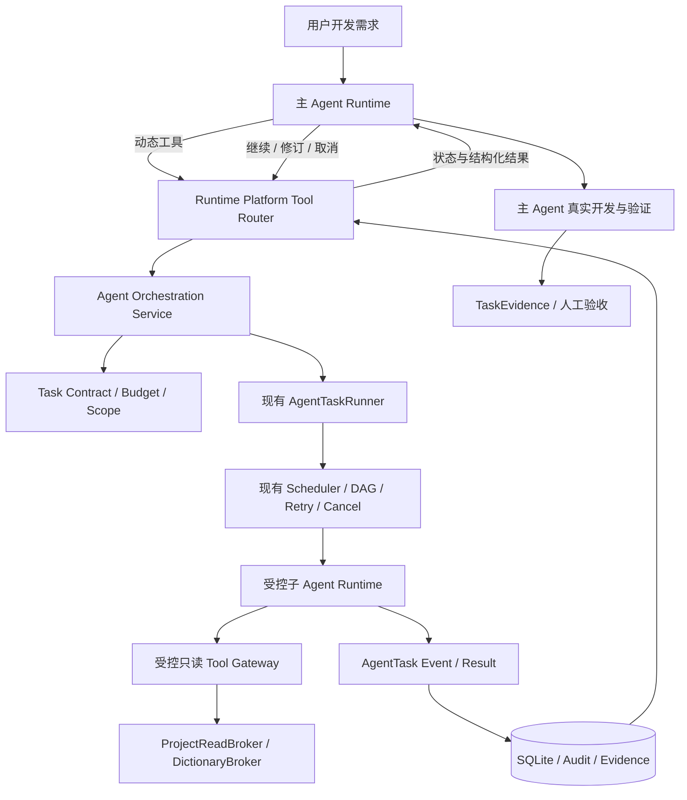

# 精工 Agent 0.9.0 技术方案

## Autonomous Multi-Agent Orchestration：复用现有 Subagents 的增量架构

- 版本：0.9.0
- 文档类型：技术设计与实施方案（TDD）
- 代码基线：`develop/desktop-poc`
- 基线 Commit：`ee5a9e36e7aaaba53e4a08aa36a6ffc23373c224`
- 设计日期：2026-11-19
- 技术栈：Electron / TypeScript / React / SQLite / Codex App Server / OpenAI Responses API / Git Worktree

---

## 1. 技术结论

0.9.0 应采用**平台托管的 Agent Orchestration**：主 Agent 通过 Runtime 动态工具调用精工 Agent 的平台编排服务；编排服务复用现有 AgentTask、AgentTaskRunner、Task Contract、Task Budget、Task Audit、TaskEvidence 和 TaskWorkspace。

不建议再造一套 Agent Registry、Agent Executor、Agent Message Bus 或新任务表。当前缺少的不是任务调度底座，而是主 Runtime 与平台任务控制面的受控连接、能力门禁的可验证认证，以及结果驱动的协作闭环。

### 1.1 目标架构



P0 主 Agent 工具只调用精工 Agent 主进程服务，不直接访问 SQLite、Runtime 进程、任意路径或 Git 命令。子 Agent 默认没有创建其他 Agent 的工具，防止递归、预算逃逸和无法解释的任务树。

---

## 2. 当前源码基线复核

以下结论来自基线 Commit 的静态源码检查。实现时必须再次核对工作区，因为用户可能已经继续提交。

### 2.1 当前可直接复用

| 模块 | 关键实现 | 结论 |
|---|---|---|
| 领域模型 | `packages/domain/src/index.ts` 的 `AgentTask`、`AgentTaskResult`、`AgentTaskEvent` | 复用；按需增加 orchestration 关联和结构化结果字段 |
| 工程模型 | `packages/domain/src/engineering.ts` 的 `TaskContract`、`TaskBudgetPolicy`、`TaskLifecycleEvent`、`TaskEvidenceRecord` | 复用，不另建业务模型 |
| DAG/状态机 | `packages/agent-orchestrator/src/index.ts` | 复用 `createAgentTask`、`assertTaskGraph`、`reconcileTaskStates`、`nextRunnableTasks`、`transitionAgentTask` |
| 治理 | `packages/agent-orchestrator/src/governance.ts` | 复用预算继承、BudgetGuard、幂等、工具审计和路径策略 |
| Runner | `apps/desktop/src/main/agent-tasks.ts` | 复用现有独立 Runtime、全局并发 3、取消、超时、失败控制和事件发布 |
| 受控分析 Runtime | `packages/agent-runtime/src/controlled-analysis.ts` | 复用 Responses 请求循环、`modelRequestGateway`、`toolGateway`、只读工具和 SSE 解析 |
| Runtime 入口 | `packages/agent-runtime/src/index.ts`、`manager.ts` | 增加主 Runtime 平台动态工具注册/分发扩展 |
| 主进程 | `apps/desktop/src/main/index.ts` | 增加内部 Orchestration Service 并绑定当前 Run Ticket |
| Storage | `packages/storage/src/index.ts` | 增量迁移、乐观状态版本、不可变事件继续复用 |
| 工程服务 | `apps/desktop/src/main/task-engineering.ts` | 复用契约修订、真实验证、人工验收、证据新鲜度检查 |
| Worktree | `packages/git-connector/src/task-workspace.ts`、`apps/desktop/src/main/task-workspaces.ts` | 复用创建、身份验证、指纹和预检；扩展未提交快照处理 |
| UI | `AgentTasksPanel.tsx`、`TaskEngineeringPanel.tsx`、`TaskWorkspacePanel.tsx` | 增量增强现有 UI |

### 2.2 当前关键缺口（不能在开发中忽略）

**缺口 A：主 Runtime 工具集合为固定列表**

`CodexRuntime.startSession()` / `resumeSession()` 中构造的 `dynamicTools` 当前只包含项目文件、字典、Change Plan、授权目录、Browser 和 Computer 工具。`item/tool/call` 进入固定分发，`handleReadTool()` 也对白名单工具名做固定判断。RuntimeOptions 目前没有通用平台工具 Provider。

**缺口 B：IPC 创建入口不能直接给主 Agent 使用**

`index.ts` 的 `agent-task:create` IPC 会拒绝当前正在运行的主会话。该约束对人工 UI 是合理的，但主 Agent 工具调用发生在主 Run Ticket 期间，不能直接复用这个 IPC Handler。需要主进程内部 Orchestration Service，以当前 Run Ticket 作为授权依据。

**缺口 C：自动规则拆分不是自主工具委派**

`createAutomaticAgentTasks()` 会在主模型发送前使用 `inferAutomaticAgentTaskPlan()` 生成任务，随后 `sendSessionTurn` 等待其全部结束再把摘要追加到主提示词。0.9.0 应将动态工具委派作为默认路径，并避免同一轮同时执行规则拆分和模型委派。

**缺口 D：受控分析能力声明仍为未认证**

`runtime-capabilities.ts` 当前 `controlledGovernanceValidated = false`。`automaticAgentTaskAvailability()` 因工具拦截/模型请求预算能力未通过而返回不可用；`AgentTaskRunner.execute()` 在新契约任务创建 Runtime 前调用 `assertRuntimeGovernance()`，未通过会将任务阻塞。

**缺口 E：Worktree 只完成管理/预检，不具备 Agent 写入执行**

`buildRuntime()` 和 `execute()` 拒绝 `workspaceMode='worktree'`；手动任务 IPC 同样拒绝该模式。Worktree manager 当前 `prepareIntegration()` 要求源工作区 clean 且包含 committed changes，而 `AGENTS.md`/Runtime 执行规则要求未经用户明确要求不自动提交。写入执行和变更快照必须先解决这一冲突。

---

## 3. Runtime 动态工具扩展

### 3.1 设计目标

扩展 `RuntimeOptions`，支持主会话在创建/恢复 Runtime Thread 时注册精工平台工具，并将工具调用安全地交给主进程业务 Handler。

建议抽象接口（具体命名可按项目现有风格调整）：

```ts
export interface RuntimePlatformToolDefinition {
  name: string;
  description: string;
  inputSchema: Record<string, unknown>;
}

export interface RuntimePlatformToolRequest {
  toolName: string;
  arguments: unknown;
  threadId: string;
  turnId: string;
  requestId: string | number;
}

export interface RuntimePlatformToolProvider {
  listTools(): RuntimePlatformToolDefinition[];
  execute(request: RuntimePlatformToolRequest): Promise<Record<string, unknown>>;
}
```

`RuntimeOptions` 可以新增：

```ts
platformToolProvider?: RuntimePlatformToolProvider;
```

或使用与当前 RuntimeOptions 风格一致的 `platformTools` + `platformToolHandler`。不要同时实现两套扩展模式。

### 3.2 工具注册

在 `CodexRuntime.startSession()` 和 `resumeSession()`：

1. 合并现有 Runtime Tools 与 `platformToolProvider.listTools()`。
2. 对工具名去重；保留现有项目/字典工具定义。
3. 校验工具定义大小、名称、Schema 类型和数量上限。
4. 将平台工具随 `thread/start`、`thread/resume` 的 `dynamicTools` 一起注册。
5. 同一个 Thread 的恢复必须重新提供一致的工具集合；版本或定义变化时按 Runtime 协议重新创建或升级，不能假设旧 Thread 自动拥有新工具。

### 3.3 工具分发

当前 `item/tool/call` 处理逻辑应改为统一分发：

1. 识别 Browser/Computer 等已有专用工具，保持当前专有处理路径。
2. 识别项目/字典工具，保持现有 `ProjectReadBroker`、`DictionaryBroker`。
3. 识别平台工具，调用当前 Session 绑定的 `RuntimePlatformToolProvider.execute()`。
4. 未知工具统一拒绝并返回安全错误，不允许回退到任意 Shell 或文件访问。
5. 所有请求检查 Thread、活动 Turn、请求 ID、Runtime 实例代次和 Session 绑定；结束、取消或过期 Turn 的调用拒绝执行。
6. 平台工具调用应写入独立审计摘要（调用名、参数 Hash、结果 Hash、状态），不得持久化 API Key 或完整敏感参数。

`RuntimeOptions.toolGateway` 当前主要覆盖原生模式下动态工具和受控分析工具的操作。平台工具不能简单绕过 `toolGateway`；建议为平台工具建立独立授权包装，或让 Provider 明确调用平台 Orchestration Service 的审计/预算门禁。不能把父 Session 的工具调用错误地套用子任务 Task Contract。

### 3.4 安全边界

- 平台工具只向主 Agent Thread 注册。
- `ControlledAnalysisRuntime` 的 `TOOLS` 保持只读，不加入 `create_agent_task` 等委派工具。
- 主 Runtime 的 Provider 闭包绑定 `sessionId`、`projectId`、`RunTicket` 和当前 `threadId`，这些信息不由模型传入。
- Runtime 收到 tool call 时必须确认 `turnId` 等于当前活动 Turn；工具执行期间再次校验 Run Ticket 是否仍有效。
- 用户取消主 Run 时，先撤销后续委派能力，再取消该 orchestration 本轮尚未终态的任务。
- 如果 Runtime Adapter 不支持动态平台工具，则 capability 标记 unsupported；不允许 UI 仍显示可委派。

---

## 4. Orchestration Service

### 4.1 新增服务定位

新增轻量主进程服务，例如：

`apps/desktop/src/main/agent-orchestration.ts`

它是主 Runtime 动态工具与现有 AgentTaskRunner 的适配层，不是新的 Agent Executor 或 Runner。

职责：

- 校验当前会话、项目和活动 Run Ticket。
- 将模型工具参数转换为严格的创建/查询/等待/取消/修订命令。
- 由服务端创建 Task Contract、Budget、Allowed Paths、Denied Paths、Runtime kind 和模型选择。
- 调用 `LocalStore`、现有 domain 工厂、`AgentTaskRunner` 和 TaskEngineeringService。
- 控制本轮 `orchestrationId` 与任务关联。
- 返回模型可消费的精简结构化结果。

### 4.2 不直接复用 IPC 的原因

`agent-task:create` IPC 当前检查 `runs.get(session.id)`，主 Agent 运行期间会拒绝创建任务。主 Runtime 工具不能调用 Renderer IPC 或模拟用户 IPC。

Orchestration Service 在主进程内部以显式 Run Ticket 授权：

```ts
interface ActiveOrchestrationContext {
  sessionId: string;
  projectId: string;
  orchestrationId: string;
  runtimeThreadId: string;
  activeTurnId: string;
  assertCurrent(): void;
}
```

每次 Tool Call 执行前和写入 Store 前调用 `assertCurrent()`。Ticket 失效、会话切换、项目变更或 Runtime Thread 不匹配时拒绝。

### 4.3 Orchestration Run 关联

现有 AgentTask 有 `sessionId` 和 `parentTaskId`，但主会话主 Agent 本身不是 AgentTask。不能创建一个会误入调度器的假 Root AgentTask。

建议增量增加 `orchestrationId`：

- 每次用户主 Turn 创建唯一 UUID。
- 本轮主 Agent 创建的顶层子任务共享该 ID。
- Revision Task 同样归属该 Orchestration ID，并用 `parentTaskId` 关联原任务。
- 在 SQLite AgentTask schema 增加可空字段及索引；旧记录保持 null，不丢数据。
- `list_agent_tasks` 默认仅列当前 orchestrationId；UI 可切换查看当前会话历史任务。
- 进程恢复时可识别某一主 Turn 对应任务，按现有审计状态恢复，不重复创建。

若当前已有等价稳定的 run/group 标识，必须先证明并优先复用，不得重复加字段。

### 4.4 服务接口

示意接口，具体应根据现有 LocalStore 和 Runner API 适配：

```ts
interface AgentOrchestrationService {
  createTask(ctx: ActiveOrchestrationContext, input: CreateSubtaskInput): Promise<AgentTask>;
  listTasks(ctx: ActiveOrchestrationContext, filter?: TaskFilter): Promise<TaskSummary[]>;
  getTask(ctx: ActiveOrchestrationContext, taskId: string): Promise<TaskDetailSummary>;
  waitTasks(ctx: ActiveOrchestrationContext, taskIds: string[], waitMs: number): Promise<TaskWaitSnapshot>;
  cancelTask(ctx: ActiveOrchestrationContext, taskId: string): Promise<TaskSummary>;
  requestRevision(ctx: ActiveOrchestrationContext, input: RevisionInput): Promise<AgentTask>;
  cancelOrchestration(ctx: ActiveOrchestrationContext): Promise<void>;
}
```

实现必须通过现有 `createAgentTask()`、`createTaskContract()`、`store.saveAgentTaskContract()`、`agentTaskRunner.startForSession()`、`agentTaskRunner.cancel()` 等接口，不复制任务逻辑。

---

## 5. 主 Agent 动态工具 Schema

### 5.1 create_agent_task

输入仅包含：

```json
{
  "name": "工序完工业务影响分析",
  "role": "architecture",
  "description": "检查工序完工校验涉及的服务、数据表、状态流转和调用方",
  "input": "用户需求原文与主 Agent 必要补充",
  "dependencyIds": [],
  "outputExpectations": ["列出影响文件和调用关系", "给出业务风险"],
  "acceptanceCriteria": ["结论必须附可核查路径和证据", "列明未覆盖项"]
}
```

服务端生成：

- `id`：UUID。
- `sessionId` / `projectId` / `orchestrationId`：从当前主运行上下文读取。
- `runtimeKind`：来自已认证 Runtime 能力选择；P0 只允许 Codex/Jinggong 的受控分析。
- `model` / provider：继承当前主会话或项目已验证配置；不由模型传入任意 Provider。
- `workspaceMode='read'`。
- Task Contract 的 permissions、allowedTools、allowedPaths、deniedPaths、budgetPolicy、dependencies、最大重试和超时：由平台策略生成并校验。
- `createdBy='main-agent:<orchestrationId>'` 或同等平台身份。

注意：`dependencyIds` 必须属于当前 session/project/orchestration；先用完整任务图检查循环和依赖。

### 5.2 list_agent_tasks / get_agent_task

只返回：

- Task ID、parentTaskId、名称、角色、状态、attempt、创建/开始/完成时间。
- 预算摘要（model turns / tool calls / elapsed）；Token/费用保持 unknown。
- 已校验结果摘要、证据文件路径、风险、未解决项。
- 错误码及安全原因。

不得返回凭据、完整 API 请求头、Runtime 环境敏感变量或其他项目数据。

### 5.3 wait_agent_tasks

当前 `AgentTaskRunner.waitForTasks()` 会在超时后取消本轮未结束任务，不能直接用作模型工具。

新增非破坏性等待方法，例如：

```ts
waitForTaskUpdates(
  sessionId: string,
  orchestrationId: string,
  taskIds: readonly string[],
  waitMs: number
): Promise<AgentTask[]>;
```

语义：

- `waitMs` 由 Zod Schema 限制在 0–90,000 ms。
- 收到任务状态变化时提前返回。
- 到期只返回当前快照，不改变任何 Task 状态、不调用 cancel。
- 轮次取消时由 `cancelOrchestration()` 执行明确取消。

### 5.4 request_task_revision

输入：

```json
{
  "taskId": "original-task-id",
  "revisionGoal": "补充后端库存扣减链路及状态变化证据",
  "missingEvidence": ["指出具体代码路径", "列出调用方"]
}
```

实现：

- 获取当前 orchestration 下原任务；只允许终态任务被创建修订子任务。
- 新任务 `parentTaskId=originalTask.id`。
- 新任务 `dependencyIds=[originalTask.id]`，依赖原任务完成。
- 新任务 input 引用原任务已校验的结构化结果和缺失项。
- 创建新的 Task Contract、预算和审计。
- 不覆盖旧任务的 result/evidence/status。
- 修订次数由父任务 `maxAgentDepth`、总 Agent 数量与 orchestration budget 约束。

---

## 6. Runtime 能力认证与治理门禁

### 6.1 当前受控分析 Runtime 的真实能力

`packages/agent-runtime/src/controlled-analysis.ts` 当前具备：

- 每次 `/responses` HTTP 请求前调用 `modelRequestGateway`。
- 每个工具调用经过 `toolGateway`。
- 暴露 `PROJECT_READ_TOOLS` 和 `DICTIONARY_TOOLS`。
- 不暴露 Shell、文件写入、删除、浏览器、网络工具或插件。
- `parallel_tool_calls=false`，限制单次输出工具调用数量。
- 校验模型输出类型、JSON 参数、重复 call_id 和响应体大小。
- 支持 Responses JSON/SSE，要求完成事件；断流不视为成功。
- 支持 Abort、请求超时和 HTTP 错误分类。

这说明代码已有较好的受控请求循环，但不能仅凭静态实现认定所有 Runtime/Provider/模型兼容性与治理边界已经验证。

### 6.2 删除硬编码能力开关的认证方式

当前：

```ts
const controlledGovernanceValidated = false;
```

0.9.0 不允许简单替换为 `true`。

建议新增 `RuntimeCapabilityCertification`（可先由设置服务/文件/SQLite 持久化，具体复用已有能力观察模型）：

```ts
interface RuntimeCapabilityCertification {
  runtimeKind: 'codex' | 'jinggong' | 'claude_agent_sdk' | 'grok_build_acp';
  runtimeVersion: string;
  providerId: string;
  modelId: string;
  wireApi: 'responses' | 'chat_completions' | 'app_server' | 'acp' | string;
  capability: 'model_request_interception' | 'tool_permission_interception' | 'independent_agent_context' | 'event_stream';
  testStatus: 'not_run' | 'passed' | 'failed' | 'unsupported' | 'unknown';
  testRunId: string;
  testedAt: string;
  evidenceRef?: string;
  notes?: string;
}
```

认证必须绑定 Runtime 版本、Provider、Model 和 Wire API；不能用一个 Provider 的测试通过证明另一个中转站/模型也通过。

### 6.3 P0 放行条件

Codex/Jinggong 的 controlled-analysis 仅在以下能力均有有效 `passed` 认证时开放：

1. `model_request_interception`：每个实际 HTTP 请求均先预算预留；超限请求不发送；没有绕过回调的重试路径。
2. `tool_permission_interception`：模型只能调用声明的只读工具；未知工具、写入、命令、浏览器、插件和其他 namespace 均被拒绝。
3. `independent_agent_context`：独立 Runtime session、cwd、history、开发规范和字典范围正确绑定。
4. `event_stream`：成功/失败/取消/断流等终态与真实请求一致，不能把部分输出当成功。
5. 工具路径验证：拒绝绝对路径、路径穿越、符号链接、junction、硬链接别名、特殊文件和 Contract 禁止路径。
6. 数据审计验证：工具调用参数和结果 Hash、工具 started/completed/unknown_outcome 事件一致，恢复时未知工具结果不重放。

任意一项失败：`runtimeCapabilityMatrix()` 返回不支持/部分支持，`automaticAgentTaskAvailability()` 返回不可用原因，Runner 阻止任务且 attempt 不增加。

### 6.4 预算与数据真实性

- `TaskBudgetGuard.reserveModelTurn()` 在真正发送请求前执行。
- `reserveToolCall()` 在执行工具前执行；工具超限时底层操作不能被调用。
- 当前 Token/费用来源不可审计，`tokenUsage` 和 `costUsage` 仍为 `unknown`。
- 如果 TaskBudgetPolicy 配置了 Token 或 cost 硬上限，而 Runtime 没有可靠 usage 来源，则严格任务应阻断或要求修改策略，不得估算后冒充精确成本。
- 现有 `platformModelTurns` / `platformToolCalls` 与供应商真实 `nativeModelRequests` / `nativeToolCalls` 分开显示。

---

## 7. AgentTaskRunner 增量改造

### 7.1 必须复用的现有行为

保留：

- `MAX_CONCURRENCY = 3` 全局限制。
- `nextRunnableTasks()` / `reconcileTaskStates()` DAG 调度。
- 项目/父任务预算继承。
- `TaskBudgetGuard`、`GovernedToolGateway` 和任务审计。
- 独立 `home`、Runtime、Thread 与上下文。
- 取消、超时、有限重试、Circuit Breaker。
- `unknown_outcome` 防重放。
- `publishAutomaticSummary()` 的旧规则任务兼容，但不得作为新动态任务的唯一回传路径。

### 7.2 增加的 Runner API

在 `AgentTaskRunner` 增加最少必要接口：

- `startForSession(sessionId)`：保留。
- `refreshSchedule()`：保留。
- `cancel(sessionId, taskId)`：保留。
- `cancelForOrchestration(sessionId, orchestrationId)`：新增，仅取消指定主轮次下未终态任务。
- `waitForTaskUpdates(...)`：新增非破坏性等待。
- `listOrchestrationTasks(...)`：可由 Store 查询实现，不复制状态。

不新增另一套执行队列或并发计数器。

### 7.3 子任务上下文与工具权限

P0 controlled-analysis Runtime：

```ts
const runtimeOptions: RuntimeOptions = {
  executionMode: 'controlled_analysis',
  shellToolEnabled: false,
  toolGateway: taskScopedToolGateway,
  modelRequestGateway: taskScopedModelRequestGateway,
  developerInstructions,
  dictionaries: taskScopedDictionaries,
};
```

- `taskScopedToolGateway` 必须由 Task Contract 固定允许工具和路径。
- `modelRequestGateway` 校验 task 仍为 RUNNING、contractVersion/stateVersion 仍匹配、预算仍可用。
- 不继承父会话所有聊天历史，仅传递 Task Contract、必要上下文和引用资料。
- 子任务 Runtime 不注册平台委派工具。
- 主 Agent 新 Turn 的创建工具调用与子 Agent 任务创建逻辑由主进程服务管理，不能让子 Agent 自己扩大任务树。

### 7.4 任务恢复

- 应用重启后对 in-flight 工具结果未知的任务保持 INTERRUPTED/BLOCKED，并要求人工核对。
- 不自动重放已经发出的模型 Turn 或写操作。
- 对无副作用、没有在途工具的任务，按现有生命周期策略允许人工重新启动一次。
- 同一 orchestrationId 重启后不应重复创建同一 task；`create_agent_task` 应支持由 `orchestrationId + toolCallId` 构成的幂等键。

---

## 8. 结果结构化与证据

### 8.1 现状

当前 `AgentTaskResult` 有 `summary`、`changedFiles`、`testSummary`、`unresolved`、`error`、`logRef`。`AgentTaskRunner.finish()` 主要将子 Agent 输出文本保存到 `summary`。这不足以支撑主 Agent稳定地进行证据核对和修订。

### 8.2 P0 结构化结果

增量扩展 `AgentTaskResult`，可采用以下结构：

```ts
interface AgentTaskStructuredResult {
  schemaVersion: 1;
  outcome: 'completed' | 'partial' | 'blocked' | 'failed';
  summary: string;
  findings: Array<{
    title: string;
    detail: string;
    severity?: 'info' | 'low' | 'medium' | 'high' | 'critical';
    evidence: Array<{ path: string; lineStart?: number; lineEnd?: number; excerptHash?: string }>;
  }>;
  risks: string[];
  unresolved: string[];
  recommendedNextSteps: string[];
}
```

验证规则：

- JSON 必须符合 Schema；不合规返回 `partial` 或 `failed`，不能将原始文本直接标为验证通过。
- `evidence.path` 必须是项目相对路径，实际存在且在 Task Contract 可读取范围内。
- lineStart/lineEnd 合法，文件内容 Hash 由平台计算；模型不得自报 Hash 作为真实值。
- P0 分析任务不允许输出可信的 `changedFiles` 或 `testSummary=passed`，除非平台确有相应证据。
- 结构化结论与原始文本可同时保存，但主 Agent收到的是精简后、脱敏后的结构化摘要。

### 8.3 P1 写入结果

实际变更文件列表必须从 Worktree Git diff 获取，不采用模型口述。测试结果从 Verification Service 获取，使用真实 exitCode、runId、reportRef、manifestHash 和 codeFingerprint。现有 TaskEvidence 及证据新鲜度验证继续作为最终验证依据。

---

## 9. P1 Worktree 写入 Agent：安全实现方案

### 9.1 先解决当前架构冲突

现有 Worktree Manager 主要负责创建、保留、检查和集成前预检；当前 Runner 明确拒绝 Worktree 执行，现有 `prepareIntegration()` 也要求源目录 clean 且具有 committed changes。

而项目执行要求默认不自动 commit。因此 P1 不得仅删除 `worktree_execution_not_supported` 判断就算完成。

### 9.2 Controlled Development Runtime

建议在 P1 新增受控开发执行模式，复用 `ControlledAnalysisRuntime` 请求循环，但使用不同的已注册 Tool Set：

- `read_project_file` / `list_project_files`。
- `write_project_file` / `delete_project_file`（受 Contract 约束，先做写入快照/备份）。
- `search_dictionary` / `read_dictionary`。
- `run_registered_command`（只运行项目登记过的命令 ID，不允许模型传任意 executable/shell）。
- `inspect_task_diff`（返回当前 Task Worktree Diff 摘要）。

所有工具经过 `toolGateway`、Task Contract、Task Budget、路径安全检查及审计。默认不提供 Browser、Computer、插件、网络搜索、Git Push、Git Merge。

不要使用主 Agent 普通 Codex Runtime 的 `danger-full-access` + `approval_policy=never` 来代替任务级隔离。Git Worktree 只是 Git 工作目录隔离，不等价于 OS sandbox。

### 9.3 命令执行

- 项目命令需要由用户/项目管理员登记，保存 ID、可执行程序、固定参数模板、允许的参数 Schema、工作目录策略和超时。
- 执行使用 `spawn/execFile`，`shell:false`，cwd 必须是该任务 Worktree。
- 禁止传入任意 shell 字符串、任意绝对可执行文件、环境变量注入和工作区外路径。
- 命令输出有大小/时长限制并脱敏。
- 对 `dotnet build/test`、`npm run build/test` 等任务可使用命令注册表模板，不能通过字符串拼接开放命令注入。
- 真实执行记录交给现有 Verification Service，不把 Agent 自报测试结果作为证据。

### 9.4 Worktree 生命周期

1. 通过现有 `TaskWorkspaceService.create()` 创建任务目录，并持久化 Worktree 映射。
2. 验证 repo identity、branch、baseCommit 和 path 后，才能启动 Agent Runtime。
3. Runtime cwd 必须是 Task Workspace path；不允许传入父 Session workspace path。
4. 所有写操作前后校验 Worktree 记录、Task Contract、状态版本和 path canonicalization。
5. 任务结束保留 Worktree，保存 diff 和指纹。
6. 取消/失败时保留文件和审计，不自动清理。

### 9.5 未提交变更快照与集成

现有 `prepareIntegration()` 主要基于 `changesSince(baseCommit)`，并要求 source clean 与 committed changes。P1 应增量扩展：

- 采集 commit delta、staged diff、unstaged diff、untracked 文件内容 Hash。
- 快照过程检查前后 Workspace stateHash，变化时标记不稳定并拒绝预检。
- 过滤或阻止符号链接、junction、硬链接风险路径、特殊文件、超大文件和敏感路径。
- 计算 source/target 完整指纹并检测路径冲突。
- 不要求 Agent 自动 commit；不自动 push。
- 集成执行必须有明确人工批准，并在实际执行前重新检查双端 HEAD、dirty、Diff 指纹和目标路径安全。
- 若当前不能安全实现自动集成，0.9.0 P1 只提供可审阅 Diff 与人工复制/导出，不得显示“已集成”。

---

## 10. 旧规则自动拆分的迁移

当前 `inferAutomaticAgentTaskPlan()` 及 `createAutomaticAgentTasks()` 继续存在，但需要避免和主 Agent 动态工具重复：

推荐新增设置：

- `agentOrchestrationMode = 'dynamic_tools' | 'legacy_preplan' | 'off'`
- 默认新会话使用 `dynamic_tools`，必须在 Runtime 工具注册和能力认证通过后才启用。
- 若能力认证未通过，可选择 `legacy_preplan`，但它同样需要受控 Runtime 可用；否则显示不可用，不创建任务。
- `off` 允许用户关闭自动委派，主 Agent 单独工作。
- 每个主 Run 只能选择一种模式，不能同时 preplan + dynamic tools。
- 旧任务、历史结果和现有 UI 兼容；迁移不删除旧任务。

注意：不能把 `automaticAgentTaskAvailability()` 从 false 直接改成 true 来作为迁移完成。应由认证结果动态决定。

---

## 11. 数据迁移

### 11.1 可选增量字段

只有当前代码确实没有等价字段时才迁移：

1. `agent_tasks.orchestration_id`：顶层任务归属当前主 Run；旧数据为 null。
2. `agent_tasks.result_json` 或扩展现有 `result` 序列化：保存经过 Schema 校验的结构化结果。
3. 工具幂等记录：可继续复用现有 `TaskLifecycleEvent` 的 correlationId / callId / payload Hash；若缺少跨主工具调用的去重表，再新增小型 `orchestration_tool_calls`，禁止重复造完整 agent_message 表。
4. Runtime Capability Certification：优先复用 `runtimeCapabilityView` 的 observation/persisted setting 模型；不存在持久化机制才新增小表/设置。

### 11.2 迁移原则

- SQLite schema 版本递增，Migration 可重复验证。
- 对历史 AgentTask 的 `orchestration_id` 不作猜测回填。
- 旧字段和历史 JSON 不破坏；读取时兼容旧 Result。
- 迁移前后检查任务数量、事件数量、Hash 和外键关系。
- 若迁移失败，应用应明确失败或进入安全模式，不允许静默丢弃任务审计。

---

## 12. 错误处理与状态一致性

| 场景 | 平台行为 |
|---|---|
| Runtime 能力未认证 | 不创建/启动子 Agent，返回 capability_blocked 原因 |
| 参数 Schema 无效 | 拒绝工具调用，写入工具拒绝审计 |
| taskId 不属于当前 orchestration | 拒绝并返回 not_found，不泄露任务存在性 |
| 已过期 Run Ticket / Turn | 拒绝调用，不产生副作用 |
| 模型请求超预算 | 发送前拒绝，记录 budget.exceeded |
| 工具调用超预算 | 操作函数不执行，记录 budget.exceeded |
| SSE 完成事件前断流 | 任务失败/中断，不得当作完成 |
| 子 Agent Runtime 崩溃 | 按现有 Runner 规则标记失败/中断；未知工具结果不重放 |
| wait_agent_tasks 超时 | 返回最新状态，不取消任何任务 |
| revision 创建失败 | 原任务及原结果不变；错误可重试但需幂等 |
| 主 Run 取消 | 取消本轮未终态子任务；审计和 Worktree 保留 |
| Worktree 快照不稳定 | 拒绝集成预检，保存阻断原因和当前指纹 |

所有状态写入都使用当前 `stateVersion` / `expectedStateVersion` 乐观并发控制；禁止 Renderer 或模型直接提交任意状态值。

---

## 13. 自动化测试和认证计划

### 13.1 Runtime Tool Router 测试

- `thread/start` 注册平台工具。
- `thread/resume` 恢复同一工具集合。
- `item/tool/call` 正确路由到 Provider。
- 未知工具、重复工具名、无效 Schema、过期 Thread/Turn 均拒绝。
- Child Controlled Runtime 没有主 Agent 平台工具。
- 取消主 Turn 后，不再执行迟到工具请求。

### 13.2 Orchestration Service 测试

- 只允许当前 Session/Project/Orchestration。
- 创建任务通过 `createAgentTask` 和 `createTaskContract`。
- 模型不能设置权限、路径、预算、Runtime home 或 API Key。
- DAG 环、跨项目依赖、重复 ID、越权 taskId 被拒绝。
- 同一 `toolCallId` 重放是幂等返回，不重复创建任务。
- `wait_agent_tasks` 超时不改变子任务状态。
- revision 创建新 child task，原任务结果/证据不变化。
- orchestration 取消仅作用于该 Run，不影响同会话历史任务。

### 13.3 ControlledAnalysisRuntime 测试

Fake Fetch 覆盖：

- Responses JSON 成功。
- SSE 多 chunk、UTF-8 边界和完成事件。
- SSE 在 `response.completed` 前断流。
- HTTP 401/403/429/500。
- 网络异常和 Abort。
- 模型输出未知 item 类型。
- 重复 call_id、非法 JSON 参数、超过工具调用上限。
- 未知工具、写入工具、Shell、Browser、插件和网络请求。
- 模型请求预算超限，验证 fetch 未被调用。
- 工具预算超限，验证 operation 未被调用。
- 工具执行后状态版本变化，验证任务进入 unknown_outcome，不重放。

### 13.4 P1 写入安全测试

- 仅 Worktree path 可读写。
- 绝对路径、`..`、大小写绕过、junction、symlink、hardlink、ADS、特殊文件、路径替换攻击均拒绝。
- 文件写入前/后 Hash 与备份一致。
- 命令不能执行未登记 executable、shell 字符串、外部路径或不允许参数。
- Worktree 不能操作父目录、其他任务目录或项目根之外文件。
- 多 Worktree 并发变更隔离。
- 未提交 diff、untracked 文件、二进制文件大小阈值和指纹稳定性。
- 人工批准过期后，若源/目标 HEAD 或指纹变化必须重新预检。
- 失败或取消后 Worktree 和审计仍保留。

### 13.5 真实能力认证

认证至少绑定：Runtime 类型、Runtime 版本、Provider ID、模型 ID、API Wire API、测试用例集版本、测试执行 ID、测试时间和证据引用。

至少完成一轮实际配置的 Codex 和 Jinggong Smoke Test。模拟测试全部通过不等于真实 Provider 认证通过；如果用户中转站的 API 兼容性不同，应分别认证。

---

## 14. 实施步骤

### Sprint 0：现状复核和门禁定位

- 在 Codex 开发前重新检查 Git HEAD、工作区变更和现有测试。
- 复核 `controlled-analysis.ts` 是否与当前主分支一致。
- 找出 `RuntimeOptions`、`item/tool/call`、`RuntimeManager`、`AgentTaskRunner` 的所有实现点。
- 输出差异报告，不修改代码。

### Sprint 1：受控 Runtime 认证

- 完善 ControlledAnalysisRuntime 单元/集成测试。
- 验证模型请求与工具调用门禁。
- 增加 Runtime Capability Certification。
- 未通过的 Provider/Model 保持 blocked。

### Sprint 2：主 Runtime 动态平台工具

- 扩展 RuntimeOptions 和 Runtime 动态工具注册。
- 改造 `item/tool/call` 为统一安全分发。
- 为主 Session 注入 Agent Orchestration Tool Provider。
- Child Runtime 不注册委派工具。

### Sprint 3：Orchestration Service 与工具闭环

- 增加 orchestrationId 和必要迁移。
- 实现 create/list/get/wait/cancel/revision。
- 将服务调用绑定当前 Run Ticket。
- 接入现有 AgentTaskRunner，复用预算、DAG 和审计。

### Sprint 4：结果结构化和 UI

- 扩展 AgentTaskResult Schema。
- 对证据路径、Hash 和状态做平台校验。
- 增强 AgentTasksPanel 任务分组、父子树和预算信息。
- 禁止重复执行旧规则拆分。

### Sprint 5：P1 Worktree 写入（独立安全门禁）

- 实现 ControlledDevelopmentRuntime 和受控文件/命令工具。
- 打通 TaskWorkspaceService 与 Runner。
- 支持未提交 Diff 快照。
- 实现人工审批后的集成操作；如不能安全完成，先只交付 Diff 审查，不宣称自动集成。

### Sprint 6：完整回归和 Windows 验收

- 单元、集成、安全、回归测试。
- npm scripts、TypeScript、构建、桌面启动。
- 实际中转站/模型 Smoke Test。
- 输出已通过/失败/未执行/环境受阻四类清单。

---

## 15. 性能要求

- 任务创建、列表和状态查询不触发额外 LLM 请求。
- AgentTaskRunner 全局并发仍为 3，超出任务排队，不自旋、不忙轮询。
- `wait_agent_tasks` 使用 Task Waiters/EventEmitter；避免固定高频 Polling。
- 工具返回给模型的结果做大小限制和摘要化，完整事件仍由平台持久化。
- Orchestration 工具定义只注册必要工具，避免膨胀主 Agent 每轮提示词。
- 子任务使用必要项目上下文，不复制整段父会话历史。
- 每个任务独立 Runtime home 和资源要在终态后释放；失败现场和 Worktree 数据按保留策略留存。
- 性能优化不得绕过预算、审计、工具授权或状态校验。

---

## 16. 明确禁止的实现方式

1. 新建第二套 AgentTask / AgentTaskRunner / DAG / Scheduler / SQLite Task 表。
2. 新建完整 Agent Registry / Message Bus / Agent Session 体系来代替现有 Task Event。
3. 简单将 `controlledGovernanceValidated` 改成 true。
4. 通过打开 Codex 原生 `features.multi_agent` 宣称精工 Agent 自主委派已完成。
5. 在主 Runtime 原生 `danger-full-access` 环境下把 Worktree 当作唯一安全边界。
6. 直接通过模型工具调用 Renderer IPC。
7. 为了让主 Agent 调用 IPC 而删除当前 `agent-task:create` 的运行中校验。
8. 将 `waitForTasks()` 的超时取消行为直接暴露给模型。
9. 允许子 Agent 任意递归创建子 Agent 或自行提高预算。
10. 模型声称的测试通过、文件修改、Token 成本直接写成平台真实证据。
11. 任务失败后自动删除 Worktree、清理日志或重放未知结果的工具操作。
12. 未经用户明确要求自动 commit、push、merge、部署或发布。

---

## 17. Codex 最终交付要求

Codex 完成后必须给出：

- 变更文件列表及每个文件的用途。
- 现有代码复用情况和新增代码边界。
- SQLite schema 迁移版本及迁移验证结果。
- Runtime 工具注册与调用路由说明。
- 能力认证矩阵（按 Runtime/Provider/Model/Wire API）。
- P0/P1 验收项逐条结果。
- 测试命令、退出码、执行时间及真实日志位置。
- 实际中转站 Smoke Test 记录；未执行项明确说明原因。
- Windows 桌面实际运行截图或测试记录（截图放到应用验证目录，不提交一次性产物到项目源码目录）。
- 已知限制与回滚方式。

不得仅以 TypeScript 编译通过或新增测试文件存在，作为多 Agent 自主协作完成的依据。

