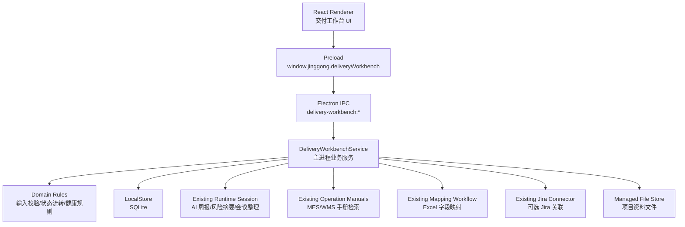

# 精工 Agent 交付工作台 1.0 技术方案

> 文档类型：技术设计说明（TDD）  
> 产品：精工 Agent Windows 桌面端  
> 版本：1.0.0  
> 目标分支：`develop/desktop-poc`  
> 基线版本：仓库 README / package.json 显示 0.9.6，开发基线 commit：`93c39887ea55f4a492b9993aa20b5b5272c7ecba`  
> 编写日期：2026-11-24

---

## 1. 技术目标

在当前 Electron + React + TypeScript + SQLite 架构中增加客户交付项目工作区，满足项目经理、实施工程师和交付负责人的基本项目执行管理需求。

本方案的首要原则是**增量扩展，复用已有模块，不重写现有 Runtime、知识库、映射引擎或开发项目体系**。

## 2. 当前仓库基线

### 2.1 已核对的技术与目录

- GitHub 仓库：`zhuangxiaolong/jg_agent`
- 当前目标分支：`develop/desktop-poc`
- 基线 commit：`93c39887ea55f4a492b9993aa20b5b5272c7ecba`
- 当前 package version：`0.9.6`
- 桌面端源码：`apps/desktop/src/main`、`apps/desktop/src/preload`、`apps/desktop/src/renderer`
- 核心模块：`packages/`
- Renderer：React 19 + TypeScript
- 主进程：Electron + TypeScript
- 本地数据库：Node `node:sqlite`（SQLite `DatabaseSync`）
- 参数校验：Zod
- 当前数据库版本：`SCHEMA_VERSION = 21`
- 项目数据保存在当前用户本机精工 Agent 数据目录。

注意：以上为已检查的仓库基线。Codex 正式开发前必须再次读取当前工作区代码和 `git status`，因为本地可能已有比该 commit 更新的未提交开发。

### 2.2 已有能力与复用点

| 现有模块 | 已有能力 | 1.0 使用方式 |
|---|---|---|
| `packages/domain` | `Project`、`Session`、`ProjectWorkspaceContext`、`ProjectFact`、`ProjectDecision`、`MappingJob`、任务及交付类型 | 新增独立交付工作台领域类型；不复用错误的实体语义 |
| `packages/storage` | SQLite Store、版本迁移、事务、JSON value 存储、迁移前备份 | 增加交付项目相关表、查询和保存方法 |
| `packages/delivery` | 开发任务交付证据快照、ZIP 包、SHA256、Jira 回写预览/确认 | 保持现有用途；不混入客户交付项目 CRUD |
| `apps/desktop/src/main/delivery-ipc.ts` | 现有 `delivery:*` IPC | 新工作台使用独立 IPC 前缀 `delivery-workbench:*` |
| `apps/desktop/src/renderer/DeliveryPanel.tsx` | 开发交付证据整理与 Jira 回写 UI | 不重写、不替换；新建独立 DeliveryWorkbench 页面 |
| `packages/second-iteration` | Excel/CSV 解析、字段映射、校验、转换、CSV/XLSX 导出、项目上下文 | 复用 MappingJob 工作流，为交付项目增加明确入口或关联信息 |
| `packages/operation-manuals` | MES/WMS 产品操作手册索引和检索 | 作为实施知识问答来源，不重新建知识库 |
| `packages/knowledge` | 文档读取、文本抽取和大小限制 | 复用读取/解析能力；附件管理在新领域单独管理元数据 |
| `packages/agent-runtime` / `packages/agent-orchestrator` | 现有 Runtime、Agent Task 和运行编排 | AI 周报/风险摘要沿用现有 Runtime/会话生命周期，不新建模型直连接口 |
| `packages/jira-connector` | Jira 查询、评论、附件等 | 1.0 只保留可选 Jira Key/链接；不扩展成双向同步 |
| `packages/expert-engine` | 专家选择、专家配置和执行能力 | 如需要可复用现有 MES/WMS 专家，不复制专家执行逻辑 |
| `apps/desktop/src/main/iteration-ipc.ts` | 现有项目上下文、资料、事实、决策、MappingJob IPC | 参考 IPC 校验、文件选择、Store 模式；注意其 projectId 绑定的是代码项目 |

### 2.3 不得混淆的两个模型

现有：

```ts
interface Project {
  id: string;
  name: string;
  path: string;
  branch: string;
  collapsed?: boolean;
}
```

此 `Project` 是本地代码仓库项目。现有 `ProjectWorkspaceContext` 及 `project_resource_links` 等迭代数据也由代码项目 ID 关联。

新增：

```ts
interface DeliveryProject {
  id: string;
  name: string;
  customerName: string;
  systemType: 'MES5' | 'MES6' | 'WMS' | 'OTHER';
  // ... delivery management metadata
}
```

**禁止把 DeliveryProject 直接塞进现有 `projects` 表，禁止用客户项目路径冒充 Git 仓库路径，禁止让交付工作台必须先建 Git 仓库项目才能建客户项目。**

---

## 3. 总体架构



分层职责：

1. **Renderer**：展示项目、任务、里程碑、问题、会议、资料和 AI 草稿；不持有数据库句柄、不访问任意磁盘路径、不直接调用模型 API。
2. **Preload**：在现有 `DesktopApi` 上增加最小且类型明确的 `deliveryWorkbench` 命名空间。
3. **IPC**：采用 `delivery-workbench:*`，对所有输入执行 Zod `.strict()` 校验；每个 handler 完成项目存在性、子记录归属及状态校验。
4. **Service**：编排 LocalStore、文件管理、风险规则、项目上下文和现有 Runtime/知识模块。
5. **Domain**：定义实体、枚举、输入校验、状态转换、健康规则、统计纯函数。
6. **Storage**：负责 SQLite 数据持久化和迁移；Renderer 不访问 Storage。
7. **Existing AI/Knowledge**：调用现有能力，不另建模型供应商配置、不绕过现有 Runtime。

## 4. 推荐代码组织

实际路径应由 Codex 先核对现有源码组织后微调；建议结构：

```text
packages/
├── domain/src/
│   ├── delivery-workbench.ts       # 交付项目相关实体、API 类型
│   └── index.ts                    # 现有导出汇总
├── delivery-workbench/src/
│   └── index.ts                    # 纯领域规则、风险计算、统计函数
└── storage/src/
    └── index.ts                    # LocalStore 迁移和读写方法

apps/desktop/src/
├── main/
│   ├── delivery-workbench-ipc.ts   # IPC 注册与主进程服务
│   └── index.ts                    # 注册新 IPC
├── preload/
│   └── index.ts                    # deliveryWorkbench bridge
└── renderer/
    ├── DeliveryWorkbench.tsx       # 新入口页面/路由容器
    └── delivery-workbench/
        ├── OverviewPage.tsx
        ├── ProjectListPage.tsx
        ├── ProjectDetailPage.tsx
        ├── ProjectForm.tsx
        ├── TaskBoard.tsx
        ├── MilestoneList.tsx
        ├── IssueRiskList.tsx
        ├── MeetingList.tsx
        ├── ProjectDocuments.tsx
        ├── ProjectAiAssistant.tsx
        └── styles.css

tests/
├── delivery-workbench-domain.test.ts
├── delivery-workbench-storage.test.ts
├── delivery-workbench-ipc.test.ts
└── delivery-workbench-ui.test.ts (按仓库现有桌面测试能力决定)
```

不要为了符合上述目录而大规模移动旧模块。可将纯领域函数先放入 `packages/domain` 或新包，但要遵守已有 package 导出方式。

## 5. 领域模型设计

### 5.1 公共约定

- ID：沿用现有 `randomUUID()` 风格，数据库以 TEXT PRIMARY KEY 保存。
- 时间：ISO 8601 UTC 字符串；日期型字段用 `YYYY-MM-DD`。
- 多语言字段：UI 中文、TypeScript 枚举采用英文 key。
- 记录主键和项目归属字段单独建列，其余属性可按现有 Storage 风格保存在 JSON `value` 中。
- 每个实体至少有 `id`、`deliveryProjectId`、`createdAt`、`updatedAt`（活动日志除外）。
- 不能将原始上传文件的二进制内容塞入 SQLite JSON value。

### 5.2 DeliveryProject

```ts
export type DeliverySystemType = 'MES5' | 'MES6' | 'WMS' | 'OTHER';
export type DeliveryProjectStatus = 'active' | 'on_hold' | 'completed' | 'archived';

export interface DeliveryProject {
  id: string;
  code?: string;
  name: string;
  customerName: string;
  systemType: DeliverySystemType;
  productVersions: string[];
  stage: string;
  status: DeliveryProjectStatus;
  projectManager?: string;
  members: string[];
  plannedStartDate?: string; // YYYY-MM-DD
  plannedEndDate?: string;   // YYYY-MM-DD
  description?: string;
  jiraKey?: string;
  linkedCodeProjectId?: string;
  createdAt: string;
  updatedAt: string;
  archivedAt?: string;
}
```

`linkedCodeProjectId` 仅是外键式引用，不让 DeliveryProject 依赖本地仓库存在；引用缺失时仍能正常打开客户交付项目。

### 5.3 Milestone

```ts
export type DeliveryMilestoneStatus =
  | 'not_started' | 'in_progress' | 'completed' | 'blocked' | 'cancelled';

export interface DeliveryMilestone {
  id: string;
  deliveryProjectId: string;
  name: string;
  description?: string;
  sortOrder: number;
  plannedDate?: string;
  actualDate?: string;
  owner?: string;
  status: DeliveryMilestoneStatus;
  createdAt: string;
  updatedAt: string;
}
```

### 5.4 DeliveryTask

```ts
export type DeliveryTaskStatus =
  | 'todo' | 'in_progress' | 'blocked' | 'completed' | 'cancelled';
export type DeliveryPriority = 'low' | 'medium' | 'high' | 'critical';

export interface DeliveryTask {
  id: string;
  deliveryProjectId: string;
  milestoneId?: string;
  title: string;
  description?: string;
  owner?: string;
  priority: DeliveryPriority;
  status: DeliveryTaskStatus;
  startDate?: string;
  dueDate?: string;
  completedAt?: string;
  completionNote?: string;
  linkedIssueIds: string[];
  linkedMeetingIds: string[];
  createdAt: string;
  updatedAt: string;
}
```

### 5.5 DeliveryIssue

```ts
export type DeliveryIssueType =
  | 'issue' | 'blocker' | 'risk' | 'question' | 'change';
export type DeliveryIssueStatus =
  | 'open' | 'in_progress' | 'pending_customer' | 'resolved' | 'closed';

export interface DeliveryIssue {
  id: string;
  deliveryProjectId: string;
  title: string;
  description?: string;
  type: DeliveryIssueType;
  priority: DeliveryPriority;
  status: DeliveryIssueStatus;
  owner?: string;
  discoveredAt: string;
  dueDate?: string;
  mitigation?: string;
  resolution?: string;
  linkedTaskIds: string[];
  linkedMilestoneId?: string;
  linkedMeetingIds: string[];
  sourceRefs: DeliverySourceRef[];
  createdAt: string;
  updatedAt: string;
}
```

### 5.6 Meeting / Document / Report / Activity

```ts
export interface DeliveryMeeting {
  id: string;
  deliveryProjectId: string;
  title: string;
  meetingAt: string;
  meetingType: 'internal' | 'customer' | 'onsite' | 'remote' | 'other';
  attendees: string[];
  minutes: string;
  linkedTaskIds: string[];
  linkedIssueIds: string[];
  createdAt: string;
  updatedAt: string;
}

export interface DeliveryDocument {
  id: string;
  deliveryProjectId: string;
  fileName: string;
  relativePath: string; // 相对应用 managed root
  category: 'contract' | 'handover' | 'requirement' | 'blueprint' | 'test' | 'go_live' | 'acceptance' | 'manual' | 'other';
  sizeBytes: number;
  sha256: string;
  mimeType?: string;
  extractedTextStatus: 'not_extracted' | 'ready' | 'failed' | 'stale';
  extractedTextPath?: string; // 若采用独立文本缓存，也必须位于 managed root
  createdAt: string;
  updatedAt: string;
}

export interface DeliveryReport {
  id: string;
  deliveryProjectId: string;
  reportType: 'weekly' | 'risk' | 'plan' | 'meeting_summary' | 'other';
  title: string;
  periodStart?: string;
  periodEnd?: string;
  markdown: string;
  status: 'draft' | 'final';
  sourceSnapshotHash: string;
  generatedAt?: string;
  runtimeKind?: string;
  model?: string;
  createdAt: string;
  updatedAt: string;
}

export interface DeliveryActivity {
  id: string;
  deliveryProjectId: string;
  entityType: 'project' | 'milestone' | 'task' | 'issue' | 'meeting' | 'document' | 'report';
  entityId: string;
  action: 'created' | 'updated' | 'status_changed' | 'archived' | 'imported' | 'exported';
  summary: string;
  changes?: Array<{ field: string; before?: string; after?: string }>;
  actorLabel: string;
  createdAt: string;
}

export interface DeliverySourceRef {
  type: 'project' | 'task' | 'milestone' | 'issue' | 'meeting' | 'document' | 'manual_chunk' | 'jira';
  id: string;
  label?: string;
  anchor?: string;
  sha256?: string;
}
```

实现时可根据现有 `domain` 类型风格调整，禁止重复定义已有公共枚举。

### 5.7 AI 草稿类型

AI 结构化建议在落库前应保持在 Renderer 临时态或单独 Draft 存储中。不得直接将模型输出解析后批量写入正式业务表。

建议通用草稿：

```ts
export interface DeliveryAiDraft<T> {
  id: string;
  deliveryProjectId: string;
  draftType: 'weekly_report' | 'risk_review' | 'implementation_plan' | 'meeting_actions';
  sourceSnapshotHash: string;
  generatedAt: string;
  content: T;
  evidence: DeliverySourceRef[];
  warnings: string[];
}
```

生成周报/风险报告可保存为 `DeliveryReport(status='draft')`；生成任务、里程碑、问题建议时，先通过预览和人工逐条确认后再写入正式实体。

---

## 6. SQLite 结构与迁移

### 6.1 版本

当前已检查基线 `SCHEMA_VERSION = 21`。新迁移建议升级至 `22`，但 Codex 开发前必须检查本地工作区是否已有更高版本；如果已经高于 21，应选择当前下一个未使用版本，不得覆盖已存在版本号。

沿用 `packages/storage/src/index.ts` 的迁移链和事务封装。迁移前必须保留当前代码现有的自动备份策略，不移除、不绕过。

### 6.2 推荐表

```sql
CREATE TABLE IF NOT EXISTS delivery_projects (
  id TEXT PRIMARY KEY,
  code_key TEXT,
  status TEXT NOT NULL,
  updated_at TEXT NOT NULL,
  value TEXT NOT NULL
);
CREATE UNIQUE INDEX IF NOT EXISTS delivery_projects_code_key_unique
  ON delivery_projects(code_key) WHERE code_key IS NOT NULL;
CREATE INDEX IF NOT EXISTS delivery_projects_status_updated
  ON delivery_projects(status, updated_at DESC);

CREATE TABLE IF NOT EXISTS delivery_milestones (
  id TEXT PRIMARY KEY,
  delivery_project_id TEXT NOT NULL REFERENCES delivery_projects(id) ON DELETE CASCADE,
  status TEXT NOT NULL,
  planned_date TEXT,
  sort_order INTEGER NOT NULL,
  updated_at TEXT NOT NULL,
  value TEXT NOT NULL
);
CREATE INDEX IF NOT EXISTS delivery_milestones_project_order
  ON delivery_milestones(delivery_project_id, sort_order, planned_date);

CREATE TABLE IF NOT EXISTS delivery_tasks (
  id TEXT PRIMARY KEY,
  delivery_project_id TEXT NOT NULL REFERENCES delivery_projects(id) ON DELETE CASCADE,
  milestone_id TEXT,
  status TEXT NOT NULL,
  priority TEXT NOT NULL,
  due_date TEXT,
  updated_at TEXT NOT NULL,
  value TEXT NOT NULL
);
CREATE INDEX IF NOT EXISTS delivery_tasks_project_status_due
  ON delivery_tasks(delivery_project_id, status, due_date);
CREATE INDEX IF NOT EXISTS delivery_tasks_project_owner
  ON delivery_tasks(delivery_project_id, updated_at DESC);

CREATE TABLE IF NOT EXISTS delivery_issues (
  id TEXT PRIMARY KEY,
  delivery_project_id TEXT NOT NULL REFERENCES delivery_projects(id) ON DELETE CASCADE,
  type TEXT NOT NULL,
  priority TEXT NOT NULL,
  status TEXT NOT NULL,
  due_date TEXT,
  updated_at TEXT NOT NULL,
  value TEXT NOT NULL
);
CREATE INDEX IF NOT EXISTS delivery_issues_project_status_priority
  ON delivery_issues(delivery_project_id, status, priority);

CREATE TABLE IF NOT EXISTS delivery_meetings (
  id TEXT PRIMARY KEY,
  delivery_project_id TEXT NOT NULL REFERENCES delivery_projects(id) ON DELETE CASCADE,
  meeting_at TEXT NOT NULL,
  updated_at TEXT NOT NULL,
  value TEXT NOT NULL
);
CREATE INDEX IF NOT EXISTS delivery_meetings_project_date
  ON delivery_meetings(delivery_project_id, meeting_at DESC);

CREATE TABLE IF NOT EXISTS delivery_documents (
  id TEXT PRIMARY KEY,
  delivery_project_id TEXT NOT NULL REFERENCES delivery_projects(id) ON DELETE CASCADE,
  category TEXT NOT NULL,
  sha256 TEXT NOT NULL,
  created_at TEXT NOT NULL,
  value TEXT NOT NULL
);
CREATE INDEX IF NOT EXISTS delivery_documents_project_category
  ON delivery_documents(delivery_project_id, category, created_at DESC);

CREATE TABLE IF NOT EXISTS delivery_reports (
  id TEXT PRIMARY KEY,
  delivery_project_id TEXT NOT NULL REFERENCES delivery_projects(id) ON DELETE CASCADE,
  report_type TEXT NOT NULL,
  status TEXT NOT NULL,
  period_end TEXT,
  updated_at TEXT NOT NULL,
  value TEXT NOT NULL
);
CREATE INDEX IF NOT EXISTS delivery_reports_project_type_date
  ON delivery_reports(delivery_project_id, report_type, period_end DESC);

CREATE TABLE IF NOT EXISTS delivery_activities (
  id TEXT PRIMARY KEY,
  delivery_project_id TEXT NOT NULL REFERENCES delivery_projects(id) ON DELETE CASCADE,
  entity_type TEXT NOT NULL,
  entity_id TEXT NOT NULL,
  created_at TEXT NOT NULL,
  value TEXT NOT NULL
);
CREATE INDEX IF NOT EXISTS delivery_activities_project_date
  ON delivery_activities(delivery_project_id, created_at DESC);
```

说明：

- SQL 为目标结构建议，Codex 必须按当前 SQLite 初始化和迁移代码的真实实现调整，不可直接复制后忽略其迁移风格。
- 具体实体值可沿用现有 `iterationValue()` 或类似 JSON 序列化/大小检查工具。
- 不建议为了每个 UI 筛选都创建索引；仅为常用过滤列建立索引。
- 子表级联删除只用于受控的项目物理删除；1.0 UI 默认归档，不开放项目物理删除。
- 若当前 Store 已有通用实体存储方式，可按当前项目最一致的实现决定列布局，但必须保证项目 ID 和常用检索字段可索引。
- 删除项目的业务逻辑必须检查关联数据；如支持删除，应事务处理并先清理 managed files，发生文件清理失败时不得让 DB 与文件状态不一致。

### 6.3 LocalStore API

建议新增方法（命名按当前 LocalStore 风格调整）：

```ts
listDeliveryProjects(filter?: DeliveryProjectFilter): DeliveryProject[];
getDeliveryProject(id: string): DeliveryProject | undefined;
saveDeliveryProject(value: DeliveryProject): void;

listDeliveryMilestones(projectId: string): DeliveryMilestone[];
saveDeliveryMilestone(value: DeliveryMilestone): void;

listDeliveryTasks(projectId: string, filter?: DeliveryTaskFilter): DeliveryTask[];
getDeliveryTask(id: string): DeliveryTask | undefined;
saveDeliveryTask(value: DeliveryTask): void;

listDeliveryIssues(projectId: string, filter?: DeliveryIssueFilter): DeliveryIssue[];
getDeliveryIssue(id: string): DeliveryIssue | undefined;
saveDeliveryIssue(value: DeliveryIssue): void;

listDeliveryMeetings(projectId: string): DeliveryMeeting[];
saveDeliveryMeeting(value: DeliveryMeeting): void;

listDeliveryDocuments(projectId: string): DeliveryDocument[];
saveDeliveryDocument(value: DeliveryDocument): void;

listDeliveryReports(projectId: string, filter?: DeliveryReportFilter): DeliveryReport[];
saveDeliveryReport(value: DeliveryReport): void;

listDeliveryActivities(projectId: string, limit?: number): DeliveryActivity[];
appendDeliveryActivity(value: DeliveryActivity): void;
```

约束：

- `save*` 方法校验记录 ID、项目 ID、枚举、时间、字符串长度。
- 每次更新前确认项目存在；子记录更新时确认所属项目 ID 未被 Renderer 篡改。
- `milestoneId`、`linkedTaskIds`、`linkedIssueIds` 等所有关联 ID 必须在同一事务中确认属于同一 `deliveryProjectId`。
- 列表 API 应设最大返回量或支持分页；不要默认把全部会议全文、资料全文一次加载到 Overview。
- `delivery_activities` 采用 append-only，不提供普通更新和删除方法。

---

## 7. IPC 与 Preload API

### 7.1 命名空间

不要使用现有 `delivery:*`，因为该前缀已经被开发交付 ZIP/Jira 回写使用。

新增：

```ts
window.jinggong.deliveryWorkbench
```

### 7.2 建议 API

```ts
interface DeliveryWorkbenchApi {
  listProjects(filter?: DeliveryProjectFilter): Promise<DeliveryProject[]>;
  getProject(projectId: string): Promise<DeliveryProjectDetail | null>;
  saveProject(input: DeliveryProjectInput): Promise<DeliveryProject>;
  archiveProject(projectId: string): Promise<DeliveryProject>;

  listMilestones(projectId: string): Promise<DeliveryMilestone[]>;
  saveMilestone(projectId: string, input: DeliveryMilestoneInput): Promise<DeliveryMilestone>;

  listTasks(projectId: string, filter?: DeliveryTaskFilter): Promise<DeliveryTask[]>;
  saveTask(projectId: string, input: DeliveryTaskInput): Promise<DeliveryTask>;
  changeTaskStatus(projectId: string, taskId: string, status: DeliveryTaskStatus, note?: string): Promise<DeliveryTask>;

  listIssues(projectId: string, filter?: DeliveryIssueFilter): Promise<DeliveryIssue[]>;
  saveIssue(projectId: string, input: DeliveryIssueInput): Promise<DeliveryIssue>;

  listMeetings(projectId: string): Promise<DeliveryMeeting[]>;
  saveMeeting(projectId: string, input: DeliveryMeetingInput): Promise<DeliveryMeeting>;

  listDocuments(projectId: string): Promise<DeliveryDocument[]>;
  importDocument(projectId: string, category: DeliveryDocumentCategory): Promise<DeliveryDocument | null>;
  revealDocument(documentId: string): Promise<void>;

  listReports(projectId: string, filter?: DeliveryReportFilter): Promise<DeliveryReport[]>;
  saveReport(projectId: string, input: DeliveryReportInput): Promise<DeliveryReport>;
  exportReport(reportId: string): Promise<string | null>;

  getOverview(): Promise<DeliveryOverview>;
  getProjectHealth(projectId: string): Promise<DeliveryProjectHealth>;
  getActivities(projectId: string, limit?: number): Promise<DeliveryActivity[]>;

  generateWeeklyDraft(input: DeliveryWeeklyDraftRequest): Promise<DeliveryAiDraft<DeliveryWeeklyReportContent>>;
  generateRiskDraft(input: DeliveryRiskDraftRequest): Promise<DeliveryAiDraft<DeliveryRiskReviewContent>>;
  generatePlanDraft(input: DeliveryPlanDraftRequest): Promise<DeliveryAiDraft<DeliveryPlanContent>>;
  confirmPlanDraft(input: DeliveryPlanDraftConfirmation): Promise<DeliveryPlanSaveResult>;
  analyzeMeetingDraft(input: DeliveryMeetingDraftRequest): Promise<DeliveryAiDraft<DeliveryMeetingActionContent>>;
  confirmMeetingDraft(input: DeliveryMeetingDraftConfirmation): Promise<DeliveryMeetingSaveResult>;
}
```

如 1.0 资源不足，可以先交付 P0 API，其余 P1 方法可暂缓，但不允许 UI 使用假的静态结果伪装已实现。

### 7.3 IPC channel 对应

使用 `delivery-workbench:projects-list`、`delivery-workbench:project-get` 等清晰名称。每个 IPC handler：

1. `z.object(...).strict()` 输入校验。
2. 清理字符串和控制字符；限制集合长度与文本长度。
3. 验证项目存在、未归档或允许读写。
4. 对所有子记录根据主键重新从 Store 读取并校验项目归属。
5. 对跨记录关联检查每一条关联的项目 ID。
6. 写数据库和活动事件使用同一个 Store 事务（或保证失败回滚）。
7. 将受控结果返回 Renderer，不返回敏感绝对路径、凭据或不必要的本地目录结构。

### 7.4 API 类型的单一来源

类型优先定义在 `packages/domain/src/delivery-workbench.ts` 并从 `packages/domain/src/index.ts` 导出。Preload `DesktopApi` 类型和 Renderer API 都引用这套类型，避免两边复制 interface 后漂移。

---

## 8. 文件管理方案

### 8.1 存储位置

建议存储在当前 `dataRoot` 下，例如：

```text
%LOCALAPPDATA%/JinggongAgent/
└── delivery-workbench/
    └── projects/
        └── <deliveryProjectId>/
            ├── resources/
            │   └── <documentId>_<safeFileName>
            └── extracted/
                └── <documentId>_<sha256>.txt
```

数据库保存相对路径，不保存 Renderer 给出的任意绝对路径。

### 8.2 导入流程

1. IPC 主进程打开 `dialog.showOpenDialog`。
2. 用户选择文件；主进程检查扩展名、MIME（可得时）、文件大小。
3. 读取前解析路径，确认不是符号链接/junction，文件真实路径可访问。
4. 复制到当前项目的受管目录，生成不可猜测文件名或 UUID 文件名。
5. 计算 SHA256 和文件大小，写入 DB 元数据。
6. 如支持文本解析，调用现有 `knowledge` 文件读取能力，沿用其文件大小/字符上限；解析结果存入受管缓存，关联源文件哈希。
7. 任一步失败，清理临时文件，不写成功记录。

### 8.3 使用和失效检测

- 使用前重新计算文件 SHA256 或核对缓存源哈希；不一致时标为 stale 并要求重新导入。
- 只有 `extractedTextStatus='ready'` 且文件哈希有效的资料才允许注入 AI 上下文。
- AI 上下文不能读取项目资料目录以外文件。
- 不对外上传文件，不默认将附件发给模型服务；若未来通过现有 Runtime 发给模型，必须在 UI 标识资料名称和外发范围，并遵守当前 Runtime 的用户授权。

---

## 9. AI 能力接入方案

### 9.1 不新增模型直连接口

AI 周报、风险摘要、计划草稿和会议整理必须复用现有精工 Agent Runtime/会话/专家执行体系。不要另建一套 `fetch(OpenAI/Claude API)`，也不要自行创建新的中转站配置。

Codex 必须先检查当前：

- Session 创建与发送任务流程。
- `RuntimeManager` / adapter 调用方式。
- 独立会话和项目会话的权限范围。
- 当前专家执行与 Agent task 结果接收接口。
- 上下文注入和知识引用处理方式。

然后确定风险最低的接入方式：

**推荐方式：为交付项目 AI 动作建立受限的 Agent Session/Task 上下文，复用现有运行编排，并把结构化项目上下文作为明确输入。**

如果现有 Session 强制绑定代码 Project 或默认给出完整工作区权限，应先提供最小增量方案：使用应用管理目录下的项目专属临时工作区/只读上下文，或复用现有可控的文本生成/专家调用能力。不得将客户交付项目错误绑定到随意一个 Git 仓库，也不得因复用会话而放大文件系统权限。

### 9.2 上下文构建器

建议提供纯函数/服务：

```ts
buildDeliveryProjectContext(
  project: DeliveryProject,
  milestones: DeliveryMilestone[],
  tasks: DeliveryTask[],
  issues: DeliveryIssue[],
  meetings: DeliveryMeeting[],
  documents: DeliveryDocumentSummary[],
  options: { periodStart?: string; periodEnd?: string; maxChars: number }
): DeliveryProjectContextSnapshot
```

快照字段：

- `deliveryProjectId`
- `snapshotId`
- `createdAt`
- `contextHash`
- `selectedSources: DeliverySourceRef[]`
- `contextText`
- `warnings[]`

规则：

- 只带当前项目数据。
- 周报应只统计指定周期的变更/记录；现有数据没有历史状态变更记录时，应说明“当前数据快照，无法还原周期内历史状态”，不伪造历史。
- 以最大字符数预算控制输入，优先基本信息、高优先级未关闭事项、周期内变更、最近会议和资料摘要。
- 不把密钥、Token、客户生产环境密码、任意本机文件内容带入上下文。
- 对缺失资料、哈希不匹配、内容截断和数据不完整返回可展示 warnings。

### 9.3 AI 生成输出契约

优先使用 Zod 校验结构化结果。模型输出无法解析时显示原始草稿并允许用户重试；不能把不可解析结果静默转换成正式任务。

周报内容示意：

```ts
interface DeliveryWeeklyReportContent {
  overview: string;
  completedItems: Array<{ text: string; sourceRefs: DeliverySourceRef[] }>;
  ongoingItems: Array<{ text: string; sourceRefs: DeliverySourceRef[] }>;
  overdueItems: Array<{ text: string; owner?: string; dueDate?: string; sourceRefs: DeliverySourceRef[] }>;
  risks: Array<{ text: string; level: 'low'|'medium'|'high'|'critical'; evidence: DeliverySourceRef[] }>;
  nextWeekPlan: Array<{ text: string; owner?: string; sourceRefs: DeliverySourceRef[] }>;
  coordinationNeeded: string[];
  warnings: string[];
  markdown: string;
}
```

AI 应遵守以下系统约束：

- 只能根据提供的项目快照和知识引用作事实性陈述。
- 不得补造项目进度、工时、人员、客户承诺、完成日期、合同范围或验收结论。
- 证据不足时使用“待确认”“未记录”“数据不足”。
- 对模型推断使用“AI 判断/建议”标识。
- 对外沟通文本作为建议稿，必须由用户编辑和确认。

### 9.4 计划与会议草稿的确认机制

AI 先返回草稿 ID、当前 `contextHash`、建议数据和来源引用。

确认时主进程重新读取对应项目和相关实体，重新计算相关快照摘要：

- 若项目关键数据在草稿生成后已变化，要求重新生成/确认，不能基于旧数据覆盖。
- 对每个建议项单独执行 schema 校验和归属检查。
- 用户勾选的任务/里程碑才允许入库。
- 确认后事务性保存正式记录并追加 Activity。

### 9.5 风险规则与 AI 区分

确定性风险规则在 `packages/delivery-workbench` 纯函数中实现，不依赖模型。

建议结果：

```ts
interface DeliveryProjectHealth {
  status: 'green' | 'yellow' | 'red' | 'insufficient_data';
  reasons: Array<{
    ruleId: string;
    level: 'yellow' | 'red';
    message: string;
    sourceRefs: DeliverySourceRef[];
  }>;
  evaluatedAt: string;
}
```

AI 只解释风险、补充语义建议；不覆盖 `status`，也不生成无依据的数字评分。

---

## 10. 现有 Excel 映射能力的复用

1.0 不重写 `packages/second-iteration`。应先检查当前 MappingJob API 是否已允许 `projectId`、`systemType`、`productVersion`、`dataType` 等参数。
2. 从 DeliveryProject 进入映射功能时，把 `systemType` 和 `productVersions` 转换为现有映射输入；仅传现有映射 API 支持的字段。
3. 若现有 `MappingJob.projectId` 语义是本地代码项目 ID，则**不能把 DeliveryProject.id 填入该字段**。改为可选独立字段 `deliveryProjectId` 并新增数据库迁移/验证，或仅通过映射完成后的 Activity/Document 引用记录关联；以最小改动为准。
4. 不改变当前映射任务的校验、数据转换和导出行为。
5. 转换文件仍受当前 MappingJob 路径安全策略约束。客户源文件不要默认加入 AI 上下文。

## 11. UI 技术方案

### 11.1 新入口

在当前 App 现有主导航/工作区切换逻辑中新增“交付工作台”入口。Codex 必须先检查 `App.tsx` 目前的导航状态管理和组件挂载方式，按现有模式接入，不整体重写 App。

- 研发工作区继续保持现有交互和状态。
- 交付工作台拥有单独路由/页面状态；可复用全局主题、图标、按钮、弹窗、表格和 Markdown 组件。
- 切换工作区不应丢失研发会话当前状态。

### 11.2 组件原则

- 列表/详情表单组件拆分，避免在一个组件中混合全部 CRUD。
- 页面状态使用当前仓库既有 React hooks 模式；如项目未使用全局状态库，不额外引入。
- 每个异步操作具备 loading、error、success 和取消/过期处理。
- 避免重复点击创建重复记录；保存按钮 pending 时禁用。
- 项目详情数据按需加载：总览先读项目元数据和统计摘要，点击 tab 再读全文。
- 所有状态文本中文化，颜色不能作为唯一判断依据。
- 报告 Markdown 复用现有 `MarkdownContent` 或已有编辑/预览组件，不引入第二套 Markdown Renderer。

### 11.3 UI 视觉建议

- 使用“左侧项目导航/主内容区/按需打开的详情侧栏”或现有 Dock Layout 模式，不影响现有全局布局。
- 项目概览优先呈现下一步行动、逾期任务和高优先级问题，不把大面积 KPI 卡片作为唯一内容。
- 任务/问题表格支持快速筛选和行内状态操作，但修改动作需明确。
- AI 助手以任务卡片/结果草稿方式展现，不把项目管理全部变成聊天机器人。

---

## 12. 业务规则与统计纯函数

建议在 `packages/delivery-workbench/src/index.ts` 实现并测试：

- `validateDeliveryProject(input)`
- `validateMilestoneTransition(current, next)`
- `validateTaskTransition(current, next)`
- `validateIssueTransition(current, next)`
- `calculateDeliveryProjectHealth(snapshot, now)`
- `calculateDeliveryOverview(projects, milestones, tasks, issues, now)`
- `buildDeliveryProjectContext(...)`
- `hashDeliveryContext(snapshot)`

日期计算必须明确使用本地自然日还是 UTC；业务日期字段为 `YYYY-MM-DD`，以应用系统本地日期判断是否逾期，不能直接把 UTC 时间戳切片造成时区偏差。

建议确定性规则 ID：

- `RISK-CRITICAL-ISSUE`: 存在未关闭 Critical 问题 → Red。
- `RISK-BLOCKER`: 存在未解除 Blocker → Red。
- `RISK-OVERDUE-MILESTONE`: 存在逾期未完成里程碑 → Red。
- `RISK-HIGH-OVERDUE-TASK`: 存在逾期 High 任务 → Yellow。
- `RISK-HIGH-ISSUE`: 存在未关闭 High 问题 → Yellow。
- `RISK-MILESTONE-DUE-7D`: 未来 7 天内到期且未完成的里程碑 → Yellow。
- `RISK-STALE-PROJECT`: 进行中项目 7 天没有更新 → Yellow（若当前数据无法可靠记录项目业务动态，则标注可能误报）。
- `RISK-INSUFFICIENT-DATA`: 无计划日期且无任务/里程碑等关键信息 → `insufficient_data`。

优先级排序：Red → Yellow → Green；如果存在关键数据不足且无法完成判定，应显示数据不足或显示有依据的风险项并附加“数据不完整”提示，不得强行绿色。

## 13. 测试策略

### 13.1 Domain 单元测试

覆盖：

- 项目编码大小写重复；必填字段、日期范围校验。
- 合法/非法状态转换。
- 完成任务不再计入逾期任务；取消任务不计入未完成任务。
- 不同项目之间的 milestone/task/issue 关联拒绝。
- Risk 红黄绿灰的规则边界和空数据情形。
- 时区边界（本地午夜、UTC 日期不一致）。
- AI 草稿证据缺失、无效 sourceRef 和过期快照。

### 13.2 Storage 测试

- 从 version 21 升级到新版本成功。
- 从旧版本（至少覆盖仓库现有测试所支持的早期版本）按当前迁移体系升级成功。
- 迁移前备份仍然创建。
- 新表数据读写、排序、筛选、事务回滚正确。
- 归档保留关联记录。
- append activity 无更新/删除路径。
- 项目删除/关联完整性符合约束。

### 13.3 IPC 安全测试

- 非法 UUID、超长字段、错误枚举、非法日期被拒绝。
- project A 的子记录不能在 project B 上读取/编辑/关联。
- `linkedCodeProjectId` 只能引用实际存在的代码项目（若允许空则不报错）。
- 文件路径穿越、符号链接、路径外访问、哈希不一致被拒绝。
- 不可信模型输出不能绕过确认流程。
- 过期 AI Draft 或 snapshotHash 变化时拒绝批量写入。

### 13.4 UI/回归测试

- 新入口出现，项目列表、新建、编辑、详情正常。
- 任务、里程碑、问题、会议、资料、报告基础流程正常。
- 页面切换和窗口重载后数据保持。
- 现有开发会话、Runtime、Jira、Expert Center、DeliveryPanel、Mapping 页面不回归。
- 按当前 README 执行 `npm run build`、`npm test`、`npm run test:desktop`。

---

## 14. 实施拆分

### Iteration A：底座和项目基本管理（P0）

- 新增 domain types、纯规则和测试。
- SQLite migration + LocalStore 方法。
- Preload API + IPC CRUD。
- 交付工作台主入口、项目列表、新建/编辑/归档、项目概览。

### Iteration B：项目执行管理（P0）

- 里程碑、任务、问题/风险 CRUD。
- 项目动态 Activity。
- 交付总览和确定性风险状态。

### Iteration C：会议、资料和报告（P0）

- 会议纪要。
- 项目资料文件导入/哈希校验/文本解析。
- 报告保存和 Markdown 导出。

### Iteration D：AI 项目助手（P0/P1）

- 复用 Runtime/Session 流程。
- 周报草稿、风险摘要。
- 计划和会议行动项草稿（确认式写入）。
- 操作手册问答入口。

### Iteration E：实施入口和打磨（P1）

- Excel 映射快捷入口。
- 上线准备清单。
- 交付项目备份/导入导出（如完成冲突处理和安全验证）。

Codex 可在实际开发中按当前代码依赖关系重新排序，但必须先完成架构盘点和可执行任务分解。

## 15. 迁移、发布和回滚

1. 新数据库迁移必须幂等、事务化，并沿用现有迁移前 DB 备份机制。
2. 安装包应包含必要代码，不在 `extraResources` 中复制用户数据库或客户文件。
3. 版本升级不应清理旧交付数据。
4. 回滚代码时，需要考虑新版本生成的数据库结构不能被旧版本读取；在 release note 中说明最低兼容版本。不要声称支持自动降级数据库 schema，除非实际实现并测试。
5. 如果迁移失败，恢复现有备份机制的错误反馈，不删除原始数据库。

## 16. 当前架构的明确限制与后续扩展

### 16.1 1.0 单机数据限制

当前 LocalStore 是本机 SQLite。1.0 的项目记录和本地文件仅存在当前 Windows 用户数据目录，不会自动出现在其他员工电脑。

**严禁让多个客户端共同读写同一个 SQLite 文件或把它放到共享盘作为“团队版”方案。**

### 16.2 未来多人协同架构

若后续要求一个 PM 与多个实施工程师在不同电脑实时共用同一项目，建议 1.1/2.0 单独设计：

- 服务端 API（REST 或 RPC）及统一认证。
- PostgreSQL/SQL Server 等中心数据库。
- 组织、用户、部门、项目成员和角色权限。
- 服务端审计日志与附件对象存储。
- 乐观锁/版本号、冲突合并、离线缓存、增量同步。
- 租户隔离、数据加密、备份恢复、操作审计。
- 本机 SQLite 改为缓存/离线队列，而不是团队主库。

这部分不是 1.0 的隐式功能，不允许通过共享文件夹、同步盘或直接传 SQLite 文件来替代中心化协同架构。

---

## 17. Codex 开发完成报告要求

实现完成后必须输出：

1. 实际采用的架构与目录结构。
2. 新增/修改文件清单。
3. SQLite 迁移版本和迁移逻辑说明。
4. Preload/IPC 接口清单。
5. 已实现 P0/P1 功能清单与未实现项。
6. AI Runtime 复用方式与权限边界。
7. 文件资料存储路径与校验说明。
8. 构建、单元测试、桌面端测试的实际命令和结果。
9. 手工验证步骤、已知问题和后续建议。

任何未实际执行的测试必须明确标注“未执行”，不得写成通过。
