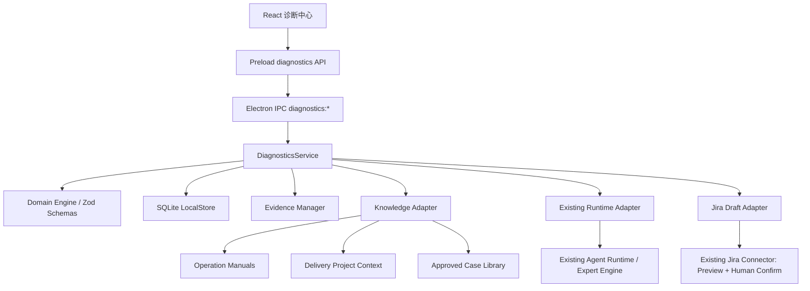

# 精工 Agent 现场问题智能诊断中心 1.0 技术方案

> 文档类型：技术设计说明（TDD）  
> 产品：精工 Agent Windows 桌面端  
> 版本：1.0.0  
> 目标分支：`develop/desktop-poc`  
> 已核对基线：`93c39887ea55f4a492b9993aa20b5b5272c7ecba`（开发前必须重新核实）  
> 编写日期：2026-11-24  
> 配套文档：`精工Agent_现场问题智能诊断中心1.0_需求规格说明.md`

---

## 1. 技术目标与设计原则

在现有 Electron + React + TypeScript + SQLite 本地桌面架构中新增现场问题诊断领域，实现可保存、可追踪、可审核的诊断闭环。

设计原则：

1. 增量扩展，不重写 Runtime、专家中心、知识库、操作手册、Jira Connector 和项目工作台。
2. 诊断业务领域独立于现有开发任务交付包 `packages/delivery`；命名和 IPC 不得与其冲突。
3. AI 通过现有 Runtime/Agent 执行链路调用，不新建模型 API 直连代码。
4. Renderer 不持有数据库、文件系统路径、模型凭据或 Jira 凭据。
5. AI 输出全部按不可信输入处理，严格校验 JSON Schema、枚举、长度、来源引用和状态转换。
6. 诊断建议与现场实际结果分开存储；AI 不能伪造工程师验证记录。
7. 1.0 所有现场步骤均为只读/人工指导，不允许执行客户环境写操作。
8. 本地 SQLite 是本机数据存储，不代表多人协同平台。

## 2. 当前仓库基线与现有能力

已核对的仓库基线（Codex 开发前必须再查一次）：

- 仓库：`zhuangxiaolong/jg_agent`
- 分支：`develop/desktop-poc`
- 基线 commit：`93c39887ea55f4a492b9993aa20b5b5272c7ecba`
- package version：`0.9.6`
- 桌面端：`apps/desktop/src/main`、`apps/desktop/src/preload`、`apps/desktop/src/renderer`
- 核心包：`packages/`
- Renderer：React 19 + TypeScript；主进程：Electron + TypeScript；SQLite：Node `node:sqlite`；输入校验：Zod。
- 已核对数据库基线 `SCHEMA_VERSION = 21`；开发时必须读取实际当前值并从当前值递增，不能照抄 22。

### 2.1 复用模块

| 模块 | 当前职责 | 诊断中心复用方式 |
|---|---|---|
| `packages/domain` | 现有领域类型、API 契约 | 新增诊断领域接口并导出 |
| `packages/storage` | SQLite `LocalStore`、迁移、事务、JSON value 存储 | 新增诊断表和 CRUD；沿用数据库备份/迁移模式 |
| `packages/operation-manuals` | 操作手册切块、产品版本元数据、来源定位和引用格式 | 检索当前 MES5/MES6/WMS 对应版本的手册片段 |
| `apps/desktop/src/main/operation-manual-library.ts` | 手册本地文件管理、索引与 Store 协作 | 通过现有服务获取手册检索结果，不复制原始手册索引 |
| `packages/knowledge` | 文档解析和文本抽取 | 解析日志、文本和办公文档；按实际支持能力处理图片/多模态 |
| `packages/second-iteration` | Excel/CSV 字段映射、校验和转换 | 在诊断上下文中链接已有 MappingJob/MappingRun，不重做 Excel 引擎 |
| `packages/expert-engine` | 专家档案、专家选择与执行策略 | 根据问题类别使用现有专家解析/协同机制；不新建第二套 Expert Center |
| `packages/agent-runtime` | Codex、Claude、精工 Runtime 等 | 通过当前会话/运行生命周期调用模型 |
| `packages/agent-orchestrator` | Agent Task 拆分、任务约束及执行治理 | 如确有需要复用现有任务治理；诊断步骤仍由诊断领域管理 |
| `apps/desktop/src/main/agent-tasks.ts` | 当前 Agent Task 执行与工具权限治理 | 参考 Runtime 执行入口和安全网关，不要绕过权限治理 |
| `packages/jira-connector` | Jira 读取、评论、附件等 | P1 创建问题单时复用现有 Jira 流程及确认机制 |
| `apps/desktop/src/main/delivery-ipc.ts` + `packages/delivery` | 开发任务交付证据快照、ZIP 和 Jira 回写 | 仅参考安全预览/确认模式；不可把客户现场诊断塞入开发交付包 |
| 交付工作台 1.0（如已实现） | `DeliveryProject` / `DeliveryIssue` 等客户交付数据 | 使用实际 API 关联项目和项目问题，不再复制项目台账实体 |

### 2.2 当前代码检查结论与开发注意

- 现有 `Project` 是本地代码仓库项目，不是客户交付项目。
- 现有 `DeliveryPanel` 与 `delivery:*` IPC 用于整理研发任务证据及 Jira 回写，不是现场问题诊断中心。
- 现有 `iteration-ipc.ts` 中项目上下文 `projectId` 关联代码项目，不能直接当作 DeliveryProject。
- 交付工作台 PRD/技术方案若已由 Codex 实施，需核查其 `DeliveryProject` 和项目问题 API；尚未实施时，诊断中心应允许 `deliveryProjectId` 为空，不得重新创建一套客户项目主数据。
- `OperationManualLibrary` 已具有手册列表、详情/切块、后台索引流程；新增检索必须检查当前真实 search 方法和现有 Store，不可根据文档猜 API 名称。
- `packages/second-iteration` 已有 `parseSourceData`、`suggestMappings`、`validateAndConvert` 等能力；诊断中心仅建立跳转/结果引用。
- 现有 Settings 安全服务具有敏感文本检测/脱敏方法（如 `assertCleanText`、`redact`）；开发前核对准确签名并复用。

## 3. 推荐模块结构

下面是推荐结构，Codex 应根据当前仓库实际 package 组织微调，不得大规模移动旧文件：

```text
packages/
├── domain/src/
│   └── diagnostics.ts                 # DiagnosticCase / Run / Step / Evidence / Finding / CaseStudy 类型
├── incident-diagnostics/
│   ├── package.json                   # 如仓库 package 组织要求
│   └── src/index.ts                   # 纯领域规则、Schema、状态转换、相似度排序
└── storage/src/index.ts               # LocalStore 的表迁移和 CRUD

apps/desktop/src/
├── main/
│   ├── diagnostics-service.ts         # 诊断编排与证据/知识适配器
│   ├── diagnostics-ipc.ts             # IPC、项目归属、安全和参数校验
│   └── index.ts                       # 注册诊断 IPC/Service
├── preload/index.ts                  # window.jinggong.diagnostics
└── renderer/
    ├── DiagnosticCenter.tsx
    └── diagnostics/
        ├── DiagnosticOverview.tsx
        ├── DiagnosticCaseList.tsx
        ├── DiagnosticCaseCreate.tsx
        ├── DiagnosticCaseDetail.tsx
        ├── DiagnosticTriagePanel.tsx
        ├── DiagnosticStepsPanel.tsx
        ├── DiagnosticEvidencePanel.tsx
        ├── DiagnosticFindingsPanel.tsx
        ├── DiagnosticCaseLibrary.tsx
        └── styles.css

tests/
├── diagnostics-domain.test.ts
├── diagnostics-storage.test.ts
├── diagnostics-ipc.test.ts
├── diagnostics-service.test.ts
├── diagnostics-security.test.ts
└── diagnostics-ui.test.ts (按现有测试能力决定)
```

避免把所有诊断逻辑写进 `apps/desktop/src/main/index.ts` 或单个 React 组件。

## 4. 总体架构



### 4.1 Renderer

- 只负责 UI、输入收集和展示。
- 不直接读写 SQLite、不使用 Node `fs`、不获取绝对附件路径、不读模型/API 凭据。
- 调用 `window.jinggong.diagnostics` 的类型化方法。
- 诊断步骤结果由用户显式提交；AI 生成建议不能自动写成工程师结果。

### 4.2 Preload

新增 `diagnostics` 命名空间，公开最小方法集合。调用方式遵循现有 `invoke`、`DesktopApi`、global.d.ts 类型模式。

### 4.3 Main IPC

- IPC 命名统一使用 `diagnostics:*`，避免使用现有 `delivery:*`。
- 所有输入均用 Zod `.strict()` 校验；拒绝未知字段。
- 校验项目、问题、步骤、附件和案例之间的归属关系。
- 每个 IPC handler 都在主进程检查 `DiagnosticCase` 是否存在、记录是否属于当前 case/project。
- Renderer 传 ID，不传任意本机文件路径；选文件通过 `dialog.showOpenDialog` 完成。
- 对会写外部系统的动作使用 preview + confirm 模式。

### 4.4 Diagnostics Service

负责：

- 创建诊断上下文快照。
- 组装用户现象、产品/版本、项目上下文、已录证据和排查反馈。
- 调用知识检索适配器。
- 调用现有 Runtime/专家服务。
- 校验 AI 结果并保存诊断运行记录。
- 维护步骤版本、假设和人工验证记录。
- 生成 Markdown 开发问题单和案例候选。

### 4.5 Domain Engine

纯函数/纯规则，不依赖 Electron、React、SQLite 或模型 SDK。负责 Schema、状态流转、字段规则、根因状态规则、步骤规则、案例检索评分、诊断指标计算。

## 5. 领域模型

### 5.1 通用约定

- 主键沿用 `randomUUID()`。
- 时间使用 ISO 8601 UTC 字符串；用户可输入的日期仅在确有日期字段时使用 `YYYY-MM-DD`。
- TypeScript 内部枚举使用英文 key，UI 使用中文标签。
- 主键、项目外键、状态、创建时间、更新时间应有单独列；业务详情可按仓库现有 Store 模式存放 JSON `value`。
- 附件二进制不放 SQLite；只存元数据与受管存储键。
- 原始诊断运行和步骤反馈应保留历史，不用新结果覆盖旧分析。

### 5.2 DiagnosticCase

```ts
export type DiagnosticProduct = 'MES5' | 'MES6' | 'WMS' | 'OTHER';
export type DiagnosticCaseStatus =
  | 'new' | 'triaging' | 'awaiting_input' | 'diagnosing'
  | 'awaiting_customer' | 'awaiting_development' | 'pending_verification'
  | 'resolved' | 'closed' | 'reopened' | 'cancelled';
export type DiagnosticPriority = 'critical' | 'high' | 'medium' | 'low';

export interface DiagnosticCase {
  id: string;
  caseNo: string;
  title: string;
  symptom: string;
  expectedResult?: string;
  actualResult?: string;
  product: DiagnosticProduct;
  productVersion?: string;
  module?: string;
  businessProcess?: string;
  issueCategory?: 'business' | 'configuration' | 'data' | 'permission' | 'integration' | 'defect' | 'performance' | 'environment' | 'operation' | 'other' | 'unknown';
  priority: DiagnosticPriority;
  status: DiagnosticCaseStatus;
  occurredAt?: string;
  frequency?: string;
  impactScope?: string;
  environment?: string;
  deliveryProjectId?: string; // 由项目集成适配器验证；不复制 DeliveryProject
  deliveryIssueId?: string; // 可选关联已有交付问题台账
  assigneeLabel?: string;
  reporterLabel?: string;
  createdAt: string;
  updatedAt: string;
  closedAt?: string;
  currentRunId?: string;
  resolutionSummary?: string;
}
```

备注：若交付工作台尚未落地 DeliveryIssue，`deliveryIssueId` 只能作为可选外部引用存储；不得依赖不存在的类型或实现。

### 5.3 DiagnosticRun

```ts
export type DiagnosticRunKind = 'triage' | 'plan' | 'replan' | 'root_cause' | 'summary';
export type DiagnosticRunStatus = 'queued' | 'running' | 'succeeded' | 'failed' | 'cancelled';

export interface DiagnosticRun {
  id: string;
  caseId: string;
  revision: number;
  kind: DiagnosticRunKind;
  status: DiagnosticRunStatus;
  runtimeKind?: string;
  model?: string;
  promptVersion: string;
  inputSnapshotHash: string;
  outputHash?: string;
  outputJson?: string;
  errorSummary?: string;
  sourceRefs: DiagnosticSourceRef[];
  startedAt: string;
  completedAt?: string;
}
```

不记录 Runtime API Key、Authorization Header、完整凭据或未经脱敏的密钥。`outputJson` 保存前必须做敏感信息检测。

### 5.4 DiagnosticStep

```ts
export type DiagnosticStepStatus =
  | 'pending' | 'in_progress' | 'confirmed_normal' | 'confirmed_abnormal'
  | 'inconclusive' | 'not_applicable' | 'blocked';
export type DiagnosticSafetyLevel = 'read_only_ui' | 'read_only_evidence' | 'manual_customer_action';

export interface DiagnosticStep {
  id: string;
  caseId: string;
  runId: string;
  planRevision: number;
  order: number;
  title: string;
  purpose: string;
  hypothesisId?: string;
  instructions: string;
  preconditions: string[];
  expectedNormal: string;
  abnormalSignals: string[];
  requestedEvidence: string[];
  safetyLevel: DiagnosticSafetyLevel;
  status: DiagnosticStepStatus;
  resultText?: string;
  resultBy?: string;
  resultAt?: string;
  evidenceIds: string[];
  blockedReason?: string;
  notApplicableReason?: string;
  createdAt: string;
  updatedAt: string;
}
```

`write_or_production_change` 不应作为模型可输出的可执行步骤安全枚举；如果模型输出该值，应被 Schema 拒绝或被映射为“禁止执行，需要升级人工处理”的安全提示，并记录安全校验事件。

### 5.5 DiagnosticEvidence

```ts
export type DiagnosticEvidenceKind = 'screenshot' | 'log' | 'text' | 'document' | 'api_request' | 'api_response' | 'database_result' | 'other';
export type DiagnosticEvidenceStatus = 'stored' | 'parsed' | 'parse_failed' | 'redacted' | 'deleted';

export interface DiagnosticEvidence {
  id: string;
  caseId: string;
  kind: DiagnosticEvidenceKind;
  originalName: string;
  storageKey: string; // 相对 dataRoot 的受管 key，不是绝对路径
  extension: string;
  mimeType?: string;
  size: number;
  sha256: string;
  status: DiagnosticEvidenceStatus;
  parseSummary?: string;
  extractedTextKey?: string; // 脱敏提取文本的受管 key
  redactionSummary?: string;
  sourceLabel?: string;
  createdAt: string;
  deletedAt?: string;
}
```

原始附件与脱敏文本分别保存，AI 默认读取脱敏副本；需保留原始证据时，只允许在 UI 按需查看。若无法可靠脱敏，则不发送模型，提示用户改为手工摘录。

### 5.6 DiagnosticHypothesis / Finding

```ts
export interface DiagnosticHypothesis {
  id: string;
  caseId: string;
  runId: string;
  title: string;
  category: string;
  confidence: 'high' | 'medium' | 'low';
  status: 'suspected' | 'under_verification' | 'verified_by_engineer' | 'rejected' | 'unknown';
  supportingRefs: DiagnosticSourceRef[];
  contradictingRefs: DiagnosticSourceRef[];
  nextVerification?: string;
  confirmedBy?: string;
  confirmedAt?: string;
}

export interface DiagnosticSourceRef {
  sourceType: 'manual' | 'project_document' | 'project_fact' | 'approved_case' | 'diagnostic_evidence' | 'diagnostic_step' | 'user_input' | 'generic_knowledge';
  sourceId: string;
  sourceName?: string;
  locator?: string;
  quote?: string;
  productVersion?: string;
}
```

证据引用必须指向已存在且属于当前诊断可见范围的来源 ID。AI 输出随机、无效或越权 sourceId 时拒绝该条引用并记录校验失败。

### 5.7 DiagnosticResolution

```ts
export interface DiagnosticResolution {
  id: string;
  caseId: string;
  rootCauseSummary: string;
  rootCauseStatus: 'suspected' | 'verified_by_engineer' | 'unknown';
  resolutionType: 'workaround' | 'permanent_fix' | 'prevention' | 'development_required' | 'customer_or_vendor_action';
  actionSummary: string;
  verificationMethod: string;
  verificationResult: 'passed' | 'failed' | 'partial' | 'not_run';
  verificationNotes?: string;
  verifiedBy?: string;
  verifiedAt?: string;
  acceptedUnverifiedRisk?: boolean;
  acceptedRiskReason?: string;
  createdAt: string;
}
```

### 5.8 DiagnosticKnowledgeCase

```ts
export interface DiagnosticKnowledgeCase {
  id: string;
  sourceCaseId: string;
  title: string;
  product: DiagnosticProduct;
  productVersionRange?: string;
  module?: string;
  symptom: string;
  diagnosisPath: string;
  rootCause: string;
  resolution: string;
  verification: string;
  constraints: string[];
  anonymizedContentHash: string;
  status: 'draft' | 'pending_review' | 'approved' | 'rejected' | 'archived';
  sharedAcrossProjects: boolean;
  reviewerLabel?: string;
  reviewNote?: string;
  reviewedAt?: string;
  createdAt: string;
  updatedAt: string;
}
```

跨项目共享要求 `sharedAcrossProjects === true` 且 `status === 'approved'`。查询层必须同时校验这两个条件。

## 6. SQLite 存储设计

沿用 `packages/storage/src/index.ts` 的 `LocalStore`、事务、JSON value 和版本迁移风格。

新增表建议：

```sql
CREATE TABLE diagnostic_cases (
  id TEXT PRIMARY KEY,
  case_no TEXT UNIQUE NOT NULL,
  status TEXT NOT NULL,
  priority TEXT NOT NULL,
  product TEXT NOT NULL,
  delivery_project_id TEXT,
  updated_at TEXT NOT NULL,
  value TEXT NOT NULL
);
CREATE INDEX diagnostic_cases_status_updated ON diagnostic_cases(status, updated_at DESC);
CREATE INDEX diagnostic_cases_project_updated ON diagnostic_cases(delivery_project_id, updated_at DESC);
CREATE INDEX diagnostic_cases_product_priority ON diagnostic_cases(product, priority, updated_at DESC);

CREATE TABLE diagnostic_runs (
  id TEXT PRIMARY KEY,
  case_id TEXT NOT NULL REFERENCES diagnostic_cases(id) ON DELETE CASCADE,
  revision INTEGER NOT NULL,
  kind TEXT NOT NULL,
  status TEXT NOT NULL,
  started_at TEXT NOT NULL,
  value TEXT NOT NULL,
  UNIQUE(case_id, revision, kind)
);
CREATE INDEX diagnostic_runs_case ON diagnostic_runs(case_id, revision DESC);

CREATE TABLE diagnostic_steps (
  id TEXT PRIMARY KEY,
  case_id TEXT NOT NULL REFERENCES diagnostic_cases(id) ON DELETE CASCADE,
  run_id TEXT NOT NULL REFERENCES diagnostic_runs(id) ON DELETE CASCADE,
  plan_revision INTEGER NOT NULL,
  step_order INTEGER NOT NULL,
  status TEXT NOT NULL,
  updated_at TEXT NOT NULL,
  value TEXT NOT NULL
);
CREATE INDEX diagnostic_steps_case ON diagnostic_steps(case_id, plan_revision, step_order);

CREATE TABLE diagnostic_evidence (
  id TEXT PRIMARY KEY,
  case_id TEXT NOT NULL REFERENCES diagnostic_cases(id) ON DELETE CASCADE,
  kind TEXT NOT NULL,
  status TEXT NOT NULL,
  sha256 TEXT NOT NULL,
  created_at TEXT NOT NULL,
  value TEXT NOT NULL
);
CREATE INDEX diagnostic_evidence_case ON diagnostic_evidence(case_id, created_at DESC);

CREATE TABLE diagnostic_hypotheses (
  id TEXT PRIMARY KEY,
  case_id TEXT NOT NULL REFERENCES diagnostic_cases(id) ON DELETE CASCADE,
  run_id TEXT NOT NULL REFERENCES diagnostic_runs(id) ON DELETE CASCADE,
  status TEXT NOT NULL,
  value TEXT NOT NULL
);
CREATE INDEX diagnostic_hypotheses_case ON diagnostic_hypotheses(case_id, run_id);

CREATE TABLE diagnostic_resolutions (
  id TEXT PRIMARY KEY,
  case_id TEXT NOT NULL REFERENCES diagnostic_cases(id) ON DELETE CASCADE,
  created_at TEXT NOT NULL,
  value TEXT NOT NULL
);
CREATE INDEX diagnostic_resolutions_case ON diagnostic_resolutions(case_id, created_at DESC);

CREATE TABLE diagnostic_knowledge_cases (
  id TEXT PRIMARY KEY,
  source_case_id TEXT NOT NULL REFERENCES diagnostic_cases(id),
  status TEXT NOT NULL,
  shared_across_projects INTEGER NOT NULL,
  product TEXT NOT NULL,
  updated_at TEXT NOT NULL,
  value TEXT NOT NULL
);
CREATE INDEX diagnostic_knowledge_approved ON diagnostic_knowledge_cases(status, shared_across_projects, product, updated_at DESC);

CREATE TABLE diagnostic_events (
  seq INTEGER PRIMARY KEY AUTOINCREMENT,
  id TEXT UNIQUE NOT NULL,
  case_id TEXT NOT NULL REFERENCES diagnostic_cases(id) ON DELETE CASCADE,
  event_type TEXT NOT NULL,
  created_at TEXT NOT NULL,
  value TEXT NOT NULL
);
CREATE INDEX diagnostic_events_case ON diagnostic_events(case_id, seq);
```

实现时须与现有表命名、迁移 SQL、`SCHEMA_VERSION` 和备份流程保持一致；如果项目已由此前交付工作台迭代更新数据库版本，以当前数据库版本为准。迁移必须保证旧数据库可备份、升级、重启后复查，并为迁移失败保留原库。

不要将任何原始敏感附件正文或凭据存到 `diagnostic_events`。事件中只保存经过脱敏的摘要、字段变更和证据 ID。

## 7. IPC / Preload API 设计

所有方法应在实际 `DesktopApi` 中定义并遵循现有命名、错误包装和 `invoke` 规范。以下为目标契约，不应原样照搬而忽略现有接口风格。

### 7.1 查询与 CRUD

- `diagnostics:listCases(input)`：分页、筛选、搜索；返回脱敏摘要，不返回绝对文件路径。
- `diagnostics:getCase(caseId)`：返回问题详情、当前运行、步骤、证据元数据、根因、解决方案和时间线。
- `diagnostics:createCase(input)`：创建问题。
- `diagnostics:updateCase(caseId, patch)`：白名单字段更新并记录事件。
- `diagnostics:transitionCase(caseId, targetStatus, reason)`：按领域规则转换状态。
- `diagnostics:getOverview(filters)`：返回按规则计算的本地统计。

### 7.2 附件

- `diagnostics:selectEvidence(caseId)`：主进程弹出文件选择框，校验并复制至 managed storage，返回元数据 ID。
- `diagnostics:readEvidencePreview(evidenceId)`：仅返回经限长/脱敏的预览；不暴露绝对路径。
- `diagnostics:deleteEvidence(evidenceId)`：二次确认，校验归属后删除受管文件并更新记录。

### 7.3 AI 分诊与排查

- `diagnostics:runTriage(caseId, options)`：开始分诊；若 Runtime 运行是异步的，返回 runId 并通过既有事件订阅/轮询机制获取结果。
- `diagnostics:runPlan(caseId, options)`：生成首版排查计划。
- `diagnostics:submitStepResult(caseId, stepId, input)`：提交工程师实际检查结果、附件引用和备注。
- `diagnostics:replan(caseId, options)`：基于新增结果生成新修订计划。
- `diagnostics:runRootCause(caseId)`：生成根因候选和支持/反向证据。
- `diagnostics:saveResolution(caseId, input)`：保存处理结果与验证记录。

### 7.4 开发升级与案例

- `diagnostics:exportDeveloperDraft(caseId)`：生成 Markdown 草稿并由主进程保存/返回内容。
- `diagnostics:previewJiraDraft(caseId, input)`：P1，预览 Jira 目标、字段和正文。
- `diagnostics:confirmJiraDraft(previewId, confirmed)`：P1，人工确认后复用现有 Jira Connector，必须校验预览没有过期/目标未变化。
- `diagnostics:submitKnowledgeCase(caseId, input)`：创建脱敏案例草稿，默认不共享。
- `diagnostics:approveKnowledgeCase(caseId, input)`：交付技术负责人审核；只允许 approved 状态进入跨项目查询。
- `diagnostics:searchKnowledgeCases(input)`：项目内和共享案例检索，强制执行 scope filter。

所有 IPC 输入 `.strict()`，包括数组上限、文本最大长度、ID 格式和枚举。所有子记录在存取前检查 `caseId`、`deliveryProjectId` 和当前本地数据的关系。

## 8. AI 运行时接入

### 8.1 关键约束

- 必须沿用现有 Runtime、Session、AgentTask 或专家中心的执行链路。
- 禁止在诊断模块中直接 `fetch` 模型供应商 API、拼接中转站 URL、读取凭据或复制 Provider 配置。
- 不要把一个诊断运行伪装成已有的代码开发任务；诊断为分析任务，默认只读。
- AI 分析必须携带 prompt version、模型/Runtime 名称、输入快照 Hash 和所用来源 ID。
- 若当前选定 Runtime 不支持图片输入，不要声称已分析图片；保留附件引用并要求用户粘贴 OCR/错误文本或切换支持视觉的 Runtime。

### 8.2 适配器边界

新增窄接口（名称可按仓库风格调整）：

```ts
export interface DiagnosticAssistantPort {
  runStructured<TInput, TOutput>(input: {
    caseId: string;
    runId: string;
    task: 'triage' | 'plan' | 'replan' | 'root_cause' | 'summary';
    promptVersion: string;
    context: TInput;
    outputSchemaVersion: 1;
    readOnly: true;
  }): Promise<{ output: TOutput; runtimeKind?: string; model?: string }>;
}
```

该接口只是 `DiagnosticsService` 的依赖反转边界。具体实现应由 Codex 阅读 `apps/desktop/src/main/index.ts`、会话发送处理、`AgentTaskRunner`、`RuntimeManager` 和 `expert-center.ts` 后决定：优先复用现有内部调用路径或提取最小共享服务，不得再造 Runtime。

**如果现有 Runtime API 只能通过标准 Session 使用**，可以为诊断问题建立专用只读分析 Session，并在会话元数据中存储 `diagnosticCaseId`；但要遵守已有 Session 生命周期、取消、失败恢复和事件流，不创建隐藏的无记录执行通道。若需调整现有执行代码，必须先查明调用面，保持现有开发会话兼容。

### 8.3 AI 上下文组装

输入上下文应按固定预算构建，建议顺序：

1. 当前问题摘要、产品版本、现象、期望/实际结果。
2. 已确认的人工现场结果。
3. 与当前产品和版本匹配的操作手册片段。
4. 当前项目已确认事实、决策和项目文档摘录（若已关联项目）。
5. 已审核共享案例和当前项目内历史案例。
6. 脱敏后的用户附件摘要/日志片段。
7. 已有 AI 假设和排查路径（明确标注为 AI 建议，不作为事实）。

禁止把完整项目目录、完整数据库、所有手册或所有历史案例不加筛选地塞入提示词。保留每条检索来源的 ID、版本和定位信息。

### 8.4 检索适配器

建议分层实现：

```ts
export interface DiagnosticKnowledgePort {
  searchManuals(input: { product: DiagnosticProduct; productVersion?: string; query: string; limit: number }): Promise<DiagnosticSourceRef[]>;
  searchProjectContext(input: { deliveryProjectId: string; query: string; limit: number }): Promise<DiagnosticSourceRef[]>;
  searchApprovedCases(input: { product: DiagnosticProduct; productVersion?: string; module?: string; query: string; limit: number }): Promise<DiagnosticSourceRef[]>;
}
```

要求：

- `searchManuals` 必须使用现有 `OperationManualLibrary` / Store 的真实查询入口；Codex 先定位实际 API，不可猜测函数名。
- 过滤手册状态、产品类型、版本范围和有效期；有版本冲突时明确警示。
- `searchProjectContext` 仅在 `deliveryProjectId` 存在且集成适配器通过归属校验后调用；如果项目不存在/工作台未部署，返回空来源并继续诊断。
- `searchApprovedCases` 只检索 `status = approved AND sharedAcrossProjects = true` 的跨项目案例。当前来源项目内部案例可以另行查询，但不能突破项目边界。
- 1.0 用本地关键词/字段评分，不引入向量数据库，不做模型驱动的无来源“知识召回”。

### 8.5 严格结构化输出 Schema

分诊结果示例：

```ts
export interface DiagnosticTriageOutput {
  schemaVersion: 1;
  summary: string;
  product: 'MES5' | 'MES6' | 'WMS' | 'OTHER' | 'unknown';
  module: string | 'unknown';
  businessProcess: string | 'unknown';
  issueCategory: string;
  prioritySuggestion: 'critical' | 'high' | 'medium' | 'low' | 'unknown';
  knownFacts: Array<{ text: string; sourceRefs: string[] }>;
  missingInformation: Array<{ question: string; whyItMatters: string; priority: 'high' | 'medium' | 'low' }>;
  hypotheses: Array<{ id: string; title: string; category: string; confidence: 'high' | 'medium' | 'low'; supportingRefs: string[]; contradictingRefs: string[]; nextVerification: string }>;
  immediateSafetyNote?: string;
}
```

排查计划输出：

```ts
export interface DiagnosticPlanOutput {
  schemaVersion: 1;
  summary: string;
  steps: Array<{
    id: string;
    title: string;
    purpose: string;
    hypothesisId?: string;
    instructions: string;
    preconditions: string[];
    expectedNormal: string;
    abnormalSignals: string[];
    requestedEvidence: string[];
    safetyLevel: 'read_only_ui' | 'read_only_evidence' | 'manual_customer_action';
    sourceRefs: string[];
    nextBranches: Array<{ when: string; nextAction: string }>;
  }>;
  stopConditions: string[];
  escalationCriteria: string[];
}
```

Zod 约束：

- `schemaVersion === 1`，所有对象 `.strict()`。
- 分诊摘要最多 5,000 字，步骤最多 20 个但服务层首版限制最多 8 个，字符串、数组和嵌套长度必须有上限。
- `sourceRefs` 中每个 ID 必须存在于本轮输入证据白名单；AI 不得自造引用。
- AI 不得输出任意工具调用名、Shell、SQL 或 URL 作为可执行动作字段。
- 安全级别不允许 `write`、`execute`、`production_change`。发现此类内容即拒绝并返回安全提示。
- 结构校验失败时保留失败 run 的状态与安全错误摘要，不将未校验 JSON 持久化为可展示的正式结果。

### 8.6 防止模型过度自信

提示词必须明确：

- “当前证据不足”是合法结论。
- 不能用通用经验冒充精工 MES/WMS 的确定行为。
- 不知道产品版本、菜单、字段或配置时必须询问或标记 unknown。
- 只能把用户明确确认的步骤结果视为现场事实。
- 根因假设必须列支持证据和反向证据。
- 不得声称已经执行检查、访问客户系统或修复问题。
- 不得把建议命令/SQL写成一键可执行按钮。

## 9. 证据文件管理与安全

### 9.1 文件管理

- 文件根目录：`<dataRoot>/diagnostics/<caseId>/evidence/`。
- 采用随机 storage key 或 UUID 文件名；数据库只保存相对 storage key。
- 扩展名白名单：`.png`、`.jpg`、`.jpeg`、`.webp`、`.txt`、`.log`、`.md`、`.json`、`.xml`、`.csv`、`.pdf`、`.docx`、`.xlsx`。
- 不接受 `.exe`、`.js`、`.ps1`、`.bat`、`.cmd`、`.dll`、`.zip`、`.rar`、`.7z` 等可执行/压缩格式。
- 文件入库前检查普通文件、大小、扩展名、路径段、符号链接/junction；复制后校验大小和 SHA-256。
- 建议单文件最大 20 MiB，单次最多 10 份，单问题累计 100 MiB；实际应复用/合并现有安全限额，避免不同模块限额冲突。
- 解析后输出放在同一 case 的 managed 子目录中，原始附件与提取/脱敏副本严格分开。

### 9.2 敏感信息保护

- 复用 `security.ts` 与 `SettingsService` 中现有脱敏/敏感检测；先检查真实函数签名，不复制一套 regex 漏洞百出的实现。
- 解析文本进入 Runtime 前必须经过敏感检查。
- 命中疑似密码、API Key、Bearer Token、Cookie、Authorization、数据库连接串、私钥等内容：默认阻止外发，提供本地脱敏预览，用户确认后才可发送脱敏副本。
- 不将敏感原文写入模型 Prompt、诊断 run 输出、事件日志或报错文本。
- 原始附件仅在本地管理；向模型传输前显示哪些附件/哪些摘录将被发送。
- 在诊断设置和每次分析摘要中显示当前 Runtime/模型及“本次会向模型发送脱敏证据”的提示。

### 9.3 文件读取与解析

- 文档类型优先复用 `packages/knowledge` 的 `readDocumentTextFile` / `importDocumentFile`（以当前 API 为准）。
- PDF、DOCX、XLSX 解析应有字符数和页/行限制，避免大文件耗尽内存。
- 截图若当前 Runtime 具备多模态输入，可作为图像输入；否则只记录元数据并提醒用户粘贴错误文本，不能对截图内容作未经读取的分析。
- 日志需限制最长文本、行数和每行长度；保留行号、时间戳和源文件名以便引用。
- XML/JSON/CSV 展示时需转义内容，防止 Renderer HTML 注入；日志内可能含模型提示注入文本，必须视为不可信数据。

## 10. 诊断服务内部接口与事件

建议服务层提供：

```ts
export interface DiagnosticsService {
  createCase(input: CreateDiagnosticCaseInput): Promise<DiagnosticCase>;
  listCases(input: DiagnosticCaseListInput): Promise<DiagnosticCaseListResult>;
  getCase(caseId: string): Promise<DiagnosticCaseDetail>;
  updateCase(caseId: string, input: UpdateDiagnosticCaseInput): Promise<DiagnosticCase>;
  addEvidence(caseId: string, selectedFiles: string[]): Promise<DiagnosticEvidence[]>;
  runTriage(caseId: string): Promise<DiagnosticRun>;
  generatePlan(caseId: string, kind: 'plan' | 'replan'): Promise<DiagnosticRun>;
  submitStepResult(caseId: string, stepId: string, input: SubmitDiagnosticStepResultInput): Promise<DiagnosticStep>;
  runRootCause(caseId: string): Promise<DiagnosticRun>;
  saveResolution(caseId: string, input: DiagnosticResolutionInput): Promise<DiagnosticResolution>;
  exportDeveloperDraft(caseId: string): Promise<string>;
  createKnowledgeCaseDraft(caseId: string, input: CreateDiagnosticKnowledgeInput): Promise<DiagnosticKnowledgeCase>;
  reviewKnowledgeCase(caseId: string, input: ReviewDiagnosticKnowledgeInput): Promise<DiagnosticKnowledgeCase>;
}
```

若当前主进程偏好类 + 函数的模块结构，可以按既有模式落地；上面为职责契约，不要求照抄接口。

诊断运行事件建议：

- `diagnostics.run.started`
- `diagnostics.run.stage`
- `diagnostics.run.succeeded`
- `diagnostics.run.failed`
- `diagnostics.step.updated`
- `diagnostics.case.status_changed`
- `diagnostics.evidence.added`
- `diagnostics.knowledge.submitted`
- `diagnostics.knowledge.reviewed`

若现有 EventBus / IPC event stream 已足够，复用；不要另起全局消息总线。

## 11. 关键业务规则

### 11.1 问题状态流转

用纯函数 `assertDiagnosticCaseTransition(current, target, context)` 控制：

- `new -> triaging | cancelled`
- `triaging -> awaiting_input | diagnosing | new`
- `awaiting_input -> triaging | diagnosing | cancelled`
- `diagnosing -> awaiting_input | awaiting_customer | awaiting_development | pending_verification | resolved | reopened`
- `awaiting_customer -> diagnosing | pending_verification | cancelled`
- `awaiting_development -> diagnosing | pending_verification | reopened`
- `pending_verification -> resolved | diagnosing | reopened`
- `resolved -> closed | reopened`
- `closed -> reopened`（必须填写重开原因）
- `reopened -> triaging | diagnosing | cancelled`

具体可以按产品已有状态习惯微调，但必须在领域层单测覆盖；不允许任意跳转。

### 11.2 关闭条件

`closed` 至少满足：

- 存在一条 DiagnosticResolution；
- 根因已验证，或明确为 unknown 并填写原因；
- 处理说明非空；
- 验证结果 `passed`，或勾选接受未验证风险并填写不少于 10 字原因；
- 关闭动作有人工确认并写入 event。

### 11.3 证据版本一致性

- 每次 AI 分析记录输入快照 hash。
- 若分诊后新增/删除附件，旧分析标记为 `stale`，重新运行前显示差异。
- 若问题产品/版本/项目变更，当前运行和知识检索结果标记为可能过期。
- 旧 run、旧 plan、旧 step 结果不物理覆盖，历史可查看。

### 11.4 案例权限范围

- 项目内诊断数据只能通过所属项目引用获取。
- 共享案例必须经过人工审核且 `sharedAcrossProjects=true`。
- 不允许通过相似度检索让模型访问未授权项目原始附件或工单。
- 案例被归档/撤销后，后续检索立即排除，但历史诊断引用仍应可查看当时引用的版本摘要（不得恢复已删除的敏感正文）。

## 12. 开发问题单输出格式

P0 生成 Markdown，字段结构：

```md
# [产品/模块] 问题标题

## 基础信息
- 产品/版本：
- 客户/项目：
- 环境：
- 优先级：
- 诊断编号：

## 问题现象
- 实际结果：
- 期望结果：
- 发生频率：
- 影响范围：

## 复现条件与步骤
1.

## 已排查项
| 检查项 | 结果 | 证据 |
|---|---|---|

## 当前定位
- 已确认事实：
- 根因候选（未验证）：
- 已排除项：

## 附件
- 文件名 / SHA256 / 脱敏说明

## 开发待确认
- 

## 交付侧临时措施
- 未经授权不可执行的操作必须单独标记
```

不允许把“根因候选”标题输出成“根因已确认”。

## 13. UI 实现建议

### 13.1 诊断中心首页

- 顶部统计：未关闭、严重/高优先级、待客户、待开发、待验证。
- 主区域：问题列表和筛选。
- 快捷入口：新建问题、上传日志分析、查看共享案例。
- 空数据时给出创建入口，不显示虚构样例作为真实数据。

### 13.2 诊断详情

- 顶部：诊断编号、标题、状态、严重程度、产品版本、项目关联。
- 左侧：基础信息、负责人、影响范围和时间线。
- 中间：排查步骤时间线；每一步显示 AI 指引、工程师反馈、证据和状态。
- 右侧：AI 分诊、候选原因、知识引用、相似案例、重新分析。
- 底部：根因与解决方案、验证、开发问题单草稿、案例沉淀。

### 13.3 视觉原则

- 沿用当前应用主题、字体、组件、间距和交互标准，不引入另一套 UI 框架。
- 采用清晰的三栏/可折叠布局，支持常见桌面尺寸；长日志独立滚动。
- 状态颜色语义固定：异常/阻塞使用警示色，已验证通过使用成功色，AI假设使用中性/信息色。
- 区分 AI 建议、工程师反馈、系统事实和引用来源；不要都渲染成同一种聊天气泡。
- 所有按钮必须有真实动作；禁用状态、错误态、空状态和加载态完整。

## 14. 测试方案

### 14.1 Domain 单元测试

- Case 状态流转与非法转换。
- 排查步骤状态更新规则。
- AI 输出 schema 校验（多余字段、过长文本、无效引用、不允许的安全动作）。
- 根因和关闭条件。
- 案例审核状态与跨项目可见性。
- 案例相似度排序的确定性。
- 指标统计分母、时间窗和样本不足情况。

### 14.2 Storage 测试

- 从当前数据库版本迁移到新版本。
- 迁移前备份、失败回滚/原库保留。
- CRUD、事务和关联索引。
- Case 删除/归档与子表级联边界。
- 附件元数据不保存绝对路径/明文密钥。
- 历史 run、step 版本不被覆盖。

### 14.3 IPC / Security 测试

- 非法 ID、未知字段、超长内容拒绝。
- 跨 case 读取附件、步骤和 run 拒绝。
- 跨项目访问受限资料拒绝。
- 路径穿越、符号链接、重复文件名、超限文件拒绝。
- 恶意日志/HTML 内容安全展示。
- 敏感文本外发前检测阻止/脱敏。
- 取消、重复提交和并发提交正确处理。
- Jira 未确认不得发生写操作（P1）。

### 14.4 AI 集成测试

用 Mock DiagnosticAssistantPort 做确定性测试，不在常规单测中消耗真实模型 Token。

覆盖：

- 正常结构化输出。
- Runtime 超时、用户取消、进程中断、模型返回非 JSON。
- 超长输出、错误字段、虚假 sourceId。
- AI 输出写操作/SQL/命令时被拒绝。
- 用户提交新证据后旧 run 标 stale。
- AI 多次重排步骤时保留原历史。
- 当前 Runtime 不支持视觉输入时正确提示。

### 14.5 回归验证

按 `README.md` 当前构建规范执行：

```powershell
npm run build
npm test
npm run test:desktop
```

如果项目已有针对某些模块的独立测试脚本，按照实际脚本补测。所有验证必须真实执行，失败不得描述为通过。

## 15. 实施拆分建议

### Iteration A：基础领域与问题档案（P0）

- Domain 类型、规则和 Zod schema。
- SQLite 表迁移、备份与 Store CRUD。
- IPC / Preload 类型 API。
- 诊断中心列表、创建和详情基础页面。
- 证据选择、存储、哈希与删除。

### Iteration B：AI 分诊和逐步排查（P0 核心）

- DiagnosticAssistantPort 对接现有 Runtime。
- 适用手册/项目上下文/案例检索。
- 分诊结构化输出、澄清问题、排查计划。
- 工程师逐步反馈、动态重新规划、历史版本。

### Iteration C：根因、验证与升级开发（P0）

- 根因假设及证据引用。
- 解决方案和验证记录。
- 关闭规则、问题时间线。
- 开发问题单 Markdown 导出。

### Iteration D：知识案例治理和交付工作台联动（P0）

- 案例匿名化预览、审核、共享检索。
- 与客户交付项目和项目问题台账建立可选关联。
- 回归、性能和安全检查。

P1：Jira 直接创建草稿预览/确认、更多日志解析器、相似问题趋势看板。不要在 P0 中提前实现生产环境自动操作。

## 16. 非功能要求

- 本地列表读取应避免加载附件正文；分页和筛选在 Store 层执行。
- 所有文件解析和较大日志处理不得阻塞 Electron 主线程；参考现有 Worker 模式。
- AI 上下文采用预算和截断策略，优先保留当前症状、工程师验证、来源定位和最新有效版本。
- 用户取消或应用退出后可识别运行中断，不把中断 run 标记为成功。
- 诊断服务异常不得影响应用启动和现有开发功能。
- 所有数据访问在本机；不新增后台上传或遥测。
- 需要外部模型分析的证据必须由用户主动触发并明确提示发送范围。

## 17. Codex 开发执行约束

1. 开发前先读取 `AGENTS.md`、本技术方案、需求文档、`package.json`、当前 Git 分支和 `git status`。
2. 当前分支如果不是 `develop/desktop-poc`，先报告并在当前用户工作分支内处理，不擅自切换或重置。
3. 阅读 `main/index.ts`、Preload `DesktopApi`、`security.ts`、`LocalStore`、操作手册检索、Expert Center、AgentTaskRunner、会话发送和事件流代码，按当前实际调用链选择复用方式。
4. 先实现 Domain/Storage/IPC，再接 Runtime 和 UI，避免 UI 假数据先行。
5. 不重写 `packages/delivery`、`delivery-ipc.ts` 或 `DeliveryPanel.tsx`。
6. 不在 `packages/operation-manuals` 旁再建一份操作手册索引。
7. 不新增直接模型 API 请求和任何凭据存储。
8. 不实现任何 SQL/命令/客户环境自动执行。
9. 每个 Iteration 完成后执行相应测试；最终执行构建、全量测试和桌面冒烟。
10. 最终报告须列出真实改动文件、迁移版本、执行命令、测试通过/失败数量、未完成能力和风险。

