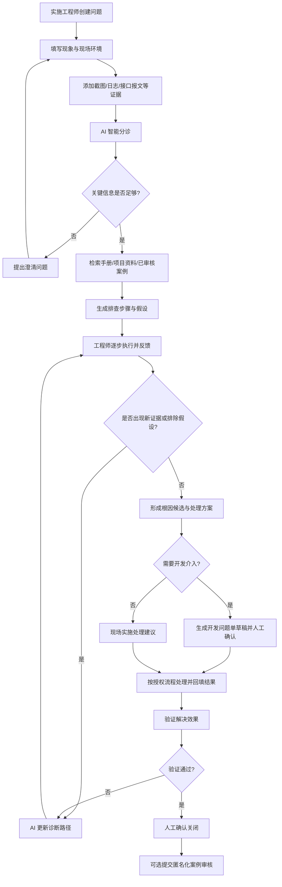

# 精工 Agent 现场问题智能诊断中心 1.0

> 文档类型：产品需求规格说明（PRD）  
> 产品：精工 Agent Windows 桌面端  
> 版本：1.0.0  
> 状态：待开发  
> 目标分支：`develop/desktop-poc`  
> 编写日期：2026-11-24  
> 配套文档：`精工Agent_现场问题智能诊断中心1.0_技术方案.md`

---

## 1. 项目背景

精工 Agent 当前主要服务开发人员，已具备多 Runtime 会话、专家中心、Jira 工作流、产品操作手册知识库、MES/WMS 数据字典、项目上下文、Excel 字段映射、代码分析和交付证据整理等能力。

MES/WMS 项目交付现场仍存在一类高频低效工作：实施工程师遇到异常后，往往依赖个人经验判断排查入口；不同工程师的排查顺序和记录质量不一致；同类问题在不同客户项目重复发生；问题升级开发时缺少复现条件、已排查项和证据，开发需要重新问询；问题关闭后经验没有形成可检索的企业案例。

现场问题诊断中心的目标不是做一个普通问答聊天框，而是把“问题收集—分类—排查计划—逐步验证—根因分析—解决验证—问题升级—案例沉淀”变成有记录、有依据、可复盘的工作流程。

## 2. 产品定位与目标用户

**产品定位：面向 MES5、MES6、WMS 项目交付团队的证据驱动型问题诊断工具。**

主要用户：

- **实施工程师**：创建问题、上传证据、按步骤排查、记录验证结果、生成问题报告。
- **项目经理**：查看项目问题进度、阻塞原因、客户待确认事项、开发升级情况和问题关闭质量。
- **开发工程师**：接收带有复现步骤、环境信息、日志、已排查项和初步定位的开发问题单。
- **交付组长/技术骨干**：复核疑难问题、确认根因、审核可复用案例，推动经验沉淀。

## 3. 1.0 产品目标与非目标

### 3.1 1.0 必须实现

| 目标 | 说明 | 验收方式 |
|---|---|---|
| 统一问题入口 | 支持从独立诊断中心创建问题，可选关联客户交付项目 | 可创建、编辑、检索、查看问题记录 |
| AI 智能分诊 | 识别产品、模块、业务环节、问题类型、影响和信息缺口 | 结构化结果可展示、编辑、重新分析 |
| 逐步排查 | AI 生成可执行排查步骤，工程师逐项提交结果，AI 根据反馈调整下一步 | 每一步有说明、预期、结果和时间记录 |
| 证据管理 | 支持截图、日志、文本、文档、接口报文等证据附件 | 文件受管存储、可预览、可追溯、可删除 |
| 知识辅助 | 优先检索适用产品版本的操作手册、项目资料和已审核案例 | AI建议展示来源和定位信息 |
| 根因与解决验证 | 区分疑似根因、已验证根因、临时措施、永久方案和验证结果 | 关闭前必须完成必要字段和人工确认 |
| 开发升级 | 生成标准化开发问题单草稿，人工确认后再走现有 Jira 流程 | 草稿可编辑；未确认不写入 Jira |
| 案例沉淀 | 问题解决后可提交匿名化案例审核，只有审核通过的案例可作为跨项目共享知识 | 有审核状态、来源和版本记录 |
| 交付工作台联动 | 可选关联 DeliveryProject / DeliveryIssue，不重复建设客户项目和项目问题台账 | 关联记录有效性校验；未部署交付工作台时仍可独立使用 |

### 3.2 1.0 不做

- 不自动连接客户生产数据库、MES/WMS 服务器、PLC、设备或客户网络。
- 不自动执行 SQL、Shell、PowerShell、API 写操作，不自动重启服务、改配置、改库存或修改生产数据。
- 不允许模型直接执行客户生产环境的修复动作。
- 不自行开发新的模型供应商配置、Runtime、向量数据库或第二套专家中心。
- 不将模型推测的内容自动标记为根因、已解决或已验证案例。
- 不在无数据来源的情况下生成“系统状态正常”“接口已恢复”等结论。
- 不建设云端多人实时协作、组织级权限和跨设备同步；当前版本定位为本机数据工作区。
- 不把某个客户的原始日志、工单、数据库内容默认共享给其他项目或提交为通用知识。
- 不把截图 OCR、视频分析或多模态能力作为所有模型都必定支持的能力；具体取决于现有 Runtime 和模型能力。

## 4. 产品原则

1. **证据优先**：结论必须区分事实、规则判断、AI 假设和人工确认。
2. **逐步验证**：先验证最可能、最安全、成本最低的假设；根据结果更新排查路径，避免一次性罗列大量无序建议。
3. **版本意识**：MES5、MES6、WMS 的菜单、数据结构、接口和配置差异必须保留产品及版本上下文，不得混用手册。
4. **人员负责**：AI 给出建议，实施人员执行并记录，技术负责人确认疑难根因，任何生产变更由客户授权人员按既有变更流程执行。
5. **数据最小化**：仅将用户选择的证据和必要上下文发送给当前会话所选 Runtime；凭据、个人信息和客户敏感数据应先提示及脱敏。
6. **不重复建设**：复用现有 Runtime、专家、操作手册、项目空间、Jira 和文件解析能力。
7. **可复盘**：每次诊断保留运行版本、输入摘要、检索来源、排查步骤、工程师反馈和最后的处理结论。

## 5. 典型业务流程



### 5.1 状态定义

诊断问题状态：

- `new`：新建，尚未开始诊断。
- `triaging`：正在智能分诊。
- `awaiting_input`：等待现场补充信息。
- `diagnosing`：排查中。
- `awaiting_customer`：等待客户确认或执行。
- `awaiting_development`：已升级开发，等待处理。
- `pending_verification`：方案已执行，等待验证。
- `resolved`：已由人员确认解决。
- `closed`：已关闭。
- `reopened`：问题重新打开。
- `cancelled`：已取消。

状态流转必须由主进程领域规则校验，Renderer 不得直接任意修改状态。`resolved` 与 `closed` 的区别是：已解决但尚未完成归档/案例评估时可处于 `resolved`；正式关闭需补齐必要结论和验证信息。

### 5.2 排查步骤状态

- `pending`：待检查。
- `in_progress`：检查中。
- `confirmed_normal`：检查结果正常，排除当前分支假设。
- `confirmed_abnormal`：确认异常，需根据结果继续定位。
- `inconclusive`：结果不明确，需要更多证据。
- `not_applicable`：该步骤不适用，必须填写原因。
- `blocked`：当前无法执行，必须说明阻塞原因。

## 6. 功能需求

优先级说明：P0 为 1.0 必须实现；P1 为后续小迭代或 1.0 后续批次；P2 为后续版本。

### 6.1 诊断中心总览（P0）

**FR-DIAG-001 诊断看板**

显示：

- 全部问题数、未关闭问题数、严重/高优先级问题数。
- 等待客户、等待开发、等待验证问题数。
- 当前用户最近处理的问题。
- 最近关闭的问题和可沉淀案例。
- 按产品类型、问题模块、问题类别筛选。

统计口径：

- 未关闭：状态不是 `closed`、`cancelled`。
- 等待开发：状态为 `awaiting_development`。
- 待验证：状态为 `pending_verification`。
- 严重/高优先级：优先级为 `critical` 或 `high`，且未关闭。
- 无数据时显示“暂无记录”；不得把未知信息视为 0 风险。

**FR-DIAG-002 问题列表**

支持按标题、编号、客户项目、产品系统、模块、状态、优先级、创建人/负责人筛选；按最近更新时间、严重程度排序。

**FR-DIAG-003 快速创建入口**

支持“描述问题”“上传截图/日志”“从项目问题台账转入诊断”三种入口。转入时应关联现有问题 ID，不重复创建同一条业务问题；具体以交付工作台 API 是否已实现为准。

### 6.2 创建诊断问题（P0）

**FR-DIAG-010 基础字段**

| 字段 | 必填 | 说明 |
|---|---:|---|
| 问题标题 | 是 | 1–200 字，可人工填写或 AI 起草 |
| 问题现象 | 是 | 10–20,000 字，描述发生了什么、预期是什么、实际是什么 |
| 产品系统 | 是 | MES5 / MES6 / WMS / OTHER |
| 产品版本 | 否 | 尽可能填写版本号、补丁/构建号 |
| 业务模块 | 否 | 可选现有分类或自定义 |
| 业务环节 | 否 | 如工单下达、报工、入库、上架、拣货、出库、库存调整等 |
| 问题类型 | 否 | 业务流程、配置、基础数据、权限、接口集成、程序缺陷、性能、操作问题、环境/部署、未知 |
| 严重程度 | 是 | critical / high / medium / low |
| 发生时间 | 否 | ISO 时间或现场描述 |
| 发生频率 | 否 | 每次、偶发、特定条件、首次发生、未知 |
| 影响范围 | 否 | 单用户、单设备、单工序/库区、单项目、多项目、生产停线/业务中断、未知 |
| 环境信息 | 否 | 测试/预生产/生产，客户部署方式，客户端/服务器版本等；不得填写明文密码 |
| 关联客户交付项目 | 否 | 关联现有 `DeliveryProject`（如交付工作台已部署），不在诊断模块复制项目数据模型 |
| 创建人/负责人 | 否 | 本地显示名称，不伪造统一身份 |

**FR-DIAG-011 标准描述模板**

提供以下引导问题：

- 在什么操作场景下发生？
- 操作步骤是什么？
- 期望结果是什么？
- 实际结果是什么？
- 是否每次都发生？
- 是否最近有版本发布、配置调整、基础数据变更或接口变更？
- 是否影响生产或关键业务？

允许先保存不完整问题，但启动 AI 诊断前必须至少有问题现象、产品系统和基本期望/实际结果；AI 可以先列出缺失信息，不得擅自补齐。

### 6.3 证据附件管理（P0）

**FR-DIAG-020 支持的证据类型**

- 截图：PNG、JPG、JPEG、WEBP（是否能直接送入模型取决于 Runtime 的图片能力）。
- 文本/日志：TXT、LOG、MD、JSON、XML、CSV。
- 文档：PDF、DOCX、XLSX（优先复用当前知识解析能力）。
- 接口报文：可作为 JSON、XML、TXT 附件或直接粘贴文本。

1.0 不接受 ZIP/RAR 等压缩包，避免压缩包路径穿越、恶意文件及难以审计的批量内容。

**FR-DIAG-021 附件要求**

- 通过主进程文件选择对话框选取文件；Renderer 不向主进程传任意本机路径。
- 默认单附件不超过 20 MiB，单次最多 10 个附件；单个问题附件累计默认不超过 100 MiB。具体上限可按现有安全常量调整，但必须在 UI 明示。
- 附件保存至应用管理目录，记录原始文件名、存储键、MIME/扩展名、大小、SHA-256、上传时间、来源和解析状态。
- 文件名和路径必须净化；拒绝符号链接、非普通文件和路径穿越。
- 日志进入模型前先执行现有敏感信息检测/脱敏；命中疑似 Token、密码、Authorization、连接串、手机号/个人信息时提示用户复核。
- 不修改原始附件；生成脱敏副本或仅把脱敏文本送入 AI。界面必须区分原始证据和脱敏预览。
- 删除附件必须确认；删除后同步清理受管文件和引用关系，保留必要的审计记录（不得保留敏感正文）。

### 6.4 AI 智能分诊（P0）

**FR-DIAG-030 自动分类**

AI 对问题进行结构化识别：

- 产品系统、产品版本（不确定时标记 unknown）。
- 一级业务域/模块、业务环节。
- 问题类别：业务、配置、数据、权限、接口、程序、性能、环境、操作、其他。
- 严重程度建议（最终由人员确认）。
- 影响描述和影响范围建议。
- 已知事实、缺失信息、需要追问的问题。
- 初步可能原因（按优先级排序，必须标注为假设而非根因）。

**FR-DIAG-031 智能澄清**

当输入信息不足时，AI 先提出最多 5 个优先问题。提问应围绕区分根因的关键条件，不重复询问已有信息。用户补充后应保留之前答案并更新分诊，不得丢失证据。

**FR-DIAG-032 分诊结果确认**

所有字段以草稿形式呈现；用户可修改分类、优先级、模块及影响范围后确认。确认后写入诊断记录，AI 不得自行覆盖人工确认字段。重新分析时必须显示差异并由用户选择是否更新。

### 6.5 知识检索与相似案例（P0）

**FR-DIAG-040 知识检索优先级**

1. 当前客户项目中已关联且有效的资料、项目事实和已确认决策。
2. 当前产品系统与版本匹配的 MES5/MES6/WMS 操作手册及现有产品知识。
3. 已审核、允许跨项目复用的匿名化故障案例。
4. 当前项目内历史诊断记录（按关联权限/范围）。
5. AI 通用知识仅作补充，必须明确标记为“通用建议，未在精工产品资料中验证”。

**FR-DIAG-041 来源展示**

引用至少提供来源名称、产品/版本、章节或页码/工作表/行号等定位信息；来源失效或版本冲突时显示警告。没有检索到相关资料时，明确显示“未找到适用的内部资料”，不得虚构手册条目。

**FR-DIAG-042 相似案例**

1.0 使用现有本地存储和确定性的文本/字段相似度检索，不新增向量数据库。按产品类型、模块、症状词、错误码和问题类型进行候选排序。

只有 `approved` 的匿名化知识案例可以作为默认跨项目案例。未审核的项目案例只在原项目范围使用，不能自动对其他项目可见。

### 6.6 逐步排查引擎（P0 核心）

**FR-DIAG-050 生成排查计划**

AI 输出 3–8 个建议步骤（如证据足够可少于 3 个，但必须说明原因），每一步包含：

- 步骤名称和目的。
- 要验证的假设。
- 具体操作说明（明确是查询页面、检查配置、查看日志还是人工确认）。
- 前置条件。
- 预期正常表现。
- 异常表现及其可能含义。
- 需要提供的结果/证据。
- 风险等级和适用环境。
- 引用的内部资料/案例。
- 下一步分支条件。

**FR-DIAG-051 安全分级**

步骤安全级别：

- `read_only_ui`：只查看系统页面、状态、配置，不更改数据。
- `read_only_evidence`：查看用户提供的日志、文件或截图。
- `manual_customer_action`：需要客户授权人员按现有 SOP 执行的操作，Agent 仅提供说明。
- `write_or_production_change`：可能修改数据、配置、生产行为或重启服务。1.0 禁止生成可直接执行的操作指令和自动化动作；如确有必要，只提示“需要升级到有权限的技术人员按变更流程处理”。

**FR-DIAG-052 逐步反馈**

实施人员对每一步选择结果状态，并填写实际观察、备注、附件/证据引用。标记“正常”或“异常”都必须允许填写依据；`not_applicable`、`blocked` 必须填写原因。

**FR-DIAG-053 动态调整**

收到新结果后，AI 可以建议：继续下一步、调整步骤顺序、追加步骤、跳过不适用步骤或要求补充信息。旧步骤不可被覆盖删除；计划变更需保存新修订，保留历史状态和调整原因。

**FR-DIAG-054 防止无效循环**

- AI 不得重复要求用户提供已经记录的同一证据。
- 对同一未验证假设，连续两轮没有新信息时提示原因并建议升级人工专家。
- 单次诊断默认最多 8 个 AI 分析轮次、20 个排查步骤；超出时要求人工复核，不自动无限运行。
- 记录每轮调用时间、模型/Runtime 标识（不含凭据）、上下文来源和执行结果。

### 6.7 根因分析与解决验证（P0）

**FR-DIAG-060 根因候选**

每个候选根因包含：描述、归属类型、置信等级（high/medium/low）、支持证据、反向证据、仍需验证内容、建议验证步骤。置信等级是模型的相对判断，不是统计概率，不得显示成精确百分比。

根因状态：`suspected`、`under_verification`、`verified_by_engineer`、`rejected`、`unknown`。

**FR-DIAG-061 解决方案分类**

- 临时绕行/恢复措施（workaround）。
- 永久修复建议（permanent_fix）。
- 预防措施（prevention）。
- 需要开发修复（development_required）。
- 需要客户/第三方处理（customer_or_vendor_action）。

AI 只生成建议草稿。可能影响客户系统的步骤必须由工程师/客户授权人员确认和执行。

**FR-DIAG-062 解决验证**

问题标记 `resolved` 前需有：处理说明、验证方法、验证结果、验证时间和确认人。验证结果只能是 `passed`、`failed`、`partial`、`not_run`。`not_run` 不得直接关闭问题，除非用户选择“接受未验证风险”并填写原因；此操作需二次确认，记录在审计中。

### 6.8 开发问题升级（P0 草稿，P1 Jira 联动）

**FR-DIAG-070 生成开发问题单**

从当前诊断证据生成结构化草稿，至少包括：

- 标题、产品系统/版本、客户项目（按授权范围）。
- 环境与前置条件。
- 可复现步骤、期望结果、实际结果。
- 错误码/异常日志片段（脱敏）。
- 已排除项、已验证异常项。
- 当前根因候选及证据。
- 影响范围和优先级建议。
- 附件清单和 SHA-256 摘要。
- 交付侧临时措施和待开发确认项。

P0：生成可编辑 Markdown/文本问题单，支持复制/导出。  
P1：接入现有 Jira 创建/评论流程，先预览目标项目、字段和正文，人工勾选确认后提交；不得自动创建或变更 Jira issue。

### 6.9 案例沉淀与审核（P0）

**FR-DIAG-080 结案后提交案例**

只有已解决或已关闭问题才能提交案例草稿。需要用户明确勾选“允许脱敏后作为跨项目案例”。默认不勾选。

**FR-DIAG-081 脱敏与审核**

- 自动扫描客户名称、项目编号、域名/IP、账号、手机号、邮箱、Token、密码、连接串、机器名、数据库名、文件路径等可识别信息。
- 自动脱敏只能作为初筛，必须展示脱敏预览供提交人复核。
- 案例状态：`draft`、`pending_review`、`approved`、`rejected`、`archived`。
- `approved` 才可以跨项目检索；`draft`、`pending_review`、`rejected` 只在来源项目内可见。
- 审核记录包含审核人显示名、审核意见、时间、脱敏版本哈希。
- 案例内容包含：适用产品/版本、症状、影响、排查路径、根因、处理方案、验证结果、不可适用条件和来源诊断编号。

### 6.10 项目经理与交付负责人视图（P0）

- 按项目查看问题数量、优先级、当前状态、负责人、等待客户/开发时间。
- 查看哪些项目问题长期未更新、未分配负责人、反复打开。
- 可从诊断记录跳转回交付项目的问题台账（如交付工作台已实现）。
- 不自动生成项目风险评分；如显示风险摘要，必须有明确的规则、数据范围和证据依据。

### 6.11 指标分析（P1）

建议统计：平均首次响应时间、平均定位时长、平均关闭时长、一次解决率、重开率、升级开发比例、重复问题占比、案例复用次数。

计算口径：

- 首次响应时间：创建时间至首次有效排查记录时间。
- 定位时长：创建时间至首次由人员标记 `verified_by_engineer` 的根因时间；未确认根因不计为已定位。
- 关闭时长：创建至关闭时间。
- 一次解决率：首次进入待验证后验证通过且 7 天内未重开的问题数 / 进入待验证的问题数。时间窗可配置，1.0 暂不作 KPI 承诺。
- 升级开发比例：有关联开发升级记录的问题数 / 已创建诊断问题数。
- 重开率：至少重开一次的问题数 / 已解决问题数。

样本量不足时显示“样本不足”，不能把单个案例包装成趋势结论。

## 7. 信息架构与页面要求

建议入口位于交付工作台中“现场问题诊断”菜单，同时保留应用导航的快捷入口（如现有导航结构适合）。不替换现有开发会话或已有开发交付证据面板。

```text
现场问题诊断中心
├── 诊断总览
├── 问题列表
│   └── 问题详情
│       ├── 基本信息
│       ├── 现场证据
│       ├── AI 分诊结果
│       ├── 排查步骤
│       ├── 根因与解决方案
│       ├── 验证记录
│       ├── 开发升级
│       └── 操作时间线
├── 案例库
│   ├── 项目内案例
│   └── 已审核共享案例
└── 诊断设置（可选版本/默认产品范围，不存密钥）
```

### 7.1 问题详情布局

推荐三栏结构：

- 左栏：问题摘要、项目、产品版本、模块、优先级、状态、责任人。
- 中栏：排查步骤时间线和人工验证记录，当前步骤突出显示。
- 右栏：AI 诊断助手、证据来源、相似案例、建议动作。

顶部提供清晰的状态、严重度和最后更新时间。AI 内容与人工记录必须视觉区分；根因未验证前显示“疑似”，不能使用“已定位”样式。

### 7.2 交互要求

- 创建问题采用分步或单页表单，不要求首次就填完所有环境字段。
- 上传完成后显示文件名、大小、解析状态和脱敏警告。
- AI 分析过程中显示当前阶段，不伪造百分比进度。
- 排查步骤支持展开详细说明、输入结果、挂载证据和标记状态。
- 重新分析前展示将使用的证据范围；有新增/删除证据时更新分析版本。
- 重要操作（提交 Jira、提交共享案例、关闭问题、接受未验证风险）必须有确认弹窗。
- 支持空状态、加载、失败重试、权限/文件访问失败和 Runtime 不支持多模态等状态。

## 8. 验收标准

### P0 功能验收

1. 可以创建诊断问题并保存草稿、编辑和检索。
2. 问题可关联客户交付项目；若交付工作台尚未部署，独立诊断仍可运行。
3. 可上传并管理允许类型的附件；附件记录含 SHA-256；非法路径和超限文件被拒绝。
4. AI 分诊返回严格结构化结果；无效 JSON/字段不合法时进入失败状态，不落库为有效结果。
5. AI 的每条内部知识引用均可在本地找到原始来源及定位信息；找不到来源不得构造引用。
6. 可生成排查步骤，逐步记录正常、异常、不确定、不适用和阻塞结果。
7. AI 根据已记录结果可生成新版排查计划，旧步骤和旧计划仍可追溯。
8. 根因候选、支持证据、反向证据和验证状态被保存。
9. 未完成验证时不能普通关闭；接受未验证风险需填写原因并二次确认。
10. 可生成开发问题单 Markdown 草稿，不触发 Jira 写操作。
11. 案例默认不共享；明确同意后经过脱敏预览和人工审核，只有 approved 案例可跨项目检索。
12. 当前项目上下文、产品版本和手册来源不混用；无适用知识时明确告知。
13. 敏感值检查和错误信息脱敏正常工作。
14. 现有会话、Runtime、专家中心、Jira、操作手册、Mapping 和开发交付面板回归通过。

### AI 质量验收

使用不少于 20 个来自真实交付场景、已脱敏的 MES/WMS 历史问题构造验收集，覆盖业务配置、基础数据、权限、接口、程序、性能、环境等类别。

由资深实施/开发人员逐项标注：分类是否合理、是否问对澄清问题、步骤是否安全且可执行、是否错误引用资料、是否把假设说成事实、是否重复要求证据。

1.0 不设“AI 根因定位准确率 95%”等未经测量的宣传指标；必须先形成基线，记录人工修改比例、错误建议和无依据结论。

## 9. 交付与推广建议

先在第二战区选择 1 个 MES 项目和 1 个 WMS 项目试用，邀请实施工程师、项目经理和一名开发骨干参与。试点期间重点比较：

- 从问题出现到第一次有效排查的时间。
- 从首次排查到根因被人工确认的时间。
- 每个问题要求开发重复补充信息的次数。
- 同类问题复用已审核案例的次数。
- AI 建议被采纳、修改、拒绝的比例。
- 未经证据支持或存在安全风险的建议数量。

试点结束后再确定是否扩展自动日志结构化、相似问题聚类和 Jira 自动化流程。

