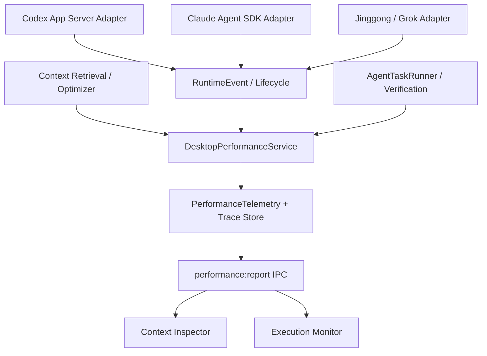

# 02｜技术架构与数据模型

## 1. 架构原则

本次只新增/扩展观测能力，不重建 Runtime 执行层。整体数据流：



原则：

- Runtime Adapter 只上报它真实知道的事件，不因 UI 需求扩大其职责。
- `DesktopPerformanceService` 负责把 Session/Project/Workspace/Turn 上下文关联起来。
- `PerformanceTelemetry` 负责结构化 Trace、Span、Event 的规范化、脱敏、限制、持久化和报告。
- Context Retrieval/Optimizer 是上下文来源选择的事实来源；UI 不重新扫描项目文件来“推断本轮上下文”。
- Renderer 只读 report，通过现有 preload/IPC 访问，不直接访问主进程对象或存储。

## 2. 当前已存在的代码入口（开发前重新核对）

| 文件 | 当前职责 | 1.0 处理方式 |
|---|---|---|
| `packages/performance/src/types.ts` | 性能、上下文统计类型 | 扩展类型，保留旧字段兼容 |
| `packages/performance/src/telemetry.ts` | Trace/Span 计时、Runtime Event、report、export | 扩展事件收集与统计，不复制另一套 Telemetry |
| `packages/performance/src/context-retrieval.ts` | 候选来源筛选和排序 | 继续作为选中/排除依据 |
| `packages/performance/src/context-optimizer.ts` | 预算、去重、估算和最终上下文组装 | 继续作为应用侧统计的权威来源 |
| `apps/desktop/src/main/performance-service.ts` | Trace 和 Workspace Index 协调 | 改为每轮 Trace 明确关联并保存快照 |
| `apps/desktop/src/main/context-sources.ts` | Memory/Dictionary/Manual 转成候选 | 按实际加载动作记录来源，不额外重复解析 |
| `apps/desktop/src/main/index.ts` | Session 主流程、Runtime Event 订阅、IPC 注册 | 仅在关键生命周期点追加关联字段/事件 |
| `apps/desktop/src/preload/index.ts` | DesktopApi 映射 | 优先复用 report；必要时再加 IPC |
| `packages/domain/src/index.ts` | DesktopApi 类型 | 只扩展需要暴露的 API 类型 |
| `apps/desktop/src/renderer/App.tsx` | 右侧 Tab、Context Tab | 修正 Session->Project 解析，拆出独立面板组件 |
| `apps/desktop/src/renderer/PerformancePanel.tsx` | 执行监控 | 重构为 Execution Monitor，保留原有性能设置/报告/测试能力 |
| `apps/desktop/src/renderer/performance.css` | 性能样式 | 拆分/扩展样式，沿用应用设计变量 |

不要求新增 `performance-ipc.ts`。当前 IPC handler 在 `apps/desktop/src/main/index.ts` 中注册；若拆文件，必须遵循项目现有 IPC 注册模式和单一职责，不能为了拆分而大规模迁移。

## 3. Trace 身份模型

### 3.1 一轮一 Trace

目前 `PerformanceTrace.taskId` 默认回退到 `sessionId`，且 `DesktopPerformanceService` 内部用 sessionId 管理当前 Trace。1.0 要明确「Session 是容器，一轮请求是 Trace」：

```ts
interface PerformanceTrace {
  id: string;                    // 本轮 Trace UUID
  sessionId: string;             // 会话 ID
  turnId?: string;               // Runtime Turn ID / 平台提交轮次 ID，必须是真实值
  runId?: string;                // RunLifecycle ID，必须是真实值
  taskId: string;                // 对应本轮任务标识，不能固定写 sessionId 充数
  projectId?: string;
  workspaceId?: string;
  repositoryId?: string;
  worktreeId?: string;
  workspacePathHash?: string;    // 如需路径关联，优先保存脱敏/Hash
  runtimeKind: RuntimeKind;
  runtimeVersion?: string;
  providerId?: string;
  modelId?: string;
  endpoint?: string;             // 仅协议 + host，不保留 path/query/凭据
  ...
}
```

如果现有 `RunLifecycle` 未能在 Trace 开始时提供 `runId` 或 `turnId`，不得自创或把 sessionId 填入。可以先记录 `traceId` 和明确可得的关联字段，并在报告中标注 `runCorrelation: unavailable`；后续补齐 RunLifecycle ID 时再接通。

### 3.2 Project / Workspace / Worktree 身份

使用当前 Session 本身的身份：

- `projectId`：`session.projectId`；空值表示独立会话。
- `projectRoot`：从已绑定 Project 的真实记录读取，不从聊天内容或目录名称推断。
- `workspacePath`：`session.workspacePath`，是当前 Runtime 真正工作的目录。
- `worktreeId`：根据当前已验证的 Worktree 路径/身份生成；沿用 `DesktopPerformanceService.identity()` 的规范，不因 UI 展示而改变安全边界。
- `repositoryId`：优先真实 Project/Repository ID；独立会话可为空。不要把 sessionId 冒充 Git repositoryId。
- 若没有 projectId：`indexStatus` 应保持现有「未关联项目」语义，不对任意目录进行项目索引。

### 3.3 轮次开始、结束与并发

- 在发送本轮用户任务、已通过现有参数校验后创建 Trace。
- Trace 生命周期覆盖本轮 Context Retrieval、Runtime 启动、可见响应、工具执行和终态。
- 若现有流程在 Runtime `completed` 后还会执行自动构建/验证，需要先查清 `performanceService.finish()` 的实际调用时点：将验证纳入本轮 Trace 时，应将 Trace 结束点放到已纳入的验证流程结束之后；如果不调整生命周期，就必须将验证显示为独立 Run 记录，不能伪装成 Trace 子阶段。
- 同一 Session 不应存在两条被当作“当前轮”的并行 Trace。若系统未来支持并行 Run，需用 turnId/runId 作为主键隔离，不能仅按 sessionId 覆盖 `traces` Map。
- 被取消/失败/中断的 Trace 必须保留终态，不自动将未结算的 Tool Call 标记成功。

## 4. 建议的数据类型

以下是目标模型示意，不要求逐字照搬。Codex 必须结合当前类型和存储层给出最小兼容修改。

### 4.1 可信度和数据来源

```ts
type MeasurementKind = 'reported' | 'measured' | 'estimated' | 'derived' | 'unavailable' | 'not_collected';
type MeasurementSource = 'runtime' | 'provider' | 'platform' | 'context_optimizer' | 'local_clock' | 'unknown';

interface MetricValue {
  value?: number;
  unit: 'ms' | 'tokens' | 'bytes' | 'count' | 'currency';
  kind: MeasurementKind;
  source: MeasurementSource;
  note?: string;
}
```

### 4.2 模型 Usage（全部可选）

```ts
interface RuntimeTokenUsage {
  inputTokens?: number;
  outputTokens?: number;
  totalTokens?: number;
  cacheReadInputTokens?: number;
  cacheWriteInputTokens?: number;
  source: 'runtime_reported' | 'provider_reported';
  reportedAt: string;
}
```

规则：

- 只有 Runtime/Provider 明确回传且字段可解析时才能创建 `RuntimeTokenUsage`。
- 不允许使用 `ContextBuildStats.estimatedTokens` 填进 inputTokens。
- 不允许通过模型 ID 查网上资料后推断这次调用的实际 context window usage。
- `modelContextWindowLimit` 只有有可信模型元数据且和当前 provider/model 配置精确匹配时才可选保存；否则 UI 显示不可用。
- 若 Provider 返回的 usage 不完整，保留已知字段，其余字段缺失，不用计算值冒充实际值。

### 4.3 工具调用摘要

```ts
interface ToolCallSummary {
  callId: string;               // Runtime 提供的稳定 ID
  operation: string;            // 脱敏后的短名称
  stage: 'tool' | 'search' | 'read' | 'command' | 'test' | 'build';
  status: 'running' | 'completed' | 'failed' | 'cancelled' | 'interrupted' | 'unknown';
  startedAt?: string;
  endedAt?: string;
  durationMs?: number;           // 只有 start/end 配对成功才计算
  exitCode?: number | null;
  requestId?: string | number;
  eventCompleteness: 'paired' | 'start_only' | 'complete_only' | 'duplicate' | 'missing_id';
}
```

- `callId` 只允许来自 Runtime/Platform 的稳定调用 ID。
- `event.type === 'tool'` 是普通事件通知，不足以建立 Tool Call。
- `callId` 重复时做幂等处理；相同调用重复完成不能重复计数。
- 已完成但缺少开始事件时，不能反推 startAt 或 duration。
- 运行结束仍只有 started 事件的调用标记 `interrupted/unknown`，不得标记完成。

### 4.4 结构化观察事件（可选）

若当前 Span 已足以支撑时间线，不必新建平行事件体系；否则可增加有界列表：

```ts
interface ObservabilityEvent {
  id: string;
  traceId: string;
  sessionId: string;
  turnId?: string;
  runId?: string;
  at: string;
  source: 'runtime' | 'platform' | 'context' | 'agent' | 'verification';
  category: 'lifecycle' | 'context' | 'model' | 'tool' | 'agent' | 'verification' | 'system';
  name: string;
  status?: string;
  correlationId?: string;
  parentId?: string;
  durationMs?: number;
  count?: number;
  errorCode?: string;
  metadata?: Record<string, string | number | boolean | null>;
}
```

metadata 只能存放白名单字段。不能直接塞入 `event.text`、prompt、工具 arguments、工具 output 或任意对象。

### 4.5 Agent 任务摘要

```ts
interface AgentExecutionSummary {
  taskId: string;
  parentTaskId?: string;
  orchestrationId?: string;
  source: 'platform_agent_task' | 'runtime_native_agent';
  role?: string;
  name: string;
  runtimeKind?: RuntimeKind;
  modelId?: string;
  status: string;
  createdAt?: string;
  startedAt?: string;
  endedAt?: string;
  durationMs?: number;
  summary?: string;              // 脱敏、截断，不保存完整原始输出
  linkedBy: 'run_id' | 'turn_id' | 'orchestration_id' | 'unlinked';
}
```

仅当 `linkedBy` 不是 `unlinked` 且关联字段匹配当前 Trace 时加入「本轮 Agent 执行树」。不要用“同 sessionId + 时间接近”作为唯一关联条件。

## 5. Context Snapshot 的采集方式

### 5.1 采集权威来源

优先直接复用：

- `ContextRetrievalPlanner.plan()` 返回的候选选择与排除原因。
- `ContextOptimizer.build()` 返回的 `ContextBuildStats`，尤其是 `selected`、`excluded`、`sourceCounts`、`estimatedTokens`、`requiredEstimatedTokens`、`optionalEstimatedTokens`、`requiredOverBudget`、`cacheStatus`、`deduplicatedCount`、`trimmedCount`。
- `DesktopPerformanceService.augmentUnifiedContext()` 已有的 Trace 统计保存入口。
- `recordLoadedSkill()` 已记录实际加载的 Skill 正文摘要。

不能在 Renderer 再扫描文件或再跑一次知识检索生成“本轮来源”，否则可能与真正送入 Runtime 的内容不同。

### 5.2 来源状态解释

建议对 UI 使用如下语义：

- `candidate`：本轮收集到的候选来源，尚未代表已注入。
- `selected`：经过 Planner/Optimizer 后最终加入应用侧构造上下文的来源。
- `excluded`：被过滤、去重、预算裁剪的来源，显示真实原因。
- `loaded`：通过 Skill Loader 等流程确认正文已加载；只有实际加载动作时才记录。
- `unavailable`：检索或来源读取失败/不可用。

如果当前 `ContextBuildStats.selected` 已代表最终构造结果，则直接使用；不重复设置另一套状态。

### 5.3 必需上下文与候选上下文

`ContextOptimizer` 当前把 `requiredText` 作为必需内容，并把 candidates 作为可选资料。UI 必须分别呈现：

- **必需上下文估算**：由当前应用侧必需开发要求、Runtime 通用指引等合并的 requiredText 估算。若没有分项统计，不要按文档数猜 Token。
- **可选来源估算**：来自 selected sources 的逐来源估算。
- **总构造上下文估算**：required + optional，由当前构造器结果给出。
- **上下文预算**：`contextBudgetTokens` 是应用侧可选上下文预算，不能默认解释为模型最大上下文窗口。

`ContextBuildStats.tokenMeasurement` 当前是 `'estimated'`；除非真实数据源变更，否则 UI 必须显示“估算”。

## 6. Runtime 事件采集与性能 Span

### 6.1 已知 Runtime 能力

当前 `RuntimeEvent` 公开 `performance` 字段包含：

- `callId`
- `phase: started | completed`
- `operation`
- `stage: tool | search | read | command | test | build`
- `exitCode?`

`PerformanceTelemetry.recordRuntimeEvent()` 已按此信息创建/结束 Span；需要补充可读的结构化工具汇总并处理异常事件序列。

各 Runtime 是否完整提供这些事件必须实际审查 Adapter：

- 若某个 Adapter 没有上报 callId/started/completed，不得从文本通知推断。
- Claude Agent SDK 的 usage 字段是否可以获取，以当前 SDK 版本和适配器真实实现为准；不能先假定有。
- Codex App Server 的内部模型 Token/队列细节如未公开，必须标为 unavailable。

### 6.2 阶段分类

继续沿用已有 `PerformanceStage` 并按必要最小范围扩展：

- `runtime.spawn`、`runtime.initialize`
- `workspace.index_check`、`workspace.index_update`
- `context.retrieve`、`context.*_retrieve`、`context.cache_lookup`、`context.budget_allocate`、`context.build`
- `model.first_token`（仅当语义准确；否则沿用首个可见响应指标而不新造）和 `model.response`（仅真实有边界时记录）
- `tool.execute`、`search`、`file.read`、`command.execute`、`test.execute`
- `task.finalize`

运行阶段可能并行。每个 Span 自身持续时间可展示，但不要把不同并行分支持续时间累加为整体总耗时。

### 6.3 模型调用次数/成本

只有存在模型请求开始/结束的稳定事件 ID 和明确的 usage/price 数据时才能展示。当前 report 已声明某些模型调用次数、内部等待时间、输入/输出 Token 不可采集。1.0 可以保留「不可用」状态，不把它当作开发缺陷去伪造。

## 7. 存储与迁移

当前 `PerformanceState` 为 v1，且 `PerformanceTelemetry` 做了基本状态校验与加载。若扩展为 v2：

1. 明确实现 v1 -> v2 迁移，旧 traces、settings、spans 不丢失。
2. v1 旧 Trace 缺少 turnId/runId 时留空，不生成伪关联。
3. 新字段全部可选或有明确默认值，旧记录读取后 UI 兼容。
4. 设置配置 `PerformanceSettings` 不应因升级而重置，除非原有版本迁移逻辑要求。
5. 继续限制 Trace、Span、Event/ToolCall、Agent Summary 数量和日志保留天数；建议初始上限：每 Trace 1500 spans、3000 events、500 tool call summaries、100 agent summaries；须评估对象大小后确认。
6. 使用当前本地应用数据存储，不在项目仓库创建 telemetry 数据库或临时日志。
7. Trace 写入失败不能阻断 Runtime 正常执行；Telemetry 错误必须被隔离、记录为非致命告警。

Codex 必须先定位 `readPerformanceState()` / `savePerformanceState()` 的存储实现和应用数据迁移路径，再决定 schema 变更方案。

## 8. IPC 和前端数据契约

### 8.1 首选扩展现有接口

当前已有：

- `performance:report`
- `performance:settings`
- `performance:reset`
- `performance:export`
- `performance:export-diagnostics`
- `performance:clear`
- `performance:index-status`
- `performance:index-rebuild`
- `performance:test-plan`
- `performance:ui-render`

`DesktopApi.performance.report(sessionId)` 已返回 `PerformanceReport`。优先扩展 `PerformanceReport.latest` 和 traces 的结构，不新增重复接口。如果新数据量过大或需要分页，才新增 `performance:trace-detail(sessionId, traceId)`；后者必须验证 trace.sessionId === session.id。

### 8.2 安全约束

- Renderer 不接受任意文件路径来查询 Trace。
- 所有查询通过 `sessionById()` 校验会话存在，再按 Session ID 过滤数据。
- 若有 traceId 参数，必须进一步验证该 Trace 属于该 Session。
- IPC 输入使用 Zod/现有 schema 校验；不能把 unknown 直接断言为任意复杂对象写入。
- 事件实时刷新继续使用现有 2 秒轮询；不要为了 1.0 引入新的 WebSocket、外部服务或无边界订阅。

## 9. 数据脱敏与隐私

禁止持久化：

- API Key、Authorization、Cookie、密码、Token、模型中转站凭据。
- 完整聊天正文、完整 developer prompt、模型隐藏推理。
- 完整工具参数和工具输出、命令 stdout/stderr、文件内容。
- 用户屏幕截图/剪贴板/无关环境变量。

允许持久化的白名单摘要：

- Runtime/Provider/Model ID、endpoint host。
- operation 名称、stage、状态、退出码、耗时。
- 内容 Hash、文档 ID/版本、路径（按现有脱敏规则）、来源标题/原因（长度限制并脱敏）。
- Token 数值（附 measurement kind/source）。
- Trace/Span/Task/Run 的稳定 ID 和时间戳。

所有自由文本字段先使用现有 `cleanPerformanceText` 和应用脱敏器，再做长度限制。原始内容只在执行流程中短暂存在，不为显示面板新增持久化。

## 10. 兼容性与失败降级

- 性能遥测关闭：Runtime 仍按现有路径执行，面板显示“本轮未采集”，不影响任务。
- 项目未关联：保留独立会话能力，禁用项目索引重建，不创建伪项目。
- Workspace Index 失败：显示错误或不可用，仍回退原 Runtime 文件工具；不能阻断任务。
- Context 优化失败：沿用 `fallbackText()` / 现有 legacy context 路径，Trace 标记该阶段 unavailable。
- Runtime 不上报 Tool Call：面板展示 Runtime 能力说明与事件缺失，不虚构调用。
- Provider 不上报 Token Usage：显示不可用，不回退成估算 Input Token。
- 历史 v1 数据：可查看已存在数据，新增字段显示未知/不可用。
