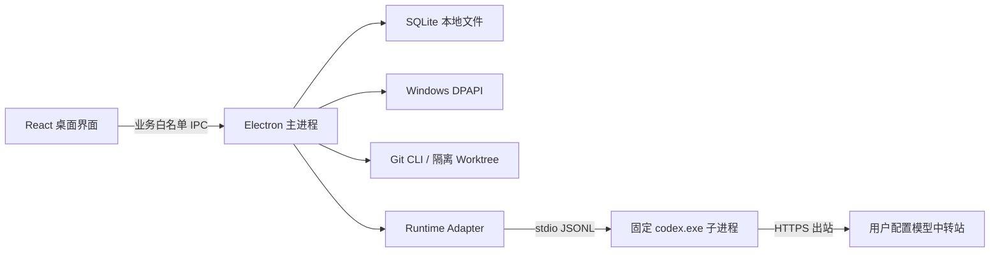

# 桌面架构与目录

单 Windows 用户、单实例、单并发 Agent，所有业务进程在本机。没有本地 HTTP/WebSocket 服务。

```text
jinggong-agent/
  apps/desktop/src/
    main/                  窗口、来源校验 IPC、配置、DPAPI、应用生命周期
    preload/               业务 API 白名单
    renderer/              React 会话、项目、Diff 和设置界面
  apps/desktop/resources/  安装资源；runtime 为可再生成且不入 Git 的固定二进制
  packages/
    domain/src/            项目、会话、事件、Diff 与 IPC 契约
    agent-runtime/src/     Codex JSON-RPC 适配，不向业务暴露协议
    git-connector/src/     本地仓库、隔离 Worktree、真实 Diff
    storage/src/           SQLite 迁移、事务、快照、备份
  installer/               NSIS 安装/卸载策略
  scripts/                 构建、运行时分发、真实桌面冒烟验证
  tests/                   SQLite、Git、Runtime、输入校验
  docs/requirements/       不改动的 V1.1 需求依据
  docs/architecture/       架构与实测
  docs/adr/                技术决策
  docs/development/        验收、任务与变更记录
```



后续模块按 PRD 新增 packages/jira-connector、model-providers、knowledge、rules；在能力具备前不放置模拟数据或把未实现界面显示为成功。跨模块只能通过 domain 契约和业务入口访问，渲染进程禁止直接导入 Node / SQLite / Runtime。

Git 项目选择仅登记用户通过原生对话框选择的根目录。每个会话创建 agent/* 分支和应用数据目录下 Worktree；源仓库存在未提交修改时不自动复制。会话中显示实际工作区路径、分支、模型和状态。无提交、推送、合并或发布 API。

分析模式通过主进程受控工具提供文件列表和代码读取；Runtime thread/turn 关闭内置执行环境，避免在原生沙箱尚未配置时暴露命令与修改工具。文件路径、链接、大小和敏感文件范围由 broker 实际校验，详见 runtime-integration。

安装包含 Electron 的 Node/Chromium、SQLite WASM 与固定版本原生 Runtime。Git 当前检测外部 Git for Windows；缺失时提供错误信息，Portable Git/官方引导属于待验收项。没有代码签名证书，不把 PoC 包视为正式企业发行包。
