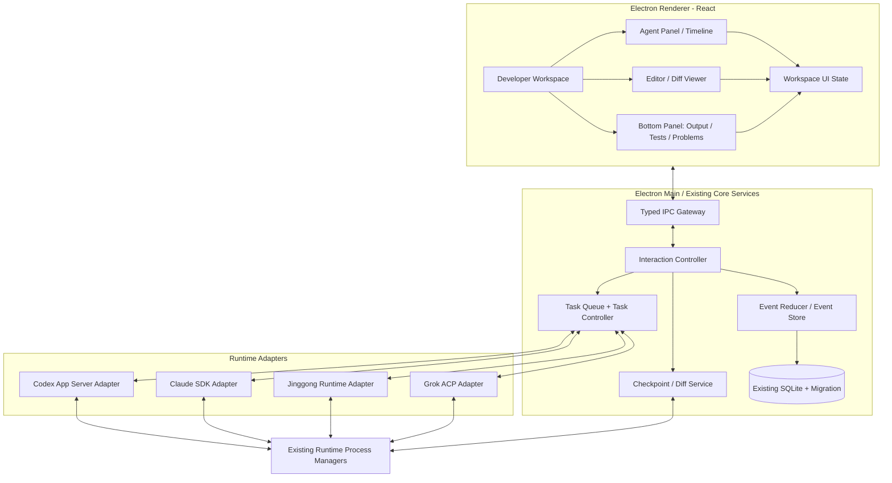

# 精工 Agent Cursor 级交互体验升级 — 技术方案

- 文档版本：V1.0
- 日期：2026-11-16
- 目标：在现有 Electron + React 桌面应用和多 Runtime 体系上增量实现 Cursor 级工作区交互
- 约束：复用现有实现；不重写 Agent Runtime；不替换桌面框架；不放宽安全权限

---

## 1. 技术基线与架构原则

### 1.1 已知技术基线

根据仓库 `package.json` 和 README 可读取内容：

| 层 | 当前基线 | 本次策略 |
|---|---|---|
| 桌面容器 | Electron 45.2.2 | 保留 |
| UI | React 19.3.1 | 保留 |
| 语言 | TypeScript 5.9.3 | 保留 |
| Runtime | Codex、Claude Agent SDK、精工 Runtime、Grok Build ACP | 保留多 Runtime |
| Codex 依赖 | `@openai/codex` 0.156.1（package.json devDependency） | 固定现有版本，先生成该版本协议类型 |
| 本地数据 | SQLite（sql.js）及既有仓储/迁移 | 扩展前先核对现有表，不另建一套会话数据库 |
| 工作区 | 会话独立工作区 / Git Worktree | 保持隔离策略 |
| 构建 | 根目录 npm scripts、自定义 build scripts、Electron Builder | 使用已有脚本 |

实际实现必须以 Codex 本地检出的工作树、锁文件和源代码为准；README 或本方案不能替代源码调查。

### 1.2 总体原则

1. **Runtime 是执行事实源**：任务执行状态、文件修改、命令执行结果、Turn 终态以对应 Runtime 事件/结果为准。
2. **Interaction Layer 是呈现与控制层**：负责事件标准化、状态归并、UI 同步、控制命令和任务排队，不重新实现模型推理循环。
3. **多 Runtime 适配**：Runtime Adapter 把各 Runtime 当前已有事件映射为统一 UI Event；不支持的能力明确声明为 unsupported。
4. **一份状态、多处呈现**：时间线、文件树、Diff、状态栏、底部面板共享统一的任务状态，不各自轮询或维护互相矛盾的数据。
5. **事件优先、快照校准**：实时事件负责增量更新；Runtime 历史或本地持久化用于恢复和校准。
6. **低耦合、渐进替换**：先接入当前事件入口，逐步将旧 UI 组件迁移到新 Workspace，不重写所有旧模块。
7. **敏感操作仍由 Main Process/既有服务负责**：Renderer 不得绕过已有权限和文件校验。

## 2. 目标架构



### 2.1 分层职责

**Renderer（React）**

- 展示工作区、时间线、计划、文件树、Diff、终端/输出、审批卡片。
- 处理拖动分栏、面板折叠、键盘快捷键、选中上下文。
- 只通过已定义 IPC 调用主进程，不直接启动 Runtime 或访问敏感文件。
- 使用局部状态和 memo/virtualization 控制高频事件渲染范围。

**Interaction Controller（Main/Core）**

- 订阅现有 Runtime event stream。
- 将 Runtime 事件归一化为统一 `UiAgentEvent`。
- 对事件进行去重、排序、状态归并和广播。
- 接收 stop/steer/queue 等用户动作并路由给正确 Adapter。
- 保持项目、会话、Worktree 与 threadId/turnId 的关联。

**Runtime Adapter**

- 暴露统一能力接口（start/resume/interrupt/steer/queue capability 等）。
- Codex Adapter 直接复用现有 Codex App Server 连接/进程管理，不能新建第二个 Codex Runtime 实例管理器。
- 其他 Adapter 适配当前 Runtime 已输出的消息、工具活动和生命周期事件，不做协议臆造。

**Persistence**

- 优先复用现有 SQLite 表、会话事件和验证证据表。
- 仅在缺失必要数据时增加轻量事件或 UI 偏好表。
- Runtime rollout / thread 历史仍由 Runtime 管理；本地数据库只保存 UI 需要的映射、队列、偏好和必要事件索引，不复制完整 Runtime 历史。

## 3. Runtime Adapter 统一接口

实际名称应遵循仓库已有命名风格。概念接口如下：

```ts
export type RuntimeCapability =
  | "streamEvents"
  | "interruptTurn"
  | "steerTurn"
  | "resumeThread"
  | "listSubagents"
  | "streamCommandOutput"
  | "turnDiff"
  | "approvalRequests";

export interface RuntimeAdapter {
  readonly runtimeId: string;
  getCapabilities(sessionId: string): Promise<RuntimeCapability[]>;
  startTurn(input: StartTurnInput): Promise<StartTurnResult>;
  interruptTurn(input: { sessionId: string; turnId: string }): Promise<void>;
  steerTurn?(input: { sessionId: string; turnId: string; text: string }): Promise<void>;
  resumeThread?(input: { sessionId: string; threadId: string }): Promise<ResumeResult>;
  subscribe(
    sessionId: string,
    listener: (event: RuntimeEvent) => void
  ): () => void;
}
```

注意：

- 不要为满足此接口而复制当前 Runtime manager；将接口作为 Adapter Facade，内部调用既有服务。
- `steerTurn`、`resumeThread` 等可选能力必须通过 capability 检查后再调用。
- `queue` 属于精工本地任务控制器，不是 Runtime Adapter 的必选方法。
- 所有操作必须关联当前 sessionId/threadId/turnId，防止用户切换会话后命令作用到旧任务。

## 4. 统一事件协议

### 4.1 UI 事件结构

```ts
export type UiAgentEventType =
  | "turn.started"
  | "turn.completed"
  | "plan.updated"
  | "item.started"
  | "item.updated"
  | "item.completed"
  | "agent.message.delta"
  | "command.output.delta"
  | "file.diff.updated"
  | "approval.requested"
  | "approval.resolved"
  | "runtime.warning"
  | "runtime.error"
  | "connection.changed"
  | "verification.updated";

export interface UiAgentEvent<T = unknown> {
  eventId: string;            // 本地生成的稳定去重 ID
  sequence: number;           // 当前本地 session 的单调递增序号
  occurredAt: string;
  receivedAt: string;
  sessionId: string;
  runtimeId: string;
  threadId?: string;
  turnId?: string;
  itemId?: string;
  type: UiAgentEventType;
  payload: T;
  sourceMethod?: string;      // App Server 原始 method，仅用于诊断
}
```

事件载荷不要默认序列化敏感信息。命令参数、工具参数和 Runtime 原始 payload 在进入持久化之前需要脱敏/筛选。

### 4.2 Codex App Server 事件映射

| App Server method / item | UI 事件 | UI 呈现 |
|---|---|---|
| `turn/started` | `turn.started` | 当前任务运行状态、开始时间 |
| `turn/completed` | `turn.completed` | completed/interrupted/failed，耗时和错误 |
| `turn/plan/updated` | `plan.updated` | 计划步骤更新 |
| `item/started` | `item.started` | 创建活动卡片 |
| `item/completed` | `item.completed` | 最终状态，覆盖临时状态 |
| `item/agentMessage/delta` | `agent.message.delta` | 消息内容增量追加 |
| `item/commandExecution/outputDelta` | `command.output.delta` | 终端/运行输出追加 |
| `turn/diff/updated` | `file.diff.updated` | 替换当前 Turn 的聚合 unified diff 快照 |
| `item/commandExecution/requestApproval` | `approval.requested` | 命令审批卡片 |
| `item/fileChange/requestApproval` | `approval.requested` | 文件修改审批卡片 |
| `serverRequest/resolved` | `approval.resolved` | 审批卡片结束/解除 |
| `warning` / `configWarning` | `runtime.warning` | 可恢复警告 |
| 连接建立/断开 | `connection.changed` | connected/reconnecting/disconnected |

注意：

1. `turn/diff/updated` 提供当前 Turn 的聚合 Diff 快照，不是可直接追加的 Diff 片段。
2. `item/started`、`item/completed` 是 item 生命周期的权威事件；delta 用于增量展示。
3. `turn/plan/updated` 和 `turn/diff/updated` 中的 items 数组可能不包含完整 Item 历史，Item 列表应来自 `item/*` 事件或分页历史。
4. 不展示 `item/reasoning/textDelta`、原始 reasoning content 或其他内部推理文本。
5. 事件字段以锁定版本 `0.156.1` 实际生成的类型和协议测试为准，不得只照抄网上最新文档字段。

### 4.3 协议类型与版本锁定

实现开始时，在现有 Codex Runtime 所使用的 `codex` 可执行文件/依赖版本上执行（若该二进制提供此命令）：

```powershell
codex --version
codex app-server generate-ts --out <现有协议类型目录>
```

- 先确认当前安装的 CLI 与 `@openai/codex` 包之间的版本关系。
- 将生成的协议类型作为对接依据；如果仓库已有生成结果，优先复用。
- 不随意升级 `@openai/codex` 或 Runtime 二进制来解决类型问题。
- 对 P0 使用的 App Server method 和 notification 建立最小集成测试。

## 5. 事件处理和 UI 状态管理

### 5.1 数据流

```text
Runtime stdout / transport notification
          ↓
Existing Runtime Process Manager
          ↓
Runtime Adapter (normalize)
          ↓
Interaction Controller
          ↓
Event Dedup + Sequence + Redaction
          ↓
Session Event Reducer
          ├── Persist required metadata
          └── Main → Renderer typed IPC
                        ↓
                 UI Store / Reducer
                    ├── Agent Timeline
                    ├── Plan Panel
                    ├── File Tree Status
                    ├── Diff Workspace
                    ├── Bottom Output
                    └── Status / Controls
```

### 5.2 归并规则

- `turn.started`：建立活动 Turn，状态 running。
- `item.started`：按 itemId 创建/更新活动记录。
- Delta：按 itemId 定位目标消息/命令活动；只更新对应组件。
- `item.completed`：将该 Item 的状态和最终文本替换为最终权威版本；不能继续把旧 delta 再拼一次。
- `turn.completed`：更新 Turn 最终状态，关闭该 Turn 的活动态；清理“停止中”标识。
- `file.diff.updated`：保存该 Turn 的最新快照，解析文件列表并更新树标识。
- `approval.requested`：建立 pending approval map；在响应完成前保留审批卡片。
- `approval.resolved`：按 requestId/itemId 清理等待状态。
- 不认识的事件：记录安全摘要，不中断会话，不把原始敏感 payload 展示给用户。

### 5.3 高速流式处理

为了避免每个 token/delta 导致整个工作区刷新：

- Main Process 接收事件后立即更新轻量状态和本地序列号。
- Renderer 使用批处理队列，文本/终端 delta 建议 30–60ms 刷新一次。
- 不同事件类型采用不同节流策略：任务状态/审批立即更新；文本和日志批量更新；Diff 采用最新快照合并更新。
- Agent 时间线按 session/turn 分区；文件树和 Diff 只订阅必要 selector。
- 大日志使用虚拟列表；超过窗口保留上限时保留文件日志/滚动缓存，不无限堆积 React state。
- 对大 Diff 在 Worker 或异步任务中解析；UI 先展示文件数量和加载状态。
- 使用 React memo/useMemo/useCallback 仅作为局部优化，不以 hooks 堆叠替代正确的数据分层。

## 6. 会话恢复与断线处理

### 6.1 状态分离

```ts
interface RuntimeConnectionState {
  status: "connected" | "reconnecting" | "disconnected";
  lastConnectedAt?: string;
  lastError?: string;
}

interface TurnState {
  status: "idle" | "running" | "waiting_approval" |
          "completed" | "failed" | "interrupted";
  threadId?: string;
  turnId?: string;
}
```

传输 disconnected 不等于 turn failed/interrupted。

### 6.2 恢复策略

- 复用当前 Runtime 的恢复入口。Codex App Server 使用已有 `thread/resume` 管理方式。
- 需恢复历史时使用官方分页接口（例如 thread turns/items list）；不要每次恢复都加载整个历史。
- `thread/resume` 可使用 `excludeTurns: true` 获取线程元数据，再按 cursor 加载 history，按当前版本协议实现。
- 重连后读取 Runtime 当前线程/Turn 状态；若 Runtime 返回结果与本地短期状态不一致，以 Runtime 权威状态校准。
- 如果 Runtime 进程已经退出且无法恢复，应明确显示“Runtime 不可用/需要重新启动”，不能伪造继续执行。
- 对正在运行的任务，恢复前确认 thread/turn 的身份与会话 ID 完全匹配。

## 7. 任务控制器与本地队列

### 7.1 停止

Codex Adapter 调用 `turn/interrupt`，并立即让 UI 进入 `stopping` 子状态；只有收到 `turn/completed` 且 status=interrupted 或真实 Runtime 结果后，才结束停止流程。

### 7.2 追加当前任务指令

Codex Adapter 使用 `turn/steer`：

- 必须带正确 threadId、当前 active turnId 和 `expectedTurnId`。
- 若当前无活动 Turn、turnId 已变化、Runtime 不支持 steer 或请求失败，向用户显示真实错误。
- steer 不创建新 Turn；时间线应将该指令作为当前 Turn 的追加输入记录。

### 7.3 排队下一任务

- 使用本地 Queue，不调用 `turn/steer`。
- 默认每个 session 同时最多一个 active Turn。
- Queue item 保存 sessionId、projectId、runtimeId、模型/强度配置快照、输入正文、附件引用和创建时间。
- 出队时再次校验会话、项目、Runtime 配置和附件是否有效；配置变化时提示用户，禁止静默换模型。
- 删除排队任务不影响当前正在运行的 Turn。
- 应用退出时持久化未执行任务；重启后先展示等待确认，不自动执行未确认任务。

## 8. 文件树、编辑器和 Diff

### 8.1 文件树

- 使用当前工作区根目录和现有文件访问服务。
- 优先复用既有文件监听/项目索引；不存在时先为当前打开目录和变更文件提供轻量刷新，避免启动时全量扫描大型仓库。
- 图标/状态至少支持：新增、修改、删除、冲突/外部变化。
- 文件路径必须按现有 Windows 路径规范、安全校验与 Worktree 根路径判定。

### 8.2 Monaco 集成

推荐 Monaco Editor / Monaco Diff Editor，但先检查现有构建脚本、Electron CSP、worker 打包方式、主题 token 和资源路径。

- P0 可先用 Monaco Diff Editor 展示 Diff；如集成成本过大，可先用当前已有 Diff Viewer 完成 P0，Monaco 放 P1，不得为换编辑器阻塞事件能力。
- P1 加入普通编辑器、文件 Tab、行列定位、查找、只读模式。
- 不允许 Renderer 直接任意写磁盘；手动编辑保存必须通过已有 Main Process 文件写入/校验服务。
- 编辑器只读查看、Agent 写入与用户手动修改必须明确区分，避免静默覆盖。
- 大文件超过阈值时转为只读或提示预览限制。

### 8.3 Diff 数据源与刷新

- Codex Turn Diff 优先消费 `turn/diff/updated` 最新聚合 unified diff。
- 对其他 Runtime，使用其已有 Git worktree diff 服务生成当前会话相对基准提交的快照。
- 不把 Runtime diff 与 Git diff 不加区分地混合：UI 标明“本轮变更”与“工作区全部未提交变更”。
- 对新增/删除文件、重命名、二进制文件、超大文件定义明确展示规则。
- Diff 解析与语法高亮放异步任务；禁止主线程同步解析大文件。

## 9. Checkpoint 和回滚设计（P1）

不得直接对用户整个会话工作区执行 `git reset --hard` 或 `git checkout -- .`。

推荐先实现任务级变更快照：

1. Turn 开始前记录工作区状态：基准 commit、tracked/untracked 列表、目标文件内容哈希及必要的备份副本。
2. 只追踪当前任务可能修改的路径；新增文件和删除文件要能恢复。
3. 任务结束后记录本任务实际变更集。
4. 回滚时先检查文件当前 hash 是否仍等于任务后 hash；如果用户或另一个进程已再次修改，拒绝自动覆盖并提示冲突。
5. 对大文件、链接、二进制文件或无法安全快照的文件，回滚动作提示人工处理。
6. Checkpoint 存于 `%LOCALAPPDATA%\\JinggongAgent` 现有数据目录下的独立子目录，不写入目标仓库。
7. 清理策略可配置，不能未经提示自动删除仍可恢复的检查点。

P0 先实现“本轮 Diff 查看 + 停止/继续 + 依赖既有 Git 审查”，Checkpoint 不作为 P0 阻塞项。

## 10. IPC 设计

所有通道沿用项目已有 IPC 命名规范和类型注册机制。以下仅为概念契约：

| Renderer → Main | 作用 |
|---|---|
| `workspace:openFile` | 打开已授权工作区内文件 |
| `agent:getCapabilities` | 获取当前 Runtime 能力 |
| `agent:interruptTurn` | 停止当前 Turn |
| `agent:steerTurn` | 当前 Turn 追加指令 |
| `agent:enqueueTask` | 排队下一项任务 |
| `agent:cancelQueuedTask` | 取消排队任务 |
| `agent:getTurnDiff` | 获取指定 Turn Diff 快照 |
| `agent:approveRequest` | 回应 App Server 审批请求 |
| `workspace:setPanelLayout` | 保存侧栏布局偏好 |

Main → Renderer：

- `agent:event`：统一 UiAgentEvent。
- `agent:connectionChanged`：连接状态。
- `agent:queueChanged`：队列变化。
- `workspace:fileChanged`：文件树变化。
- `workspace:diffUpdated`：Diff 快照/元数据变化。

IPC 要求：

- 每个输入使用 Zod 或现有 schema 校验。
- 校验 sessionId、projectId、threadId、turnId、workspace path 的对应关系。
- IPC listener 必须有清理逻辑，避免切换会话后重复订阅。
- 单个会话的事件不能广播到不相关会话页面。
- 所有高频 delta 事件按 sessionId + turnId 合并批次。

## 11. 前端状态结构建议

不要创建第二个独立聊天 Store。先查当前会话 store，再决定把以下字段加入现有结构还是新增 slice。

```ts
interface DeveloperWorkspaceState {
  activeSessionId?: string;
  layout: {
    leftSidebarWidth: number;
    rightPanelWidth: number;
    bottomPanelHeight: number;
    leftCollapsed: boolean;
    rightCollapsed: boolean;
    bottomCollapsed: boolean;
  };
  selectedView: "task" | "editor" | "diff";
  openFiles: Array<{ path: string; pinned: boolean; dirty: boolean }>;
  activeFilePath?: string;
  bottomTab: "output" | "terminal" | "tests" | "problems";
  sessions: Record<string, {
    connection: RuntimeConnectionState;
    turn: TurnState;
    activities: AgentActivity[];
    plan: PlanStep[];
    diff: TurnDiffSnapshot;
    queue: QueuedTask[];
  }>;
}
```

布局偏好可持久化到现有设置表；短期消息增量应保持内存态，必要的最终事件摘要再写入既有数据层。

## 12. UI 技术选型

| 模块 | 推荐方案 | 约束 |
|---|---|---|
| 编辑器 | Monaco Editor / Diff Editor | 先验证 Electron worker、CSP、打包大小 |
| 终端输出 | 先复用现有运行输出组件；如需交互式 PTY，再评估 xterm.js | 本轮不擅自引入不安全的任意 shell IPC |
| 分栏布局 | 复用现有可拖动侧栏实现；缺失时采用成熟可访问的 resizable pane 方案 | 拖动状态本地化，不触发重载 |
| 长列表 | 虚拟列表或窗口化渲染 | 适用于终端日志、任务活动、文件列表 |
| Diff 解析 | 复用项目已有 Diff parser；缺失时选轻量解析器 | 解析放异步任务 |
| 图标 | 复用现有图标体系 | 不混用多个图标库 |
| 主题 | 复用现有深色/浅色/系统主题 tokens | 新控件必须适配两种主题 |
| 状态 | 复用当前 Store/Reducer；若没有统一方案再补充轻量 store | 不引入第二套平行状态管理 |

## 13. 错误处理

| 错误 | UI 处理 | 系统处理 |
|---|---|---|
| App Server 断开 | 显示重连状态和最后收到事件时间 | 复用现有重连/进程恢复逻辑 |
| steer 失败 | 提示“追加指令未发送”，不伪装成功 | 保留用户输入，允许复制或重新发送为新任务 |
| interrupt 失败 | 显示“停止请求失败/等待 Runtime 响应” | 不擅自把 Turn 标为 interrupted |
| Diff 解析失败 | 显示原始 Diff 文本/错误提示 | 任务继续运行，不阻断 Runtime |
| 文件已被外部修改 | 显示冲突标识和 reload/compare 提示 | 禁止静默覆盖 |
| 审批请求无法识别 | 显示安全兜底审批摘要 | 不自动 accept |
| 历史恢复失败 | 显示当前本地记录与 Runtime 不一致 | 禁止伪造活动状态，允许用户显式新建 Turn |
| SQLite 迁移失败 | 阻止写入并提示备份恢复 | 不删除旧数据或自动重建数据库 |

## 14. 安全和权限设计

- 现有 Runtime 的 sandbox、approvalPolicy、会话 Worktree 和主进程校验保持不变。
- 不要因为 UI 要“快”而在 Renderer 直接执行命令、改文件或忽略审批。
- 命令审批展示命令、cwd 和风险摘要；网络审批显示 host/protocol；文件审批显示路径和变更范围。
- 支持的决策以 App Server 实际 `availableDecisions` 为准，不硬编码不存在的审批按钮。
- 敏感字段进入事件层前先脱敏；UI 不显示 API Key、Authorization Header、Cookie、密码和完整凭据内容。
- 审批事件以 requestId/itemId 关联，并处理 turn 结束/中断时请求自动清理。
- 用户关闭会话/切换会话不能将审批状态误用到其他 thread。

## 15. 测试方案

### 15.1 单元测试

- Runtime 原始事件 → UiAgentEvent mapping。
- eventId/sequence 去重和排序。
- item lifecycle reducer：started/delta/completed。
- turn lifecycle reducer：started/completed/interrupted/failed。
- Diff 快照替换与文件状态提取。
- stop/steer capability gating 和 turnId 校验。
- Queue 顺序、取消、恢复和配置快照校验。
- 敏感字段脱敏。
- 断线状态和重新校准。

### 15.2 集成测试

- 使用受控假 Runtime 或现有测试 Runtime 发送事件序列，验证 UI 多区域同步。
- Codex App Server 最小协议集成：initialize → thread/start/resume → turn/start → 订阅 item/turn 事件 → steer/interrupt → turn/completed。
- 验证 `turn/diff/updated` 最新快照不会重复累加。
- 验证审批请求/响应/清理。
- 验证多会话切换不串事件。

### 15.3 桌面冒烟测试

- 启动 Electron 应用。
- 打开项目会话并进入 Workspace。
- 发送测试任务，观察实时消息、计划、工具活动、Diff、底部输出。
- 点击停止，确认最终状态。
- 追加一条当前 Turn 指令（Codex Runtime 支持时）。
- 排队下一任务并确认只在当前任务终止后启动。
- 重启应用恢复同一会话。
- 验证原 Jira、Git、设置等入口。

### 15.4 性能测试

使用固定的小/中型测试仓库和固定事件回放数据，分别压测：

- 10 KB/s、50 KB/s 的增量输出。
- 500、5,000、20,000 行终端日志。
- 50、200 个文件变化的 Diff 列表。
- 连续拖动左右/底部面板并同时流式输出。

采集事件接收时间、UI reducer 时间、首帧更新时间、渲染批次、主线程长任务和内存。不得使用模型响应时间单独代表 UI 性能。

## 16. 实施分解

### Sprint A：先摸清现状并建立事件底座

1. 确认已有 Runtime 事件与 App Server 通道。
2. 对照实际协议版本生成/核对 TS 类型。
3. 建立 UiAgentEvent、Normalizer、Reducer 和单元测试。
4. 统一事件 IPC，接入当前输出组件。

### Sprint B：开发工作区和任务中心

1. 新增 Workspace 容器，复用项目/会话导航。
2. 将 Agent 对话/活动时间线布置到右侧面板。
3. 增加中央代码/变更面板和底部可折叠输出区。
4. 将文件变化和 Diff 状态同步到文件树与中央区域。

### Sprint C：运行控制和恢复

1. stop 与 steer 控制。
2. 本地任务 Queue。
3. 断线/恢复状态。
4. 审批卡片与旧权限逻辑对接。

### Sprint D：P1 增强

1. Monaco 编辑器和上下文引用。
2. 子 Agent 任务可视化。
3. Checkpoint 和文件级审查。
4. 性能与可访问性优化。

每个 Sprint 完成后执行 `npm run build`、`npm test`、`npm run test:desktop`；若脚本或环境不适用，说明原因并执行仓库定义的等效验证。

## 17. 风险与回避

| 风险 | 回避策略 |
|---|---|
| 当前已有 Runtime 事件系统与新系统重复 | 必须先读 Runtime 入口；Adapter 只封装，不复制 Process Manager |
| Codex App Server 事件协议随版本变化 | 固定版本并使用生成的类型，协议测试随版本更新 |
| 高速 Delta 导致界面卡顿 | 批处理、局部订阅、虚拟列表、Diff 异步解析 |
| 重排布局导致旧功能丢失 | 旧面板先迁移入口，不删除功能；做截图和流程回归 |
| Diff/回滚损坏用户修改 | P0 只查看；P1 Checkpoint 比较 hash，冲突时停止自动回滚 |
| 多 Runtime 能力不一致 | Capability gating；不支持显示原因，不做假功能 |
| SQLite schema 改动损坏用户数据 | 复用迁移机制，测试从旧版本数据升级 |
| 新增 Monaco 导致构建体积/worker 问题 | 先做最小 Electron spike，确认 CSP/worker 和打包方式 |

## 18. 官方参考

- Codex App Server 文档：<https://learn.chatgpt.com/docs/app-server>
- Codex App Server 协议类型生成：`codex app-server generate-ts --out <dir>`（按本地固定 Runtime 版本运行）
- 精工 Agent 仓库：<https://github.com/zhuangxiaolong/jg_agent>
- 用户提供的开发入口：<https://github.com/zhuangxiaolong/jg_agent/tree/develop/desktop-poc>

官方文档当前说明了 JSON-RPC、thread/turn/item 生命周期、事件流、Diff/计划通知、steer/interrupt、线程恢复和审批请求。协议字段和能力必须以项目固定版本本地生成的 schema 为准。
