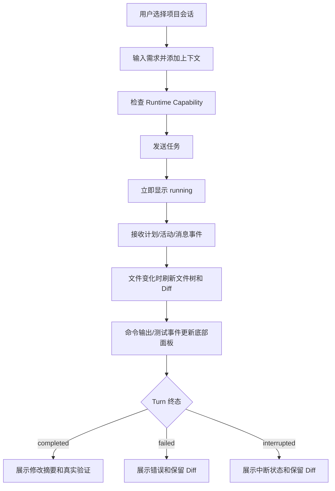
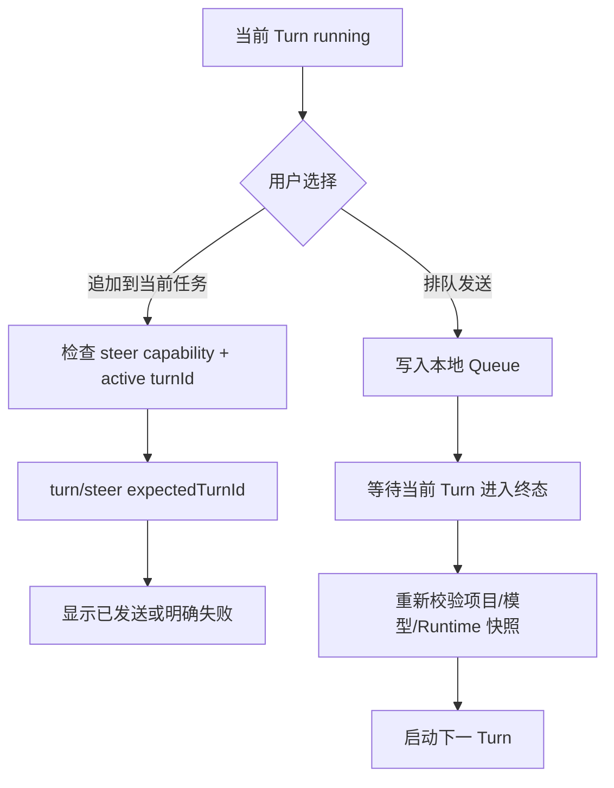
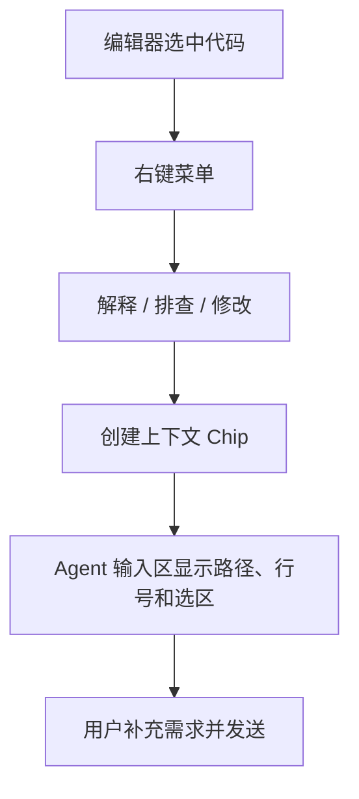

# 精工 Agent Cursor 级交互体验升级 — 交互原型说明

- 文档版本：V1.0
- 日期：2026-11-16
- 原型类型：低保真布局 / 交互说明 / 组件状态规范
- 用途：指导 Codex 在现有 Electron + React 页面中实现，不要求先制作独立设计稿

---

## 1. 设计原则

1. **代码和对话同屏**：Agent 对话不占满整个页面；有项目的开发会话使用三栏开发工作区。
2. **执行过程实时可见**：当前阶段、最近活动、计划、文件变化和命令输出都能找到。
3. **用户随时可控**：停止、追加指令、排队、审批不隐藏在二级菜单深处。
4. **重要信息有层级**：当前任务状态 > 当前活动 > 代码变化 > 历史详情。
5. **保留原有能力**：Jira、Git、上下文、规范、数据字典、执行监控、子 Agent、会话设置仍可访问。
6. **避免视觉噪声**：不是所有原始事件都要显示成大卡片；相同类型活动合并，详细日志按需展开。
7. **尊重现有主题**：复用精工 Agent 当前深色/浅色/系统主题和设计 Token。

## 2. 主工作区线框

### 2.1 有项目的开发会话

```text
┌──────────────────────────────────────────────────────────────────────────────────────────────┐
│ 精工 Agent   项目：MES6 / Inventory       分支：agent/xxx     Codex · GPT · High     ● 运行中 │
├──────────────┬──────────────────────────────────────────────┬─────────────────────────────────┤
│ 项目/会话导航 │ 中央工作区                                   │ Agent 面板                      │
│              │                                              │                                 │
│ [项目]       │ [任务] [代码] [变更 4]                        │ 任务：库存扣减校验              │
│ [文件]       │ ┌──────────────────────────────────────────┐ │                                 │
│ [搜索]       │ │ InventoryService.java                     │ │ ● 已分析 3 个相关文件           │
│ [Git]        │ │                                          │ │ ● 计划已生成                   │
│ [Jira]       │ │ 原代码                  修改后            │ │ ◉ 正在修改库存校验              │
│              │ │ - old logic             + validate type  │ │ ○ 运行测试                     │
│ 文件树       │ │ - direct update         + transaction    │ │                                 │
│  ▾ src       │ │                                          │ │ [查看计划 ▾]                   │
│    ▾ WMS     │ │                                          │ │                                 │
│      ▾ Stock │ │                                          │ │ Agent 输出增量显示……           │
│        file  │ └──────────────────────────────────────────┘ │                                 │
│              │                                              │                                 │
│              │                                              │ ┌─────────────────────────────┐ │
│              │                                              │ │ @文件 / 输入追加指令……      │ │
│              │                                              │ │                              │ │
│              │                                              │ │ [排队] [发送/追加] [停止 ■]   │ │
│              │                                              │ └─────────────────────────────┘ │
├──────────────┴──────────────────────────────────────────────┴─────────────────────────────────┤
│ 底部面板 [运行输出] [终端活动] [测试/验证] [问题]                              [收起] [调整高度]│
│ 11:21:03  dotnet test ...                                                    Running ...       │
└──────────────────────────────────────────────────────────────────────────────────────────────┘
```

说明：

- 上图是有项目开发会话的目标布局，不代表必须新增独立应用窗口。
- 左侧项目/会话导航优先复用现有组件；文件树可在同一个左侧区域切换显示。
- 中央工作区包含任务概览、文件编辑和 Diff 三种视图；默认按当前任务状态决定默认视图。
- 右侧 Agent 面板包含时间线/对话/输入，不得将 Agent 正文和执行活动混成难以区分的单一长文本。
- 底部面板复用现有运行输出、执行监控和真实验证数据。

### 2.2 独立会话

```text
┌───────────────────────────────────────────────────────────────────────────────┐
│ 精工 Agent                                  Runtime / 模型 / 推理强度           │
├───────────────────────────────────────────────────────────────────────────────┤
│                                                                               │
│                          原有独立会话聊天体验                                 │
│                                                                               │
│                          消息与附件                                           │
│                                                                               │
│                          输入区 / 发送 / 停止                                 │
│                                                                               │
├───────────────────────────────────────────────────────────────────────────────┤
│ [运行输出] [工具活动] [验证记录]                                               │
└───────────────────────────────────────────────────────────────────────────────┘
```

独立会话没有本地项目时，不显示空文件树或伪造 Git/代码编辑区。

## 3. 布局尺寸与响应规则

推荐初始尺寸（可根据现有窗口大小微调）：

| 区域 | 建议初始宽/高 | 可调整范围 | 行为 |
|---|---:|---:|---|
| 左侧导航/文件区 | 250px | 200–360px | 可折叠，宽度保存到用户偏好 |
| 右侧 Agent 区 | 420px | 340–560px | 可折叠，宽度保存到用户偏好 |
| 底部输出区 | 220px | 140–420px | 可收起，可拖动高度 |
| 顶部栏 | 44–52px | 固定 | 不随滚动消失 |
| 中央工作区 | 自适应 | 最小宽度 420px | 优先保证代码可读性 |

响应规则：

- 窗口宽度 ≥ 1440px：三栏完整显示。
- 1200–1439px：左侧可折叠，右侧维持最小宽度；必要时关闭文件树子区域。
- 1024–1199px：Agent 面板改为可切换抽屉，中央区优先。
- 小于 1024px：不承诺完整 IDE 三栏体验，采用中央主视图 + 面板抽屉。
- 最小窗口尺寸遵循现有 Electron 设置；若当前小于 1024px，先不要强制修改系统窗口最小值，避免影响旧设备。

## 4. 关键组件原型

### 4.1 顶部工作区栏

显示：

- 精工 Agent 标识。
- 当前项目 / 会话名称。
- 当前 Worktree 分支或工作目录简称。
- Runtime、模型、推理强度（沿用现有配置，不新增第二套配置）。
- 当前任务状态：空闲、运行中、等待审批、停止中、已完成、失败、中断。
- 任务计时/本轮修改文件数量可作为次级信息。

交互：

- 点击项目名称：打开已有项目/会话切换入口。
- 点击 Runtime/模型信息：进入原有会话设置；当前 Turn 运行期间遵循原有锁定规则。
- 点击任务状态：聚焦右侧当前任务时间线。

### 4.2 左侧导航与文件树

建议导航分组：

- 项目与会话（原入口）。
- 文件树。
- 项目内搜索。
- Git 变更。
- Jira。
- 历史/辅助面板（原有入口）。

文件树状态：

| 状态 | 视觉表现 | 说明 |
|---|---|---|
| 未修改 | 普通文件图标 | 工作区文件 |
| 新增 | 绿色新增标记 | 当前任务新增 |
| 修改 | 黄色/主题强调标记 | 有未提交变更 |
| 删除 | 红色删除标记或删除列表 | 文件已删除 |
| 冲突/外部变化 | 警告标记 | 文件在 Agent 运行中被用户/外部程序修改 |

要求：状态不只依赖文件树本地扫描；需要与 Runtime Diff 和现有 Git Diff 状态合并，并标明数据来源。

### 4.3 中央工作区导航 Tab

P0 推荐三个 Tab：

- **任务**：展示任务简要、计划、关键活动和结果摘要。
- **代码**：展示打开文件内容（若 P0 未集成完整编辑器，先使用只读代码查看器）。
- **变更**：显示当前 Turn Diff 和文件列表。

默认规则：

- 新任务开始：任务 Tab。
- 第一次收到文件变更：可提示用户，但不强制自动抢焦点。
- 用户点击某文件：代码/变更 Tab 打开对应文件。
- 用户手动切换 Tab 后，后续事件不应抢走焦点。
- 有未保存人工编辑内容时，切换文件必须提示保存/放弃/取消。

### 4.4 Diff 视图

```text
┌────────────────────────────────────────────────────────────────┐
│ 本轮变更 4 个文件     +32  -11                  [全部文件] [刷新] │
├──────────────────────────┬─────────────────────────────────────┤
│ 文件列表                 │ InventoryService.java               │
│                          │                                     │
│ M InventoryService.java  │ 原代码             修改后            │
│ M StockRepository.cs     │ - old              + new             │
│ A StockRule.cs           │ -                  + validate        │
│ D LegacyStock.cs         │ old code           -                 │
│                          │                                     │
└──────────────────────────┴─────────────────────────────────────┘
```

P0 必须：

- 文件列表、状态、新增/删除行统计。
- 单文件 Diff 展示。
- 上一文件/下一文件切换。
- 点击变更行定位文件内容。
- 处理大 Diff 的加载状态和错误状态。

P1：

- Monaco Diff Editor。
- 行级/块级导航。
- 文件级保留/撤销修改。
- 从 Diff 选区创建上下文任务。

**重要：** P0 不要把“看见 Diff”冒充“已实现 Accept/Reject”。代码修改已经写入 Worktree 时，撤销操作需要安全快照或可靠的逆向变更机制；文件级撤销属于 P1。

### 4.5 右侧 Agent 时间线

```text
┌─────────────────────────────────────────────┐
│ Agent                         [活动] [聊天] │
├─────────────────────────────────────────────┤
│ 库存扣减校验                                 │
│ ● 运行中  已修改 3 个文件                    │
│                                             │
│ 计划                                         │
│  ✓ 定位库存服务                              │
│  ✓ 检查现有扣减逻辑                          │
│  ● 修改校验逻辑                              │
│  ○ 执行单元测试                              │
│                                             │
│ 活动                                         │
│ 11:20:04  搜索 StockService                  │
│ 11:20:08  读取 InventoryService.java         │
│ 11:20:22  修改 InventoryService.java        │
│ 11:20:31  执行 dotnet test                   │
│                                             │
│ Agent 消息                                   │
│ 正在补充库存变更类型校验……                    │
│                                             │
├─────────────────────────────────────────────┤
│ [＋ 上下文]                                  │
│ 输入补充要求……                               │
│                                             │
│ [排队发送] [追加到当前任务] [停止]            │
└─────────────────────────────────────────────┘
```

时间线表现：

- Plan 用可折叠列表呈现，步骤状态来自 Runtime 的真实 plan 事件。
- 工具活动默认简洁显示，展开后显示详情；命令活动提供命令、cwd、输出、退出码和耗时。
- 同一命令的输出聚合在命令活动卡片，不要每行输出都生成一个新卡片。
- Agent 消息使用 Markdown 渲染；流式期间避免每个 token 都重建整段 Markdown AST。
- 内部 reasoning 原文不能显示。可显示“分析中”等状态，不显示隐藏推理正文。
- 错误/审批活动应高优先级置顶或固定提示，避免被后续日志淹没。

### 4.6 输入框与发送状态

输入区需区分三种发送动作：

1. 空闲：主按钮“发送”。
2. 当前 Turn 运行中：按钮“追加到当前任务”（有 steer 能力时）；另有“排队发送”。
3. 不支持 steer 的 Runtime：隐藏或禁用“追加”，但允许排队。

上下文 Chip 示例：

```text
[@ InventoryService.java] [@ StockRepository.cs] [选区 L120-L158] [错误日志]
```

要求：

- 用户可单独删除任一 Chip。
- 文件引用记录路径；代码选区记录起止行、原始内容哈希和引用文本。
- 文件被修改后，旧选区上下文提示可能过期，不静默替换引用内容。
- 输入草稿遵循当前会话草稿持久化规则。

### 4.7 底部面板

Tab：

- 运行输出：复用当前 Runtime 输出和工具活动。
- 终端活动：展示 Agent 发起的命令和 stdout/stderr；P1 再评估交互式 PTY。
- 测试/验证：显示当前平台真实验证 RunId、命令、退出码、报告路径和时间。
- 问题：聚合编译错误、测试失败、Runtime 错误和工作区冲突。

交互：

- 每个 Tab 可独立清空“当前视图”但不得删除真实验证记录。
- 点击命令活动可展开日志。
- 点击错误位置可打开对应文件行。
- 点击 RunId 打开现有验证报告。
- 底部高度记忆到用户设置。

## 5. 状态原型

### 5.1 空闲状态

- Header 显示“就绪”。
- 主视图展示当前任务/最近文件/变更摘要。
- 输入区可发送新任务。
- 不显示停止按钮。

### 5.2 运行中状态

- Header 显示“运行中 + 耗时”。
- 输入区主操作为“追加到当前任务”（仅能力支持时）。
- 显示“排队发送”和“停止”。
- 任务计划实时更新。
- 文件 Diff 和输出同步刷新。

### 5.3 等待审批状态

```text
┌─────────────────────────────────────────────────┐
│ 需要你确认                                      │
│                                                 │
│ 操作：执行命令                                  │
│ 命令：dotnet test ...                           │
│ 工作目录：当前会话 Worktree                     │
│ 原因：Runtime 请求执行授权                      │
│                                                 │
│ [允许一次] [允许本会话] [拒绝] [取消]            │
└─────────────────────────────────────────────────┘
```

按钮必须根据 Runtime 提供的 `availableDecisions` 生成。该卡片仅示意；如果当前策略不会产生该审批请求，不应强行造出审批流程。审批成功后等待真实 `serverRequest/resolved` / `item/completed` 事件更新。

### 5.4 停止中状态

- 点击停止后按钮变为“正在停止…”。
- 输入区暂时禁止重复启动相同任务。
- 仍显示当前输出和 Diff。
- 等到 Runtime 返回 interrupted 或其他权威终态后再恢复空闲状态。

### 5.5 失败状态

- Header 显示失败，但保留所有事件、Diff 和命令日志。
- 允许用户复制错误、重新发送、创建 Debug 任务。
- 不自动清空工作区改动。

### 5.6 断线重连状态

- 顶部显示“连接中断，正在恢复”。
- 禁用不能安全执行的 stop/steer 按钮或根据当前 Runtime 连接能力决定。
- 本地已有活动仅标记为“最后已知状态”，不宣称仍在运行。
- 重连后通过 Runtime 当前 thread/turn 状态重新校准。

## 6. 交互流程

### 6.1 新开发任务



### 6.2 运行中追加指令与排队



### 6.3 选中代码发起任务（P1）



## 7. 视觉规范建议

- 优先复用现有设计 Token，不在本轮创建新的全局色彩体系。
- 背景层级：应用背景、面板背景、浮层背景、代码编辑背景，层级清楚但不过度使用边框。
- 运行状态使用低饱和强调色；错误使用主题 Danger；审批使用 Warning；完成使用 Success。
- 新增/修改/删除 Diff 颜色沿用代码差异惯例，但颜色之外必须有 `+/-/M/A/D` 文本或图标，保证色觉可访问性。
- 字体遵循当前产品设置；代码字体使用等宽字体，中文 UI 使用现有默认中文字体配置。
- 统一按钮尺寸、圆角、图标尺寸、Tooltip 和 hover 状态。
- 动画只用于面板展开、状态切换和轻微加载反馈；禁止持续高频动画影响开发体验。

## 8. 无障碍和键盘操作

P0：

- Tab 顺序可预测；按钮和面板具备可读名称。
- 不只通过颜色区分状态。
- 输入框保留 Enter/Shift+Enter 语义。
- Escape 只关闭最上层可关闭弹层，不得误中断 Runtime。

P1：

| 快捷键（建议，可按现有冲突调整） | 动作 |
|---|---|
| Ctrl+P | 快速打开文件 |
| Ctrl+Shift+F | 项目内搜索 |
| Ctrl+J | 显示/隐藏底部面板 |
| Ctrl+L | 聚焦 Agent 输入框 |
| Ctrl+Shift+E | 显示文件树 |
| Ctrl+Shift+D | 聚焦 Diff |

必须先检查应用当前已注册快捷键和 Windows 输入法冲突；不得直接覆盖已有重要快捷键。

## 9. 原型完成检查清单

- [ ] 项目会话三栏工作区结构明确。
- [ ] 独立会话不显示无项目意义的文件区。
- [ ] 中央区支持任务、代码、变更三个主视图。
- [ ] 右侧区包含时间线、计划、Agent 消息和输入控制。
- [ ] 底部区复用运行输出和验证记录。
- [ ] 运行、等待审批、停止中、完成、失败、中断、断线状态均有视觉规范。
- [ ] 追加当前任务和排队下一任务有独立按钮和文案。
- [ ] 已有 Jira/Git/知识库/执行监控等入口没有消失。
- [ ] 深色、浅色主题适配。
- [ ] 面板宽高和折叠状态可保存。

## 10. Codex 实施提示

- 本文 ASCII 原型用于布局和信息层级，不是要求逐像素照抄。
- 先读取当前应用真实截图、组件树、主题 tokens 和路由/面板实现，再将原型映射到现有组件。
- 不要为了复刻示意图新建平行项目导航或第二套会话面板。
- 优先把“实时任务时间线 + 中央 Diff + 底部运行输出”打通，再逐步加入 Monaco 编辑器、@ 引用和高级交互。
