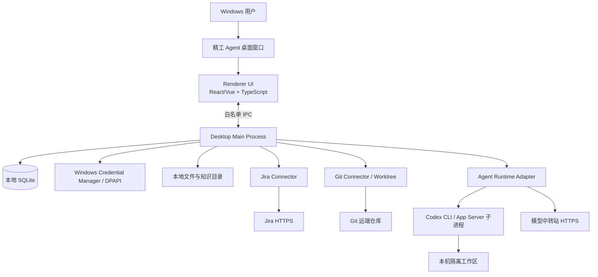

# 精工 Agent Windows 桌面端技术方案与 Codex 启动说明 V1.1

> **产品形态已调整：** Windows 安装式桌面应用，像 Codex 一样安装后从开始菜单/桌面直接启动。不是浏览器 Web 应用，不建设用户需要维护的服务器。
>
> **首版部署边界：** 单台 Windows 电脑、本地数据、本机 Agent Runtime 子进程、主动出站访问 Jira/Git/模型网关。
>
> **编制日期：** 2026-11-04

---

## 1. 最终产品形态

精工 Agent 应交付为一个 Windows 桌面安装包，例如：

- `JinggongAgent-Setup-x64.exe`（优先）
- 或 `JinggongAgent-x64.msi`

用户安装后，双击桌面图标即可进入应用。用户不应需要执行 `npm run dev`、启动 Python/FastAPI、打开浏览器访问 `localhost`、安装 Docker 或维护数据库服务。

### 明确排除

- 不做浏览器访问的本地 Web 服务。
- 不部署 PostgreSQL、Redis、MinIO、Docker Compose、Kubernetes。
- 不开放本机 HTTP/WebSocket 端口供其他设备访问。
- 不建设首期多人共享服务端、公司账号中心和跨设备同步。

**技术说明：** Electron/Tauri 桌面应用内部可以使用 Web 技术绘制 UI，但对最终用户呈现的是独立桌面程序，不是 Web 部署形态。

## 2. 推荐总体架构



**关键原则：** Desktop Main Process 是本机应用主控，不是一个对外提供 API 的服务器。Renderer 通过 Electron IPC 或 Tauri Command 调用它；Agent Runtime 由主进程启动为子进程，通过 stdio 收发消息。

## 3. 桌面技术栈：交给 Codex 做最终调研

不再把 Vue + FastAPI + PostgreSQL 当作默认架构。Codex 必须比较以下桌面栈，并基于本机环境、团队熟悉度、进程管理、安全边界和打包复杂度做 ADR 决策。

| 方案 | 前端/桌面壳 | 本机主控 | 优势 | 代价/风险 |
|---|---|---|---|---|
| A（优先评估） | Electron + React + TypeScript | Electron Main（Node.js） | Node `child_process` 直接管理 Codex/Git 子进程；生态成熟；IPC、文件、安装包和更新方案丰富；无需单独 Python 服务 | 安装包和内存占用通常较 Tauri 大；必须严格隔离 Renderer 能力 |
| B | Tauri 2 + React/Vue + TypeScript | Rust Commands/Plugins | 安装包体积和资源占用通常较小；原生权限模型清晰 | 需要 Rust；若集成 Node/Python 工具可能要处理 sidecar 打包；团队学习成本需评估 |
| C | .NET WinUI 3 / WPF | C# 桌面层 | Windows 原生集成和企业终端管理强 | 前端交互及复杂代码 Diff 生态需要评估；与 Node Agent Runtime 之间需进程桥接 |

### 3.1 建议的决策倾向

首轮 PoC 优先验证 **Electron + React + TypeScript**。原因不是 Electron 一定最好，而是本产品的关键复杂度在于管理本机 Codex Runtime、Git、附件解析、文件访问和多模型 Provider；Electron Main 使用 Node.js 进程能力，最容易把这些能力收敛到一个本机主进程。

但最终必须由 Codex 对比 Electron 与 Tauri，并做一个能够启动 Runtime、流式显示事件、管理取消和安全 IPC 的小 PoC。若 Tauri 的 Windows 子进程、sidecar 和打包验证明显更优，可以改选 Tauri。

## 4. 推荐逻辑架构（选型通过后的目标）

```text
jinggong-agent/
├── apps/
│   └── desktop/
│       ├── src/main/              # 窗口、IPC、应用生命周期、子进程管理
│       ├── src/preload/           # 白名单 API 暴露层
│       ├── src/renderer/          # 桌面 UI：Jira/会话/Diff/知识库/设置
│       └── resources/             # 图标、运行时元数据、规则模板
├── packages/
│   ├── domain/                   # 领域模型和业务规则
│   ├── jira-connector/           # Jira REST Connector
│   ├── git-connector/            # Git/Worktree Connector
│   ├── agent-runtime/            # Codex/其他 Agent Runtime 适配层
│   ├── model-providers/          # Provider 配置和能力检测
│   ├── knowledge/                # 字典导入、检索、版本和来源
│   ├── rules/                    # 规范检查与测试编排
│   └── storage/                  # SQLite、文件存储、迁移
├── installer/                    # NSIS/MSI 打包配置
├── docs/
│   ├── requirements/
│   ├── architecture/
│   ├── adr/
│   └── development/
├── tests/
├── AGENTS.md
└── README.md
```

> Codex 可以按最终选型调整目录，不要求机械照搬。重点是 UI、桌面主进程、Runtime 和领域业务分层。

## 5. 本机数据与凭据

### 5.1 数据位置

建议按当前 Windows 用户隔离：

```text
%LOCALAPPDATA%\JinggongAgent\
├── database\jinggong-agent.db
├── attachments\
├── knowledge\
├── workspaces\
├── logs\
├── exports\
├── runtime\              # 应用管理的运行时文件/版本
└── config\                # 非敏感配置
```

- SQLite 为首期主数据库；使用事务、迁移、备份和完整性检查。
- 结构化字典通过数据库索引精确检索；文档全文检索可使用 SQLite FTS5。首期不强制引入独立向量数据库。
- 附件、源文件、解析结果与 Diff 放文件系统，数据库只存元数据、校验值和相对路径。
- 备份可打包数据库和知识/附件数据；API Key、Token 不导出明文，恢复后重新授权。

### 5.2 凭据管理

- Windows Credential Manager 优先；或使用经评审的 DPAPI 加密方案。
- SQLite 仅保存 credential reference，不保存明文 Key。
- Renderer 不可读取凭据，只能请求主进程执行连接测试并返回成功/失败、脱敏名称。
- 不得把用户现有 `%USERPROFILE%\.codex` 配置和认证文件直接复制进应用目录。
- 应用使用独立 `CODEX_HOME`，避免更改用户已安装 Codex 的全局配置；如用户选择复用现有登录态，必须明确提示并取得授权。

## 6. Agent Runtime 与 Codex 集成

### 6.1 设计要求

抽象 `AgentRuntimeAdapter`，对业务层统一提供：

- `checkRuntime()`：运行时存在性、版本和兼容性检查；
- `startSession()` / `resumeSession()`：创建和恢复会话；
- `sendTurn()`：提交用户任务和上下文；
- `subscribeEvents()`：接收流式文本、工具状态、审批请求和结果；
- `approveAction()` / `rejectAction()`：处理工具审批；
- `cancelRun()`：取消当前任务；
- `closeSession()`：安全关闭会话；
- `getCapabilities()`：报告当前 Runtime/模型支持能力。

业务模块不得直接拼接 Codex 原始 JSON-RPC 请求，也不得依赖 Codex 私有目录结构。

### 6.2 Codex App Server PoC 注意事项

- 官方文档描述 App Server 是 Codex 丰富客户端的集成协议，支持认证、会话历史、审批和流式 Agent 事件。
- 当前官方文档把 `codex app-server` 标记为 Experimental；WebSocket 传输也标记为实验性/不支持生产工作负载。首期若验证，使用本机 `stdio`，不要开放 WebSocket 监听端口。
- 必须锁定 CLI/App Server 版本，并建立协议回归测试。升级前先在测试环境验证，不随用户机器自动漂移。
- 同时评估稳定 CLI 命令/SDK 作为批处理、模型能力验证或备用 Runtime 的用途。不要假设 App Server API 永远稳定。

### 6.3 Runtime 分发方式

Codex 必须评估两种方法：

1. **随安装包携带固定版本 `codex.exe`**：安装后离线也能启动 Runtime（模型调用仍需网络）；需要核验官方分发方式、许可证、更新和安全签名。
2. **首次启动引导安装/下载 Runtime**：应用从可信官方来源获取固定版本，下载后校验签名/哈希并记录版本；下载失败给出可操作错误。

不得静默调用不可信第三方脚本安装运行时。不得强依赖用户自行安装 Codex 桌面 App。应用升级和 Runtime 升级应解耦。

### 6.4 Windows 沙箱

- 使用 Runtime 当前支持的 Windows 原生沙箱和权限审批，先检测设备能力。
- 官方 Codex Windows 文档将 Windows 11 作为推荐基线；MXC 在兼容设备上优先，旧方案有 elevated/unelevated 等回退。必须在 PoC 中实测公司电脑兼容性，不能仅凭版本号宣称已隔离。
- Agent 只能写入当前任务 Worktree 和明确授权的缓存/输出目录。
- 默认禁止生产数据库连接、任意磁盘扫描、全盘读写、Git 自动推送、合并和发布。
- 审批要绑定准确命令、路径、网络目标和会话 ID，避免审批后目标被替换。

## 7. Git 与代码工作区

- 对每个 Jira 开发会话创建独立分支和 Git Worktree；不要在原始仓库工作目录和主分支上写代码。
- 优先调用 Git CLI；Installer 应检测 Git for Windows。
- 为实现“安装即可用”，Codex 必须评估随安装包提供受控版本的 Portable Git，或首次启动安全引导官方 Git for Windows 安装。必须核验许可证、版本、签名和升级策略。
- Git 凭据存 Windows 安全存储，避免把 Token 写进 remote URL、命令行参数、日志或错误堆栈。
- 任务结束后保留/清理 Worktree 由用户选择；自动清理前必须检查未提交变更。

## 8. 模型中转站和会话选模

至少区分两类模型用途：

1. **普通问答模型**：用于 Jira 摘要、知识库问答、日报/说明生成。
2. **代码 Agent 模型**：必须通过 Runtime 能力测试，验证工具调用、流式事件、长上下文、代码编辑、审批交互和中断恢复。

Provider 配置字段建议：名称、Base URL、协议、模型 ID、显示别名、密钥引用、流式能力、工具调用能力、上下文限制、最近测试时间、Runtime 版本和测试结论。

Codex 官方支持通过自定义 Provider/模型网关配置 Base URL 和模型信息，但每个中转站的协议细节及兼容度需要实测；不要因为 `/chat/completions` 可用，就认定能驱动 Codex Agent。代码 Agent 的可选模型必须经过能力认证。

## 9. 桌面安全设计

若选择 Electron，以下为强制安全基线：

- `nodeIntegration: false`；
- `contextIsolation: true`；
- `sandbox: true`（按 Electron 当前支持情况启用）；
- 仅通过 preload 暴露有限 IPC 方法；
- IPC 对参数、调用来源和路径做校验；
- 配置严格 CSP；禁止不受信任远程页面在主窗口中加载；
- 不使用 `shell.openExternal` 打开未经校验的任意 URL；
- Agent 子进程命令参数使用参数数组，不拼接 Shell 字符串；
- Renderer 不直接访问文件系统、SQLite、凭据或任意命令执行。

若最终选 Tauri，必须使用最小 capability/permission allowlist，并对命令、文件和 URL 范围做同等控制。

## 10. Windows 安装、升级和卸载

### MVP 安装要求

- Windows 10/11 x64；Windows 11 作为优先验证基线，目标环境需实际测试。
- 首选 per-user 安装到 `%LOCALAPPDATA%`，尽量不要求管理员权限；企业 IT 若需要可另行构建 per-machine 安装包。
- Electron 方案优先评估 electron-builder + NSIS；Tauri 方案评估 NSIS/MSI。
- 安装包包含应用本体、图标、必要资源和运行时管理逻辑。
- 未具备代码签名证书时，测试包需说明 SmartScreen 提示；正式分发应评估代码签名。
- 卸载时让用户选择是否保留 `%LOCALAPPDATA%\JinggongAgent` 数据。

### 自动更新

MVP 可以先手动下载安装新版本，但必须防止覆盖用户数据库。V1.1 后续再实现签名更新源、版本检查、更新前备份和回滚。不要在未完成签名与完整性验证前自动执行更新程序。

## 11. 开发阶段与验收顺序

### 阶段 A：桌面壳 PoC

1. 比较 Electron、Tauri、.NET 方案；
2. 建立最小 Windows 桌面应用；
3. 验证安全 IPC；
4. 验证 SQLite 和本地数据目录；
5. 能启动/停止 Agent Runtime 子进程，接收 stdio 流式事件；
6. 构建一个 Windows 安装包，并在干净 Windows 用户环境安装运行。

**通过标准：** 无浏览器、无 localhost 服务、无 Docker/PostgreSQL/Python/Node 预装依赖；安装后打开桌面窗口；主进程能正确控制 Agent 子进程；重启应用后可读回本地会话。

### 阶段 B：Jira + Git 闭环

1. 配置 Jira 只读连接；
2. 按 `cf[11116]` 查询测试日期任务；
3. 读取任务概要、描述、附件并展示来源；
4. 选择本地仓库；
5. 建立隔离 Worktree；
6. 触发 Agent 只读分析；
7. 触发一次受控小文件修改；
8. 展示 Diff、测试日志和总结。

### 阶段 C：知识库和规范

1. 导入 MES5、MES6、WMS 样本数据字典；
2. 结构化表/字段精确查询；
3. 文件全文检索和来源追溯；
4. 加载版本化规则包；
5. 生成测试用例；
6. 对阻断级规则执行真实脚本/测试门禁。

### 阶段 D：本地稳定性

- 崩溃恢复、进程退出、电脑重启后会话状态；
- SQLite 备份、恢复和数据库升级；
- 长时间 Agent 任务、取消和异常超时；
- 1–3 个并发任务的内存、CPU 和磁盘观察；
- 安装、升级、卸载和用户数据保留。

## 12. 交给 Codex 的第一条任务指令（桌面端版）

将本文件和以下需求文档放入项目：

- `docs/requirements/feasibility.md`
- `docs/requirements/PRD.md`
- `docs/development/windows-desktop-plan.md`

然后把以下内容交给 Codex：

```text
你现在负责开发“精工 Agent”Windows 桌面客户端。请先完整阅读：
1. docs/requirements/feasibility.md
2. docs/requirements/PRD.md
3. docs/development/windows-desktop-plan.md

产品形态已明确：这是一个类似 Codex 的 Windows 桌面安装应用。用户安装后双击启动使用。不得把项目做成浏览器 Web 服务，不得要求用户自行启动本地 HTTP 服务、FastAPI、Docker、PostgreSQL 或 Redis。

当前阶段只做环境盘点、桌面技术选型和 PoC 计划，不开始大规模编码。

A. 本机环境盘点（只读）
- Windows 版本/架构、CPU、内存、磁盘；
- Git for Windows、Node.js、包管理器、Rust、.NET、Visual Studio Build Tools 的存在和版本；
- Codex CLI 是否可用、版本和登录状态；不得打印任何 Token/密码；
- 不修改全局环境变量、不升级软件、不安装依赖。

B. 桌面技术选型
- 比较 Electron + React + TypeScript、Tauri 2 + React/Vue、.NET WinUI/WPF；
- 重点评估 Windows 安装包、IPC 安全、子进程管理、Codex Runtime 集成、SQLite、Git Worktree、附件解析和自动更新；
- 给出唯一主推方案及备选方案，写入 ADR；
- 若推荐 Electron，必须给出主进程/预加载/Renderer 的安全配置；若推荐 Tauri，必须说明 sidecar/子进程分发方案。

C. Agent Runtime 验证
- 核验当前 Codex CLI/App Server/SDK 的官方状态、协议和版本；
- App Server 当前如为 Experimental，必须标记风险并提出版本固定、兼容性测试和替代适配方案；
- 首选本机 stdio，不开放 WebSocket/HTTP 监听端口；
- 验证自定义模型 Provider 与当前中转站协议的兼容性；
- 不将用户全局 Codex 配置直接复制到产品目录。

D. 本地数据和安全
- 以 SQLite 为首选本地数据库；比较全文检索与向量检索，首期不要引入独立数据库服务器；
- 设计 Windows Credential Manager/DPAPI 凭据保护；
- 设计每任务 Git Worktree 和执行审批；
- 明确应用没有外部可访问监听端口；
- 设计本地数据备份、恢复和卸载保留策略。

E. 交付文档
- docs/architecture/environment-assessment.md
- docs/architecture/desktop-architecture.md
- docs/architecture/runtime-integration.md
- docs/architecture/local-data-security.md
- docs/adr/ADR-001-desktop-stack.md
- docs/development/desktop-poc-plan.md
- docs/development/desktop-backlog.md

F. 汇报要求
1. 技术栈对比表及推荐理由；
2. 桌面进程架构图；
3. Windows 安装包和运行时分发方案；
4. SQLite/本地文件/凭据存储方案；
5. Codex Runtime 风险、版本和兼容性；
6. Jira、Git、模型网关的测试前置条件；
7. PoC 任务清单和验收标准；
8. 未确认问题列表。

严禁：
- 不得创建 Web 服务器架构或 localhost HTTP API；
- 不得要求部署 Docker/PostgreSQL/Redis；
- 不得打印或提交任何真实密钥；
- 不得连接生产 Jira/Git 或修改生产代码；
- 未经确认不得执行安装、升级、推送、合并或发布。

完成后停止，等待我审核技术方案。
```

## 13. 技术参考（开发前再次按当前版本核验）

- Codex App Server：<https://learn.chatgpt.com/docs/app-server>
- Codex CLI 命令参考：<https://learn.chatgpt.com/docs/cli/reference>
- Codex Windows Sandbox：<https://learn.chatgpt.com/docs/windows/windows-sandbox>
- Codex 自定义模型网关：<https://learn.chatgpt.com/docs/enterprise/connect-to-a-gateway>
- Codex 模型目录/网关目录：<https://learn.chatgpt.com/docs/model-catalogs>
- Tauri Windows Installer：<https://v2.tauri.app/distribute/windows-installer/>
- Electron Builder：<https://www.electron.build/docs/>

## 14. 本次修订的结论

**精工 Agent 首期不是“部署一个本地服务器”，而是“交付一个 Windows 安装包”。** Electron/Tauri 只负责桌面 UI 与主进程；本地数据库使用 SQLite；Codex/Git 作为受控子进程；Jira 和模型服务通过 HTTPS 出站访问。安装、运行、配置、升级、备份都应由桌面应用提供可视化入口。
