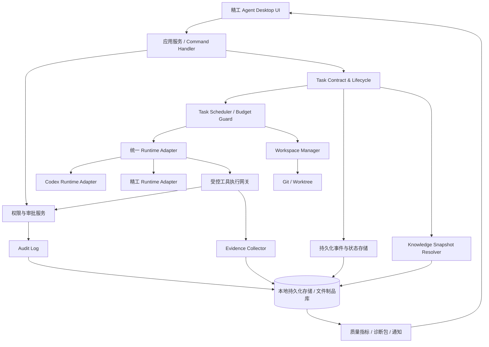
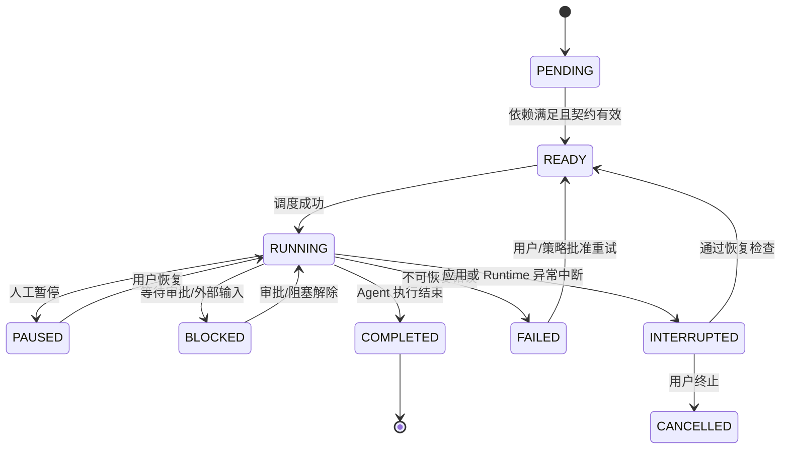
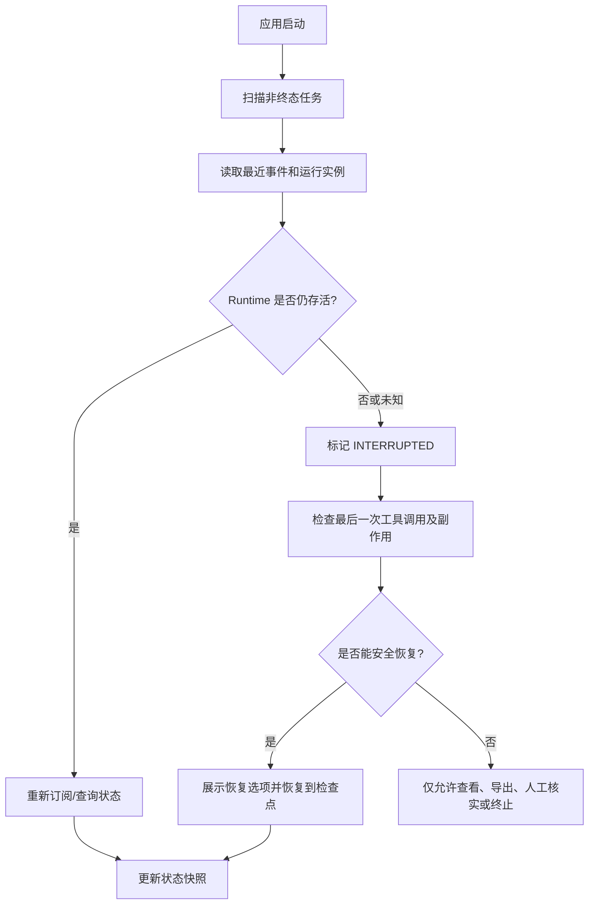

# 精工 Agent 第二轮工程化增强技术方案

版本：V1.0  
适用平台：精工Agent（Windows 桌面端）  
适用 Runtime：Codex Runtime、精工 Runtime  
前置条件：基于现有代码架构增量改造，本文为目标技术方案，不预设现有技术栈。

---

## 1. 技术实施总原则

本方案必须以 Codex 对现有仓库的实际检查结果为准。任何模块在设计前均需标注：

- `REUSE`：现有能力完整可用，直接复用。
- `EXTEND`：现有能力存在，需补充字段、接口或策略。
- `NEW`：现有能力不存在，需新增。
- `UNSUPPORTED`：对应 Runtime 或平台无法实现，需列明限制和替代方案。

禁止未经盘点直接新增第二套会话管理、模型管理、知识库、Git 管理、通知或日志体系。

## 2. 目标架构



### 2.1 模块职责边界

| 模块 | 职责 | 不能承担的职责 |
|---|---|---|
| Task Contract Service | 任务契约校验、版本、父子关系 | 直接执行模型请求 |
| Task Lifecycle Service | 状态机、状态迁移校验 | 根据模型自然语言直接改为验证通过 |
| Scheduler | 依赖、并发、预算、重试、熔断 | 绕过 Runtime 直接执行工具 |
| Runtime Adapter | 对接 Codex/精工 Runtime | 假设两个 Runtime 底层接口相同 |
| Tool Gateway | 工具权限、参数校验、执行记录 | 只在 UI 层做权限判断 |
| Workspace Manager | Worktree 生命周期和文件隔离 | 不经确认自动删除成果 |
| Evidence Collector | 采集构建、测试、Git 等真实证据 | 仅保存模型生成的摘要 |
| Approval Service | 审批申请、绑定操作、失效规则 | 让 Agent 自己批准自己的高风险操作 |
| Audit Service | 追加式审计事件 | 存储明文密钥 |
| Recovery Service | 检查中断任务并提供恢复策略 | 无条件重放不确定的副作用调用 |
| Knowledge Snapshot Resolver | 冻结任务使用的知识版本引用 | 改写历史任务知识版本 |
| Metrics Service | 按定义计算统计指标 | 用模型自评填充统计数据 |

## 3. 统一数据契约

### 3.1 Task Contract 示例

以下为概念结构，字段命名和序列化格式应适配现有技术栈：

```json
{
  "contract_version": 1,
  "task_id": "task_...",
  "session_id": "session_...",
  "project_id": "project_...",
  "runtime_type": "codex",
  "parent_task_id": null,
  "title": "MES生产订单批量导入",
  "task_type": "implementation",
  "goal": "实现生产订单Excel批量导入和结果查询",
  "inputs": [
    {"type": "jira", "ref": "CD-435"},
    {"type": "knowledge", "ref": "MES_IMPORT_RULES@v3"}
  ],
  "expected_outputs": ["代码变更", "测试报告", "变更说明"],
  "acceptance_criteria": [
    "模板字段校验符合项目规则",
    "重复订单能返回明确错误",
    "自动化测试有真实执行记录"
  ],
  "allowed_tools": ["read_project", "write_workspace", "execute_command"],
  "permission_profile": "project-developer",
  "allowed_paths": ["src/**", "tests/**"],
  "denied_paths": [".env", "secrets/**", "production-config/**"],
  "dependencies": [],
  "workspace_policy": "isolated_worktree",
  "budget_policy": {
    "max_concurrent_agents": 3,
    "max_agent_depth": 1,
    "max_runtime_minutes": 60,
    "max_model_requests": 80,
    "max_tool_calls": 120,
    "max_retries": 2
  }
}
```

注意：真实模型 API Key、Jira Token、企业微信 Secret 等敏感信息不得进入 Task Contract、Agent Prompt、普通日志或导出文件。只保存受控配置引用。

### 3.2 Runtime Adapter 接口建议

统一接口用于平台编排，不代表 Codex Runtime 必须原生实现每个动作：

```text
capabilities(runtime) -> RuntimeCapabilities
createRun(taskContract) -> RuntimeRunRef
startRun(runtimeRunRef) -> ExecutionRef
sendInput(runtimeRunRef, message) -> Ack
requestStop(runtimeRunRef, reason) -> StopResult
getRunStatus(runtimeRunRef) -> RuntimeStatus
getRunEvents(runtimeRunRef, cursor) -> EventPage
getRunResult(runtimeRunRef) -> RuntimeResult
```

`RuntimeCapabilities` 应声明：

- native_subagents
- independent_agent_context
- pause_resume
- session_recovery
- token_usage
- cost_usage
- tool_permission_interception
- worktree_support
- event_stream
- structured_result

每项能力包含 `supported`、`enforcement_layer`（runtime/platform/partial/none）和 `notes`。平台不得把 `partial` 或 `none` 显示为完整支持。

### 3.3 统一 Agent 任务结果

```json
{
  "task_id": "task_...",
  "execution_status": "COMPLETED",
  "summary": "实现已完成，测试命令已执行",
  "changed_files": ["src/...", "tests/..."],
  "workspace_ref": "workspace_...",
  "commit_sha": null,
  "evidence_refs": ["evidence_build_...", "evidence_test_..."],
  "known_issues": [],
  "runtime_result_ref": "..."
}
```

Agent 返回的 `verification_status` 只能作为建议或待核实信息；最终验证状态必须由 Evidence Collector 根据真实执行证据和项目质量门禁计算。

## 4. 状态机设计

### 4.1 三个正交状态维度

不要将执行、验证、验收混为一个状态字段。

| 维度 | 状态 |
|---|---|
| execution_status | PENDING、READY、RUNNING、PAUSED、BLOCKED、COMPLETED、FAILED、CANCELLED、INTERRUPTED |
| verification_status | NOT_REQUIRED、NOT_STARTED、RUNNING、PASSED、FAILED、PARTIAL、INCONCLUSIVE |
| acceptance_status | NOT_SUBMITTED、PENDING_REVIEW、ACCEPTED、REJECTED |

### 4.2 核心状态迁移



执行结束后，验证与验收分别运行独立状态机。状态迁移应由服务端校验，不接受前端或模型直接写入任意状态。

### 4.3 状态迁移事件

每次迁移追加事件：`task.created`、`task.ready`、`task.started`、`task.paused`、`task.blocked`、`task.completed`、`task.failed`、`task.interrupted`、`verification.started`、`verification.passed`、`verification.failed`、`acceptance.submitted`、`acceptance.accepted` 等。

事件建议字段：event_id、aggregate_id、aggregate_version、event_type、payload_json、actor_type、actor_id、occurred_at、correlation_id、causation_id。状态表保存当前快照，事件表保存可追溯历史。

## 5. P0 技术实现

### 5.1 任务契约服务

建议流程：

1. 用户提交任务。
2. 现有需求准入模块输出需求完整性检查结果。
3. Task Contract Service 组装任务契约。
4. 校验项目、Runtime、Agent 角色、路径、工具权限、依赖和预算。
5. 契约通过后生成不可变版本并进入 READY；未通过则返回具体缺项。
6. 子任务继承父任务必要字段，但必须重新校验自己的工具和路径权限。

契约版本采用乐观锁或版本号防止并发覆盖。修改契约必须形成新版本，并判断是否需要暂停正在运行的任务。

### 5.2 工具执行网关与权限

所有具有副作用的工具调用应经过统一 Tool Gateway：

```text
Agent -> Tool Gateway -> Permission Check -> Approval Check
                            |                    |
                            v                    v
                       参数/路径校验 <------ 授权审批记录
                            |
                            v
                       执行器 / Runtime Tool
                            |
                            v
                       结果采集 + 审计事件
```

权限判定输入至少包含：user、project、task、agent role、runtime、tool name、arguments、workspace path。

建议风险级别：

- LOW：读取项目文件、读取 Git 状态等只读操作。
- MEDIUM：写入当前任务工作区、运行项目测试、安装受信任依赖（可按项目策略调整）。
- HIGH：数据库写入、访问外网、安装未知脚本、批量删除、Git Push、合并受保护分支、修改全局配置。
- CRITICAL：读取秘密、生产数据库操作、删除仓库/历史等，默认禁止或需平台管理员专项授权。

审批记录绑定 `task_id + tool_name + normalized_arguments_hash + workspace_ref + expires_at`。参数变化后必须重新审批。

必须在工具执行服务端校验，而不是只靠前端禁用按钮。Codex Runtime 若无法拦截某些原生工具调用，应在能力矩阵中标明，并采用可实现的限制措施或禁止该能力用于受限场景。

### 5.3 真实证据采集

Evidence Collector 订阅构建、测试、静态检查、Git 和 Runtime 事件。

证据分层：

- 原始证据：stdout/stderr、JUnit/测试报告、构建日志、Git diff、退出码。
- 规范化元数据：状态、耗时、环境、命令、commit SHA、文件清单。
- 模型摘要：只引用原始证据 ID，不覆盖原始证据。

测试证据需关联：代码版本（commit SHA 或 diff hash）、测试命令、测试环境、测试框架版本、结果文件 hash。

判定规则示例：

- 命令未实际执行：NOT_STARTED 或 INCONCLUSIVE。
- 退出码非 0：FAILED（除非命令有明确的特殊成功码映射）。
- 退出码为 0 但缺少预期报告：按项目规则判为 PARTIAL 或 INCONCLUSIVE。
- Agent 摘要说通过但原始日志失败：以原始执行证据为准。
- 环境不可用：INCONCLUSIVE，不能判 PASSED。

证据文件应存放在本地应用数据目录或既有制品管理目录，数据库只存元数据和相对引用；计算 SHA-256 或现有项目认可的内容摘要用于完整性核验。路径不能暴露机器用户名等不必要信息。

### 5.4 Git Worktree 工作区管理

Workspace Manager 生命周期：

1. 检查仓库路径、Git 状态和基础分支。
2. 获取任务基准 commit。
3. 创建 task 专属目录和分支（名称应可配置并进行非法字符清理）。
4. 将 workspace_ref 注入该 Agent 的受控工具环境。
5. 执行期间持续记录变更摘要和路径边界。
6. 结束后记录 diff、状态、分支和基准 commit。
7. 集成前检查冲突和基准分支变化。
8. 经审批执行 cherry-pick/merge 或以 patch 方式集成。
9. 默认保留工作区，清理需用户确认或按明确保留策略执行。

需考虑 Windows 特性：路径长度、文件占用、进程未退出、杀毒软件锁文件、大小写不敏感、符号链接权限、Git Worktree 清理失败。任何清理失败均需记录并提供人工处理路径。

同一任务多个写入 Agent：优先按模块/文件范围拆分；若无法避免同文件编辑，应串行化或由主 Agent 统一修改，不允许并行写入相同文件。

### 5.5 预算与调度

预算检查点：创建任务前、派发子 Agent 前、每次模型请求前、每次工具调用前、重试前。

预算层级：全局默认 < 项目策略 < 会话策略 < Agent/任务策略。更严格的限制优先；任何下级配置不得扩大上级明确设置的硬上限。

建议调度算法：

1. 依赖未满足：WAITING。
2. 权限/审批未通过：BLOCKED。
3. 当前并发达到上限：PENDING。
4. 预算不足：BLOCKED 或 FAILED（按策略选择并告知用户）。
5. 达到运行时间/调用次数硬上限：停止派发，向 Runtime 请求安全停止，持久化结果。
6. 可重试错误：指数退避 + jitter；超过次数后熔断。

成本计算：仅当 provider 返回可信 Token Usage 且平台维护了带版本和生效时间的价格表时计算费用。若只有 Token 没有价格，显示用量但费用未知；若 Usage 来自模型文本估算，必须显示为估算。不要把不同供应商的计价单位混为一谈。

幂等性：每个可能产生副作用的工具操作生成 `operation_id` / `idempotency_key`。重试前查询该操作是否已执行及其结果；无法确认时要求人工核实，不自动重复。

### 5.6 持久化与恢复

建议采用“状态快照 + 追加事件 + 文件制品”的组合：

- 数据库：任务、契约、状态快照、依赖、预算、审批、审计、证据元数据。
- 事件日志：任务状态变化、Runtime 事件、工具调用、恢复事件。
- 文件制品目录：日志、测试报告、diff、诊断包。

应用启动恢复流程：



重要限制：模型请求中断后不保证能够恢复到完全相同的内部推理状态。平台应恢复已持久化的任务上下文、消息和证据，并由 Runtime 能力决定是否续接原会话；否则创建续接执行并明确标记，不宣称恢复了原模型内部状态。

对于长任务，建议在阶段边界写入 checkpoint：需求确认、设计完成、代码修改完成、构建完成、测试完成、待验收。

### 5.7 审计与敏感信息脱敏

审计事件建议包含：actor、agent、task、project、runtime、tool、参数摘要/hash、结果、时间、审批 ID、correlation ID。

脱敏规则：

- 对 API Key、Bearer Token、密码、数据库连接串、私钥、Cookie 等进行模式识别和配置化脱敏。
- 不记录完整环境变量。
- 不把 secret 值传入普通模型上下文；由受控工具通过凭据引用使用。
- 诊断包导出前二次扫描敏感字段。
- 日志查询按权限过滤，不允许通过错误堆栈泄露凭据。

审计记录建议追加写入；对本地单机应用可使用数据库约束、内容 hash 链或只追加文件等方式提高篡改可发现性。若采用 hash 链，必须处理并发写入顺序和崩溃恢复，不能仅做形式上的 hash 字段。

## 6. P1 技术实现

### 6.1 Agent 模板

将模板定义与 Agent 运行实例分离。模板保存默认 Prompt、权限建议、工具列表、预算建议、知识库集合和输出结构；运行时复制为任务契约，并按项目策略再次校验。

模板升级不能修改已经创建的 Agent 运行实例。每次实例记录来源模板 ID 和版本号。

### 6.2 质量指标计算

建议指标定义：

| 指标 | 口径建议 |
|---|---|
| 执行完成率 | 统计期内 COMPLETED 任务数 / 已结束任务数；明确是否排除 CANCELLED |
| 验证通过率 | PASSED 任务数 / 有效验证任务数；排除 NOT_STARTED、INCONCLUSIVE |
| 一次验证通过率 | 首次验证即 PASSED 的任务数 / 已执行验证任务数 |
| 返工率 | 验证失败后发生修复/重新开发的任务数 / 已开发任务数 |
| 人工介入率 | 发生人工接管/追加指令/人工修复的任务数 / 总任务数 |
| 平均耗时 | 从首次 RUNNING 到 COMPLETED 的耗时均值；另提供中位数和 P90 |
| 单任务成本 | 有可信 usage 和价格的任务费用合计 / 可核算任务数 |

所有图表支持下钻到明细。P1 初期不要做跨任务的“人类工程师效率对比”，除非任务难度、范围和质量口径经过匹配验证。

### 6.3 知识库版本快照

不一定需要复制全部文档内容。优先采用现有知识库的版本 ID、文档版本 ID、内容 hash 和检索命中引用组成逻辑快照。如果现有知识库不支持版本化，则先为文档增加版本记录和内容 hash。

任务启动时冻结：知识库集合、版本、文档列表、数据字典/开发规范版本、项目规则版本。执行期间如知识库发生变化，应提示本任务仍使用原快照；用户明确刷新上下文后生成新的契约版本或新任务。

### 6.4 人工接管

人工接管应作为任务事件，而不是修改聊天文本：

- `human.pause_requested`
- `human.instruction_added`
- `human.approval_granted`
- `human.approval_rejected`
- `human.resume_requested`
- `human.cancel_requested`
- `human.handoff_assigned`

追加指令必须记录操作者、时间、内容 hash/引用和应用范围。敏感内容仍按现有安全策略处理。

### 6.5 诊断包

建议文件结构：

```text
support-bundle-<task-id>/
  manifest.json
  task-contract.json
  state-history.json
  runtime-info.json
  tool-events.jsonl
  audit-events.jsonl
  evidence-index.json
  logs/
  git-diff-summary.txt
  errors/
  README.txt
```

不默认包含完整源码、`.env`、凭据文件、客户生产数据。导出前生成 manifest，列出每个文件、脱敏状态、hash 和是否排除。

### 6.6 企业微信通知

通知模块使用事件订阅，不直接耦合在 Scheduler 内。通知服务消费任务事件，依据用户通知配置决定接收人、事件类型和频率。实现去重键、重试策略和失败队列/失败记录。仅复用已存在的企业微信个人通知能力，不在本轮另建一套凭据管理。

### 6.7 四视图 UI

建议前端组件边界：

- `ConversationView`：消息与主 Agent 摘要。
- `TaskTreeView`：任务层级、依赖和状态维度。
- `CodeChangesView`：文件清单、diff、分支和工作区。
- `RuntimeMonitorView`：事件流、模型/工具用量、预算、错误和证据。
- `RightInspectorPanel`：Jira、Git、上下文、属性等可配置分栏。

UI 只展示服务端状态，不自行推算并写入执行状态。布局记忆使用现有设置存储机制；若无则增加版本化的 UI preference 配置。小窗口时允许隐藏右侧面板和切换标签。

## 7. 建议数据模型

以下为逻辑实体；开发前需映射现有表结构，禁止重复建表。

| 实体 | 关键字段 |
|---|---|
| agent_task_contract | id、task_id、version、contract_json、created_by、created_at、hash |
| agent_task_state | task_id、execution_status、verification_status、acceptance_status、version、updated_at |
| agent_task_dependency | task_id、depends_on_task_id、dependency_type |
| agent_task_event | event_id、task_id、event_type、payload、actor、occurred_at、correlation_id |
| agent_budget_policy | scope_type、scope_id、policy_json、version、updated_at |
| agent_usage_record | task_id、agent_id、provider、model、input_tokens、output_tokens、usage_source、price_version、cost、currency、recorded_at |
| agent_workspace | workspace_id、task_id、repo_ref、base_commit、branch_name、path_ref、status、created_at、cleaned_at |
| agent_approval | approval_id、task_id、tool_name、args_hash、workspace_id、requested_by、approved_by、status、expires_at |
| agent_audit_event | event_id、actor、task_id、tool_name、args_summary、args_hash、result、approval_id、occurred_at |
| agent_evidence | evidence_id、task_id、evidence_type、source、status、exit_code、command_ref、log_ref、artifact_ref、code_ref、content_hash、created_at |
| agent_kb_snapshot | snapshot_id、task_id、collection_ref、version_ref、documents_json、snapshot_hash、created_at |
| agent_template | template_id、name、version、definition_json、status、created_by、updated_at |
| agent_human_intervention | intervention_id、task_id、type、actor、payload_ref、created_at |
| agent_notification | notification_id、task_id、event_id、channel、recipient_ref、status、attempt_count、sent_at、error |

索引建议：task_id、session_id、project_id、parent_task_id、status、occurred_at、event_type、workspace_id。大体量日志和报告应作为文件制品保存，避免全部塞入关系数据库。

数据库选择、字段类型和 JSON 能力必须服从现有项目技术栈；迁移脚本必须包含备份说明、升级脚本、兼容读取和回滚策略。

## 8. 接口与命令建议

按现有项目通信方式实现，不强制 REST。逻辑操作至少包括：

```text
createTaskContract
validateTaskContract
getTaskContractVersions
transitionTaskState
createSubTask
checkBudget
reserveBudget
releaseBudget
requestToolApproval
resolveToolApproval
executeGuardedTool
createWorkspace
inspectWorkspace
prepareIntegration
integrateWorkspace
collectEvidence
getEvidence
interruptTask
inspectRecoveryCandidates
resumeTask
cancelTask
createDiagnosticBundle
getQualityMetrics
```

所有写操作需具备身份、项目、任务范围校验和幂等处理。返回统一错误码和用户可读原因。

## 9. 事件与运行可观测性

统一事件 envelope：

```json
{
  "event_id": "evt_...",
  "event_type": "tool.execution.completed",
  "occurred_at": "ISO-8601",
  "project_id": "project_...",
  "session_id": "session_...",
  "task_id": "task_...",
  "agent_id": "agent_...",
  "runtime_type": "jinggong",
  "correlation_id": "corr_...",
  "payload": {}
}
```

必须能从一次失败追溯：用户任务 → Task Contract 版本 → Agent 执行实例 → 模型调用/工具调用 → 工作区 → 代码版本 → 构建/测试证据 → 最终状态。

日志至少区分 INFO、WARN、ERROR；日志中的用户文本和路径需按隐私策略处理。避免将高频完整输出同步写入 UI 主线程导致卡顿，应采用分页、游标或虚拟滚动。

## 10. 测试策略

### 10.1 单元测试

- 状态迁移是否合法。
- 契约版本与字段校验。
- 权限策略和路径匹配。
- 预算继承与硬上限。
- 成本计算和未知 Usage 处理。
- 审批参数 hash 匹配及过期。
- 证据判定逻辑。
- 指标分母/分子计算。

### 10.2 集成测试

- Runtime Adapter 能力探测。
- Tool Gateway 权限拦截。
- Worktree 创建、状态检查、冲突检测和清理。
- 日志/测试报告采集。
- 数据库事务与事件顺序。
- 企业微信通知去重和失败重试（复用现有模块时）。

### 10.3 故障注入测试

- 模型请求超时。
- 工具执行中应用退出。
- 工具执行完成但状态尚未写入时崩溃。
- 重复事件到达。
- 数据库短暂不可用。
- Worktree 文件被 Windows 进程占用。
- 测试报告缺失但退出码为 0。
- Token Usage 缺失或价格版本过期。
- 用户取消时子 Agent 正在执行。

### 10.4 端到端测试

在隔离的测试仓库和非生产 MES/WMS 环境完成一次真实开发闭环，并验证所有状态、证据、权限、工作区、成本（可得时）和诊断信息。

## 11. 实施顺序

### 阶段 0：现状盘点（先做，不修改业务代码）

输出：
- 当前模块/表/服务清单。
- 已有能力与需求映射表。
- Codex Runtime 与精工 Runtime 能力矩阵。
- 重复建设风险。
- 数据迁移风险。
- 推荐改造文件清单和依赖图。

### 阶段 1：P0 基础契约与状态

先完成 Task Contract、状态机、事件记录和验证证据关联。此阶段不做大规模 UI 改造。

### 阶段 2：权限、预算和工具网关

完成权限强制校验、审批、幂等操作、预算守卫、超时和熔断。

### 阶段 3：工作区隔离

完成 Worktree 生命周期、变更检测、冲突检查和人工集成。

### 阶段 4：持久化与恢复

完成启动扫描、INTERRUPTED 标记、恢复检查、工作区保护和故障注入测试。

### 阶段 5：P0 端到端验收

真实执行 MES/WMS 测试任务，完成所有 P0 验收用例。P0 未通过不得以 P1 UI 或统计页面代替验收。

### 阶段 6：P1 管理能力

按模板 → 知识库版本 → 人工接管 → 诊断包 → 指标驾驶舱 → UI 四视图 → 通知的顺序实施。若现有企业微信通知已可用，则优先复用并补齐事件类型与去重。

## 12. 发布、兼容与回滚

- 新字段优先采用可空字段或默认值，确保旧会话/旧任务可读取。
- 先升级数据库和服务端兼容层，再启用新 UI 功能。
- 新功能采用功能开关，按项目或用户灰度。
- 升级前备份本地数据库和必要的工作区元数据。
- 回滚时关闭新功能开关，保留已产生的任务、证据和审计数据；禁止简单删除新表导致证据丢失。
- 对不能自动迁移的历史任务显示“历史数据/无证据”，不得补造验证状态。

## 13. Codex 执行提示

请先阅读需求方案和本技术方案，然后检查现有仓库。第一轮只输出架构盘点和差距分析，不立即修改代码。

盘点至少覆盖：

1. 前端框架、状态管理、布局系统和当前页面入口。
2. 会话、任务、消息、Agent、Runtime 的实际数据模型。
3. Codex Runtime 接入协议、版本和可用能力。
4. 精工 Runtime 的执行器、工具注册和模型调用链。
5. Jira、Git、代码变更、知识库、需求准入和测试证据实现。
6. 数据库及本地文件存储位置、迁移体系和备份方式。
7. 工具权限、命令执行、网络访问和密钥配置机制。
8. 应用退出/启动时的任务恢复逻辑。
9. 企业微信通知是否已有实现。
10. 当前自动化测试和端到端运行方式。

随后建立需求映射矩阵，逐项标注 REUSE / EXTEND / NEW / UNSUPPORTED，并给出拟修改文件、数据库变更、风险和测试方法。经代码事实确认后按阶段执行，禁止猜测接口、虚构 Runtime 能力或以静态模拟代替实际功能。
